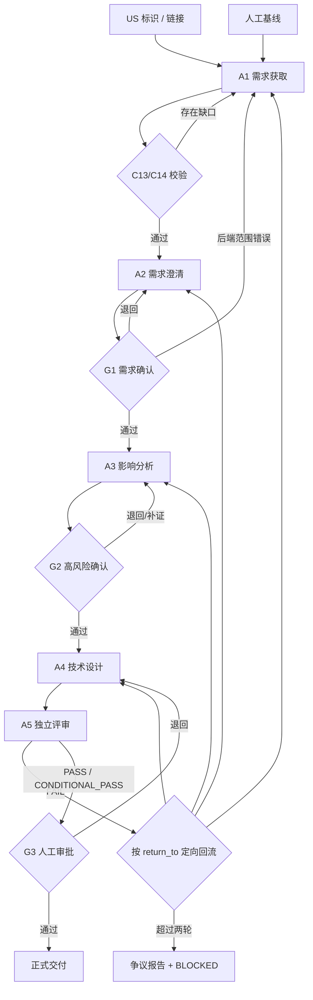

# AWF 工作流定义（A0）

本文件是 `/etp-awf-*` 命令与主线程的唯一流程依据。A0 是控制面，由 workflow 编排、校验脚本与人工门禁共同实现，不派发为子代理。任何推进、回流、重跑都必须按本文件执行，并在 `workflow-manifest.yaml` 留痕。

## 1. 输入与输出

输入：

- 产品 US：平台链接，或用户提供的文件/正文；由 A1 调用 `etp-requirement-fetch` 获取，落到 `01-source/`。
- 代码基线（**人工提供**）：branch、commit、图谱版本与 commit、docs 版本、skills 版本。
- 知识来源（可选）：业务规范、领域词典、历史设计、框架封装约定、运行时证据。

输出：`docs/awf/<US-ID>/` 下的完整交付包，正式交付物为 ART-41 技术设计方案及其追溯链。多 US 批次额外输出 `docs/awf/portfolio.yaml`（ART-04）。

边界：A0 **不建立、不切换、不回退** 代码基线，只做校验、登记与失效判定。基线缺失或不可用时停在 `CREATED`/`BLOCKED`，不得自行取当前 HEAD 顶上。

## 2. 流程图



获取阶段不设人工门禁：A0 自动校验 C13/C14，缺口在 G1 汇总中展示；后端范围判断错误由 G1 直接退回 A1。

## 3. 状态与派发

状态定义、合法迁移、每状态必须存在的文件见 `.claude/skills/etp-awf-workflow/references/state-machine.md`。

| 当前状态 | 主线程动作 | 派发对象 | 退出条件 |
| --- | --- | --- | --- |
| `CREATED` | 校验人工基线，初始化 manifest | 无 | 基线有效 → `BASELINE_CONFIRMED`；无效 → `BLOCKED` |
| `BASELINE_CONFIRMED` | 派发 A1 | `etp-requirement-collector` | 产物校验通过 → `A2_RUNNING` |
| `A1_RUNNING` | 派发 A1（重跑或补缺口） | `etp-requirement-collector` | C13/C14 通过 → `A2_RUNNING`；缺口未补 → `BLOCKED` |
| `A2_RUNNING` | 派发 A2 | `etp-requirement-analyst` | 产物校验通过 → `WAITING_G1`（final）或 `A3_RUNNING`（draft） |
| `WAITING_G1` | 生成 G1 摘要并停下 | 无 | `/etp-awf-gate G1` 通过 → `A3_RUNNING`；范围错误 → `A1_RUNNING` |
| `A3_RUNNING` | 派发 A3 | `etp-impact-analyst` | 产物校验通过 → `WAITING_G2` |
| `WAITING_G2` | 生成 G2 摘要并停下 | 无 | `/etp-awf-gate G2` 通过 → `A4_RUNNING` |
| `A4_RUNNING` | 派发 A4 | `etp-technical-designer` | 产物校验通过 → `A5_RUNNING` |
| `A5_RUNNING` | 派发 A5 | `etp-design-reviewer` | PASS/CONDITIONAL → `WAITING_G3`；FAIL → `DESIGN_REVISION` |
| `DESIGN_REVISION` | 读修订指令，按 `target_agent` 重派 | A1/A2/A3/A4 | 重跑完成 → `A5_RUNNING` |
| `WAITING_DEPENDENCY` | 多 US 批次等待上游 | 无 | 上游完成或人工解除 → 原阶段 |
| `WAITING_G3` | 生成 G3 摘要并停下 | 无 | `/etp-awf-gate G3` 通过 → `COMPLETED` |
| `COMPLETED` | 冻结版本、输出交付摘要 | 无 | 结束 |
| `BLOCKED` | 输出阻断原因与建议动作 | 无 | 人工处理 + `/etp-awf-rerun` 或解除阻断 |

同一状态重复执行必须幂等：先读 manifest 中的产物版本，再从该版本继续，不重复生成已通过校验的产物。

## 4. 子代理派发协议

每次派发用 Task，prompt 必须包含以下字段，不得省略：

```text
你是 <agent-name>（A<stage>），执行 AWF 的 <stage> 阶段。

必读：
- .claude/skills/etp-awf-workflow/SKILL.md
- .claude/skills/etp-awf-workflow/references/<本阶段需要的文件>
- .claude/skills/<本阶段需要的领域 skill>

工作目录：docs/awf/<US-ID>/
输入产物：
- <绝对或仓库相对路径，逐个列出>
分析基线：
- repo: <name> / <branch> / <commit>
- graph: <version 或 none，含 lag_policy>
- docs: <version 或 none>
- skills: <skill 文件相对路径与版本>

约束：
- 只写 <本阶段目录>，不修改其他阶段产物与仓库代码
- 每条结论必须带证据；无证据写 evidence_gap
- 不扩大需求，不替其他阶段做结论
- 严格按 artifact-protocol 的字段与 ID 规则
- 检查项必须逐条给 pass / fail / not_applicable，not_applicable 需理由

返回（不超过 15 行）：
- 写出的文件与版本
- 关键计数（内容块/规则/触点/设计/问题）
- 阻断项与需人工确认项
- 建议下一步
```

子代理返回后，主线程必须自己读文件校验，不能只信摘要。

## 5. 产物校验（阶段推进前必做）

1. 文件齐全：该阶段 `artifact-protocol.md` 规定的文件都存在。
2. 字段齐全：必填字段非空；ID 前缀与版本合法。
3. 引用闭合：所有 `*_ref` / `rule_refs` / `impact_refs` 指向存在的 ID 与版本。
4. 职责边界：A1 只做获取与过滤；A2 没有代码影响；A3 没有实现方案；A4 没有新增需求；A5 没有改设计内容。
5. 一致性检查：执行 `gates-and-checks.md` 中该阶段适用的 C 规则，逐条记录 `pass/fail + 证据`：
   - A1 → C13、C14
   - A2 → C01、C02
   - A3 → C03、C04
   - A4 → C05、C06、C07、C11、C15
   - A5 → C08、C09、C12、C15
6. 更新 `artifact-manifest.yaml`（版本、sha256、依赖、状态）与 `workflow-manifest.yaml`（状态、产物、门禁、轮次）。

任一项失败：不推进状态，把失败原因写回 manifest，并让对应子代理重做或转人工。

## 6. 门禁

- `/etp-awf-gate G1`：确认后端范围（ART-11）、范围、规则、存量行为变化、推断项、验收标准、获取缺口、阻断问题。
- `/etp-awf-gate G2`：确认高风险数据写路径、权限、多租户、对外契约、特殊租户、证据缺口。
- `/etp-awf-gate G3`：确认 A5 无阻断项、G1/G2 已完成、检查项结论完整、覆盖矩阵完整、发布回滚完整。

门禁执行细则与阻断项判定见 `gates-and-checks.md`。命令必须先展示阻断项与待决策项，然后等待用户明确选择；禁止代替用户填写审批人与结论。

审批通过后写 `workflow-manifest.yaml` 的 `approvals`，并记录：结论、审批人、时间、说明、决策项、接受的风险缺口。

## 7. 评审回流

A5 结论为 `FAIL` 时：

1. 读 `05-review/revision-instructions.yaml`，取 `target_agent` 与 `issues[]`。
2. 状态置 `DESIGN_REVISION`，把 `invalidated_artifacts` 标记 `STALE`。
3. 只重派目标阶段，并把 `issues` 原文作为 `revision` 传入派发 prompt。
4. 目标阶段必须逐条回应修订指令，写入 `modifications[]` 或对应章节。
5. 重跑 A5。

轮次写在 `workflow-manifest.yaml.review_rounds`。超过 2 轮仍 FAIL：写 `05-review/DISPUTE.md`，状态置 `BLOCKED`，停止自动循环。

## 8. 增量重跑

用户修改产物或基线变化时，先分类再决定重跑范围，禁止「从某阶段开始全量重跑并保留旧产物」。

| 变更 | 重跑 | 重验门禁 |
| --- | --- | --- |
| 原始需求快照（US 变更） | A1→A5 | G1/G2/G3 |
| 后端范围/剔除项 | A1→A5 | G1/G2/G3 |
| A2 业务规则/范围/AC | A2→A5 | G1/G2/G3 |
| A2 纯文字 | 仅记录，重渲染文档 | 无 |
| A3 触点/证据 | A3→A5 | G2/G3 |
| A4 设计/ADR/文件清单 | A4、A5 | G3 |
| A5 评审结论 | A5 | G3 |
| 检查项清单变化 | 按检查项适用阶段 | 相关门禁 |
| 上游 US 产物变化 | 下游 A4、A5 | G2/G3 |
| 代码基线变化（人工更新） | 按触点交集判断，命中则 A3→A5 | G2/G3 |

失效产物标 `STALE` 并记录原因；恢复前不得用于 G3。

## 9. 模式

- `final`：必须完整经过 A1、A2、G1、A3、G2、A4、A5、G3，产物不得含未确认项。
- `draft`：允许跳过 G1/G2/G3 与未确认假设，但必须完成产物结构校验，所有文档标记 `DRAFT`；不得作为开发交接依据。
- `batch`：多 US 批次，额外要求 `portfolio.yaml` 中的依赖与冲突登记完整。

## 10. 多 US 批次

批次不是把多个 US 简单并行，必须先登记关系（ART-04）：

- `depends_on`：上游 US 的产物是下游输入。A1/A2/A3 可并行，**A4 必须串行**，下游读取上游已冻结的接口/表/契约产物。
- `conflicts_with`：互不依赖但改同一文件、表、接口、消息、配置或权限点。同方法/表/契约冲突强制串行设计并合并 G2。
- `none`：可完全并行，默认并行度 3。

规则：

1. 每个 US 目录独立，跨 US 只读上游已冻结产物；编号带 US 前缀。
2. 上游产物新版本 → 下游标 STALE，人工确认是否重跑。
3. A3 发现未登记的重叠 → 写 `CONFLICT` 并回写 portfolio，由人工确认关系，不自行改排程。
4. 上游未完成时下游停在 `WAITING_DEPENDENCY`，不占用并行槽位。
5. 批次完成条件：每个 US 达到单 US DoD，冲突全部关闭，依赖链完成或显式声明不在本期。

## 11. 异常处理

| 情况 | 处理 |
| --- | --- |
| 获取平台不可达 / 鉴权失败 | 停在 `A1_RUNNING`，置 `BLOCKED`，不得空跑后续阶段 |
| 附件或图片无法解析 | 登记 gap 后继续；影响后端范围判断时不得进入 A2 |
| 外部链接失效或需登录 | 登记 gap，人工补充或明确忽略 |
| 图谱不可用 | 用 `etp-code-graph-query` 的静态检索降级，证据类型写 `static_analysis`，记录 `degraded` |
| 图谱与代码不一致 | 以基线 commit 代码为准，记录 drift，相关结论不得标 `final` |
| 检查项清单不可用 | 置 `BLOCKED`，不得跳过检查推进 |
| US 与规范冲突 | A2 输出 `conflicts[]`，G1 阻断 |
| 关键歧义 | A2 生成 blocking open question，G1 阻断 |
| 高风险缺证据 | A3 写 `evidence_gap`，G2 强制人工确认或补证 |
| 运行时数据不可用 | 标 `NEEDS_RUNTIME_CONFIRM`，禁止断言无影响 |
| 在途变更或跨 US 冲突 | A3 输出 `in_flight_conflicts[]` / `CONFLICT`，交人工裁决 |
| A4 无法复用现有封装 | 写 `compatibility.deviations[]` 并交 G3 人工确认 |
| 子代理失败 | 保留已写产物，记录 `00-workflow/workflow-report.md`，重试或转人工 |
| 人工修改上游 | 按第 8 节失效下游，禁止静默继续 |

## 12. 完成条件

G3 通过时同时满足：

- `workflow-manifest.yaml.status = COMPLETED`
- 五个阶段产物状态均为 `final`，版本与依赖一致
- A5 无 open 阻断项，或条件已全部 closed
- 适用检查项全部有结论，无遗漏
- G1/G2/G3 审批记录完整
- `00-workflow/workflow-report.md` 含每阶段执行、校验、门禁与人工操作记录
- 交付包目录结构与 `artifact-protocol.md` 一致
- 批次模式：`portfolio.yaml` 冲突全部关闭
