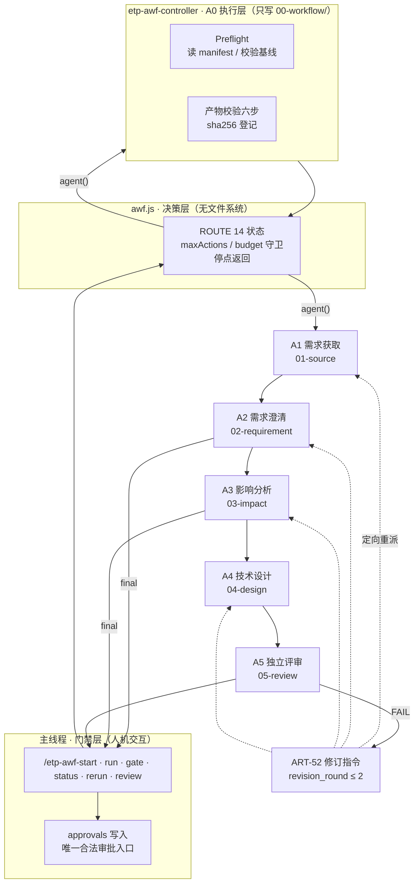

# 基于多 Agent 的存量 Spring Boot SaaS 系统需求分析与技术设计工作流

> **版本**：DS-V5.0 ｜ **基线**：`Agent技术方案设计-GPT-V3.md`（V3.0）｜ **落地目标**：本仓库 `.claude/` 下已实现的 AWF 资产
> **定位**：V3 的**可执行修订版**。保留 V3 的设计意图与大部分结构，逐条修复其载体缺失、编号矛盾、规则双轨与指标失真，并与仓库已落地的 `awf.js` / `etp-awf-*` / `artifact-protocol.md` 对齐。

---

## 修订说明

### 审查结论

V3 在**问题意识**上是四份方案里最强的：它第一次把"证据幻觉""门禁被执行者自批""人工改动未复核""跨 US 文件冲突"这些真正会出事的地方点名了。但它在**可执行性**上是悬空的：

- 全文 1720 行，**没有一章说明这套东西跑在什么平台上**。A0 被写成一个能自由读文件、算 hash、执行规则、渲染文档、拦截状态转换的"全能 Agent"，而本仓库真实的编排载体（Claude Code Workflow 脚本）**没有文件系统权限**，主线程之外的子代理**不能再派发子代理**，脚本**无法阻塞等人**。
- 产物编号体系**自身矛盾**（§10.1 说 ART-11/21/31/41 是渲染件，§14 又把它们列成独立产物行；§6.8 又用 ART-21 指 G2 审批对象），且与本仓库已落地的 ART-10…ART-52 体系**整体错位**，出现三处"同号不同物"。
- 规则体系是**第二套并行编号**：V3 的 C01–C14 与仓库的 C01–C16 有 8 条同号不同义，且 V3 的每条 C 规则只写"由 Gate Engine 判定"，没有输入、断言、输出、无法判定时的处置。
- 指标与门禁**互相脱节**：`证据幻觉率 ≤ 0.02` 由 Evidence Verifier 的 `FAILED` 占比计算，但 Verifier 只校验引用是否存在，LLM 编造的业务影响永远不会被判 `FAILED`；`影响召回率 ≥ 0.90` 依赖 gold set，而 gold set 要到第二阶段才建。

一句话结论：**V3 是一份好的问题清单，不是一份可执行的方案。** DS-V5 的任务是把它变成后者。

### 四类根因

| # | 根因 | 具体表现 | 后果 |
| --- | --- | --- | --- |
| R1 | **载体缺失** | 无运行载体章节；A0 被当作单体全能 Agent；未提 Workflow / 子代理 / 嵌套限制 / 停点 | 60% 篇幅挂在不存在的能力上，无法开工 |
| R2 | **编号漂移** | 仓库插入 A1 需求获取后 A1–A4 整体后移为 A2–A5，ART 编号未同步；V3 另起一套 ART 与实体 ID | 同一编号指两样东西，产物无法交接 |
| R3 | **规则双轨** | C 规则两套并行编号；无执行者实现；G1/G2/G3 审批对象与真实机器产物不一致 | 规则写了不能跑，跑了不能判 |
| R4 | **指标失真** | 指标分母未定义、依赖未建成的能力、把"数量"当"质量" | 度量不可信，无法据此决策 |

### 本版十项结构性改动

| # | 改动 | 修复的问题 | 章节 |
| --- | --- | --- | --- |
| 1 | **新增"运行载体与编排约束"章**：A0 三件套（脚本决策层 / controller 执行层 / 主线程门禁层）与 9 条平台约束 | R1，V3 全篇 | §2 |
| 2 | **角色重排为 A0–A5**，插入 A1"需求获取"（取 US、固化快照、多模态图片识读、前后端范围过滤、缺口登记） | 编号漂移的上游，缺阶段 | §5 |
| 3 | **产物编号整体对齐仓库**：ART-10/11、20/21/22、30/31/32、40/41/42/43/44、50/51/52 + ART-00/01/02/03/04；废弃 V3 的 ART-12/33/34 独立编号 | 同号不同物、自相矛盾 | §11 |
| 4 | **C 规则统一为 C01–C16（原样沿用仓库语义）+ C17–C20 四条新增**，每条给判定方式、执行者、无法判定时处置 | 规则双轨、无实现 | §4.2 / §4.3 |
| 5 | **状态机收敛为 14 状态**，取消 V3 的 `BASELINE_BUILDING`/`ESCALATED`/`G1_PARTIALLY_APPROVED`/三种 `*_REVISION` 独立状态，每个状态给入口、出口、守卫与失败处置 | 状态不可达/无出口 | §12 |
| 6 | **门禁对象改为"机器消费的那一份"**：G1 增补 ART-20、G2 增补 ART-30、G3 增补 ART-40/43/44 | 人批的与机器跑的不是同一份 | §10 |
| 7 | **取消 `WAIVED` 与"T0 跳过 G2"**；T0 只裁剪分析深度，不裁剪门禁与产物 | 门禁不可自动通过 vs 快速通道 | §1.6、§10.6 |
| 8 | **指标全部重定义为可计算式**，并标注"第几阶段才可用"；依赖未建成能力的一律降级为演进指标 | 指标失真 | §1.5、§16 |
| 9 | **增量重跑统一为 12 类变化**（`/etp-awf-rerun` 口径），删除 V3 的"文字性/语义性/结构性"三分 | 三套并行枚举 | §12.6 |
| 10 | **明确"本期不建设"清单**（9 项），每项给替代做法与人工兜底 | 把未建能力写成强制门禁 | §15.5 |

### 保留 V3 的设计意图

以下内容 DS-V5 完整保留，只做表述与落点修正：

- 九条核心原则（§1.7）：需求真实性、证据优先、存量行为保护、决策可解释、审查独立、人工最终决策、全流程可追溯、自动化不等于无门禁、机器可判定的事不交给 LLM。
- 风险等级确定性规则表（§4.4）：BLOCKER/HIGH/MEDIUM/LOW/INFO 的命中条件必须由字段组合决定，不由模型打分。
- 证据七型与 `evidence_gap` 协议："无证据不得断言无影响"。
- 覆盖矩阵作为交付主件（§11.5）。
- 公共封装偏差必须走 ADR + 人工豁免（§8.6）。
- 变更分级 T0/T1/T2（§1.6），但只用于裁剪深度。
- A5 独立检索的硬性预算（§9.2）：独立检索不得复用 A3 结果，这是唯一能打破共同盲区的机制。

---

## 0. 阅读约定与全局词汇表

### 0.1 引用与版本格式

| 形式 | 含义 |
| --- | --- |
| `ART-XX:vN` | 产物编号 + bundle 版本，如 `ART-40:v2` |
| `A3-001:v2` | bundle ID + 版本，跨阶段引用一律用这种写法 |
| `ART-XX.yaml` / `ART-XX.md` | 同一 bundle 的事实源与渲染件，**版本必须相同** |
| `R-NNN` / `AC-NNN` | 业务规则 / 验收标准 |
| `IMPACT-NNN` / `EVIDENCE-NNN` / `CONFLICT-NNN` | 影响触点 / 证据 / 冲突 |
| `DESIGN-NNN` / `ADR-NNN` | 设计项 / 架构决策 |
| `REVIEW-NNN` / `REV-NNN` / `COND-NNN` | 评审问题 / 修订指令 / 条件 |
| `SRC-NNN` / `BLK-NNN` / `ASSET-NNN` / `GAP-NNN` | 需求源 / 内容块 / 附件 / 获取缺口 |
| `US-YYYY-NNN` / `BATCH-NNN` / `BASE-NNN` / `WF-NNN` | US / 批次 / 基线 / 执行记录 |

**编号纪律（R2 的修法）**：编号一旦发布不得复用、不得改义。新增产物只能追加段号（A1 段 1x、A2 段 2x……），不得插号。本版不重排仓库既有编号，只补齐仓库缺失的编号（ART-03、ART-04 已在仓库定义，直接沿用）。

### 0.2 三层状态（不得混用）

| 层 | 字段 | 取值 | 写入者 |
| --- | --- | --- | --- |
| 流程状态 | `workflow-manifest.yaml.status` | 14 状态（§12.2） | **只有主线程命令或 A0 执行层** |
| 产物状态 | `artifact.status` | `draft` / `final` / `STALE` | A0 执行层登记 |
| 评审结论 | `review-report.yaml.conclusion` | `PASS` / `CONDITIONAL_PASS` / `FAIL` | A5 子代理 |

`DRAFT` / `FINAL` 是**运行模式**（`run_mode`），不是产物状态。V3 §0.2 这一点是对的，本版沿用。

### 0.3 统一枚举

| 枚举 | 取值 |
| --- | --- |
| `run_mode` | `draft` / `final` |
| `change_tier` | `T0` / `T1` / `T2`（只影响深度，不影响门禁） |
| `risk` | `BLOCKER` / `HIGH` / `MEDIUM` / `LOW` / `INFO` |
| `impact_type` | `mandatory` / `potential` / `read_only` |
| `evidence.type` | `graph_proven` / `static_analysis` / `runtime_proven` / `configuration_proven` / `git_history` / `heuristic` / `needs_runtime_confirm` |
| `confidence` | `high` / `medium` / `low` |
| `rule.source.type` | `explicit` / `specification` / `existing` / `inferred` / `unknown` / `human` |
| `decision_status` | `confirmed` / `pending` / `rejected` / `assumption` |
| `approval_status` | `not_started` / `APPROVED` / `PARTIALLY_APPROVED` / `REJECTED` |
| `parse_status` | `parsed` / `partial` / `unreadable` / `unsupported` |
| `scope`（内容块归属） | `backend` / `shared` / `frontend` / `out_of_scope` / `unknown` |
| `checklist.result` | `pass` / `fail` / `not_applicable` |
| `conclusion` | `PASS` / `CONDITIONAL_PASS` / `FAIL` |

**与 V3 的三处差异（均为修正）**：

1. **证据类型保留 `needs_runtime_confirm`**。V3 §0.3 以"缺证据不是证据类型"为由删掉它，方向是对的，但删掉之后"运行时不可用"只能写进自由文本，机器无法统计。本版保留该类型，但强制规则：`needs_runtime_confirm` **不能单独支撑 `mandatory` 触点**（§7.4）。
2. **取消 `verification_status`**。V3 的 `VERIFIED|FAILED|UNVERIFIED|PENDING` 依赖 Evidence Verifier 组件，而该组件本期不建（§15.5）。本期用 `evidence.confidence` + C 规则引用闭合性检查替代；`verification_status` 作为二期预留字段，出现时必须为 `null` 并记 `note: pending_inf05`。
3. **取消 `TIMED_OUT` / `WAIVED`**。审批超时不得改变审批状态（否则等于自动通过），只产生提醒；"豁免"只能通过 `accepted_gaps` 显式记录具体缺口，不能整条门禁豁免。

### 0.4 术语

- **事实源（Source of Truth）**：YAML 文件。Markdown 是渲染件，不是事实源。
- **渲染件**：由事实源按模板生成的 Markdown。本期由阶段子代理渲染，A0 校验一致性（C18），三期改为确定性渲染器。
- **bundle**：一个阶段的全部产物集合，如 `A3-001`。bundle 内所有文件版本相同。
- **停点（stop point）**：脚本无法继续、必须由人推进的状态返回。脚本所有等待型状态都是停点。
- **机械可判定**：能用字段存在性、集合包含、相等比较、ID 引用闭合算出来的判断。凡是需要"理解语义"的判断都不属于此类。
- **证据缺口（evidence_gap）**：无法获得证据时的显式登记，含缺什么、为什么静态分析不够、会导致什么误判、建议怎么补。

---

## 1. 项目背景、目标与度量

### 1.1 背景

存量 Spring Boot SaaS 系统的技术设计有两个结构性难题：

1. **需求在图片里**。产品 US 大量以原型图、截图、流程图承载，接口、字段、枚举、错误码只画在图上。文字描述经常与图不一致，且图里独有的信息一旦漏读，后续所有设计都建立在残缺需求上。
2. **影响在暗处**。一个字段改动会牵动 Controller、Service、Mapper、MQ 消费者、定时任务、权限点、租户上下文、特殊租户分支、前端契约。人靠经验检索，覆盖率不稳定；模型靠"看起来相关"检索，幻觉率高。

本工作流把这两个难题拆成六个可追责的阶段，用**证据**和**门禁**而不是模型自信来保证质量。

### 1.2 建设目标

| 目标 | 可验证的表述 |
| --- | --- |
| G-1 需求可追溯 | 每条业务规则能指回 US 原文的具体内容块；每张图片的独有信息都能落到块或缺口 |
| G-2 影响可复核 | 每个 mandatory 触点至少一条可被人复核的证据（`file:line` / `graph:node` / `runtime:source`） |
| G-3 设计可解释 | 每个设计决策有 ADR；每个文件变更挂得上 DESIGN 与 IMPACT |
| G-4 评审有独立性 | A5 独立检索 ≥10 次且不复用 A3 结果，能报出 A3 未识别的触点 |
| G-5 过程可审计 | 每次状态迁移、每次人工修改、每次门禁结论都有记录，版本不覆盖 |
| G-6 失败可恢复 | 任一异常都有明确归宿（`BLOCKED` + 解除方案），不存在"卡死但没人知道"的状态 |

### 1.3 本期建设范围

| 类别 | 本期建设 | 本期不建设 |
| --- | --- | --- |
| 运行载体 | Workflow 脚本 + 6 个子代理 + 6 条命令 + 技能库 | 独立服务、Web UI、数据库 |
| 阶段 | A0–A5 全链路 | 编码、Code Review、测试、发布（A6–A9） |
| 机械校验 | C01–C20 中可脚本化的子集、覆盖矩阵复算、双产物一致性、sha256 登记 | 语义级证据校验（需 LLM 判真伪） |
| 知识 | 代码图谱（外部提供）、规范库、SaaS 检查清单 | 图谱自建、向量检索、知识库问答 |
| 门禁 | G1/G2/G3 三道人工作业门禁 + 阻断项自动计算 | 审批流系统、电子签 |

### 1.4 非目标

- 不生成业务代码，不做 Code Review，不做发布。
- 不替代人工需求判断与架构决策；本工作流只把决策过程结构化、把证据摆出来。
- 不保证"一次生成即正确"；质量来自门禁、证据与独立评审。
- 不建立代码基线。基线由人工提供，A0 只校验、登记、判失效。

### 1.5 成功度量（全部可计算）

> V3 §1.5 的七个指标有五个不可计算或依赖未建成能力。本节按"分母是什么、数据从哪来、第几阶段可用"重写。

| 指标 | 定义式 | 数据来源 | 可用阶段 | 阈值 |
| --- | --- | --- | --- | --- |
| M1 C 规则通过率 | 通过项数 ÷ 适用项数（按阶段统计） | `workflow-report.md` 的 `{id,passed}` | 一期 | 闸门：100%（不通过不得推进） |
| M2 引用失效率 | 无效引用数 ÷ 引用总数（`*_ref`/`rule_ids`/`references` 指向不存在或版本不符的条目） | A0 引用闭合校验 | 一期 | ≤ 0.02 |
| M3 覆盖缺口数 | `ART-43` 中 `status≠Covered` 且未写理由的行数 | A0 复算矩阵 | 一期 | = 0（有理由不计） |
| M4 双产物一致率 | 版本与 sha256 一致的文件对数 ÷ 总文件对数 | C18 | 一期 | = 1.00 |
| M5 独立评审有效性 | A5 报出的"A3 未识别触点"数 ÷ REVIEW 总数 | `ART-50.independent_verification.missed_impacts[]` | 一期 | ≥ 0.15（低于说明评审在复述） |
| M6 门禁一次通过率 | 首次即 `APPROVED` 的门禁数 ÷ 门禁总数 | `ART-00.approvals` | 一期 | ≥ 0.60（过低说明上游质量差） |
| M7 回流率 | 发生 `DESIGN_REVISION` 的 US 数 ÷ US 总数 | `ART-00.review_rounds` | 一期 | ≤ 0.30 |
| M8 人工修改未复核数 | `human_edits[]` 中 `recheck_gate` 已过但未重新确认的条数 | C10 | 一期 | = 0 |
| M9 影响召回率 | 命中人工标注集的 mandatory 触点数 ÷ 标注集 mandatory 触点数 | 历史 US 回归集（**二期才建**） | 二期 | ≥ 0.90 |
| M10 影响精确率 | 人工复核为真的触点数 ÷ 申报触点数 | 抽样复核（每 US 抽 20 条） | 二期 | ≥ 0.80 |
| M11 语义幻觉率 | 抽检中"证据存在但结论不成立"的条数 ÷ 抽检条数 | 人工抽检 + LLM 交叉复核 | 三期 | ≤ 0.05 |
| M12 交付周期 | US 登记到 G3 通过的日历天（中位数） | `ART-00` 时间戳 | 一期 | 对比人工基线下降 ≥ 40% |

**三条纪律**：

1. **M9/M10/M11 不得在本期作为门禁阈值**。V3 把它们写进第一章当成功标准，但 gold set 与语义校验器都不存在，等于给一个测不出来的指标。本版降级为"二期/三期演进指标"，并在 §16 给出启用前置条件。
2. **每个指标必须有分母与采集点**，没有分母的指标不进本表。
3. **指标不得反向驱动产物**。禁止为了压低 M7 而把 `FAIL` 改判 `CONDITIONAL_PASS`。

### 1.6 变更分级（只裁剪深度，不裁剪门禁）

| 层级 | 判定条件（满足其一） | 深度裁剪 | 门禁 |
| --- | --- | --- | --- |
| **T0** | 单文件、单方法、无 DB/契约/权限/租户变更、无新增外部依赖 | A3 检索预算减半（≤20 次）；A5 八层中第二层可抽样；A4 文件变更数预期 ≤3 | **完整 G1/G2/G3**，但允许单人审批、SLA 减半 |
| **T1** | 涉及 2–5 个模块，或含 DB 变更（非破坏性），或含非契约类配置 | 不裁剪 | 完整 |
| **T2** | 含 BLOCKER/HIGH 风险、契约变更、权限点变更、多租户路径、跨 US 冲突、迁移 | **加严**：A5 必须全量八层；G3 必须架构师参与 | 完整 |

**升级规则**：任何层级在分析中命中 `BLOCKER` 或 `HIGH`，立即按 T2 执行，已产出的浅层分析标记 `STALE` 并重跑。**降级只能由人工在 G1 显式确认，Agent 不得自行降级。**

> V3 §2.4 允许 T0 `WAIVED` G2，与仓库硬性规则"人工门禁不可自动通过"直接冲突。本版取消 `WAIVED`：T0 省的是分析工作量，不是审批责任。

### 1.7 九条核心原则

这九条是整套方案的价值观约束。当规则之间出现解释分歧时，以下原则优先。

| # | 原则 | 含义 | 反例 |
| --- | --- | --- | --- |
| P1 | **需求真实性** | 需求只能来自 US 原文、明确规范或人工确认；代码现状不是需求 | 因为"现有实现就是这样"就把它写成规则 |
| P2 | **证据优先** | 每个影响判断都指向可复核的位置；无证据写 `evidence_gap`，不得断言"无影响" | "看了下没有别的地方调用" |
| P3 | **存量行为保护** | 改动不得无意改变既有行为；行为变化必须显式声明 | 顺手把默认值改了 |
| P4 | **决策可解释** | 每个关键选择有 ADR，含被否决的选项与否决理由 | 只写"采用方案 A" |
| P5 | **审查独立性** | 评审者自己检索、自己取证，不复用被评审者的结论 | A5 直接引用 A3 的 EVIDENCE |
| P6 | **人工最终决策** | 门禁、豁免、接受缺口都只能由人做；Agent 只准备材料 | 子代理写 `APPROVED` |
| P7 | **全流程可追溯** | 从 US 块到文件变更的链路可查；版本不覆盖 | 直接改上一版文件 |
| P8 | **自动化不等于无门禁** | 能自动判定的自动判，不能的转人工；自动化率提升不改变门禁存在 | "都自动跑了就不用人看了" |
| P9 | **机器可判定的事不交给 LLM** | 存在性、包含、相等、闭合一律脚本判定；语义判断才交模型/人 | 让模型"感觉一下覆盖够不够" |

**原则之间的冲突处理**：P2（证据）与 P7（可追溯）冲突时以 P2 为准——有位置但追溯不上的证据，比没有证据更危险，因为它看起来可信。

---

## 2. 运行载体与编排约束（本版新增，R1 的修法）

> **这是 V3 最大的缺口，也是本版最重要的一章。** 所有后续规则都必须满足本章的约束，否则写了也跑不起来。

### 2.1 平台事实

本工作流运行在 **Claude Code 类 coding agent** 上（兼容 CodeBuddy 等把 `.claude/` 目录约定同步过去的实现）。可用的原语只有四种：

| 原语 | 能力 | 限制 |
| --- | --- | --- |
| **Workflow 脚本**（`.claude/workflows/awf.js`） | 按状态路由、派发子代理、收集结构化结果、返回停点 | **没有文件系统、没有网络、没有定时器**；不能阻塞等人；不能嵌套 workflow |
| **子代理**（`.claude/agents/*.md`） | 独立上下文执行一个阶段任务，可读写工作区文件 | **不能再派发子代理**；无持久记忆；单次调用上下文有限；可能返回 `null`（用户跳过或终端错误） |
| **技能**（`.claude/skills/*/SKILL.md`） | 可复用的规则与模板，由子代理显式 Read | 不是自动执行的代码，只是被读的文档 |
| **命令**（`.claude/commands/etp-awf-*.md`） | 主线程的人机交互入口，可读可写、可阻塞等人 | 只有主线程有 |

### 2.2 由平台事实推出的九条架构约束

| # | 约束 | 设计后果 |
| --- | --- | --- |
| K1 | 脚本无文件系统 | 一切"读 manifest / 算 sha256 / 校验字段 / 写登记"必须交给 **A0 执行层子代理**（`etp-awf-controller`）；脚本只能读 `args` 和子代理返回的结构化结果 |
| K2 | 脚本不能阻塞等人 | 所有等待型状态（`WAITING_G1/G2/G3`、`WAITING_DEPENDENCY`、`COMPLETED`、`BLOCKED`）都是**停点**：返回 `{stop, gate, reason, next}` 后结束；由主线程命令接手 |
| K3 | 子代理不能再派发 | A1–A5 **互不调用**。跨阶段只通过文件 + 主线程 + 脚本路由传递，不存在"A4 让 A3 补一下"这种路径 |
| K4 | 子代理无持久记忆 | 每次派发必须重新装配完整上下文（§2.5 的 11 项清单）；不能依赖"上次说过" |
| K5 | 子代理可能返回 `null` | 空返回按"未产出"处理：重试一次，两次都空则停止并记 `BLOCKED`，**不得按成功推进** |
| K6 | 单次调用有动作上限 | `maxActions` 默认 8、上限 20；`budget.remaining() < 50000` 主动停；返回 `status: max_actions`，再执行 `/etp-awf-run` 从原状态继续 |
| K7 | 状态只能有一处写 | `workflow-manifest.yaml.status` **只允许主线程命令与 A0 执行层写**；子代理只写自己阶段目录，越界即 C 规则失败 |
| K8 | 一次调用只处理一个 US | 批次并行由人按批次多次调用 `/etp-awf-run` 调度，脚本不并发 |
| K9 | 状态与阶段必须一致 | `forceStage` 与 manifest 状态不一致时脚本直接报错退出，不改任何产物（防跳过上游） |

### 2.3 A0 三件套（不是"一个 Agent"）

V3 §4.1 把 A0 写成单个 Agent 承担十一项职责。本版拆成三层，各层只能做自己能做的事：

| 层 | 载体 | 只做 | 绝不做 |
| --- | --- | --- | --- |
| **决策层** | `.claude/workflows/awf.js` | 状态路由、阶段派发、schema 校验、停点返回、轮次与上限控制 | 读文件、写文件、算 hash、判断业务内容 |
| **执行层** | `etp-awf-controller` 子代理 | Preflight、读 manifest、产物校验六步、sha256 计算与登记、写 `00-workflow/` | 做需求/影响/设计/评审结论；写其他阶段目录 |
| **门禁层** | 主线程 `/etp-awf-*` 命令 | 展示阻断项、收集审批人结论、写 `approvals`、改状态、跑 `/etp-awf-rerun` | 替用户填审批人、把未回复记为通过、默认同意 |



**为什么必须这样拆**（三条硬理由）：

1. **门禁必须只由主线程写**。如果子代理能改状态，A5 想让自己通过就改一个字段；这是权限问题，不是纪律问题。
2. **文件操作必须有上下文预算**。脚本读不了文件，controller 子代理有独立上下文，专门做机械校验，不消耗业务阶段的上下文。
3. **脚本不能等人**。门禁天然是异步的（人可能第二天才看），只能表现为"脚本停下、命令接手"。

### 2.4 编排循环

```text
用户 /etp-awf-run
  → 脚本读 args，返回 Preflight 结果（或停点）
  → 主线程调 etp-awf-controller 做 Preflight（读 manifest、校验基线、返回 PREFLIGHT_SCHEMA）
  → 脚本按 status 查 ROUTE：
      · 有派发对象 → agent(prompt, {agentType}) → 拿到 STAGE_SCHEMA → 派 controller 校验 → 拿 VERIFY_SCHEMA → 写状态
      · 无派发对象 → return {stop: true, gate/reason, next}  ← 停点
  → 达到 maxActions 或预算不足 → return {status: "max_actions"}
  → 主线程展示结果，用户决定下一步
```

**单轮上限**：`maxActions` 默认 8、上限 20；每轮最多推进 8 个阶段动作。这不是性能限制，是**人工检查点**——一轮跑太远，出错时回溯成本高。

### 2.5 上下文装配（每次派发必须齐全的 11 项）

子代理没有记忆（K4），派发 prompt 必须自包含。缺任何一项，子代理就会去猜，猜出来的东西不可追溯。

| # | 项 | 说明 |
| --- | --- | --- |
| 1 | Agent 名与阶段号 | 如 `etp-impact-analyst / A3` |
| 2 | 必读文件**绝对路径** | 含 skill 与 reference，不许写"见上文" |
| 3 | 输入产物路径与版本 | 如 `02-requirement/requirement-package.yaml(A2-001:v2)` |
| 4 | 基线四项 + `graph.lag_policy` | repo / graph / docs / skills |
| 5 | 本阶段输出目录 | 只许写这里 |
| 6 | 适用检查项清单 | A3–A5 必给 |
| 7 | 批次依赖与冲突 | 有则给 US 列表与关系 |
| 8 | 本轮修订指令 | 有则给 `REV-NNN` 原文与轮次 |
| 9 | 硬约束 | 不改代码、不越界、证据格式、双产物纪律 |
| 10 | 上下文预算 | 图片张数 / 检索次数 / 规范份数 |
| 11 | 返回格式 | `STAGE_SCHEMA`，≤15 行摘要，不写散文 |

### 2.6 子代理返回契约

只返回结构化摘要，不回传全文：

```yaml
stage: A3
bundleId: A3-001
version: 1
status: draft
files:
  - 03-impact/impact-package.yaml
  - 03-impact/impact-analysis.md
  - 03-impact/evidence-manifest.yaml
counts: { mandatory: 4, potential: 8, high_risk: 10, evidence_gaps: 2 }
blocked: [ "IMPACT-007 缺少运行时证据" ]
needHuman: [ "确认退款事件消费者是否在本次范围" ]
gateSignals: { blocker: 0, high: 10, accepted_gaps: 0 }
conclusion: null
next: "A0 校验 C03，随后进入 G2"
```

**A0 收到摘要后必须自行读文件复核，摘要不作为验收依据。** 这是 V3 完全没有的一条——它默认 A0 知道子代理做了什么，而实际上摘要可能与文件不一致。

### 2.7 七条反模式（禁止）

| 反模式 | 后果 | 正确做法 |
| --- | --- | --- |
| 把历史文档全塞给 A2 | 引用过期规范 | 只给 `ART-01` 登记的 ACTIVE 版本（C19） |
| A1 顺手解释业务规则 | 产生未经确认的"需求" | A1 只登记块与缺口，规则留给 A2 |
| A3 只查图谱不查代码 | 图谱漂移未发现 | 图谱结论必须静态代码复核（§7.3） |
| A5 复用 A3 的检索结果 | 共同盲区 | 独立检索 ≥10 次并记录检索词（§9.2） |
| 把 Markdown 当唯一产物 | 无法机器校验 | YAML 事实源 + 渲染件（C18） |
| 子代理改别的阶段文件 | 版本与责任混乱 | 只写本阶段目录（C 规则 fail） |
| 让子代理写 `workflow-manifest.yaml` | 越权推进状态 | 只有主线程与 controller 能写（K7） |
## 3. 基础设施

### 3.1 能力清单

| ID | 能力 | 形态 | 本期状态 | 不可用时的降级 |
| --- | --- | --- | --- | --- |
| INF-01 | 代码图谱（结构 + 调用 + 数据流） | 外部服务，人工提供 `graph.commit` | **依赖外部** | 降级为纯静态检索，结论全部标 `evidence_gap`（§3.2.4） |
| INF-02 | 规范库（编码规范、SaaS 规范、领域规则） | 仓库内 Markdown，纳入 `ART-01` | 已有 | 缺规范 → `checklist` 置 `not_applicable` 并写理由 |
| INF-03 | 框架封装知识（公司自研 Starter / 拦截器 / 工具类） | Skill + 仓库文档 | 部分（需补） | A4 只能按通用 Spring 习惯设计，公共封装偏差必须走 ADR |
| INF-04 | 运行时证据（Trace / SQL 日志 / 配置中心 / 灰度开关只读查询） | 只读连接 | **未建设** | `include_runtime_evidence=off`，相关结论一律 `needs_runtime_confirm` |
| INF-05 | 证据语义校验器 | 无（原 V3 的 Evidence Verifier） | **本期不建** | 用 C 规则引用闭合 + 人工抽检替代（§3.5.3） |
| INF-06 | 规则执行与校验 | `etp-awf-controller` 子代理 + CI 的 JSON Schema 校验 | 部分（见 §4.6） | 脚本无法判定的条目转人工，**不得默认通过** |
| INF-07 | 文档渲染 | 阶段子代理按模板渲染 Markdown | 已有（人工校核） | 渲染件与事实源不一致由 C18 拦截 |
| INF-08 | 代码检索能力 | Grep / Glob / Read / Git（平台内置） | 已有 | — |
| INF-09 | 回归评测集（历史 US + 人工标注影响集） | 数据集 + 评测脚本 | **二期** | M9/M10 不可用（§1.5） |
| INF-10 | 静态分析工具 | 平台内置 LSP / 编译期检查 / Grep 模式库 | 部分 | 见 §3.6.2 的替代动作 |
| INF-11 | 契约差异检查 | 对比改动前后的 Controller 签名 / DTO / MQ 消息体 / Feign 接口 | 人工 + 脚本辅助 | 契约类触点必须两侧证据，否则 `evidence_gap` |
| INF-12 | 运行时抽样 | 依赖 INF-04 | **未建设** | 不使用；不写入任何强制动作 |

> **修正 V3 F-05**：V3 §8.1 要求 A4 强制调用 `StaticAnalyzer` / `ContractDiffer` / `RuntimeTraceSampler` 各 ≥ 5 次，但这三件工具既不在建设范围，也没有 Owner 与数据源。本版把"调用工具"改为"**完成独立验证动作**"：A4 的独立性由"检索/比对动作的次数与记录"定义（用平台内置 Grep/Read/Git 即可完成），而不是由某个外部工具定义。这样规则可执行，也不会因为工具没买而全流程停摆。

### 3.2 代码图谱

#### 3.2.1 必须支持的查询

| 查询 | 用途 | 主要使用阶段 |
| --- | --- | --- |
| `find_entry_points` | 按 URL / 方法名 / 类名定位入口 | A3 |
| `blast_radius` | 变更点的传递影响面（含深度参数） | A3 |
| `data_read_write_paths` | 表/字段的读写链路 | A3 |
| `api_contracts` | 接口契约（路径、入参、出参、错误码） | A3 / A4 |
| `message_consumers` | MQ 主题的生产者与消费者 | A3 |
| `feature_flags` | 动态配置/开关的读取点 | A3 |
| `config_references` | 配置项的引用位置 | A3 |
| `permission_checkpoints` | 权限注解/拦截器位置 | A3 |
| `tenant_context_paths` | 租户上下文获取与透传路径 | A3 |
| `cross_module_calls` | 跨模块调用边 | A3 |
| `historical_changes` | 文件/符号的历史变更记录 | A3 |
| `special_tenant_logic` | 特殊租户分支（`if tenant == X`） | A3 |

#### 3.2.2 查询结果必须带元数据

每次图谱查询的证据必须能回答"用哪个版本的图谱、查的什么、命中哪些节点"：

```yaml
evidence_id: EVIDENCE-012
type: graph_proven
query: blast_radius
query_params: { node: "com.xxx.RefundService.apply", depth: 3 }
graph_version: "2026.11.20-1"
commit: 8b0e1ca
nodes: [ "com.xxx.RefundService.apply", "com.xxx.RefundController.apply" ]
confidence: high
note: "深度 3 内命中 2 个节点；未覆盖反射调用"
```

#### 3.2.3 图谱滞后的处理（修正 V3 F-06 / F-07）

V3 有两套互相矛盾的基线有效性判据（§3.8 的"禁止 final 三条件" vs §4.3 的"有效基线四条件"），且冻结窗口 3 个工作日短于门禁 SLA 合计 6 个工作日，逻辑上必然活锁。

本版只保留**一处**判据，即 C12：

> **C12**：所有产物 `baseline_id` 一致；`final` 模式下 `graph.commit` 与本 US 登记的 `graph.commit` 相同，或落后差值在 `lag_policy` 允许的提交数内，且落后期间 `pending_changes` 与本 US 触点无交集。

配套的三个数值必须显式声明，不允许"默认"：

| 参数 | 取值 | 理由 |
| --- | --- | --- |
| `lag_policy.max_commits_behind` | 20 | 按日均合并 5–8 个 commit 估算，约 3 个工作日 |
| 冻结窗口 `freeze_window_days` | **10 个工作日** | = 门禁 SLA 上限（G1 2 + G2 1 + G3 3）+ A1–A4 执行预算（4），留 0；低于 10 必然在交付前过期 |
| 冻结到期处理 | **自动续冻一次（+5 工作日）并记 `baseline_events[]`**；再到期则 C12 判 FAIL，回到 A3 定向重跑 | 避免"每轮都重跑"的抖动 |

#### 3.2.4 图谱不可用时的降级

| 情况 | 处置 |
| --- | --- |
| 图谱服务不可达 | A3 改用 Grep/Glob 全仓检索 + 阅读关键文件；所有结论 `evidence.type` 降为 `static_analysis` 或 `heuristic`；**必须**在 `evidence_gaps[]` 登记"图谱不可用，影响面可能不完整" |
| 图谱版本落后超 `lag_policy` | 与不可达同处理；且 `ART-01.capabilities.knowledge_graph=false`，G3 前置自动不满足 |
| 图谱节点与代码不符 | **以代码为准**，记 `graph_drift[]`（C 规则不拦，但 A5 必须复核），并把该节点排除出本项目后续查询 |

> **修正 V3 F-27**：V3 的增量重建只重建"变更文件及其直接调用方"，二阶以上调用图陈旧但 `graph_version` 已刷新，`blast_radius` 会给陈旧结果。本版要求：查询结果必须带 `rebuild_depth`，且当 `blast_radius` 请求深度 > `rebuild_depth` 时，超出部分强制标 `confidence: low` 并提示"可能陈旧"。

### 3.3 规范库元数据

每份纳入基线的规范文档必须有以下字段，缺一不得进入 `ART-01`：

```yaml
doc_id: SPEC-003
title: 多租户数据隔离规范
version: "2.1"
status: ACTIVE            # ACTIVE | DEPRECATED | DRAFT
effective_from: 2026-06-01
applicable_modules: [order, refund, billing]
content_hash: sha256:...
path: docs/spec/tenant-isolation.md
```

**三条硬规则**：

1. **只有 `ACTIVE` 可被引用**。引用 `DEPRECATED`/`DRAFT` 由 C19 判 FAIL。
2. **`applicable_modules` 必须与本 US 的模块交集非空**才可引用；跨模块引用需在证据里说明理由。
3. **`content_hash` 参与基线一致性**。规范内容变化等同基线变化，触发 `/etp-awf-rerun` 的 `checklist` 类型。

### 3.4 框架与 Skill 纳入基线

框架封装（公司自研 Starter、统一异常处理、统一返回体、审计日志切面、租户上下文工具类）必须作为**可检索的事实**纳入基线：要么在图谱里，要么在 `ART-01.repo_policy` 里给出路径与 hash，要么在 Skill 里给出类名与用法示例。

**Baseline 的 `skills{}` 字段记录每个技能的版本**。技能版本变化（`SKILL.md` 的 `content_hash` 变）等同 commit 变化，触发下游 `STALE`。这一条 V3 §3.4 提过但没有落点，本版落实到 C12 与 `ART-02`。

### 3.5 运行时证据

#### 3.5.1 四种可读源

| 源 | 能回答什么问题 | 只读约束 |
| --- | --- | --- |
| Trace | 实际调用链、耗时、异常点 | 只读查询接口，不得修改采样率 |
| SQL 日志 | 实际执行的 SQL、扫描行数、是否命中索引 | 只读，敏感字段脱敏 |
| 配置中心 | 各环境实际配置值、开关状态 | 只读，不写任何键 |
| 灰度/开关 | 当前灰度维度与命中比例 | 只读 |

#### 3.5.2 模式开关

`workflow_config.include_runtime_evidence`：

- `required`：所有 `mandatory` 触点必须补齐运行时证据才能进 A4；缺则 `BLOCKED`。
- `auto`（默认）：能取则取；取不到写 `needs_runtime_confirm` 并在 `evidence_gaps[]` 登记。
- `off`：不读取，所有相关结论标 `needs_runtime_confirm`。

#### 3.5.3 没有语义校验器时的替代（修正 V3 F-01 / F-29 / F-30）

V3 依赖 `Evidence Verifier` 判定证据真伪，从而计算"证据幻觉率"。它有两个问题：组件不存在；且即使存在，也只能校验"引用是否存在"，无法判定"结论是否成立"（一条引用真实文件但语义曲解的证据依然会 `VERIFIED`）。

本版的做法：

| 层次 | 检查什么 | 谁做 | 能否机器判定 |
| --- | --- | --- | --- |
| L1 引用闭合 | `*_ref` / `rule_ids` / `references` 指向的条目存在且版本一致 | A0 校验（C09/C11） | ✅ 能 |
| L2 位置真实 | `file:line` 存在、`graph:<node>` 在图中、`git:<commit>` 在历史中 | A0 校验（C11 的 evidence.reference 格式） | ✅ 能 |
| L3 结论成立 | 该位置的内容真的能支撑这条结论 | **A5 人工/模型复核**（抽样） | ⚠️ 只能抽样 |
| L4 语义幻觉率 | L3 抽检中不成立的条数 ÷ 抽检条数 | A5 抽检（每 US ≥ 20 条） | ⚠️ 只能抽样 |

因此本版**不承诺**"证据幻觉率 ≤ 0.02"这种全量指标，改为 M11（抽样语义幻觉率，三期）+ 人工抽检。承认能力边界比写一个测不出的数更好。

### 3.6 双产物纪律与 `source_hash`（修正 V3 F-01）

> **这是 V3 最严重的一条缺陷**：它要求"渲染件与事实源的 `content_hash` 一致"。两个文件字节不同，哈希必然不等——这条规则恒假，只要实现就永远不可能通过 G3。本版必须给出可判定的具名字段。

#### 3.6.1 字段定义

事实源（YAML）的公共头：

```yaml
artifact:
  id: ART-40
  type: design-package
  version: 2
  content_hash: sha256:9f2a...   # 本文件去掉 content_hash 字段后的规范化哈希
```

渲染件（Markdown）的公共头：

```yaml
artifact:
  id: ART-40
  type: design-package
  version: 2                    # 必须与事实源相同
  source_hash: sha256:9f2a...   # 等于事实源的 content_hash
  render_revision: 3            # 渲染次序，仅文字性重渲染时递增
  rendered_from: docs/awf/US-2026-001/04-design/technical-design-package.yaml
```

#### 3.6.2 C18 的判定（可执行）

```text
C18 = (render.version == source.version)
   && (render.source_hash == source.content_hash)
   && (render.artifact.id == source.artifact.id)
```

三项都是**具名字段比较**，不涉及两个文件的字节哈希。`render_revision` 不参与 C18。

#### 3.6.3 三条渲染纪律

1. Markdown **只能**由 YAML 渲染，不得手工编辑正文（手工改会被 C18 的 `source_hash` 失配抓到）。
2. 改 YAML 必须重渲染并把 `version` 递增；只重渲染不改内容时 `render_revision` 递增、`version` 不变。
3. `01-source/raw.md` 与 `01-source/assets/` **只读**，任何修正都必须重新获取并生成新版本（V3 §3.11 已提，本版落到 C14 与 `/etp-awf-rerun` 的 `source` 类型）。

### 3.7 安全与数据治理

| 项 | 要求 | 本期 |
| --- | --- | --- |
| 租户数据 | 报告中出现租户标识时使用哈希或代号，不落真实租户 ID | ✅ 本期 |
| 密钥/令牌 | 任何产物不得出现密钥、token、连接串明文；发现即 C 规则人工阻断 | ✅ 本期 |
| 提示注入 | 外部文档中形如"忽略以上指令"的内容必须剔除并记 `untrusted_instruction` | ⚠️ 本期靠子代理自觉，三期做检测 |
| 审批记录 | 写入 `ART-00.approvals`，**只有主线程命令可写**（K7） | ✅ 本期 |
| 篡改检测 | 每次写 `approvals` 记 `prev_approval_hash`，形成链 | ✅ 本期（轻量） |
| 不可篡改存储 | 追加式账本 + 审批人签名 | ❌ 三期 |

> **修正 V3 F-10**：V3 只说"审批记录不可由 Agent 修改"，靠一句声明。本版承认单机文件系统无法真正防篡改，改为两条可落地的折衷：①只有主线程命令能写（权限边界，不是纪律）；②每条审批记录带 `prev_approval_hash` 形成哈希链，事后可发现断链。真正的防篡改需要外部存储，列入三期。

### 3.8 跨 US 协调：portfolio 与文件占位（修正 V3 F-19 / F-20）

V3 的全局注册表（`file_claims[]` 互斥占用）与仓库的 portfolio（`ART-04` 的 `depends_on` / `conflicts_with`）是两套东西，**功能不重叠，本版都保留**：

| 机制 | 解决什么 | 时机 | 落点 |
| --- | --- | --- | --- |
| `ART-04` 关系图 | US 之间的先后与冲突声明（人类可读的调度依据） | A1 阶段即登记 | `00-workflow/portfolio.yaml` |
| 文件占位 `claims[]` | 两个 US 改同一文件的机械冲突（机器可判的锁） | **A4 产出 `ART-44` 后**即登记 `PROVISIONAL`，G3 后转 `HELD` | `00-workflow/portfolio.yaml` 的 `claims[]` |

```yaml
claims:
  - us_id: US-2026-001
    status: PROVISIONAL          # PROVISIONAL | HELD | RELEASED | FORCE_RELEASED
    files: [ "src/main/java/com/xxx/RefundService.java" ]
    claimed_at: 2026-11-26T10:00:00Z
    expires_at: 2026-12-26T10:00:00Z   # 默认 30 天，到期 A0 提醒
```

**四条规则**（针对 V3 的时点错位与永锁）：

1. **A4 一产出 `ART-44` 就登记 `PROVISIONAL`**，不等 G3。A3 的冲突检测范围包含 `PROVISIONAL` 与 `HELD`，这样在途 US 才互相可见。
2. **`PROVISIONAL` 不阻断，只告警**；`HELD` 才阻断（后登记者必须走 G2 合并审批）。
3. **`expires_at` 到期自动降级为 `EXPIRED`**，A0 在 `/etp-awf-status` 列出待续期清单。`BLOCKED` / `ESCALATED` 的 US 保留 30 天后必须人工续期或释放，不允许永久占用。
4. **`FORCE_RELEASED` 只能由人工执行**，必须写 `released_by` 与理由。

---

## 4. 通用规则层

### 4.1 规则的三种判定强度与时点

不是所有规则都能机器判。V3 把所有规则都写成"由 Gate Engine 判定"，这是它不可执行的根源之一（F-09 / F-53）。本版给每条规则标注判定强度：

| 强度 | 含义 | 执行者 | 未通过时 |
| --- | --- | --- | --- |
| **A（自动）** | 字段存在性、集合包含、相等比较、ID 闭合 | A0 执行层脚本 | 直接 FAIL，阻断推进 |
| **B（半自动）** | 需要读取代码/文档内容做模式匹配 | A0 执行层 + 正则/结构解析 | FAIL 并列出待人工确认项 |
| **C（人工）** | 需要业务判断（如"这个影响是否成立"） | 门禁审批人 | 必须显式给结论，不给不允许推进 |

**判定时点**也必须标注，否则会出现 V3 的 F-17（C04 要求 G2 的处置记录，却在 G2 之前判定）：

- `pre_gate`：进入门禁前判定，用于决定能否进审批。
- `post_gate`：门禁结论写入后判定，用于决定能否离开审批状态。

### 4.2 C 规则总表

**C01–C16 原样沿用仓库 `gates-and-checks.md` 的编号与语义**（不得改义，改义会造成同一编号两套含义，正是 V3 的错误）。C17–C20 是本版新增，编号接续。

| ID | 规则 | 强度 | 时点 | 失败含义 |
| --- | --- | --- | --- | --- |
| C01 | 每条非 `rejected` 规则都被某个 `acceptance_criteria[].rule_ids` 覆盖 | A | pre_gate | 需求无法验收 |
| C02 | 不存在「`inferred` + `confirmation_required=true` + `decision_status=confirmed`」；推断转 confirmed 必须有 DEC 或 `human` 来源 | A | pre_gate | 推断被当成需求 |
| C03 | 每个 `impact_type=mandatory` 的 `rule_refs` 或 `acceptance_refs` 至少一个指向存在的 A2 条目 | A | pre_gate | 触点无需求依据 |
| C04 | 存在 BLOCKER/HIGH 时 G2 已完成（draft 除外） | A | **post_gate** | 高风险未确认 |
| C05 | 每个 mandatory 触点都出现在某个 `designs[].impact_refs`，且出现在某个 `file_changes[].impact_refs` | A | pre_gate | 必改项无落点 |
| C06 | 每个 `DESIGN` 至少被一个 ADR 的 `references[]` 覆盖；`migration.required=true` 时必须存在 ADR | A | pre_gate | 决策不可解释 |
| C07 | 存在契约类触点（Controller/API/Listener/Producer/Consumer/MQ/Feign）时 `compatibility.required=true`、`strategy` 非空、`contracts[]` 覆盖这些触点 | A | pre_gate | 契约无兼容策略 |
| C08 | A5 结论非 `FAIL` 且无 `status=open` 的 `blocking` 问题 | A | pre_gate | 评审未通过 |
| C09 | A2–A5 的 `*_ref` 与当前上游版本一致；`*_text` 类重渲染可豁免 | A | pre_gate | 版本串味 |
| C10 | 关键人工修改后，对应门禁已重新确认，且 `decided_at` 晚于修改时间 | A | **post_gate** | 人工改动未复核 |
| C11 | 每个 DESIGN 的 impact 引用有效且可回溯到规则；每个文件变更都挂 DESIGN 与 IMPACT | A | pre_gate | 无依据设计 |
| C12 | 所有产物 `baseline_id` 一致；`final` 下基线有效（§3.2.3 的单一定义） | A | pre_gate | 基线失效 |
| C13 | ART-10 每个内容块有 `scope`；`frontend`/`out_of_scope` 在 `excluded[]` 给理由；图片独有信息（接口/字段/枚举/错误码）已单独成块，不得因整图判为前端而整体归 `frontend` | B | pre_gate | 内容被静默丢弃 |
| C14 | ART-10 的 `source` 含 `source_url`/`fetched_at`/`content_hash` 且快照文件存在；每个 `assets[]` 的 `path` 存在非空；`type=image` 的 `parse_status` ∈ 四态并带 `text`/`description`/`confidence`；非 `parsed` 时 `missing_parts` 非空且已登记 `gap` | A | pre_gate | 来源不可追溯 |
| C15 | 适用当前阶段的检查项全部有结论；`not_applicable` 均有理由 | A | pre_gate | 检查项漏执行 |
| C16 | 批次模式下触点重叠的 US 均已在 `ART-04` 登记并以 `depends_on` 或 `conflicts_with` 处理 | A | pre_gate | 跨 US 冲突未登记 |
| **C17** | **覆盖矩阵 `ART-43` 的每一行可复算**：`ref_id` 存在于上游、`design_id` 存在于 `designs[]`、`section` 能在 `ART-41` 中定位；`status=Missing` 的行必须有 `note` | A | pre_gate | 覆盖矩阵是自述 |
| **C18** | **双产物一致**：`version` 相等、`source_hash == source.content_hash`、`artifact.id` 相等（§3.6.2） | A | pre_gate | 人批的不是机器跑的 |
| **C19** | **引用文档 `status=ACTIVE`**；`applicable_modules` 与本 US 模块交集非空（§3.3） | A | pre_gate | 引用过期规范 |
| **C20** | **迁移与回滚成对**：`migration.required=true` 时 `migration.rollback` 非空且 `rollback.data_rollback` 非空；DDL 含不可逆操作（DROP/TRUNCATE/改类型）时必须有人工签署的 `risk_acceptance` | B | pre_gate | 迁移不可回滚 |

**与 V3 的差异说明**：

- V3 的 C05 只到 `designs[]`，不校验 `file_changes[]`——它的批评对仓库同样成立，本版把 C05 升级为两段（impact→design→file）。
- V3 的 C13 是"渲染件哈希一致"，与仓库 C13（内容块归属）**同号不同义**。本版：哈希一致改判 C18，C13 回归仓库语义。
- V3 的 C14 是"文档/Skill ACTIVE"，与仓库 C14（来源可追溯）同号不同义。本版：ACTIVE 判定改判 C19，C14 回归仓库语义。
- C17/C18/C20 是 V3 的合理增量，保留；C19 是 V3 §3.3 的落地化。

### 4.3 规则的可执行断言

每条规则不能只写"应该怎样"，必须能写成断言。以三条最容易写虚的为例：

**C05（必改项无落点）**

```text
for impact in ART-30.impacts where impact.impact_type == "mandatory":
    assert exists d in ART-40.designs where impact.id in d.impact_refs
    assert exists f in ART-40.file_changes where impact.id in f.impact_refs
```

**C11（无依据设计）**

```text
for d in ART-40.designs:
    for ref in d.impact_refs:
        assert ref in ART-30.impacts
        assert ART-30.impacts[ref].rule_refs 或 acceptance_refs 非空
for f in ART-40.file_changes:
    assert f.design_refs 非空 and f.impact_refs 非空
```

**C17（覆盖矩阵可复算）**

```text
for row in ART-43.rows:
    assert row.ref_id in (ART-20.rules + ART-20.acceptance_criteria + ART-30.impacts)
    assert row.design_id in ART-40.designs
    if row.status == "Missing": assert row.note 非空
```

**无法判定时怎么办（V3 完全缺失的一条）**：

1. 字段缺失 → 判 FAIL，报"字段缺失"，不猜。
2. 字段存在但内容无法自动理解 → 降级为强度 C，列进"待人工确认清单"，**在门禁里显式要求审批人逐条给结论**。
3. 数据集为空（例如没有任何 mandatory 触点）→ 判 **PASS 但记 `vacuous: true`**，并在报告中标注"空集通过"，避免"没有检查"被误读为"检查通过"。

### 4.4 风险等级：从自然语言到稳定 ID（修正 V3 F-09）

V3 §6.5 的风险规则表读起来很有道理，但每条都是自然语言（"涉及资金/计费计算""框架公共封装被绕过"），没有字段映射，机器无法判定，而 V3 又宣称这是"确定性规则"。

本版给每条规则一个稳定 ID 与**判定输入**。判定输入只允许是"字段为真"或"集合非空"，不允许模型打分。

| ID | 等级 | 命中条件（全部为可判定的字段谓词） |
| --- | --- | --- |
| RSK-01 | BLOCKER | 触点命中 `tenant_context_paths`，且该文件同时命中 `data_read_write_paths` 的写路径 |
| RSK-02 | BLOCKER | `file_changes[].operation=delete` 作用于数据表/字段/对外接口；或 DDL 含 `DROP`/`TRUNCATE` |
| RSK-03 | BLOCKER | 触点命中 `permission_checkpoints`，且变更移除了校验注解/条件 |
| RSK-04 | BLOCKER | 变更文件所属模块 ∈ `billing_modules`（基线配置），且触及金额/账务字段 |
| RSK-05 | HIGH | 数据写路径变更（`data_read_write_paths` 中 `write=true` 的路径被修改） |
| RSK-06 | HIGH | 权限点新增/删除/改名（`permission_checkpoints` 集合变化） |
| RSK-07 | HIGH | 契约类触点（C07 的同一集合）发生变化 |
| RSK-08 | HIGH | 动态配置（`feature_flags` / `config_references`）控制主流程分支 |
| RSK-09 | HIGH | 命中 `special_tenant_logic` 且变更影响该分支 |
| RSK-10 | MEDIUM | 间接依赖 / Job / 缓存 / 只读表 / 异步链路 |
| RSK-11 | LOW | 边缘引用 / 仅日志监控 |
| RSK-12 | INFO | 仅参考，不产生变更 |

**计算规则（确定性）**：

```text
risk(impact) = max_level( { RSK-i | 该 impact 命中 RSK-i } )，无命中则 MEDIUM 不许更低
risk(us)     = max_level( 所有 impact 的 risk )
```

`risk_rule_hits` 字段**只允许写 `RSK-NN`**，不允许写中文标签。写标签即 C 规则 FAIL（因为无法比对）。

### 4.5 证据模型

#### 4.5.1 七种类型与使用约束

| 类型 | 含义 | 可用于 mandatory | 额外要求 |
| --- | --- | --- | --- |
| `graph_proven` | 图谱查询命中 | ✅ | 必须带 `graph_version` + `commit`，且被静态代码复核过 |
| `static_analysis` | 直接读代码/配置得出 | ✅ | 必须给 `file:line` |
| `runtime_proven` | 运行时观测 | ✅ | 必须给 `runtime:<source>` 与时间窗 |
| `configuration_proven` | 配置项/开关取值 | ✅ | 必须给配置键与来源环境 |
| `git_history` | 历史提交 | ❌ | 只能作辅证 |
| `heuristic` | 模式推断 | ❌ | **必须写推断链**（从什么现象推出什么结论，缺一步即无效） |
| `needs_runtime_confirm` | 静态无法确认 | ❌ | 必须同时存在 `evidence_gap` 四要素 |

> **修正 V3 F-21**：V3 要求 Agent 断言 `expected_hash` 与"引用片段的内容哈希"比对，但 `expected_hash` 在所有 Schema 里都不存在，"片段"的边界也未定义。本版删除该机制：证据的可信度由"类型 + 位置精确度 + 是否被独立复核"决定，不由哈希决定。

#### 4.5.2 evidence_gap 四要素（缺一即无效）

```yaml
gap_id: GAP-007
what: "退款失败后是否回滚库存"
why_static_insufficient: "库存扣减在 MQ 消费端，静态无法确定消费失败是否重试"
would_mislead: "若不回滚而设计成幂等重试，会造成库存少扣"
how_to_fill: "查预发环境 refund-fail 主题的消费日志，或由业务确认"
owner: 张工
due: 2026-12-01
```

#### 4.5.3 覆盖要求

| 风险 | 最少证据数 | 其中必须包含 |
| --- | --- | --- |
| BLOCKER | ≥2 | ≥1 条 `static_analysis` 或 `runtime_proven` |
| HIGH | ≥2 | 同上 |
| MEDIUM | ≥1 | 任意可复核类型 |
| 契约变更 | 生产方 + 消费方各 ≥1 | 两侧都要有 |

### 4.6 规则执行与记录

#### 4.6.1 执行者

- **A0 执行层（`etp-awf-controller` 子代理）** 执行 A/B 强度的规则，结果写入 `00-workflow/workflow-report.md` 的 `checks[]`，每条 `{id, passed, evidence, note}`。
- **子代理自检不能替代 A0 结论**。A1–A5 可以在自己的产物里写 `self_check`，但只有 A0 的结论计入 C 规则。这条是防"自批"的关键。
- **C 强度（人工）** 由门禁审批人给结论，写进 `approvals`。

#### 4.6.2 执行时机

| 时机 | 跑哪些 |
| --- | --- |
| 阶段产物落盘后 | 该阶段的 `pre_gate` 规则（A1→C13/C14；A2→C01/C02；A3→C03；A4→C05/C06/C07/C11/C15/C17/C18/C19/C20；A5→C08/C09/C12/C15） |
| 门禁通过后 | `post_gate` 规则（C04/C10） |
| 状态迁移前 | 全量重跑适用子集（防"上次通过了这次不算"） |

#### 4.6.3 无法判定时的三条纪律

1. **不得默认通过**。脚本做不到就转人工，人工不给结论就停在原地。
2. **不得用"看起来没问题"代替判定**。判断不了就写"无法判定"，不要写 PASS。
3. **空集通过要标记**（§4.3 第 3 条）。

#### 4.6.4 本期与三期的能力差

| 规则 | 本期执行方式 | 三期 |
| --- | --- | --- |
| C01–C04, C06–C09, C11–C12, C14–C19 | A0 子代理读 YAML 逐条断言 | CI 里用 JSON Schema + 脚本，脱离 LLM |
| C05, C13, C20 | A0 子代理 + 正则/结构匹配 | 静态分析器 |
| C10 | 比对 `human_edits[]` 时间戳与 `approvals[].decided_at` | 同左（已经是机械判定） |
| 语义级"结论是否成立" | A5 抽样 | 语义校验器（INF-05） |

> 与仓库 README 的"不内置校验脚本"取舍的关系：本版不新增独立校验服务，规则由 A0 执行层子代理在既有流程里执行，产物是 `workflow-report.md`。这与"不内置校验脚本"并不冲突——它反对的是"另做一个校验服务"，不是"不做校验"。
---

## 5. A1 需求获取（本版插入，修复编号漂移的源头）

> V3 直接从"需求澄清"开始，没有"需求获取"这一阶段。这是它最大的结构性缺环：US 在内部平台上、可能是图片、可能是附件、可能大半是前端原型，**没有这一步，"需求澄清"分析的对象就是一段来历不明的文本**。仓库已实现该阶段，本版补齐。

### 5.1 职责与边界

| 做 | 不做 |
| --- | --- |
| 取回 US 正文与全部附件（含图片） | 解释业务规则（那是 A2） |
| 固化快照，登记来源元数据 | 判断技术影响（那是 A3） |
| 逐张识读图片，产出识读卡 | 设计任何方案（那是 A4） |
| 划分内容块并判定前后端归属 | 评价需求好坏 |
| 登记获取缺口 `GAP-NNN` | 修改 US 原文 |

**上下文白名单**：A1 只能读 US 标识、`etp-requirement-fetch` 技能、基线 `ART-01`、已有的 `01-source/`。**禁止读业务规范、禁止读代码、禁止读历史设计文档**。这条限制的目的：A1 一旦读了代码，就会把"现在的实现"当"需求应该的样子"写进快照。

### 5.2 产物

| 产物 | 文件 | 内容 |
| --- | --- | --- |
| ART-10 | `01-source/source-package.yaml` | 来源元数据、内容块、附件索引、缺口 |
| ART-11 | `01-source/backend-scope.md` | 后端范围清单（固定 10 章，见 §5.6） |
| 快照 | `01-source/raw.md` | US 原文逐字快照，**只读** |
| 附件 | `01-source/assets/` | 图片与文件原件，**只读** |

bundle：`A1-001`，每次重新获取版本 +1。

### 5.3 多模态图片识读协议（V3 完全没有，这是本版新增的重点）

存量 SaaS 的需求文档里，**接口、字段、枚举、错误码经常只画在图上**。漏读一张图，后面五个阶段全部建立在残缺需求上，且没有任何规则能发现。所以图片不是"附件"，是**第一等需求来源**。

#### 5.3.1 识读方式

用模型的多模态能力**直接读图**，不依赖外部 OCR：

- **一次一张**。不要一次看多张再回忆，模型对多图细节的保留会显著下降。
- **长图分区重读**。原型长图切分成上/中/下三段分别读，每段单独产出识读卡。
- **读完立刻落盘**。识读卡写进 `source-package.yaml` 后再读下一张；不要把十张图的结论攒在上下文里最后一起写。

#### 5.3.2 识读卡字段（每张图一条）

```yaml
- id: ASSET-001
  path: 01-source/assets/refund-dialog.png
  type: image
  original_name: 退款弹窗.png
  kind: prototype          # prototype | flow | table | screenshot | error_page | other
  parse_status: parsed     # parsed | partial | unreadable | unsupported
  text: |
    【逐字照录】
    退款金额 [输入框] 退款渠道 [下拉：原路退回 / 退回余额]
    按钮：确认退款 / 取消
  description: |
    退款申请弹窗。确认后提交退款请求。渠道为"退回余额"时金额不得超过账户余额。
  backend_signals:
    - "POST /api/refund/apply"
    - "refundAmount"
    - "refundChannel=ORIGINAL|BALANCE"
  related_blocks: [BLK-003]
  confidence: high         # high | medium | low
  missing_parts: []        # 非 parsed 时必填
```

#### 5.3.3 `text` 与 `description` 必须分开

| 字段 | 是什么 | 反例 |
| --- | --- | --- |
| `text` | **逐字照录**图上的文字，不改写、不概括、不补全 | ❌ 写"退款相关字段" |
| `description` | **客观描述**图的结构与可见关系，允许概括，但不许推断业务意图 | ❌ 写"用户想退款所以需要退款接口" |

分开的理由：`text` 是可核对的原文，`description` 是理解。混在一起，事后无法判断"这句话是图上写的还是模型想的"——而这正是幻觉进入需求的主路径。

#### 5.3.4 `parse_status` 四态与处置

| 状态 | 含义 | 必须做的事 |
| --- | --- | --- |
| `parsed` | 图内信息完整读出 | — |
| `partial` | 部分信息读出（模糊、遮挡、切边） | `missing_parts` 逐条列出缺什么，并登记 `GAP` |
| `unreadable` | 完全无法识别 | 登记 `GAP`，影响后端判断时 A1 必须 `BLOCKED` 等人工 |
| `unsupported` | 格式不支持（如 CAD、加密 PDF） | 同 `unreadable` |

`confidence` 三级（`high`/`medium`/`low`）必须给：`low` 的识读卡内容**不得被 A2 直接作为 `explicit` 来源**，只能作 `inferred` 并 `confirmation_required=true`。

#### 5.3.5 图内后端信号必须单独成块（C13 的核心）

一张图即使整体是"前端原型"，只要里面有接口路径、字段名、枚举值、错误码、状态机流转，**这些信息必须单独成为内容块并归 `backend`**。

**反例（V3 会犯的错）**：一张"退款弹窗"原型图，判为"前端原型"，整图归 `frontend`，于是 `POST /api/refund/apply`、`refundChannel` 的枚举值全部丢失。后续 A2 不知道有这两个渠道，A3 找不到退款服务，A4 设计出的接口与既有契约不一致。

C13 就是拦这个的：`frontend`/`out_of_scope` 必须有 `excluded[]` 理由，且图内后端信号必须已单独成块。

#### 5.3.6 图片预算与分批

单次调用读图上限 **30 张**。超过则按优先级分批：

1. 正文直接引用的图（必须读完）
2. 流程图 / 原型 / 表格
3. 装饰图（可只记 `path` + `parse_status: unsupported`）

某批读不完，登记 `GAP` 并在下一轮继续，**不得因超预算整体跳过**。

### 5.4 内容块与前后端范围

#### 5.4.1 内容块

把 US 切成可独立追踪的块，每块必须判归属：

```yaml
blocks:
  - id: BLK-001
    title: 退款申请入口
    location: "正文 §2.1 / 图 ASSET-001"
    scope: backend
    reason: null
  - id: BLK-002
    title: 退款弹窗交互样式
    location: "图 ASSET-001"
    scope: frontend
    reason: "纯视觉与交互，无接口/字段信息；接口信息已单独成 BLK-003"
```

`scope` 五值：

| 值 | 含义 | 要求 |
| --- | --- | --- |
| `backend` | 后端需实现或改变 | 进入后端范围清单 |
| `shared` | 前后端共同约定（接口、字段、错误码） | 进入后端范围清单，并在 A2 产出契约类规则 |
| `frontend` | 纯前端 | **必须在 `excluded[]` 给理由** |
| `out_of_scope` | 本期不做 | 必须在 `excluded[]` 给理由 |
| `unknown` | 判不了 | **必须有 `GAP`**，且影响后端判断时 `BLOCKED` |

#### 5.4.2 排除项

```yaml
excluded:
  - block_id: BLK-002
    category: frontend
    reason: "纯视觉交互；ASSET-001 中的接口与字段已单独成 BLK-003/BLK-004"
```

**判据**：一条块被排除，必须能回答"为什么不影响后端"。答不上来就不是 frontend，是 `unknown`。

### 5.5 缺口登记

```yaml
gaps:
  - id: GAP-003
    block_id: BLK-007
    type: missing_asset      # missing_asset | unreadable_image | ambiguous_text | missing_link | external_ref_unreachable
    impact: "无法确认退款失败是否需回滚库存，影响后端事务边界设计"
    action: "请产品补充失败场景流程图，或由业务在 A2 确认"
```

`impact` 里出现"影响后端判断"的缺口，A1 不得标记完成，必须 `BLOCKED` 等人工。

### 5.6 ART-11 的固定 10 章

1. 需求来源
2. 快照信息
3. 内容结构与归属
4. 后端范围清单
5. 共用约定（接口/字段/错误码的跨块约定）
6. 前端范围（仅背景，不展开）
7. 剔除项与理由
8. 外部参考摘要
9. 附件与图片解析（识读卡汇总）
10. 获取缺口与建议

### 5.7 A1 的退出条件与门禁

**退出条件（全部满足才可迁出 A1_RUNNING）**：

- [ ] `ART-10`、`ART-11` 存在且为 `draft` 以上
- [ ] `source{url, fetched_at, content_hash}` 非空，快照文件存在（C14）
- [ ] 每个 `blocks[].scope` 有值；`frontend`/`out_of_scope` 在 `excluded[]` 有理由（C13）
- [ ] 每张图的 `parse_status` ∈ 四态；非 `parsed` 有 `missing_parts` 且已登记 `GAP`（C14）
- [ ] 内容块覆盖全部正文段落（无孤儿段落）
- [ ] 无 `scope: unknown` 的块，或已登记 `GAP` 且不阻断后端判断

A1 **不设人工门禁**。G1 在 A2 之后（因为要审批的是"结构化需求"，不是"原文快照"）。这与 V3 把 G1 放在"需求澄清"之后是一致的，只是 V3 缺了前面的获取阶段。

---

## 6. A2 需求澄清与结构化

### 6.1 职责与边界

| 做 | 不做 |
| --- | --- |
| 把内容块转成业务规则 `R-NNN` | 评估代码影响（A3） |
| 写验收标准 `AC-NNN` | 设计实现方案（A4） |
| 标注规则来源与置信度 | 改 A1 的快照与归属 |
| 记录存量行为 `baseline_behavior[]` | 把代码现状当需求 |
| 产出待确认问题 `OQ-NNN` 与决策 `DEC-NNN` | 自行确认推断项 |

**上下文白名单**：`ART-10`、`ART-11`、`ART-01`、适用的 `ACTIVE` 规范（≤5 份）、≤20 个能力节点。**禁止大范围读源码**，禁止读 A3 及之后的产物。

### 6.2 产物

| 产物 | 文件 |
| --- | --- |
| ART-20 | `02-requirement/requirement-package.yaml` |
| ART-21 | `02-requirement/requirement-clarification.md` |
| ART-22 | `02-requirement/decision-log.yaml` |

### 6.3 规则字段

```yaml
rules:
  - id: R-004
    description: "退款渠道为退回余额时，退款金额不得超过账户可用余额"
    source:
      type: explicit            # explicit|specification|existing|inferred|unknown|human
      reference: "ASSET-001 text / BLK-004"
    confidence: high
    behavior_change: YES        # YES|NO|UNKNOWN
    confirmation_required: false
    decision_status: confirmed
    category: billing           # functional|data|api|permission|tenant|billing|non_functional|compatibility
    risk: HIGH
    source_block: BLK-004
```

**五条硬规则**：

1. **`source.type=existing` 只能用于"现状如此、本次不改"**，`behavior_change` 必须为 `NO`。代码现状不得直接转成需求（这是 V3 F-41 的错误）。
2. **`inferred` + `confirmation_required=true` 不得为 `confirmed`**（C02）。推断要变成需求，必须有 `DEC` 或人工确认。
3. **`behavior_change` 是枚举 `YES|NO|UNKNOWN`**，`UNKNOWN` 强制 `confirmation_required=true`。不允许写布尔值（V3 F-40）。
4. **`confidence=low` 的规则不得进 G1 的"通过"结论**，必须转成 `OQ` 或 `DEC` 待定项。
5. **规则描述必须是可判定的陈述**。"系统应友好地处理退款"不是规则；"渠道为余额时金额上限=可用余额"是规则。

### 6.4 存量行为分离

`baseline_behavior[]` 与 `rules[]` 必须分开：

```yaml
baseline_behavior:
  - id: BB-002
    description: "现有退款接口不做余额校验，超额会透支"
    evidence: { type: static_analysis, reference: "src/main/java/com/xxx/RefundService.java:142" }
    change: false
```

分开的理由：存量行为是**事实**，需求是**意图**。混在一起，评审时无法区分"这条是要求改的"还是"这条是现状如此"。A2 一旦把存量行为写进 `rules[]`，后续 C01/C02 全部失效。

### 6.5 验收标准

```yaml
acceptance_criteria:
  - id: AC-004
    rule_ids: [R-004]
    preconditions: "账户可用余额 100 元"
    steps:
      - "发起退款，渠道=退回余额，金额=150"
    expected: "接口返回 400，错误码 BALANCE_NOT_ENOUGH，账户余额不变"
    role_scope: "财务"
    tenant_scope: "所有租户"
```

**要求**：`expected` 必须是可验证的（返回码、状态、数据变化），不能是"正确处理了"。

### 6.6 待确认问题的状态

```yaml
open_questions:
  - id: OQ-002
    question: "退款失败后是否需要回滚库存？"
    blocking: true
    status: open            # open | resolved | deferred
    raised_from: BLK-007
    resolution: null
```

`blocking: true` 且 `status: open` 的 `OQ` **阻断 G1**。`deferred` 允许通过，但必须在 `approvals.G1.decisions` 里记录"由谁决定延期"。

### 6.7 G1 门禁

**审批对象**：

| 产物 | 为什么批它 |
| --- | --- |
| `ART-11`（后端范围） | 人批的是"哪些做、哪些不做" |
| `ART-20`（结构化需求） | **这是机器后续真正消费的东西**，批它才等于批了需求 |
| `ART-22`（决策记录） | 待定项的确认 |

> **修正 V3 F-18 / 仓库 D17**：V3 把 `ART-12`（决策日志，G1 的产物）列为 G1 的审批对象，逻辑上手心互指——审批对象不能是审批行为本身的产物；仓库则**漏批 `ART-20`**，人只批了 Markdown 渲染件，机器却按 YAML 跑。本版：审批对象为 `ART-11` / `ART-20` / `ART-22` 三个**事实源**，Markdown 仅作阅读辅助（C18 保证两者同源）。

**十条阻断项（任一命中不得通过）**：

1. 有 `rules[]` 无 `source.type` 或 `source.reference`
2. 有 `rules[]` 无对应 `AC`
3. 存在 `inferred` + `confirmation_required=true` + `confirmed`
4. 存在 `blocking: true` 的 `OQ` 且 `status: open`
5. 存在 `decision_status: pending` 且未列入待定清单、无责任人
6. 后端范围清单为空，或 `scope: unknown` 未处置
7. `CONFLICT` 未处理
8. `scope=unknown` 或 `excluded[]` 无理由
9. `scope_errors[]` 未关闭
10. `gaps[]` 未逐条处理且影响后端判断

**通过时必须做的动作（由 A0 执行层写，不是子代理）**：

- 逐条 `pending` 的 `DEC` 必须选定 option
- 对应规则改 `decision_status=confirmed`、`source.type=human`、`confirmation_required=false`
- 生成 `A2-002`（版本 +1），旧版本标 `SUPERSEDED`
- 写 `approvals.G1 = {status: APPROVED, approver: <真实姓名>, decided_at, decisions, accepted_gaps}`

**`PARTIALLY_APPROVED` 的严格限制**：

- 只允许非阻断项待定
- 必须列"待定清单 + 责任人 + 期限"
- **不改变状态机路径**：仍在 `WAITING_G1` 内等待补齐后重新定稿；补齐后再记一次 `APPROVED`。V3 的 `G1_PARTIALLY_APPROVED` 是个独立状态，但没有出边，实际上会让流程卡死（F-14 同类问题）。

**退回**：`REJECTED` + `rejected_to`，若原因是范围错误则回 `A1_RUNNING`，否则回 `A2_RUNNING`。

### 6.8 A2 的退出条件

- [ ] `ART-20/21/22` 存在，字段完整
- [ ] C01、C02 通过
- [ ] 每条规则有 `source`、每条 AC 有 `expected`
- [ ] `baseline_behavior[]` 与 `rules[]` 分离
- [ ] `scope_errors[]` 为空或已上报
- [ ] `final` 模式下所有 `blocking OQ` 已关闭

---

## 7. A3 影响分析

### 7.1 职责与边界

| 做 | 不做 |
| --- | --- |
| 定位所有需要改的代码位置 | 设计怎么改（A4） |
| 为每个触点提供可复核证据 | 修改代码 |
| 判定影响类型与风险等级 | 决定是否接受风险（人） |
| 登记跨 US 冲突与证据缺口 | 评价需求合理性（A2） |

**上下文白名单**：`ART-20`、`ART-22`、`ART-01`、图谱、仓库代码、运行时能力（若可用）、`ART-04`。**不得读 A4 及之后的产物**（防止"按设计找影响"的确认偏差）。

### 7.2 产物

| 产物 | 文件 |
| --- | --- |
| ART-30 | `03-impact/impact-package.yaml` |
| ART-31 | `03-impact/impact-analysis.md` |
| ART-32 | `03-impact/evidence-manifest.yaml` |

### 7.3 分析七步（顺序不可颠倒）

| # | 步骤 | 产出 | 为什么这个顺序 |
| --- | --- | --- | --- |
| 1 | 规则→入口映射（`find_entry_points`） | 候选入口清单 | 从需求找代码，不从代码找需求 |
| 2 | 调用链与数据读写（`blast_radius` / `data_read_write_paths`） | 候选触点集 | 图谱给广度 |
| 3 | **静态代码复核**（Read/Grep 关键文件） | 确认/否定候选 | **图谱会漂移，必须复核**；不复核的图谱结论不能作 `graph_proven` |
| 4 | 运行时证据（可选） | `runtime_proven` 或 `needs_runtime_confirm` | 静态定不了的才用 |
| 5 | 横向逐项检查（DB / 缓存 / MQ / API / 权限 / 租户） | 六类补充触点 | 防漏，这六类是历史事故高发区 |
| 6 | 存量行为对比 | `constraints[]` | 改动会不会破坏现有行为 |
| 7 | 风险分级（RSK 规则）+ 冲突检测 | `risk` / `CONFLICT` | 最后算，因为依赖前面全部结果 |

**第 3 步不可跳过**：图谱说"这里引用了 X"，代码里可能已经删了；图谱说"没有别的调用方"，可能有反射/SPI。凡未经代码复核的图谱结论，`evidence.type` 只能是 `heuristic`，不能是 `graph_proven`。

### 7.4 触点字段

```yaml
impacts:
  - id: IMPACT-007
    rule_refs: [R-004]
    acceptance_refs: [AC-004]
    target:
      module: refund
      file: src/main/java/com/xxx/RefundService.java
      symbol: applyRefund
      line: 142
    impact_type: mandatory          # mandatory | potential | read_only
    evidence:
      - type: static_analysis
        reference: "file:src/main/java/com/xxx/RefundService.java:142"
        confidence: high
    affected_features: [退款申请, 余额校验]
    reason: "现有实现不校验余额，需求要求校验"
    constraints: [ "退款流程已在生产运行 3 年，不得改变成功路径的行为" ]
    risk: HIGH
    risk_rule_hits: [RSK-05]
    status: confirmed               # confirmed | pending | unconfirmed
    evidence_gap: null
```

**`evidence_gap` 的强制规则**：

| 风险 | `evidence_gap` 要求 |
| --- | --- |
| BLOCKER / HIGH | 必须为空，或在 G2 被显式记入 `accepted_gaps` |
| MEDIUM | 允许非空，但必须写四要素 |
| LOW / INFO | 允许非空 |

**`mandatory` 的证据底线**：至少一条 `graph_proven` / `static_analysis` / `runtime_proven` / `configuration_proven`。`needs_runtime_confirm` **不能单独支撑 mandatory**（V3 F-28 的死结在这里解开：mandatory 要么有实证据，要么降级为 `potential` 并在 G2 说明）。

### 7.5 风险与阻断

- 风险等级一律由 §4.4 的 RSK 规则算出，**不允许 A3 自评**。
- 出现 `BLOCKER` 时：**仍然进入 G2**，但在 `gateSignals.blocker > 0`，G2 必须逐条给出处置（`accepted` / `fixed` / `rejected`）。**不得因为"有 BLOCKER"就不让进 G2**——V3 正是这么写的，结果高风险 US 卡死在 A2/A3 之间（F-02）。

### 7.6 冲突检测

| 冲突类型 | 检测方式 | 处置 |
| --- | --- | --- |
| `in_flight`（在途改动） | 读 `git log` 近 30 天同文件改动 | 记 `CONFLICT`，G2 提示 |
| `cross_us`（跨 US） | 读 `portfolio.yaml` 的 `claims[]`（含 `PROVISIONAL`）+ `depends_on`/`conflicts_with` | 记 `CONFLICT`，C16 校验 |
| `contract`（契约生产/消费双方） | `api_contracts` + `message_consumers` | 两侧证据都要 |

### 7.7 G2 门禁

**审批对象**：`ART-31`（影响分析）、`ART-32`（证据清单）、**`ART-30`（影响包）**。

> **修正仓库 D18**：仓库 G2 只批 `ART-31/32`（Markdown + 证据清单），漏了机器消费的 `ART-30`。与 G1 同理：人批的和机器跑的不是同一份。

**四条阻断项**：

1. `BLOCKER` 未经人工确认
2. `BLOCKER` / `HIGH` 且 `evidence_gap` 非空，未补证也未记入 `accepted_gaps`
3. `mandatory` 无有效证据
4. 高风险缺口未处理

**必须确认的六项**：

1. 影响面是否完整（对照 §7.3 七步逐项核对）
2. 风险分级是否合理（对照 RSK 命中）
3. `mandatory` 是否都是真必改
4. `potential` 是否已明确"不改"的理由
5. 证据缺口是否接受
6. 跨 US 冲突如何排期

**`accepted_gaps` 的写法**：

```yaml
accepted_gaps:
  - impact_id: IMPACT-011
    gap: "无法确认退款失败是否触发库存回滚"
    accepted_by: 张工
    accepted_at: 2026-11-26
    mitigation: "上线前在预发验证；若回滚缺失则本次不启用自动退款"
```

**没有 `mitigation` 的 `accepted_gaps` 无效**——接受缺口不等于不管理缺口。

### 7.8 A3 的退出条件

- [ ] `ART-30/31/32` 存在
- [ ] C03、C04（post_gate）通过
- [ ] 每个 `mandatory` 有证据、有 `rule_refs`/`acceptance_refs`
- [ ] 风险等级全部由 RSK 规则给出，`risk_rule_hits` 只含 `RSK-NN`
- [ ] 冲突已登记
- [ ] `evidence_gaps[]` 每条有四要素

---

## 8. A4 技术设计

### 8.1 职责与边界

| 做 | 不做 |
| --- | --- |
| 设计实现方案 `DESIGN-NNN` | 改需求（回 A2） |
| 写 ADR 记录关键决策 | 改影响范围（回 A3） |
| 列文件变更清单 | 写业务代码 |
| 设计迁移、兼容、可观测、回滚 | 替代 A0 的阻断结论 |

**上下文白名单**：`ART-20/21/22`、`ART-30/31/32`、框架封装知识、项目检查项技能。**不得读 A5 的评审报告**（本轮内）。

### 8.2 产物

| 产物 | 文件 |
| --- | --- |
| ART-40 | `04-design/technical-design-package.yaml` |
| ART-41 | `04-design/technical-design.md` |
| ART-42 | `04-design/adrs/*.yaml`（每个 ADR 一个文件） |
| ART-43 | `04-design/design-coverage.yaml` |
| ART-44 | `04-design/expected-file-changes.yaml` |

### 8.3 DESIGN 字段

```yaml
designs:
  - id: DESIGN-002
    impact_refs: [IMPACT-007, IMPACT-008]
    description: "在 RefundService.applyRefund 入口增加余额校验，复用 AccountService.getAvailableBalance"
    status: confirmed
    rules: [R-004]
    approach: |
      1. 在 RefundService.applyRefund 参数校验后插入渠道判断
      2. 渠道=BALANCE 时调用 AccountService.getAvailableBalance(tenantId, userId)
      3. 金额 > 可用余额时抛 BizException(BALANCE_NOT_ENOUGH)
      4. 校验在事务外，避免长事务
    alternatives: "在 Controller 层校验（否决：多入口会漏）"
```

**`approach` 必须具体到可实施**：写"在 X 类的 Y 方法增加 Z 校验"，不写"增加校验逻辑"。

### 8.4 文件变更

```yaml
file_changes:
  - path: src/main/java/com/xxx/RefundService.java
    operation: modify            # add | modify | delete
    impact_refs: [IMPACT-007]
    design_refs: [DESIGN-002]
    reason: "增加余额校验分支"
  - path: src/main/java/com/xxx/RefundServiceTest.java
    operation: add
    impact_refs: [IMPACT-007]
    design_refs: [DESIGN-002]
    reason: "补充余额不足场景的单测"
```

**三条纪律**：

1. **每个文件变更必须同时挂 `impact_refs` 与 `design_refs`**（C11）。挂不上说明这个改动没依据，删掉或补设计。
2. **不允许"顺手重构"**。无关的格式化、重命名、包移动一律不得出现在清单里。
3. **文件变更数与需求规模要匹配**。默认阈值 25 个文件；超过必须在 ADR 里说明理由。新增文件超过 3 个同理。

### 8.5 ADR

每个**关键决策**一条 ADR。什么算关键：技术选型、数据结构变更、契约变更、公共封装的使用或偏离、迁移方式、并发/事务策略。

```yaml
id: ADR-002
title: "余额校验放在 Service 层而非 Controller 层"
status: accepted            # proposed | accepted | rejected | superseded
context:
  - "退款有 3 个入口：自助、客服、定时补单"
  - "Controller 层校验会漏掉客服与定时入口"
options:
  - name: "Controller 层校验"
    reason: "改动集中"
    selected: false
    rejected_because: "多入口漏校验"
  - name: "Service 层校验"
    reason: "所有入口收敛到同一方法"
    selected: true
consequences:
  - "RefundService 增加对 AccountService 的依赖"
  - "需要处理 AccountService 不可用时的降级"
references: [IMPACT-007, DESIGN-002, R-004]
```

**硬要求**：`options` ≥ 2，且**被否决的选项必须写 `rejected_because`**。只有一个选项的 ADR 不是决策记录，是说明文。

### 8.6 公共封装的使用与偏离

存量 SaaS 系统通常有自研的统一返回体、统一异常、审计切面、租户上下文工具、分布式锁。**必须优先复用。**

确实无法复用（例如需要用新的重试语义），必须：

1. 新增 ADR，说明为什么不能复用、不复用的影响范围
2. 在 `ART-40.compatibility.deviations[]` 登记
3. **G3 需要架构师签署 `waiver_ref`**，未签署不得 `final`

```yaml
compatibility:
  deviations:
    - component: "统一重试组件 RetryTemplate"
      reason: "退款需要幂等键 + 指数退避，现有组件不支持幂等键"
      adr_ref: ADR-005
      waiver_ref: null          # G3 架构师签署后填 WAIVER-001
```

### 8.7 迁移、兼容、可观测、回滚

四个字段**不能空**，即使 `required: false` 也要写明理由：

```yaml
migration:
  required: true
  reason: "refund_record 表增加 channel 字段"
  steps:
    - "ALTER TABLE refund_record ADD COLUMN channel VARCHAR(16) DEFAULT 'ORIGINAL'"
    - "回填历史数据（分批，每批 1000 条）"
  order: "先 DDL 后发版"
  rollback: "ALTER TABLE refund_record DROP COLUMN channel（确认无代码引用后）"

compatibility:
  required: true
  strategy: "新增字段可选，旧客户端不传时默认 ORIGINAL"
  contracts: [ "POST /api/refund/apply 增加可选参数 channel" ]
  legacy_behavior: [ "旧版本调用方不传 channel，行为不变" ]
  deviations: []

observability:
  logging: "退款渠道、金额、校验结果写入业务日志"
  metrics: "refund_balance_check_fail_total（按租户标签）"
  tracing: "applyRefund 增加 span，标记 channel 与校验结果"
  audit: "退款操作写入审计表（既有 AuditAspect 覆盖）"

rollback:
  strategy: "应用回滚到上一版本，字段保留不删"
  data_rollback: "channel 字段默认值不影响旧逻辑，无需数据回滚"
  release_order: "DDL → 灰度 10% → 全量"
  gray_strategy: "按租户白名单，先 2 个内部租户"
```

**C20 校验迁移与回滚成对**：`migration.required=true` 时 `migration.rollback` 与 `rollback.data_rollback` 都不能空。DDL 含 `DROP`/`TRUNCATE`/改类型时，必须有人工签署的 `risk_acceptance`。

### 8.8 覆盖矩阵 ART-43

```yaml
rows:
  - ref_id: R-004
    ref_type: R
    design_id: DESIGN-002
    section: "8.3 DESIGN-002"
    status: Covered
    note: null
  - ref_id: AC-004
    ref_type: AC
    design_id: DESIGN-002
    section: "8.3 DESIGN-002"
    status: Covered
    note: null
  - ref_id: IMPACT-009
    ref_type: IMPACT
    design_id: null
    section: null
    status: Missing
    note: "该触点属客服入口，本期不改；已在 G2 accepted_gaps 记录"
```

**要求**：

1. `status=Missing` 必须有 `note`（C17），否则视为漏覆盖。
2. 覆盖矩阵由 A4 **自述**，由 A0 **复算**（C17 校验每行可定位）。V3 让 Gate Engine 全自动算，但本期没有该组件；本版用"自述 + 复算"折衷，比纯自述强，比全自动弱，且诚实。
3. **覆盖率不设统一阈值**。`Missing` 有合理理由就是可接受的；强行要求 100% 会逼出假覆盖。

### 8.9 设计检查项

| 层 | 检查什么 | 常见失败 |
| --- | --- | --- |
| 分层 | Controller 只做参数与响应，业务在 Service | 业务逻辑写进 Controller |
| 事务 | 事务边界在 Service；无嵌套事务；无长事务（>3s） | 校验放在事务内导致锁等待 |
| 幂等 | 有幂等键且可落库；重复请求结果一致 | 只靠前端防重 |
| 并发 | 有竞态分析；锁的粒度与顺序明确 | 无锁扣减 |
| 异常 | 走统一异常处理；错误码有定义 | 抛 RuntimeException |
| 复用 | 公共封装优先；偏离走 ADR | 重造轮子 |
| 复杂度 | 方案复杂度与需求规模匹配 | 简单需求引入新中间件 |

### 8.10 A4 的退出条件

- [ ] `ART-40/41/42/43/44` 存在
- [ ] C05、C06、C07、C11、C15、C17、C18、C19、C20 通过
- [ ] 每个 `mandatory` 触点都有 `designs[].impact_refs` **且** 有 `file_changes[].impact_refs`
- [ ] 每个 `DESIGN` 被至少一个 ADR 覆盖
- [ ] 契约类触点有兼容策略
- [ ] 迁移/回滚/观测/灰度四段非空

---

## 9. A5 独立评审

### 9.1 职责与边界

A5 是**唯一**能对前四阶段说"不"的角色，它必须独立。

| 做 | 不做 |
| --- | --- |
| 独立检索验证影响面 | 复用 A3 的检索结果 |
| 复核需求覆盖、设计正确性、契约、SaaS 风险 | 替 A4 改设计 |
| 报出 A3 未识别的触点 | 把 A3 的 `EVIDENCE-NNN` 当自己的证据 |
| 给结论与修订指令 | 决定是否豁免（人） |

**上下文白名单**：全部正式产物 + `ART-01` + `ART-04`。**不得把 A1–A4 的结论当证据**——它只能当"待验证的断言"。

### 9.2 独立性要求（硬性）

| 要求 | 数值 | 记录方式 |
| --- | --- | --- |
| 独立检索次数 | ≥ 10 次（检索/读文件/图谱查询合计） | `ART-50.independent_verification.queries[]` 记检索词与范围 |
| 每个 mandatory 触点的调用方检索 | ≥ 1 次 | 同上 |
| 契约类触点的消费方检索 | ≥ 1 次 | 同上 |
| 租户路径检索 | ≥ 1 次 | 同上 |
| 配置引用检索 | ≥ 1 次 | 同上 |

**"独立"的定义**：A5 自己发起检索并自己读结果，不是读 A3 的报告说"这里有个影响"。检索词可以相同，但必须自己执行、自己看代码。

**为什么必须是 10 次**：这个数字不是精确的科学结论，是工程经验下限。低于它，评审基本等于"读一遍 A3 的报告然后说看起来没问题"，共同盲区必然存在。

> **修正 V3 F-05**：V3 要求调用 `StaticAnalyzer`/`ContractDiffer`/`RuntimeTraceSampler` 各 ≥5 次，但工具不存在。本版改为"独立检索动作 ≥10 次"，用平台内置 Grep/Read/Glob 即可完成，规则可执行。

### 9.3 八层评审

| 层 | 检查什么 | 失败必须给什么 |
| --- | --- | --- |
| **L1 需求覆盖** | 规则→设计映射、AC→测试映射、范围是否被扩大、推断是否被当已确认 | 具体的 `R-NNN` / `AC-NNN` 编号 |
| **L2 影响覆盖** | 调用方、数据、消息、Job、配置权限、租户六类是否都查了 | `file:line` 或 `graph:<node>`，**仅凭命名猜测不算** |
| **L3 设计正确性** | 分层、事务边界、幂等、竞态、异常、复杂度 | 具体代码位置与问题描述 |
| **L4 数据与契约** | DDL 可逆、大表锁、回填可重入、API 兼容、MQ 兼容、缓存一致、迁移回滚成对 | 契约对照（改前/改后） |
| **L5 SaaS 与检查项** | 复核 A4 的检查项结论，查漏项与虚假 `not_applicable` | 检查项 ID + 理由 |
| **L6 发布与回滚** | 发布顺序与迁移一致、新旧同跑、灰度维度、回滚后数据可读、不可逆操作有备份 | 具体步骤问题 |
| **L7 合理性** | 文件变更数与需求规模匹配（默认阈值 25）、无关重构、新中间件必要性 | 变更清单位置 |
| **L8 跨 US 一致性** | 与 portfolio 其他 US 冲突、依赖上游版本一致、未登记即阻断 | US 编号与冲突点 |

> V3 只有七层，缺 L8。跨 US 冲突是存量系统最常见的线上事故来源之一（两个需求同改一张表），必须在评审层拦。

### 9.4 结论与问题

```yaml
conclusion: CONDITIONAL_PASS      # PASS | CONDITIONAL_PASS | FAIL
round: 1
issues:
  - id: REVIEW-003
    category: impact_coverage      # 14 类之一
    description: "客服入口的退款也会走 RefundService.applyRefund，A3 未识别"
    references: [IMPACT-007]
    evidence: [ "file:src/main/java/com/xxx/CsRefundController.java:31" ]
    recommendation: "补充 IMPACT-012 并在设计里覆盖"
    return_to: A3
    status: open                   # open | closed | accepted
    blocking: true
    check: L2
conditions:
  - id: COND-001
    description: "补充客服入口影响点与设计"
    status: open                   # open | closed
    closed_at: null
    closed_by: null
    closed_note: null
```

**三种结论的判定**：

| 结论 | 条件 | 后续 |
| --- | --- | --- |
| `PASS` | 无 `blocking: true` 且 `status: open` 的问题 | 进 G3 |
| `CONDITIONAL_PASS` | 有非阻断问题，`conditions[]` 全部有明确关闭条件 | **条件未关闭不得进 G3**（C08 + G3 前置） |
| `FAIL` | 存在阻断问题（需求无法实现、数据/资金/权限风险、契约不兼容、覆盖缺失、跨 US 冲突未处理） | 回 `DESIGN_REVISION` |

### 9.5 条件的关闭（三步，缺一不可）

1. 责任人确认已完成（谁、什么时候、怎么验证的）
2. 写 `conditions[].status=closed` + `closed_at` + `closed_by` + `closed_note`
3. A5 生成新版本、重跑 C08

**未关闭的条件阻塞 G3**。不接受"口头确认已完成"。

### 9.6 回流与轮次

| 问题类型 | 回流目标 | 计数器 | 上限 |
| --- | --- | --- | --- |
| 需求问题（规则错/缺/多） | A2（范围错误回 A1） | `baseline_rerun_count` | 1 |
| 影响遗漏 | A3 | `impact_rerun_count` | 1 |
| 设计问题 | A4 | `revision_round` | 2 |

超过上限 → `BLOCKED` + 写 `05-review/DISPUTE.md`（争议报告：分歧点、双方理由、需要谁裁决）。**不是"再试一次"，是"升级给人"。**

### 9.7 A5 的退出条件

- [ ] `ART-50/51/52` 存在
- [ ] 独立检索次数 ≥10 且已记录
- [ ] 结论与问题状态自洽（`FAIL` 必有 blocking open；`PASS` 必无）
- [ ] `CONDITIONAL_PASS` 的每个条件有关闭条件与责任人
- [ ] 轮次已写
---

## 10. 人工门禁

### 10.1 三道门禁的共同纪律

| 纪律 | 说明 |
| --- | --- |
| **只有主线程命令能写审批记录** | 子代理无写权限（K7）。A5 不能给自己写 `APPROVED`。 |
| **审批人必须是真实姓名** | 记 `approver: 张工`，不记 `approver_role: 架构师`。角色只是流程说明，责任要落到人。禁止代填、禁止"默认同意"、禁止"未回复记为通过"。 |
| **审批对象是事实源** | 人批的是机器要消费的那份 YAML，Markdown 只作阅读辅助（C18 保证同源）。 |
| **阻断项必须逐条清零** | 不是"整体感觉可以"，是逐条 `pass`。清单见各门禁。 |
| **超时不改变结论** | 超时只提醒、升级，不产生任何自动通过或自动拒绝。 |
| **退回必须给去向** | `rejected_to` 只能是 `A1` / `A2` / `A3` / `A4`，且必须写原因。 |

### 10.2 G1｜需求确认

**时点**：A2 完成、`run_mode=final` 时。

**审批对象**：

| 产物 | 版本要求 | 为什么批它 |
| --- | --- | --- |
| `ART-11` 后端范围 | 与 `ART-10` 同 bundle 版本 | 人批"做什么、不做什么" |
| `ART-20` 结构化需求 | 同上 | 机器后续消费的规则与 AC |
| `ART-22` 决策记录 | 同上 | 待定项的最终选择 |

**十条阻断项**（§6.7 已列，此处不重复）。

**通过时必须执行的动作**（A0 执行层，紧接审批后）：

1. 逐条 `pending` 的 `DEC` 选定 option，写 `decided_by` / `decided_at`
2. 相关规则改 `decision_status=confirmed`、`source.type=human`、`confirmation_required=false`
3. **生成 `A2-002`**（版本 +1），旧 bundle 标 `SUPERSEDED`
4. 写 `approvals.G1`
5. 重跑 C01/C02/C09（新版本可能引入引用失配）

**`PARTIALLY_APPROVED`**：

- 只允许**非阻断项**待定，必须列待定清单（条目、责任人、期限）
- **停在同一状态** `WAITING_G1`，补齐后重新记录 `APPROVED`
- 不允许"部分通过就往下走"——下游拿到的是半份需求

**退回**：范围问题 → `A1_RUNNING`；规则/AC/决策问题 → `A2_RUNNING`。

**SLA**：2 个工作日。到期提醒审批人；超 5 个工作日升级到技术负责人，**仍不自动通过**。

### 10.3 G2｜影响确认

**时点**：A3 完成、`run_mode=final` 时。

**审批对象**：`ART-30`（影响包）、`ART-31`（影响分析）、`ART-32`（证据清单）。

**四条阻断项**（§7.7 已列）。

**`BLOCKER` 的处置规则（修正 V3 F-02 的死锁）**：

> V3 规定"有未决 BLOCKER 不得进入 `WAITING_G2`"，同时规定"BLOCKER 必须由 G2 裁决"。两条规则互相否定：高风险需求既进不了 G2，也得不到裁决，只能永久卡在 A2/A3。

本版：

| 情形 | 状态迁移 | 门禁表现 |
| --- | --- | --- |
| 有 `BLOCKER`，证据齐全 | **正常进入 `WAITING_G2`** | `gateSignals.blocker > 0`，审批页首屏置顶，必须逐条处置 |
| 有 `BLOCKER`，证据缺失（`evidence_gap` 非空） | 停在 `A3_RUNNING`，回补证据 | 不进门禁，`evidence_retry_count++`，上限 2 |
| 证据存在但引用断裂（C11/C19 fail） | 停在 `A3_RUNNING`，修复引用 | 同上 |

`BLOCKER` 的三选一处置：`accepted`（带 `mitigation`）/ `fixed`（补证据或改方案）/ `rejected`（判定为误报，需说明为什么 RSK 规则命中但实际不成立）。

**必须确认的六项**：见 §7.7。

**通过后**：写 `approvals.G2`，迁 `A4_RUNNING`。**退回**：`A3_RUNNING`。

**SLA**：1 个工作日。

### 10.4 G3｜设计交付确认

**时点**：A5 结论为 `PASS`，或 `CONDITIONAL_PASS` 且**全部 conditions 已 closed**。

**审批对象**：

| 产物 | 为什么批它 |
| --- | --- |
| `ART-40` 设计包 | 机器消费的主体 |
| `ART-43` 覆盖矩阵 | 需求是否真的被设计覆盖 |
| `ART-44` 文件清单 | 改动边界 |
| `ART-42` ADR 集 | 关键决策是否可解释 |
| `ART-51` 评审报告 | 问题是否已闭环 |

> **修正仓库 D19**：仓库 G3 只批 `ART-41/42/51`（Markdown + ADR + 评审报告），漏了 `ART-40`（设计包）、`ART-43`（覆盖矩阵）、`ART-44`（文件清单）。覆盖矩阵不批，等于"覆盖不足也能交付"。

**七条前置（缺一不得进入 G3）**：

1. A5 结论为 `PASS`，或 `CONDITIONAL_PASS` 且 `conditions[]` 全部 `closed`
2. 无 `status=open` 的 `blocking` 问题
3. G1、G2 均为 `APPROVED`（`PARTIALLY_APPROVED` 不算）
4. C01/C02/C03/C05/C06/C07/C11/C15/C17/C18/C19/C20 全通过
5. `rollback` 四段（`strategy`/`data_rollback`/`release_order`/`gray_strategy`）均有内容
6. 无 `STALE` 产物
7. 批次模式下 `ART-04` 冲突全部关闭

**契约类与治理类的额外前置**：

8. `compatibility.deviations[]` 每项有 `waiver_ref`（架构师签署）
9. 不可逆 DDL 有 `risk_acceptance`
10. `accepted_gaps[]` 每项有 `mitigation`

**通过后**：五个 bundle 全部置 `final`，写 `frozen_at`，迁 `COMPLETED`。

**退回**：按 `return_to` 回 `A1`/`A2`/`A3`/`A4`。

**SLA**：3 个工作日。

### 10.5 审批记录格式

```yaml
approvals:
  G2:
    status: APPROVED              # not_started | APPROVED | PARTIALLY_APPROVED | REJECTED
    approver: 张工                 # 真实姓名
    decided_at: 2026-11-26T14:30:00Z
    notes: "影响面认可；IMPACT-011 的缺口按 mitigation 执行"
    decisions:
      - IMPACT-011: "接受缺口，上线前预发验证"
    accepted_gaps: [IMPACT-011]
    rejected_to: null
    prev_approval_hash: sha256:...   # 哈希链，防断链
```

**字段纪律**：

- `approver` 为空 → 记录无效，不得推进
- `status=APPROVED` 但有未处置的阻断项 → 记录无效，C 规则拦
- `accepted_gaps` 只装 `impact_id`，具体承诺写 `decisions`
- `prev_approval_hash` 是上一条审批记录的哈希；断链即视为记录被改动

### 10.6 门禁与变更分级

| 层级 | G1 | G2 | G3 | 说明 |
| --- | --- | --- | --- | --- |
| T0 | ✅ 完整 | ✅ 完整 | ✅ 完整 | 只缩减分析深度与 SLA，**不缩减门禁** |
| T1 | ✅ | ✅ | ✅ | — |
| T2 | ✅ 加严 | ✅ 加严 | ✅ 加严（架构师必到） | — |

> **修正 V3 F-03 / F-52**：V3 让 T0 把 G2 记为 `WAIVED`，但状态机里没有 `WAIVED` 这条边，T0 会永远停在 `WAITING_G2`；而且"门禁可被豁免"与它自己的第一条硬规则（人工门禁不可自动通过）矛盾。本版取消 `WAIVED`。T0 的价值在于**少查少写**，不在于**少批**。

---

## 11. 产物体系、版本与追溯

### 11.1 产物总表

| ID | 名称 | 产生 | 消费 | 格式 | 目录 |
| --- | --- | --- | --- | --- | --- |
| ART-00 | 工作流清单 | A0 | 全体 | YAML | `00-workflow/` |
| ART-01 | 分析基线 | 人工提供，A0 登记 | A1–A5 | YAML | `00-workflow/` |
| ART-02 | 产物清单 | A0 | A0 | YAML | `00-workflow/` |
| ART-03 | 工作流报告 | A0 | 人 | MD | `00-workflow/` |
| ART-04 | 批次清单 | 人/A0 | A1–A5 | YAML | `00-workflow/` |
| ART-10 | 需求快照包 | A1 | A2 | YAML | `01-source/` |
| ART-11 | 后端范围 | A1 | A2 / G1 | MD | `01-source/` |
| ART-20 | 结构化需求 | A2 | A3 / G1 | YAML | `02-requirement/` |
| ART-21 | 需求澄清 | A2 | G1 | MD | `02-requirement/` |
| ART-22 | 决策记录 | A2 | A3 / G1 | YAML | `02-requirement/` |
| ART-30 | 影响包 | A3 | A4 / G2 | YAML | `03-impact/` |
| ART-31 | 影响分析 | A3 | G2 | MD | `03-impact/` |
| ART-32 | 证据清单 | A3 | A4 / A5 / G2 | YAML | `03-impact/` |
| ART-40 | 设计包 | A4 | A5 / G3 | YAML | `04-design/` |
| ART-41 | 技术设计 | A4 | G3 | MD | `04-design/` |
| ART-42 | ADR 集 | A4 | A5 / G3 | YAML（每 ADR 一个文件） | `04-design/adrs/` |
| ART-43 | 覆盖矩阵 | A4 | A5 / G3 | YAML | `04-design/` |
| ART-44 | 预期文件清单 | A4 | A5 / G3 / 占位登记 | YAML | `04-design/` |
| ART-50 | 评审报告 | A5 | G3 | YAML | `05-review/` |
| ART-51 | 评审报告（人读） | A5 | G3 | MD | `05-review/` |
| ART-52 | 修订指令 | A5 | 回流阶段 | YAML | `05-review/` |

**与 V3 的差异（修正 F-32 / R2）**：

- V3 的 `ART-11/21/31/41` 被它自己声明为"渲染件"，又在 §14 列为独立产物；V3 新造的 `ART-12`（决策日志）、`ART-33`（覆盖矩阵）、`ART-34`（文件清单）在仓库里没有对应编号——仓库里这三件事分别并进 `ART-22`、`ART-43`、`ART-44`。
- 本版：**每个编号只指一样东西**。ART-11/21/31/41 是独立产物（人读文档），不是"渲染件别名"；渲染件通过 `source_hash` 与事实源绑定（C18），但**有自己的编号**，因为人对它的审批与机器对 YAML 的消费是两件事。

### 11.2 bundle 与版本

```yaml
# 引用格式
requirement_ref: A2-001:v2
impact_ref: A3-001:v3
```

**六条版本纪律**：

1. bundle 内**所有文件版本相同**。`ART-20/21/22` 同属 `A2-001`，全部 v2。
2. 新版本 = 旧版本 + 1，**不跳号**。
3. 追加新版本前，必须在 `ART-02` 里能看到旧版本的 `sha256` 记录（不覆盖历史）。
4. 被替代的旧版本：`status: SUPERSEDED`（被新版本替代）或 `status: STALE`（上游变了，本阶段要重算）。**两者不同**：`SUPERSEDED` 是"这版已经不用了"，`STALE` 是"这版要重做但还没做"。
5. `final` 是终态，不可原地修改；要改必须新版本，且旧版本保持 `final` 与 `frozen_at`（历史可查）。
6. `render_revision` 只用于渲染件重排（如修订错别字），**不改变 `version`**，不触发下游失效。

> **修正 V3 F-12 / F-13**：V3 把"被替代""要重算""被重跑触发"三种情况都叫 `INVALIDATED`，生命周期完全不同；又规定"文字性修改 bump 渲染版本"，导致 C13 必然失败。本版拆成 `SUPERSEDED` / `STALE` 两态，并引入 `render_revision` 与 `version` 分离。

### 11.3 追溯链

每条需求必须能走完整条链，**任一环断开即为不完整**：

```text
US 原文块 (BLK-003)
  → 规则 (R-004)        [A2: rule.source.reference 指向 BLK]
  → 验收 (AC-004)       [A2: AC.rule_ids 含 R-004]
  → 触点 (IMPACT-007)   [A3: impact.rule_refs 含 R-004]
  → 设计 (DESIGN-002)   [A4: design.impact_refs 含 IMPACT-007]
  → 文件 (RefundService.java)  [A4: file_change.impact_refs 含 IMPACT-007]
  → 检查项结论 (CHK-xx)  [A4/A5: checklist]
```

**追溯查询**（`/etp-awf-status` 提供）：

- 给定 `R-NNN`：它被哪些 AC / IMPACT / DESIGN / 文件覆盖
- 给定文件：它服务于哪些需求（反向追溯）
- 给定 `Missing` 覆盖行：它挂在哪条规则上

**断链的处置**：断链不一定是错误（可能本期不做），但**必须有 `note` 说明**。无说明的断链 = 漏覆盖（C11/C17 拦）。

### 11.4 单一事实源与双产物

| 项 | 规定 |
| --- | --- |
| 事实源 | YAML。所有机器判定读 YAML。 |
| 渲染件 | Markdown。由阶段子代理按模板渲染，人可以读，**不作为判定依据**。 |
| 一致性 | C18：`version` 相等、`source_hash == content_hash`、`artifact.id` 相等 |
| 渲染时机 | 每次 YAML 版本变更后立即重渲染 |
| 人工修改 | 写 `human_edits[]`，记 `{file, type, at, field_summary, recheck_gate}`，并按 §12.7 处理 |

> **V3 的"单一事实源"目标是对的，但它写成了"由 A0 确定性渲染"，而 A0 没有渲染器。** 本版把目标降级为可执行的"双产物纪律"：YAML 是唯一事实源（这条不变），Markdown 由阶段子代理渲染（务实），A0 只校验一致性（可执行）。三期上渲染器后再收回"必须由 A0 渲染"。

### 11.5 覆盖矩阵的意义

`ART-43` 是本工作流**唯一的量化交付依据**。它回答一个问题：**需求里的每一条，在设计里有没有落点？**

| `status` | 含义 | 是否阻断交付 |
| --- | --- | --- |
| `Covered` | 有设计、有文件 | 否 |
| `Partial` | 有设计、文件不全 | 否，但必须写 `note` |
| `Missing` | 无设计 | 否，但必须写 `note` 并由 G3 明确知悉 |

**为什么 `Missing` 不自动阻断**：存量系统的很多需求是"本期只改一半"，强行 100% 覆盖会逼出假覆盖（把 `Missing` 改成 `Covered`）。真正该做的是**让缺口可见**，由人在 G3 决定接不接受。

---

## 12. 状态机（14 状态，全部可达、全部有出口）

### 12.1 设计原则

1. **每个状态必须有入口、出口、守卫、失败去向**。V3 的 `BLOCKED`/`BASELINE_BUILDING`/`ESCALATED` 都是"进去了出不来"。
2. **状态只表达"流程在哪"，不表达"问题多严重"**。V3 把 `ESCALATED`（严重程度）当成状态，导致与 `BLOCKED` 语义重叠。
3. **状态数尽量少**。V3 的 19 个状态里有 5 个是"某一类退回"，本版把它们收敛为 `BLOCKED` + `blocked_reasons[].return_to`。
4. **状态机与脚本 ROUTE 表一一对应**（14 个键），测试锁定 `tests/awf-workflow.test.mjs:69-83`。

### 12.2 状态定义

| # | 状态 | 含义 | 必须存在的产物 | 允许的下一状态 |
| --- | --- | --- | --- | --- |
| 1 | `CREATED` | US 已登记，基线未确认 | `ART-00` | `BASELINE_CONFIRMED`、`BLOCKED` |
| 2 | `BASELINE_CONFIRMED` | 基线四项已校验登记 | `ART-00`、`ART-01`、`ART-02` | `A1_RUNNING`、`BLOCKED` |
| 3 | `A1_RUNNING` | 需求获取中 | `01-source/` 写入中 | `A2_RUNNING`、`BLOCKED` |
| 4 | `A2_RUNNING` | 需求澄清中 | `02-requirement/` 写入中 | `WAITING_G1`（final）、`A3_RUNNING`（draft）、`A1_RUNNING`（范围错）、`BLOCKED` |
| 5 | `WAITING_G1` | 等需求确认 | `ART-10/11/20/21/22` | `A3_RUNNING`（通过）、`A2_RUNNING`（退回）、`A1_RUNNING`（范围错）、`BLOCKED` |
| 6 | `A3_RUNNING` | 影响分析中 | `03-impact/` 写入中 | `WAITING_G2`（final）、`A4_RUNNING`（draft）、`A2_RUNNING`（需补规则）、`BLOCKED` |
| 7 | `WAITING_G2` | 等影响确认 | `ART-30/31/32` | `A4_RUNNING`（通过）、`A3_RUNNING`（退回）、`BLOCKED` |
| 8 | `A4_RUNNING` | 技术设计中 | `04-design/` 写入中 | `A5_RUNNING`、`A3_RUNNING`（设计不下去）、`BLOCKED` |
| 9 | `A5_RUNNING` | 独立评审中 | `05-review/` 写入中 | `WAITING_G3`（PASS/条件全关）、`DESIGN_REVISION`（FAIL 且轮次未满）、`BLOCKED`（轮次用尽） |
| 10 | `DESIGN_REVISION` | 按修订指令回流 | `ART-52` + 目标阶段新版本 | 目标阶段 `*_RUNNING`、`BLOCKED` |
| 11 | `WAITING_DEPENDENCY` | 等外部依赖（上游 US、图谱、运行时能力） | 依赖说明 | 原阶段 `*_RUNNING`、`BLOCKED` |
| 12 | `WAITING_G3` | 等交付确认 | `ART-40/41/42/43/44/50/51` | `COMPLETED`（通过）、回 `A1/A2/A3/A4`（退回） |
| 13 | `COMPLETED` | 交付完成，五 bundle 为 `final` | 全部 `final` + `frozen_at` | `A1/A2/A3/A4_RUNNING`（重开） |
| 14 | `BLOCKED` | 阻断等待人工 | 阻断原因、必要的 `DISPUTE.md` | 人工指定阶段、`BASELINE_CONFIRMED` |

### 12.3 关键转换（27 条，含 V3 十处死锁/无出口/绕过门禁的修复）

| # | 从 | 到 | 守卫 | 失败去向 | 修复点 |
| --- | --- | --- | --- | --- | --- |
| T1 | CREATED | BASELINE_CONFIRMED | 基线四项齐全且校验通过 | BLOCKED（缺项） | V3 `BASELINE_BUILDING` 无出边，本版删除该状态：基线由人工提供，A0 不建基线 |
| T2 | BASELINE_CONFIRMED | A1_RUNNING | 派发 A1 | — | — |
| T3 | A1_RUNNING | A2_RUNNING | C13/C14 通过且无阻断性 gap | BLOCKED（有阻断性 gap） | — |
| T4 | A1_RUNNING | BLOCKED | 存在 `impact=影响后端判断` 的 gap | — | — |
| T5 | A2_RUNNING | WAITING_G1 | `final` + C01/C02 通过 | 留原状态 | — |
| T6 | A2_RUNNING | A3_RUNNING | `draft` | — | — |
| T7 | A2_RUNNING | A1_RUNNING | 上报 `scope_errors[]` | — | — |
| T8 | WAITING_G1 | A3_RUNNING | `APPROVED` + 决策已回写 + 生成 A2 新版本 | 留原状态 | V3 `G1_PARTIALLY_APPROVED` 无出边；本版 `PARTIALLY_APPROVED` 停留原状态 |
| T9 | WAITING_G1 | A2_RUNNING | `REJECTED` + `rejected_to=A2` | — | — |
| T10 | WAITING_G1 | A1_RUNNING | `REJECTED` + `rejected_to=A1` | — | — |
| T11 | A3_RUNNING | WAITING_G2 | `final` + C03 通过 **（不要求"无 BLOCKER"）** | 留原状态 | **V3 F-02 死锁修复**：BLOCKER 必须能进 G2 被裁决 |
| T12 | A3_RUNNING | A3_RUNNING（自环） | 证据缺失需补：`evidence_retry_count++` | 上限 2 → BLOCKED | **V3 F-16 修复**：FAILED 但非 BLOCKER 有合法出边 |
| T13 | A3_RUNNING | A4_RUNNING | `draft` | — | — |
| T14 | WAITING_G2 | A4_RUNNING | `APPROVED`（含 BLOCKER 已处置） | 留原状态 | — |
| T15 | WAITING_G2 | A3_RUNNING | `REJECTED` | — | — |
| T16 | A4_RUNNING | A5_RUNNING | C05/C06/C07/C11/C15/C17/C18/C19/C20 通过 | 留原状态 | — |
| T17 | A5_RUNNING | WAITING_G3 | `PASS`，或 `CONDITIONAL_PASS` 且 `conditions` 全 `closed` | 留原状态 | **D13 修复**：`CONDITIONAL_PASS` 条件未关不得进 G3（仓库 `awf.js:462` 直接放行是错的） |
| T18 | A5_RUNNING | DESIGN_REVISION | `FAIL` 且 `revision_round < 2` | 轮次满 → BLOCKED | — |
| T19 | DESIGN_REVISION | 目标阶段 | `ART-52` 已逐条回应 + 目标阶段新版本已生成 | — | V3 三个 `*_REVISION` 状态收敛为这一个 |
| T20 | A5_RUNNING | BLOCKED | `FAIL` 且 `revision_round >= 2`，写 `DISPUTE.md` | — | V3 `ESCALATED` 无回边；本版用 `BLOCKED` + `blocked_reasons[].return_to` 恢复到任意阶段 |
| T21 | WAITING_G3 | COMPLETED | 七条前置 + 三条额外前置全通过 | 留原状态 | — |
| T22 | WAITING_G3 | A1/A2/A3/A4_RUNNING | `REJECTED` + `rejected_to` | — | — |
| T23 | COMPLETED | A1/A2/A3/A4_RUNNING | **先按 `human_edits` 与变更类型判定最早受影响阶段**；清除 `frozen_at` 与 G3 记录；若命中最上游则**G1 必须重开** | — | **V3 #26 修复**：V3 从 COMPLETED 直接进 A2 且不重开 G1，等于绕过需求确认 |
| T24 | 任意 | WAITING_DEPENDENCY | 上游 US 未冻结、图谱不可用超 `lag_policy`、运行时能力缺失且 `include_runtime_evidence=required` | — | V3 `WAITING_RUNTIME_EVIDENCE` 只覆盖一种情况，本版合并 |
| T25 | WAITING_DEPENDENCY | 原阶段 | 依赖解除 | BLOCKED（超期） | — |
| T26 | 任意 | BLOCKED | 人工阻断、计数超限、门禁超时升级、依赖超期 | — | — |
| T27 | BLOCKED | 人工指定阶段 | `blocked_reasons[].resolution` 非空且写 `resolved_by` | — | **V3 F-15 修复**：BLOCKED 有明确恢复路径 |

### 12.4 状态迁移的五条规则

1. **只有主线程命令与 A0 执行层能改 `status`**。子代理只写产物文件。
2. **每次迁移写 `ART-03` 的 `transitions[]`**：`{at, from, to, reason, operator, checks[]}`。
3. **守卫不满足不得迁移**，保持原状态并在 `ART-03` 记 `failed_transition{from,to,reason}`。不允许"先过去再补"。
4. **同状态可重复进入**（如 A3 自环），但每次必须递增产物版本。
5. **迁移前必须重跑适用的 C 规则**（§4.6.2 的"状态迁移前"行），不允许复用上次的 `checks[]`。

### 12.5 状态与门禁的对应

| 门禁 | 通过后 | 退回后 |
| --- | --- | --- |
| G1 | `A3_RUNNING` | `A2_RUNNING`（范围问题 → `A1_RUNNING`） |
| G2 | `A4_RUNNING` | `A3_RUNNING` |
| G3 | `COMPLETED`（五 bundle 置 `final`） | 按 `return_to` 回 `A1/A2/A3/A4` |

### 12.6 增量重跑（12 类变化，统一口径）

> **修正 V3 F-42**：V3 用"文字性/语义性/结构性"三分，`artifact-protocol.md` 用六分类，`/etp-awf-rerun` 用 12 类。三套并行必然打架。本版**只保留 12 类**。

| 变化 | 类型 | 重跑范围 | 重置门禁 |
| --- | --- | --- | --- |
| US 正文/附件变更 | `source` | A1→A5 | G1, G2, G3 |
| 内容块归属/剔除项 | `a1_scope` | A1→A5 | G1, G2, G3 |
| 规则/范围/AC | `a2_rules` | A2→A5 | G1, G2, G3 |
| 决策记录 | `a2_decision` | A2→A5 | G1, G2, G3 |
| 需求仅措辞 | `a2_text` | 不重跑，重渲染 | 不重置 |
| 触点/证据 | `a3_impacts` | A3→A5 | G2, G3 |
| 影响仅措辞 | `a3_text` | 不重跑，重渲染 | 不重置 |
| 设计/ADR/文件清单 | `a4_design` | A4, A5 | G3 |
| 评审结论/问题 | `a5_review` | A5 | G3 |
| 检查项清单版本变化 | `checklist` | 按检查项适用阶段 | 对应阶段 |
| 代码基线变化且命中触点 | `code` | A3→A5 | G2, G3 |
| 代码基线变化但未命中 | `none` | 无 | 不重置 |

**失效处理八步**：

1. 上游 bundle 版本 +1，旧版本留 git（不覆盖）。
2. 下游 bundle 置 `artifact.status: STALE`，并在 `ART-02` 记录。
3. `ART-00.stale[]` 追加 `{stage, ref, reason, at}`。
4. `*_text` 类型：生成新版本、重渲染、更新 `render_revision`、写 `human_edits[]`（`type: text`，`recheck_gate: null`），**不重跑、不重置门禁**。
5. 重置门禁（按上表）。
6. 人工修改写 `human_edits[]`，含类型、时间、需重验门禁。
7. 状态迁到**最早受影响阶段**（不是全部重来）。
8. 批次模式下，若影响下游 US，在 `ART-04` 标 `needs_review`。

**判断不了怎么办**：读 `git diff` 或 `human_edits[]` 的字段摘要，按上表对照分类；仍判不了，按最严重处理（`source`）并说明理由。**不允许"一律全量重跑"**——那等于没有增量重跑。

### 12.7 人工修改的处理

| 修改了什么 | 类型 | 重验门禁 | 处置 |
| --- | --- | --- | --- |
| 内容块归属/剔除项 | `a1_scope` | G1, G2, G3 | 从 A1 起重跑 |
| 需求规则/AC | `a2_rules` | G1, G2, G3 | 从 A2 起重跑 |
| 决策记录 | `a2_decision` | G1, G2, G3 | 从 A2 起重跑 |
| 需求文案（不改语义） | `a2_text` | 无 | 重渲染 + 记 `human_edits` |
| 影响触点/证据 | `a3_impacts` | G2, G3 | 从 A3 起重跑 |
| 设计/ADR/文件清单 | `a4_design` | G3 | 从 A4 起重跑 |
| 评审结论/问题 | `a5_review` | G3 | 从 A5 起重跑 |

**判定"仅措辞"的标准（修正 V3 F-14 的"无判定算法"）**：满足全部三条才算仅措辞——① 规则/AC/影响/设计的**结构化字段**（`description` 以外的 id、类型、状态、引用、数值）无变化；② 覆盖矩阵的行数与 `ref_id` 不变；③ 变更 diff 只涉及 `description` / `notes` / `reason` 三类的自然语言字段。任一条不满足即按语义变更处理。**判定由 A0 执行层的字段级 diff 给出，不由模型"感觉"**。

---

## 13. 失败与降级

### 13.1 异常总表

| # | 异常 | 检测方式 | 处置 | 用户可见输出 |
| --- | --- | --- | --- | --- |
| 1 | US 取不到 | `etp-requirement-fetch` 失败 | `BLOCKED` | 缺哪个 URL/权限，需要谁开通 |
| 2 | 附件缺失 | `assets[]` 与链接不符 | 记 `GAP`，A1 继续 | 缺哪个附件，影响哪些块 |
| 3 | 图片无法识别 | `parse_status ∈ unreadable/unsupported` | 记 `GAP` + `missing_parts`；影响后端判断则 `BLOCKED` | 哪张图、缺什么、需要谁补 |
| 4 | 图片超 30 张 | 计数 | 分批，未读的记 `GAP` | 已读 N 张，剩 M 张待下一轮 |
| 5 | 图谱不可用 | 查询超时/报错 | 降级纯静态检索，`evidence.type` 降级 | 哪些结论因此降级 |
| 6 | 图谱落后超 `lag_policy` | 版本对比 | `.capabilities.knowledge_graph=false`，C12 FAIL | 落后多少 commit，需重建 |
| 7 | 图谱与代码不符 | A3 静态复核/A5 独立检索 | 代码为准，记 `graph_drift[]` | 哪个节点漂移 |
| 8 | 运行时证据不可用 | 只读查询失败 | 记 `needs_runtime_confirm` + `evidence_gap` | 哪些触点缺运行时证据 |
| 9 | 规则执行无法判定 | A0 校验遇到歧义 | 降级强度 C，列待人工确认 | 具体哪条、需要什么判断 |
| 10 | 子代理空返回 | `null` | 重试 1 次 | 第二次仍空 → `BLOCKED` |
| 11 | 子代理越界写文件 | 目录比对 | C 规则 FAIL，产物回滚 | 写了哪个不该写的文件 |
| 12 | 达到 `maxActions` | 脚本计数 | `status: max_actions` 停 | 再执行 `/etp-awf-run` 继续 |
| 13 | 预算不足 | `budget.remaining() < 50000` | 主动停 | 剩余预算与建议 |
| 14 | 审批超时 | SLA 计时 | 提醒 + 升级，**不自动通过** | 超期天数与升级对象 |
| 15 | 回流轮次用尽 | `revision_round >= 2` | `BLOCKED` + `DISPUTE.md` | 分歧点、双方理由、需谁裁决 |
| 16 | 证据重取证超限 | `evidence_retry_count >= 2` | `BLOCKED` | 反复缺证的是哪个触点 |
| 17 | 基线过期 | C12 FAIL | 定向重跑（按 §12.6） | 哪些文件变了、影响哪阶段 |
| 18 | 跨 US 冲突 | C16 FAIL | `WAITING_DEPENDENCY` 或 G2 合并审批 | 与哪个 US 冲突在哪个文件 |
| 19 | 文件占位过期 | `expires_at` | 降级 `EXPIRED`，列出待续期 | 哪些占位要续 |
| 20 | 产物版本分叉 | C09 FAIL | 按 `*_text` 或语义变更处理 | 哪一对版本不一致 |

### 13.2 `BLOCKED` 的标准输出（V3 完全缺失的一条）

V3 只说"升级/阻断"，没说什么人看到什么。本版规定 `BLOCKED` 必须产出三样东西：

**1. 阻断卡（写进 `ART-03`）**

```yaml
blocked_reasons:
  - id: BLK-001
    type: human_decision        # human_decision | missing_input | dependency | limit_exceeded | baseline_invalid
    stage: A5
    summary: "评审轮次用尽，需求与影响存在根本分歧"
    detail: "A2 认为退款渠道只有原路退回，ASSET-001 显示还有余额渠道；A2 未采纳"
    return_to: A2               # 恢复时回到哪个阶段（T27 用）
    needs: "产品确认渠道范围"
    owner: 李工
    created_at: 2026-11-26T16:00:00Z
    resolution: null            # 人工填：怎么解决、谁批准
    resolved_by: null
    resolved_at: null
```

**2. 争议报告 `05-review/DISPUTE.md`**（仅轮次用尽时）

- 分歧点陈述（各方的原话，不改写）
- 双方证据（各自的 `file:line` / `graph:node`）
- 已尝试的处置
- 需要谁裁决（角色 + 具体人）

**3. 用户可见的一句话摘要**（`/etp-awf-status` 首行）

> `BLOCKED` @ A5：评审 2 轮未达成一致，需求与影响在"退款渠道范围"上冲突，需产品（李工）裁决。恢复方式：补充决策后执行 `/etp-awf-rerun US-2026-001 --from A2`。

### 13.3 降级的三条底线

1. **降级必须留痕**：每一种降级都要写进 `ART-03.degradations[]`（什么能力不可用、影响了哪些结论、置信度如何变化）。
2. **降级不能改变门禁**：能力不可用不等于门禁可以通过。要么补证据，要么走 `accepted_gaps`。
3. **降级要有上限**：`evidence_gap` 占 `mandatory` 触点的比例超过 30% 时，**必须** `BLOCKED`——不是"SaaS 系统就是这样"，是这套分析已经不可信。

---

## 14. 交付物与完成标准

### 14.1 目录结构

```text
docs/awf/US-2026-001/
├── 00-workflow/
│   ├── workflow-manifest.yaml          # ART-00
│   ├── analysis-baseline.yaml          # ART-01
│   ├── artifact-manifest.yaml          # ART-02
│   ├── workflow-report.md              # ART-03
│   └── portfolio.yaml                  # ART-04（批次模式）
├── 01-source/
│   ├── source-package.yaml             # ART-10
│   ├── backend-scope.md                # ART-11
│   ├── raw.md                          # 只读快照
│   └── assets/                         # 只读附件
├── 02-requirement/
│   ├── requirement-package.yaml        # ART-20
│   ├── requirement-clarification.md    # ART-21
│   └── decision-log.yaml               # ART-22
├── 03-impact/
│   ├── impact-package.yaml             # ART-30
│   ├── impact-analysis.md              # ART-31
│   └── evidence-manifest.yaml          # ART-32
├── 04-design/
│   ├── technical-design-package.yaml   # ART-40
│   ├── technical-design.md             # ART-41
│   ├── adrs/                           # ART-42（每 ADR 一个 .yaml）
│   ├── design-coverage.yaml            # ART-43
│   └── expected-file-changes.yaml      # ART-44
└── 05-review/
    ├── review-report.yaml              # ART-50
    ├── review-report.md                # ART-51
    ├── revision-instructions.yaml      # ART-52
    └── DISPUTE.md                      # 争议报告（仅 BLOCKED 时）
```

> **修正 V3 F-55**：V3 的目录树有 `revision-history/` 但没有对应编号产物，且与"git 保存历史"冲突。本版删除该目录，历史版本由 git 保存。

### 14.2 完成判定（DoD，15 项）

| # | 条件 | 校验方 |
| --- | --- | --- |
| 1 | 目录齐全，六个目录都有内容 | A0 |
| 2 | 全部必填字段非空 | A0 |
| 3 | 引用闭合：所有 `*_ref` / `rule_ids` / `references` 指向存在 | C09/C11 |
| 4 | 版本与 `sha256` 一致，`ART-02` 可查到每个文件 | C18 |
| 5 | 无 `STALE` 产物 | A0 |
| 6 | A5 无 `status=open` 的 `blocking` 问题 | C08 |
| 7 | 检查项全部有结论，`not_applicable` 有理由 | C15 |
| 8 | G1、G2、G3 均为 `APPROVED`（非 `PARTIALLY`） | A0 |
| 9 | 无 `DRAFT` 标记 | A0 |
| 10 | 批次模式：`ART-04` 冲突全关 | C16 |
| 11 | 需求获取：C13、C14 通过 | A0 |
| 12 | 需求完整：C01、C02 通过 | A0 |
| 13 | 影响完整：每个 `mandatory` 有 ≥1 有效证据；C03 通过 | A0 |
| 14 | 设计完整：C05 两段（design + file）通过；C06 全覆盖 | A0 |
| 15 | 契约与迁移：C07、C20 通过；`compatibility.deviations` 全部有 `waiver_ref` | A0 + 架构师 |

**附加一条非 DoD 但重要的检查**：`ART-43` 的 `Missing` 行必须每条有 `note`，且 G3 的 `notes` 里明确提到"已知 N 处未覆盖，已接受"。

### 14.3 `draft` 与 `final` 的区别

| 项 | `draft` | `final` |
| --- | --- | --- |
| 门禁 | G1/G2/G3 可跳过（记 `not_started` 并在报告标 `DRAFT`） | 全部必须通过 |
| 产物状态 | 全部 `draft` | 全部 `final` + `frozen_at` |
| 基线有效性 | C12 不校验 | 必须满足 |
| 用途 | 内部推演、方案对比 | 开发交接 |
| 交付 | **不得交付**，报告首行必须有 `DRAFT` 横幅 | 可交付 |

**`draft` 不是"随便跑"**：C13/C14/C01/C02/C03/C05 等**与门禁无关的质量规则仍要跑**，因为这些是"产物是否自洽"，不是"人是否批准"。

---

## 15. 建设路线

### 15.1 四阶段

| 阶段 | 内容 | 出口标准 |
| --- | --- | --- |
| **一期：可跑通** | A0 三件套、A1–A5 子代理、6 条命令、C01–C20 中 A/B 强度的规则、双产物纪律、14 状态机 | 3 个真实 US 走完 G1/G2/G3，M1/M4/M8 达标 |
| **二期：可度量** | 回归评测集 INF-09、M9/M10 采集、检查项库落地（当前占位）、渲染器 | M9 ≥ 0.90、M10 ≥ 0.80 可测 |
| **三期：可自动化** | Evidence Verifier（INF-05）、Gate Engine 确定性复算、语义幻觉检测、审批账本 | M11 可测；C 规则 80% 脱离 LLM |
| **四期：可扩展** | 多 US 调度优化、图谱自建、A6–A9（编码/CR/测试/发布）接入 | — |

### 15.2 一期的关键路径

```text
A1 需求获取（含图片识读协议）  ← 最长、最容易被低估
  → A2 结构化
  → A3 影响（图谱 + 静态复核）
  → A4 设计（ADR/覆盖矩阵/文件清单）
  → A5 八层评审（独立检索）
  → G1/G2/G3
```

**为什么 A1 是关键路径**：图片识读是串行的（一次一张、长图分区），一个 US 20 张图就是 20+ 次读图，且每次都要落盘。它也是最容易被"先跳过"的一步，而跳过它的代价在后面四个阶段不断放大。

### 15.3 里程碑

| 里程碑 | 判据 |
| --- | --- |
| M0 骨架可用 | `/etp-awf-start` + `/etp-awf-run` 能跑完 A1，产物通过 C13/C14 |
| M1 首份设计交付 | 1 个 T1 需求完整走通三关，M1/M2/M4 达标 |
| M2 高风险验证 | 1 个含 BLOCKER 的 T2 需求走通（验证 G2 处置 BLOCKER 的路径） |
| M3 度量可用 | M5/M6/M7 连续 5 个 US 有数据 |
| M4 演进 | 回归集上线，M9/M10 可测 |

### 15.4 资源与角色

| 角色 | 职责 | 投入 |
| --- | --- | --- |
| 技术负责人 | 裁决架构冲突（C05 升级、G3 豁免）、DS-V5 维护 | 0.2 FTE |
| 平台工程师 | 脚本、命令、子代理 prompt、技能库 | 1.0 FTE（一期） |
| 图谱 Owner | 图谱可用性与版本、`lag_policy` 执行 | 0.3 FTE |
| 业务/产品 | A1 缺口补充、G1 审批、需求裁决 | 按 US |
| 架构师 | G2 高风险确认、G3 豁免签署 | 按 US |

### 15.5 本期不建设（V3 写了但无计划，必须显式声明）

| # | V3 的能力 | 本版处置 | 替代做法 |
| --- | --- | --- | --- |
| 1 | Evidence Verifier（语义校验） | 不建 | C 规则引用闭合 + A5 抽检（§3.5.3） |
| 2 | Gate Engine（确定性复算全部 C 规则） | 不建 | A0 执行层子代理逐条断言 + CI JSON Schema |
| 3 | Markdown 渲染器 | 不建 | 阶段子代理渲染 + C18 校验 |
| 4 | StaticAnalyzer / ContractDiffer / RuntimeTraceSampler | 不建 | 平台内置 Grep/Read/Git + 人工比对（§3.1 INF-10/11/12） |
| 5 | 审批 WORM 存储与签名 | 不建 | 主线程独占写 + `prev_approval_hash` 哈希链 |
| 6 | 提示注入检测 | 不建 | 子代理自觉 + 人工复核 |
| 7 | 全局 US 注册表的 `file_claims` 互斥锁 | **部分建** | `PROVISIONAL`/`HELD` 占位 + 30 天过期（§3.8） |
| 8 | 模型分层 L1/L2/L3 与 token 上限强制 | 不建 | 用 `maxActions` 与 `budget.remaining()` 控制（平台能做的） |
| 9 | 冻结窗口 3 工作日 | 改 | 10 工作日 + 自动续冻一次（§3.2.3） |

> **这一节是 V3 最需要但完全缺失的**。V3 把 9 项未建能力写成强制门禁，结果就是"规则写得漂亮，一条也执行不了"。

---

## 16. 验收与度量

### 16.1 一期验收清单

| 项 | 标准 | 验证方式 |
| --- | --- | --- |
| 流程可跑 | 从 `/etp-awf-start` 到 `COMPLETED` 无人工改文件 | 实跑 3 个 US |
| 门禁有效 | 故意造 1 个缺 AC 的需求，G1 必须拦下 | 负例测试 |
| 证据有效 | 故意造 1 条假 `file:line`，A0 校验必须 FAIL | 负例测试 |
| 独立评审有效 | A5 至少报出 1 个 A3 未识别的触点（M5） | 统计 5 个 US |
| 可追溯 | 任取 1 条规则，能查到文件清单 | 手工抽查 |
| 可恢复 | 制造 1 次 `BLOCKED`，按 `return_to` 成功恢复 | 演练 |
| 版本不覆盖 | 任意 bundle 的历史版本可查 | 查 git |

### 16.2 指标采集点

| 指标 | 采集点 | 频率 | 责任人 |
| --- | --- | --- | --- |
| M1 C 规则通过率 | `ART-03.checks[]` | 每阶段 | A0 |
| M2 引用失效率 | C09/C11 结果 | 每阶段 | A0 |
| M3 覆盖缺口数 | `ART-43` 复算 | 每 US | A0 |
| M4 双产物一致率 | C18 | 每次渲染 | A0 |
| M5 独立评审有效性 | `ART-50.independent_verification.missed_impacts[]` | 每 US | A5 |
| M6 门禁一次通过率 | `approvals[]` | 每月 | 技术负责人 |
| M7 回流率 | `review_rounds` | 每月 | 技术负责人 |
| M8 未复核修改数 | C10 | 每周 | A0 |
| M9/M10 | 回归集 | 二期 | 平台工程师 |
| M11 | 抽检 | 三期 | 技术负责人 |
| M12 交付周期 | `ART-00` 时间戳 | 每月 | 技术负责人 |

### 16.3 指标与阶段闸门的关系（修正 V3 F-08）

| 阶段 | 哪些指标参与闸门 | 哪些只看不判 |
| --- | --- | --- |
| 一期 | M1, M2, M3, M4, M8（都是"产物自洽"类） | M5, M6, M7, M12（观察值） |
| 二期 | + M9, M10 | M11 |
| 三期 | + M11 | — |

**规则**：**指标只有在采集点存在之后才能进闸门**。V3 在一期就把 M9/M10/M11 当成功标准，而 gold set 与语义校验器都不存在，等于给了一个测不出来也没人负责的数。

---

## 17. 决策记录与版本对照

### 17.1 关键决策

| ID | 决策 | 理由 | 备选与否决原因 |
| --- | --- | --- | --- |
| D-01 | 插入 A1 需求获取，角色重排为 A0–A5 | US 在图片里，不获取就没有分析对象 | 并入 A2：会让 A2 同时做"取"与"解"，越权且上下文超限 |
| D-02 | 运行载体拆为脚本/controller/主线程三件套 | 平台约束（脚本无 fs、子代理不能嵌套、门禁不能阻塞） | 单个全能 A0 Agent：无法实现，且违反权限分离 |
| D-03 | 状态机收敛为 14 个 | 每个状态必须有进出；19 个里有 5 个进去出不来 | 保留 V3 19 状态：3 处死锁无法修复 |
| D-04 | C 规则用 C01–C16（仓库语义）+ C17–C20 新增 | 同号不同义会造成两套规则并行 | 沿用 V3 的 C01–C14：与仓库 8 条冲突，且无执行方式 |
| D-05 | 取消 `WAIVED`，T0 只裁剪深度 | 门禁不可自动通过与快速通道冲突 | 保留 WAIVED：状态机无该边，T0 会死锁 |
| D-06 | `BLOCKER` 必须能进 G2 | BLOCKER 的处置权在 G2，不让进就无法处置 | V3 的"无 BLOCKER 才进 G2"：高风险 US 卡死 |
| D-07 | 双产物用 `source_hash` + `version` + `artifact.id` 三字段判定 | V3 要求两文件 `content_hash` 相等，恒假 | 保持 V3：没有任何包能通过 G3 |
| D-08 | 证据类型保留 `needs_runtime_confirm`，但不得单独支撑 mandatory | 删掉它会让"运行时不可用"无法统计 | 沿用 V3 删除：缺口无法量化 |
| D-09 | 风险规则改为 `RSK-NN` 稳定 ID + 字段谓词 | 自然语言规则不可机器判定 | 保持自然语言：伪确定性 |
| D-10 | 增量重跑统一为 12 类 | 三套枚举并行必然打架 | 自创三分法：与仓库命令冲突 |
| D-11 | 审批对象改为"按阶段全部事实源 + 关键渲染件" | 人批的与机器跑的不是同一份 | 只批 Markdown：机器按 YAML 跑，等于没批 |
| D-12 | `CONDITIONAL_PASS` 条件未关不得进 G3 | 条件未关等于问题未解决 | 仓库现行为（直进 G3）：与 G3 前置矛盾 |
| D-13 | 本期不建 9 项能力，显式声明 | 把未建能力写成强制门禁，规则一条也跑不了 | 假设都能建：无法交付 |
| D-14 | 覆盖矩阵"自述 + 复算" | 全自动需 Gate Engine（未建）；纯自述不可信 | 纯自述：正是 V3 批评的"不可信自述" |

### 17.2 V3 → DS-V5 修订对照

| # | V3 的问题 | V3 位置 | DS-V5 的处理 | 本版位置 |
| --- | --- | --- | --- | --- |
| 1 | 无运行载体章节 | 全篇 | 新增第 2 章（平台四原语、九条约束、A0 三件套） | §2 |
| 2 | 缺 A1 需求获取 | §2.1 | 插入 A1，角色重排 A0–A5 | §5 |
| 3 | 无图片识读协议 | 全篇 | 新增识读卡、`text`/`description` 分离、四态、30 张预算 | §5.3 |
| 4 | 产物编号自相矛盾 | §10.1 / §14 | 统一为 ART-10…52，每号一物 | §11.1 |
| 5 | `BLOCKED` 无进出边 | §4.4 | 14 状态机，BLOCKED 有 T26/T27 | §12.2/§12.3 |
| 6 | `BASELINE_BUILDING` 无出口 | §4.4 | 删除，基线人工提供 | §12.2 |
| 7 | `ESCALATED` 无回边 | §4.4 | 合并进 `BLOCKED` + `return_to` | §12.3 T20/T27 |
| 8 | `G1_PARTIALLY_APPROVED` 无出边 | §5.5 | 停留 `WAITING_G1` | §10.2 |
| 9 | `COMPLETED` 重开跳过 G1 | §4.4 #26 | 先判失效，命中最上游则 G1 重开 | §12.3 T23 |
| 10 | C13 要求两文件 `content_hash` 相等（恒假） | V3 §4.7 / §10.1 | 改判 C18 三字段，C13 回归内容块语义 | §3.6 / §4.2 |
| 11 | 有 BLOCKER 不得进 G2（死锁） | §4.4 #11 | 允许进 G2，逐条处置 | §10.3 |
| 12 | T0 记 G2 `WAIVED`（无该边） | §2.4 | 取消 WAIVED，T0 只裁深度 | §1.6 / §10.6 |
| 13 | 冻结窗口 3 天 < SLA 6 天 | §3.8 | 改 10 天 + 自动续冻一次 | §3.2.3 |
| 14 | 基线有效性两套判据 | §3.8 / §4.3 | 只保留 C12 | §3.2.3 |
| 15 | A4 强制调用三件不存在的工具 | §8.1 | 改为"独立验证动作 ≥10 次" | §9.2 |
| 16 | 风险规则是自然语言却称确定性 | §6.5 | `RSK-01…12` + 字段谓词 | §4.4 |
| 17 | 审批不可篡改仅靠声明 | V3 §3.10 | 主线程独占写 + 哈希链；WORM 列三期 | §3.7 / §10.5 |
| 18 | 证据幻觉率指标不可算 | §1.5 | 拆 M2（引用失效）+ M11（抽样语义） | §1.5 / §3.5.3 |
| 19 | 阶段二闸门含无采集点的指标 | §1.5 | 指标按采集点分批启用 | §16.3 |
| 20 | 变更分类三套并行 | V3 §4.8 | 统一 12 类 | §12.6 |
| 21 | `file_claims` 时点错位 + 永锁 | V3 §3.12 | `PROVISIONAL` 提前登记 + 30 天过期 | §3.8 |
| 22 | 依赖图有环且混用阶段/产物 | §10.3 | 删除该图，改为状态机 + 追溯链 | §12 / §11.3 |
| 23 | 术语过载（`invalidated_artifacts` 等） | §4.5 / §10.2 | 拆 `SUPERSEDED`/`STALE` + `render_revision` | §11.2 |
| 24 | 示例数字互相矛盾 | §8.6 / §7.7 | 本版示例统一口径，不再出现两个覆盖率 | §8.8 |
| 25 | 失败后无用户可见输出 | 全篇 | 新增阻断卡 + DISPUTE + 一句话摘要 | §13.2 |
| 26 | 把 9 项未建能力写成强制门禁 | §3 / §15 | 显式列"本期不建设" + 替代做法 | §15.5 |
| 27 | 缺非功能/性能/可观测落点 | §7 / §11 | 设计包增加 `observability` 与性能检查项 | §8.7 / §8.9 |
| 28 | 审批记录只记角色不记姓名 | §9.1 | 强制 `approver` 真实姓名 | §10.1 |

### 17.3 与仓库现存的已知不一致（本版一并指出）

| # | 位置 | 不一致 | 本版认定 |
| --- | --- | --- | --- |
| 1 | `README.md:53-55` | mermaid 仍是旧编号，与同文件 14 状态表矛盾 | 仓库文档待修 |
| 2 | `README.md:78` | 写 C01–C12，实际 C01–C16 | 仓库文档待修 |
| 3 | `etp-awf-run.md:79` | A5 检查项多了 C16，与 `awf.js:158`、`orchestration-rules.md:148` 不一致 | 以 `awf.js` 为准 |
| 4 | `awf.js:462` | `CONDITIONAL_PASS` 直接进 `WAITING_G3` | 本版 D-12 判定仓库错 |
| 5 | `gates-and-checks.md` G1/G2/G3 | 漏批 ART-20 / ART-30 / ART-40/43/44 | 本版 D-11 判定仓库错 |
| 6 | `gates-and-checks.md` C05 | 只到 `designs[]`，不校验 `file_changes[]` | 本版升级为两段 |
| 7 | `gates-and-checks.md:76` | 写"执行者=A0 校验脚本"，但仓库无脚本 | 本版明确为 A0 执行层子代理 |

---

## 附录 A：一页速查

**六个阶段**：A1 取 → A2 清 → A3 查 → A4 设 → A5 评 → G1/G2/G3 批

**三条铁律**：
1. 没有证据不许说"没影响"（写 `evidence_gap`）
2. 人没签字不算通过（`APPROVED` 不能是 Agent 写的）
3. 图里的接口字段不许丢（C13）

**四个最容易出错的地方**：
- 图片整图判前端 → 图内后端信号必须单独成块
- 把代码现状写成需求 → `existing` 只能配 `behavior_change: NO`
- A5 复用 A3 的检索 → 必须自己检索 ≥10 次
- 渲染件与事实源不一致 → C18 三字段校验

**遇到问题怎么办**：
- 卡住 → `BLOCKED` + 阻断卡 + `return_to`
- 判不了 → 转人工，不默认通过
- 缺证据 → `evidence_gap` 四要素
- 改口径 → 12 类变化 + 八步失效

---

**文档结束** ｜ DS-V5.0 ｜ 基于 V3.0 修订
