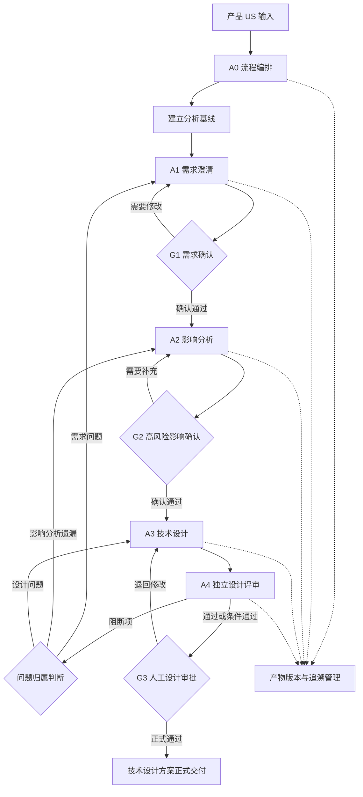
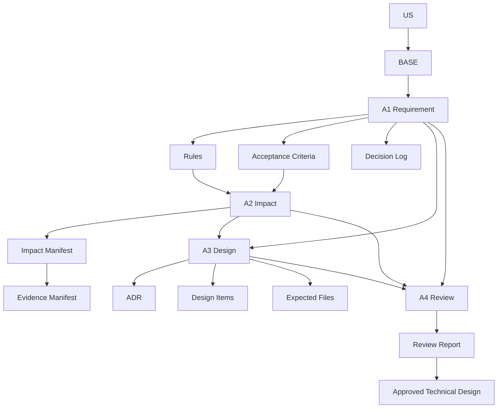

# 基于多 Agent 的存量 Spring Boot SaaS 系统需求分析与技术设计工作流

**文档版本：** V2.0

**建设范围：** US 输入 → 需求澄清 → 代码影响分析 → 技术方案设计 → 设计评审 → 技术方案正式交付

---

# 1. 项目背景与建设目标

## 1.1 项目背景

当前系统是一个具有约 10 年历史的 Spring Boot SaaS 系统，长期迭代过程中积累了大量历史业务逻辑、技术封装、模块依赖、兼容性处理和特殊租户逻辑。

日常研发流程如下：

1. 产品经理提交已经过初步分析的 User Story（US）。
2. 研发人员理解需求，分析涉及的业务模块和代码。
3. 研发人员梳理代码影响范围、存量功能影响及潜在风险。
4. 输出详细技术设计方案。
5. 组织技术评审会议。
6. 评审通过后，将技术设计方案交接给其他开发人员实施。

目前上述工作高度依赖研发人员的个人经验，需要投入大量时间理解历史代码、梳理业务调用关系和分析潜在影响。

计划通过构建多 Agent 协作系统，将上述流程标准化、自动化。

## 1.2 建设目标

构建一套 AI Software Engineering Workflow，通过多个职责明确的 Agent 协同工作，实现：

- 自动理解产品 US。
- 结合业务规范和代码知识图谱补充需求上下文。
- 识别需求中的歧义、冲突和遗漏。
- 自动分析存量代码的修改范围及功能影响。
- 识别数据库、缓存、消息、API、权限及多租户风险。
- 自动生成符合项目技术规范的详细设计方案。
- 自动检查需求、影响分析和技术设计之间的一致性。
- 支持人工修改、确认、审批及断点重跑。
- 输出能够直接用于技术评审和后续开发交接的技术设计文档。

## 1.3 本期建设范围

| 阶段     | 内容                     | 是否建设 |
| -------- | ------------------------ | -------- |
| US 输入  | 接收产品需求             | 是       |
| A1       | 需求澄清                 | 是       |
| A2       | 代码影响分析             | 是       |
| A3       | 技术方案设计             | 是       |
| A4       | 设计评审                 | 是       |
| 人工审批 | 需求、影响、技术设计确认 | 是       |
| A5       | 开发任务拆分             | 暂不建设 |
| A6       | Coding Agent             | 暂不建设 |
| A7       | Code Review Agent        | 暂不建设 |
| A8       | Release Agent            | 暂不建设 |

本期最终交付物为：

**经过需求确认、影响分析、技术设计及设计评审的正式技术设计方案。**

---

# 2. 整体架构设计

## 2.1 Agent 划分

系统采用一个编排 Agent 和四个业务 Agent 的架构。

| Agent | 名称                      | 核心职责                                       |
| ----- | ------------------------- | ---------------------------------------------- |
| A0    | Orchestrator Agent        | 流程编排、状态管理、版本管理、门禁和一致性检查 |
| A1    | Requirement Analyst Agent | US 需求澄清、业务规则识别、验收标准生成        |
| A2    | Impact Analyst Agent      | 代码触点识别、功能影响分析、风险分析           |
| A3    | Technical Designer Agent  | 详细技术设计、技术决策、兼容与迁移方案         |
| A4    | Design Reviewer Agent     | 独立审查需求覆盖、影响覆盖和技术设计质量       |

所有 Agent 通过统一的产物协议交换信息。

A0 不直接承担业务分析和技术设计，而是负责组织各个 Agent 的执行过程，并保证产物之间的一致性。

## 2.2 整体工作流



## 2.3 核心设计原则

### 原则一：事实与推断分离

Agent 必须明确区分：

- US 明确描述的事实。
- 项目规范中定义的规则。
- 当前代码中真实存在的行为。
- Agent 根据上下文推断出的内容。
- 尚未得到确认的假设。

代码现状不能自动成为产品需求。

### 原则二：所有结论必须有证据

每一个重要的需求规则、代码影响点、技术决策都应该能够追溯到来源。

证据来源包括：

- US 原文。
- 业务规范。
- 代码文件及符号。
- 代码知识图谱。
- Git 历史。
- 运行时调用记录。
- 人工确认记录。

### 原则三：Agent 不得擅自扩大需求范围

发现潜在业务遗漏时，可以提出问题，但不能直接将推断内容转化为已确认的需求。

### 原则四：设计与实现分离

A2 负责回答修改哪里、影响什么。

A3 负责回答应该如何修改。

A4 负责判断设计是否正确。

三个阶段不能混淆职责。

### 原则五：所有阶段均可追溯、可恢复

任何 Agent 产物都必须具有唯一 ID、版本号、输入依赖和生成记录。

---

# 3. 基础设施与共享能力

在开发 A0～A4 之前，需要准备统一的基础能力。

## 3.1 代码知识图谱

假设代码知识图谱已经建设完成。

图谱至少应支持以下查询：

| 查询能力               | 用途                     |
| ---------------------- | ------------------------ |
| entities_by_capability | 根据业务能力查找关联代码 |
| blast_radius           | 根据代码符号查询影响范围 |
| table_field_usages     | 查询表及字段的读写关系   |
| api_consumers          | 查询 API 调用方          |
| jobs_touching          | 查询关联 Job             |
| message_producers      | 查询消息生产者           |
| message_consumers      | 查询消息消费者           |
| config_references      | 查询配置项引用           |
| permission_references  | 查询权限点关联           |
| bean_dependencies      | 查询 Spring Bean 依赖    |
| cross_module_calls     | 查询跨模块调用关系       |
| tenant_context_paths   | 查询租户上下文传递关系   |

图谱查询结果必须提供：

```yaml
evidence:
  node_id: graph-node-001
  node_type: method
  symbol: RefundService.refund
  file: module-order/RefundService.java
  relation: CALLS
  target: RefundRepository.save
  source: static_analysis
  confidence: high
  graph_version: graph-20261114-001
  commit: 8f3a9c2
```

禁止只返回一段自然语言描述而不提供证据节点。

## 3.2 规范与知识库

知识库需要管理：

1. 业务需求规范。
2. 领域术语词典。
3. 业务规则文档。
4. 系统架构文档。
5. 数据库设计规范。
6. API 设计规范。
7. 消息设计规范。
8. 权限与多租户规范。
9. 开发规范。
10. 历史技术设计文档。
11. 历史架构决策记录。
12. 已知技术债务及兼容性约束。

每份文档需要维护：

- 文档 ID。
- 版本。
- 有效状态。
- 生效时间。
- 适用模块。
- 来源。
- 是否已经废弃。

历史文档不能直接作为当前系统事实，必须结合代码基线判断有效性。

## 3.3 框架封装 Skill

框架封装 Skill 是 A3 的重要约束来源。

需要提供：

- Controller 标准写法。
- Service 分层规范。
- Repository/Mapper 规范。
- 统一异常处理。
- 统一返回结构。
- 数据库访问封装。
- 事务管理规范。
- 缓存使用规范。
- MQ 使用规范。
- 权限控制规范。
- 租户上下文规范。
- 日志及审计规范。
- 现有公共组件及 Helper 清单。

每个 Skill 需要有版本号，A3 必须记录实际引用的 Skill 版本。

## 3.4 运行时证据

知识图谱主要反映静态代码关系，不能完全代表生产环境中的实际行为。例如：

1. 某个功能通过数据库配置动态启用。
2. 某个接口通过反射调用。
3. 某个 Job 由数据库配置决定是否执行。
4. 某个功能依赖租户级配置。
5. 某个业务分支通过 Spring Bean 条件装配。
6. 某个模块通过 MQ 订阅其他模块的事件。
7. 某些租户使用历史遗留的特殊配置。
8. 某个功能虽然代码存在，但已经没有实际调用。

建议提供可选的运行时证据查询能力：

| 数据来源     | 用途                   |
| ------------ | ---------------------- |
| API 访问记录 | 判断接口实际使用情况   |
| Trace 调用链 | 发现真实跨模块调用     |
| MQ 监控      | 识别实际消息订阅关系   |
| Job 执行记录 | 判断任务实际执行情况   |
| 配置中心     | 识别动态配置及租户差异 |
| SQL 访问记录 | 验证数据库读写路径     |

运行时证据不是每次都必须获取。

当需求涉及高风险业务链路、动态配置或无法通过静态分析确认的行为时，A2 应主动提出运行时证据查询。

没有数据时，必须标记为证据不足，不能推断为没有影响。

## 3.5 产物存储

建议将产物统一管理，而不是让每个 Agent 独立维护 Markdown 文件。

建议采用：

- Markdown：正式技术文档。
- JSON/YAML：结构化产物。
- PostgreSQL：任务、版本、状态、依赖和审批记录。
- Git：正式产物版本管理。
- 对象存储：较大的分析附件、证据快照。

Markdown 用于阅读，结构化数据用于机器校验。

---

# 4. A0：Orchestrator Agent

## 4.1 职责

A0 是整个工作流的控制中心。

负责：

1. 接收 US。
2. 建立分析基线。
3. 选择执行模式。
4. 调度 A1～A4。
5. 管理阶段状态。
6. 维护产物版本及依赖关系。
7. 执行跨阶段一致性检查。
8. 管理人工审批。
9. 管理 Agent 失败、重试和回流。
10. 识别人工修改及影响范围。
11. 组织最终交付物。

A0 不应该自行编写需求、影响分析或技术设计结论。

## 4.2 输入

```yaml
workflow_request:
  us_id: US-2026-001
  us_content: ...
  mode: draft

  repository:
    name: legacy-saas
    base_branch: release/10.x

  options:
    rerun_from: null
    existing_artifacts: []
    include_runtime_evidence: auto
```

支持：

- 新建分析。
- 指定阶段重跑。
- 从指定产物版本继续执行。
- 人工修改后重新分析。
- 根据评审意见进行定向回流。

## 4.3 分析基线管理

每个 US 必须建立独立的 Analysis Baseline。

```yaml
analysis_baseline:
  baseline_id: BASE-001

  repository:
    name: legacy-saas
    branch: release/10.x
    commit: 8f3a9c2

  knowledge_graph:
    version: graph-20261114-001
    commit: 8f3a9c2

  documentation:
    version: docs-20261114-001

  skills:
    framework_skill: v3.2
    saas_checklist: v2.1

  created_at: 2026-11-14T20:00:00+08:00
```

必须保证：

1. 图谱版本对应指定代码 Commit。
2. 所有 Agent 使用同一份代码基线。
3. 文档及 Skill 版本可以追溯。
4. 代码基线变化时能够识别受影响的分析产物。

如果当前代码已经发生变化：

- 检查变化文件是否与 A2 触点相关。
- 检查相关方法、接口、表结构是否发生变化。
- 如果没有影响，可以保留当前分析并记录差异。
- 如果影响了分析结论，必须重新运行相关阶段。
- 如果图谱与代码基线不一致，禁止将相关分析标记为 final。

## 4.4 运行模式

| 模式  | 说明             | 约束                         |
| ----- | ---------------- | ---------------------------- |
| draft | 快速生成讨论稿   | 允许存在未确认假设           |
| final | 正式技术设计流程 | 必须完成规定的人审和质量门禁 |

draft 可以跳过人工审批，但不能跳过产物结构校验。

final 必须通过 G1、G2、A4 和 G3。

## 4.5 流程状态

```text
CREATED
BASELINE_READY
A1_RUNNING
WAITING_G1
A2_RUNNING
WAITING_G2
A3_RUNNING
A4_RUNNING
DESIGN_REVISION
WAITING_G3
COMPLETED
BLOCKED
```

每个阶段还需要记录：

- 当前 Agent。
- 当前产物 ID。
- 当前产物版本。
- 输入依赖版本。
- 执行时间。
- 执行状态。
- 失败原因。
- 人工操作记录。

## 4.6 跨阶段一致性门禁

| 规则 ID | 校验规则                                     |
| ------- | -------------------------------------------- |
| C01     | A1 所有 US 必须需求均有对应验收标准          |
| C02     | A1 推断规则不得未经确认进入最终需求          |
| C03     | A2 每个必改触点必须关联至少一条 A1 规则或 AC |
| C04     | A2 高风险触点必须完成 G2                     |
| C05     | A3 每个必改触点必须有对应设计说明            |
| C06     | A3 每个重要技术决策必须有决策记录            |
| C07     | A3 每个对外契约变更必须有兼容策略            |
| C08     | A4 不得存在未关闭的阻断项                    |
| C09     | 所有产物的输入版本必须一致                   |
| C10     | 人工修改的关键内容必须重新经过对应阶段确认   |
| C11     | 不允许存在无需求依据的设计变更               |
| C12     | final 产物必须使用有效的分析基线             |

## 4.7 人工修改检测

所有 Agent 产物都需要进行版本管理。

修改检测不能只依赖文件 Hash，还应比较结构化产物的字段及章节差异。

修改分类：

| 修改类型     | 处理                   |
| ------------ | ---------------------- |
| 普通文字修改 | 记录修改，可继续执行   |
| 需求范围修改 | 返回 A1                |
| 业务规则修改 | 返回 A1，必要时重新 G1 |
| 影响触点修改 | 返回 A2                |
| 技术设计修改 | 返回 A3，并重新 A4     |
| 评审结论修改 | 重新执行相关审查       |
| 代码基线变化 | 检查相关分析是否失效   |

每次人工修改生成新的 Artifact Version，不覆盖旧版本。

如果人工修改导致下游产物依赖失效，A0 必须将其标记为 STALE。

## 4.8 输出产物

### ART-00：Workflow Manifest

记录整个 US 的工作流信息。

```yaml
workflow:
  id: WF-001
  us_id: US-2026-001
  mode: final
  status: WAITING_G1

  baseline_id: BASE-001

  artifacts:
    - A1-001:v1
    - A2-001:v0

  approvals:
    G1: pending
    G2: not_started
    G3: not_started

  current_stage: A1

  blocked_reasons: []
```

### ART-01：Analysis Baseline

记录代码、知识图谱、规范文档和 Skill 的版本。

### ART-02：Artifact Manifest

记录所有产物之间的版本依赖关系。

### ART-03：Workflow Report

记录每个阶段的执行情况、门禁结果、阻断原因及后续动作。

---

# 5. A1：Requirement Analyst Agent

## 5.1 目标

将产品 US 转化为结构化、可追溯、可验收的需求澄清包。

A1 的核心目标不是重新编写 US，而是：

- 识别需求真实意图。
- 补充必要的业务上下文。
- 识别歧义和遗漏。
- 识别与现有业务规则的冲突。
- 区分目标行为与存量行为。
- 生成明确的验收标准。

A1 不得擅自将代码现状转化为已确认的业务需求。

## 5.2 输入

| 输入              | 说明               |
| ----------------- | ------------------ |
| US                | 产品提交的原始需求 |
| 领域词典          | 业务术语解释       |
| 业务规范          | 已有业务规则       |
| 历史需求          | 相关历史 US        |
| 代码知识图谱      | 业务能力及关联节点 |
| 历史设计文档      | 相关历史设计决策   |
| Analysis Baseline | 本次分析基线       |

## 5.3 处理流程

### 步骤一：US 结构解析

提取：

- 业务目标。
- 需求背景。
- 用户角色。
- 适用业务场景。
- 主流程。
- 异常流程。
- 数据输入与输出。
- 状态变化。
- 权限要求。
- 非功能要求。
- 范围限制。

### 步骤二：需求完整性检查

检查：

- 是否存在模糊描述。
- 是否存在缺少前置条件的流程。
- 是否存在不可验证的要求。
- 是否存在业务状态不完整。
- 是否存在异常场景遗漏。
- 是否存在角色权限不明确。
- 是否存在数据边界不明确。
- 是否存在相互矛盾的规则。

重点识别以下表达：

- 参考原有功能。
- 按照之前的逻辑。
- 自动处理。
- 正常情况下。
- 适当调整。
- 支持相关配置。
- 保持原有兼容性。

这些表达必须结合具体业务上下文进行澄清。

### 步骤三：规范检查

检索相关业务规范，识别：

- US 与现行规范冲突。
- US 与历史决策冲突。
- US 缺少规范要求。
- US 使用了不一致的领域术语。

### 步骤四：图谱辅助补漏

通过知识图谱查找相关业务能力：

- 关联 API。
- 关联权限点。
- 关联业务状态。
- 关联 Job。
- 关联消息。
- 关联配置项。
- 关联数据库实体。
- 关联其他业务流程。

此处只负责发现潜在遗漏，不负责自动确认业务需求。

### 步骤五：区分事实与推断

所有业务规则必须标记来源。

定义以下类型：

| 类型          | 含义                     |
| ------------- | ------------------------ |
| explicit      | US 明确描述              |
| specification | 现行规范明确规定         |
| existing      | 当前代码中已经存在的行为 |
| inferred      | Agent 根据上下文推断     |
| unknown       | 当前无法确认             |

规则还需要记录：

- 置信度。
- 是否改变存量行为。
- 是否需要人工确认。
- 不处理可能造成的风险。

### 步骤六：现状与目标对比

明确：

- 当前系统行为。
- 本次需求目标行为。
- 本次保持不变的行为。
- 本次明确要改变的行为。
- 暂时无法确认的行为。

### 步骤七：生成验收标准

每条验收标准必须：

- 可以执行。
- 可以观察结果。
- 有明确前置条件。
- 有明确期望结果。
- 能关联业务规则。
- 能明确适用角色或租户范围。

## 5.4 输出产物

### ART-10：Requirement Clarification Package

A1 的正式结构化输出。

```yaml
requirement:
  id: A1-001
  version: 1
  us_id: US-2026-001
  baseline_id: BASE-001

  summary: 支持订单部分退款

  scope:
    in_scope: []
    out_of_scope: []

  roles: []

  rules:
    - id: R-001
      description: 部分退款金额不能超过剩余可退款金额
      source:
        type: explicit
        reference: US-2026-001
      confidence: high
      behavior_change: true
      confirmation_required: false
      decision_status: confirmed

    - id: R-002
      description: 部分退款时需要同步调整会员积分
      source:
        type: inferred
        reference: graph-node-123
      confidence: medium
      behavior_change: unknown
      confirmation_required: true
      decision_status: pending

  acceptance_criteria:
    - id: AC-001
      rule_ids:
        - R-001
      preconditions: 订单存在可退款金额
      steps: 执行部分退款
      expected: 退款成功且金额正确

  open_questions: []
  risks: []
```

### ART-11：Requirement Clarification Document

Markdown 文档，用于研发人员和产品经理阅读。

文档结构：

```markdown
# 需求澄清文档

## 1. 需求摘要

## 2. 需求范围
### 2.1 In Scope
### 2.2 Out of Scope

## 3. 角色与权限

## 4. 业务规则清单
### 4.1 已确认规则
### 4.2 存量行为
### 4.3 推断规则
### 4.4 待确认规则

## 5. 主流程与异常流程

## 6. 数据与状态

## 7. 非功能需求

## 8. SaaS 专项检查
### 8.1 多租户
### 8.2 默认配置与存量租户
### 8.3 计费与权益
### 8.4 审计日志
### 8.5 对外 API 与事件契约

## 9. 验收标准

## 10. 冲突与待裁决

## 11. Open Questions

## 12. 假设与风险
```

### ART-12：Requirement Decision Log

记录需求澄清过程中需要人工决定的问题。

```yaml
decisions:
  - id: DEC-001
    question: 部分退款是否需要按比例扣减会员积分
    source: R-002
    options:
      - 保持现有积分处理逻辑
      - 按退款比例扣减
      - 部分退款不处理积分
    recommended_option: 保持现有逻辑
    status: pending
    decided_by: null
    decision: null
    decided_at: null
```

## 5.5 人工门禁 G1：需求确认

G1 的目的：

确认 A1 输出的业务需求是否真实、完整、准确。

重点确认：

1. In Scope 和 Out of Scope。
2. 业务规则。
3. 存量行为是否发生变化。
4. 推断规则。
5. 验收标准。
6. Open Questions。
7. 重大业务风险。

G1 审批状态：

- APPROVED：通过。
- REJECTED：退回 A1。
- PARTIALLY_APPROVED：部分规则确认，其他规则继续待定。

对于无法确认的非核心问题，可以在最终方案中保留明确假设。

对于阻断核心流程、影响计费、权限或数据安全的问题，不允许进入 final 模式下的 A2。

## 5.6 完成条件

- 所有必须需求均有对应验收标准。
- 所有规则具有来源和分类。
- 不存在未经确认的推断需求。
- 业务范围明确。
- 关键 Open Questions 已处理。
- G1 审批完成。

---

# 6. A2：Impact Analyst Agent

## 6.1 目标

根据已经确认的需求，分析存量系统需要修改的代码位置、影响的业务功能、潜在风险和测试方向。

A2 只负责分析，不负责提出详细实现方案。

核心回答：

1. 哪些代码必须修改？
2. 哪些代码可能需要修改？
3. 哪些现有功能会受到影响？
4. 哪些数据和外部契约可能受到影响？
5. 哪些历史行为需要保护？
6. 哪些影响目前缺少足够证据？

## 6.2 输入

| 输入         | 说明                   |
| ------------ | ---------------------- |
| ART-10       | 结构化需求澄清包       |
| ART-12       | 已确认的需求决策       |
| 代码知识图谱 | 代码关系与业务映射     |
| 仓库代码     | 基线版本的真实代码     |
| Git 历史     | 历史修改情况           |
| 运行时证据   | API、Trace、MQ、Job 等 |
| 项目规范     | 模块、分层及技术约束   |
| 在途变更     | 其他分支的未合并变更   |

## 6.3 处理流程

### 步骤一：提取变更关注点

从 A1 提取：

- 业务实体。
- 业务规则。
- API。
- 状态。
- 数据字段。
- 配置项。
- 权限点。
- 消息事件。
- Job。
- 租户上下文。

生成本次分析的 Change Scope。

### 步骤二：知识图谱影响扩散

从关键业务节点开始进行图谱扩散。

分析：

- 直接调用方。
- 间接调用方。
- 关联 Service。
- 关联 Repository/Mapper。
- 数据库读写。
- 缓存引用。
- MQ 生产者与消费者。
- 定时任务。
- 配置引用。
- 权限引用。
- 跨模块调用。

扩散需要设置深度和边类型约束，避免无意义地遍历整个系统。

### 步骤三：静态代码验证

对图谱结果进行代码验证。

检查：

- 类和方法是否真实存在。
- 当前代码是否仍然与图谱一致。
- 是否存在反射调用。
- 是否存在 Spring Bean 动态装配。
- 是否存在动态 SQL。
- 是否存在配置驱动逻辑。
- 是否存在框架封装带来的隐式行为。

### 步骤四：运行时证据补充

对于以下场景主动查询运行时信息：

- 动态配置控制的功能。
- 反射调用。
- 跨服务异步链路。
- 特殊租户逻辑。
- 高风险数据写路径。
- 无法确认是否真实使用的接口。

没有运行时证据时，明确记录证据缺失。

### 步骤五：功能级 Blast Radius

将代码节点映射为产品功能。

例如：

| 代码节点           | 产品功能 | 影响说明 |
| ------------------ | -------- | -------- |
| RefundService      | 订单退款 | 直接影响 |
| MemberPointService | 会员积分 | 间接影响 |
| FinanceJob         | 财务对账 | 可能影响 |
| RefundController   | 退款 API | 直接影响 |

### 步骤六：数据与契约影响

检查：

- 数据库表及字段。
- 索引与约束。
- 缓存 Key。
- 缓存失效策略。
- MQ 消息。
- API 请求与响应。
- 配置项。
- 权限点。
- 租户上下文。
- 审计日志。

### 步骤七：存量行为与兼容性分析

识别：

- 默认配置变化。
- 老版本业务行为。
- 特殊租户定制逻辑。
- 历史状态处理。
- 老接口调用方。
- 历史数据依赖。
- 可能失效的兼容代码。

### 步骤八：风险分级

统一采用：

| 等级    | 含义                               |
| ------- | ---------------------------------- |
| BLOCKER | 存在明确的重大安全、数据或业务风险 |
| HIGH    | 高风险，需要研发确认               |
| MEDIUM  | 存在一定影响，需要在设计中处理     |
| LOW     | 影响范围较小                       |
| INFO    | 仅提供参考信息                     |

风险等级不能仅由 LLM 主观判断，应结合规则、影响范围和证据共同确定。

### 步骤九：在途变更冲突分析

检查：

- 是否有其他分支修改相同文件。
- 是否修改相同方法。
- 是否修改相同数据库表。
- 是否存在接口契约冲突。
- 是否存在其他 US 已经修改相同业务流程。

## 6.4 证据类型

统一使用：

| 类型                  | 含义                     |
| --------------------- | ------------------------ |
| graph_proven          | 知识图谱关系证明         |
| static_analysis       | 静态代码分析证明         |
| runtime_proven        | 运行时行为证明           |
| configuration_proven  | 配置来源证明             |
| git_history           | Git 历史证明             |
| heuristic             | 根据代码或业务上下文推断 |
| needs_runtime_confirm | 需要运行时验证           |

每个影响点必须记录：

- 证据类型。
- 证据来源。
- 对应文件或图谱节点。
- 对应代码基线。
- 结论置信度。
- 是否需要人工确认。

## 6.5 输出产物

### ART-20：Impact Analysis Package

```yaml
impact_analysis:
  id: A2-001
  version: 1
  baseline_id: BASE-001
  requirement_ref: A1-001:v2

  summary:
    mandatory_changes: 3
    potential_changes: 2
    high_risks: 1

  impacts:
    - id: IMPACT-001
      rule_refs:
        - R-001
      acceptance_refs:
        - AC-001

      target:
        module: module-order
        file: RefundService.java
        symbol: RefundService.refund

      impact_type: mandatory
      evidence:
        - type: graph_proven
          reference: graph-node-001
        - type: static_analysis
          reference: RefundService.java:120

      affected_features:
        - 订单退款

      risk: high

      reason: 需要调整现有退款金额计算逻辑

      constraints:
        - 保持原有全额退款行为

      status: confirmed
```

### ART-21：Impact Analysis Document

```markdown
# 代码影响分析报告

## 1. 影响摘要

## 2. 功能级影响范围
### 2.1 直接影响功能
### 2.2 间接影响功能
### 2.3 潜在影响功能

## 3. 代码触点清单
### 3.1 必改项
### 3.2 可能修改项
### 3.3 只读依赖项

## 4. 数据影响
### 4.1 数据库
### 4.2 缓存
### 4.3 历史数据

## 5. 对外契约影响
### 5.1 API
### 5.2 MQ
### 5.3 配置
### 5.4 权限

## 6. SaaS 专项影响
### 6.1 多租户
### 6.2 特殊租户
### 6.3 默认配置
### 6.4 计费与权益
### 6.5 审计

## 7. 存量行为及兼容性风险

## 8. 在途变更冲突

## 9. 风险清单

## 10. 建议测试方向

## 11. 证据不足与待确认事项
```

### ART-22：Impact Evidence Manifest

独立保存影响分析的证据。

```yaml
evidence_manifest:
  impact_id: IMPACT-001
  baseline_id: BASE-001

  evidence:
    - id: EVIDENCE-001
      type: graph_proven
      source: graph-node-001
      description: RefundService 调用 RefundRepository

    - id: EVIDENCE-002
      type: static_analysis
      source: RefundService.java:120
      description: 当前退款金额计算逻辑
```

## 6.6 人工门禁 G2：高风险影响确认

G2 不是重新审查整个 A2 报告。

重点确认：

- 高风险数据写路径。
- 权限变更。
- 多租户隔离。
- 对外 API 契约。
- MQ 事件契约。
- 存量行为变更。
- 特殊租户影响。
- 无法通过静态分析确认的关键调用链。

研发可以：

- 确认影响结论。
- 修正影响范围。
- 补充遗漏触点。
- 要求 A2 进一步分析。
- 标记为暂时无法确认。

## 6.7 完成条件

- 所有必改项均关联 A1 规则或验收标准。
- 关键影响点有可验证证据。
- 所有高风险触点已经确认。
- 重要数据和契约影响已识别。
- 证据不足项已明确标记。
- G2 审批完成。

---

# 7. A3：Technical Designer Agent

## 7.1 目标

基于已确认的需求和影响分析，生成可以直接用于技术评审和后续开发交接的详细技术设计方案。

A3 必须遵循现有项目架构、分层规范和框架封装 Skill。

A3 不得随意重构无关代码，不得绕过已有公共封装。

## 7.2 输入

| 输入              | 说明          |
| ----------------- | ------------- |
| ART-10            | 需求澄清包    |
| ART-11            | 需求澄清文档  |
| ART-12            | 需求决策记录  |
| ART-20            | 影响分析包    |
| ART-21            | 影响分析报告  |
| ART-22            | 影响证据      |
| Framework Skill   | 项目技术封装  |
| SaaS Checklist    | SaaS 专项检查 |
| AGENTS.md         | 仓库开发规范  |
| Analysis Baseline | 分析基线      |

## 7.3 处理流程

### 步骤一：建立设计覆盖清单

提取所有 A2 必改触点。

生成 Design Coverage Matrix。

每个 IMPACT 必须对应一个或多个 DESIGN。

不允许出现没有设计归属的必改项。

### 步骤二：检索现有技术实现

根据 A2 的代码触点，进一步检索：

- 现有代码实现。
- 公共封装。
- 类似业务功能。
- 历史设计决策。
- 相关技术规范。
- 现有异常处理。
- 现有事务管理。
- 现有缓存和消息机制。

### 步骤三：确定技术方案

对关键设计问题提出候选方案。

例如：

- 修改现有接口还是新增接口？
- 同步处理还是异步处理？
- 扩展现有表还是新增表？
- 使用现有状态机还是扩展状态机？
- 采用数据库事务还是最终一致性？

对重要决策记录：

- 方案背景。
- 候选方案。
- 推荐方案。
- 选择理由。
- 影响。
- 代价。
- 风险。

### 步骤四：生成 ADR

对于重要架构和技术决策，生成 ADR。

```yaml
adr:
  id: ADR-001
  title: 部分退款采用现有退款服务扩展方案
  status: proposed

  context:
    - 现有系统已有退款处理流程
    - 本次需要支持部分退款

  options:
    - id: OPTION-001
      name: 扩展现有退款服务
      selected: true
      reason: 最大程度复用原有流程

    - id: OPTION-002
      name: 新建部分退款服务
      selected: false
      reason: 会增加重复业务逻辑

  consequences:
    - 需要调整金额计算逻辑
    - 需要保证原有全额退款兼容性

  references:
    - IMPACT-001
    - R-001
```

### 步骤五：设计关键业务流程

明确：

- 正常流程。
- 异常流程。
- 状态流转。
- 并发处理。
- 幂等处理。
- 事务边界。
- 超时与重试。
- 失败补偿。

### 步骤六：设计数据与契约

涉及数据库变更时，必须说明：

- 表结构。
- 字段定义。
- 类型。
- 默认值。
- 索引。
- 约束。
- 数据迁移。
- 历史数据兼容。
- 回滚可行性。

涉及 API 或 MQ 变更时，必须说明：

- 请求与响应。
- 字段兼容。
- 消费者兼容。
- 新旧版本共存。
- 是否需要灰度。

### 步骤七：设计 SaaS 安全与兼容性

重点检查：

- 租户上下文。
- 数据隔离。
- 权限。
- 缓存租户维度。
- 异步消息租户上下文。
- 特殊租户逻辑。
- 默认配置。
- 存量数据。
- 计费及权益。

### 步骤八：设计观测与故障处理

根据需求实际情况，设计：

- 日志。
- Trace。
- 指标。
- 审计记录。
- 异常告警。
- 业务监控。

不要求每个需求都增加所有观测项，但必须说明是否需要变化。

### 步骤九：发布与回滚设计

虽然本期不实现发布 Agent，但技术设计必须包含：

- 发布顺序。
- 配置变更。
- 数据迁移顺序。
- 灰度策略。
- 新旧版本兼容。
- 回滚方式。
- 数据回滚可行性。

### 步骤十：生成预期文件变更清单

根据 A2 触点和技术设计，给出预期修改文件。

注意：

此处是设计预期，不是实际代码修改结果。

## 7.4 输出产物

### ART-30：Technical Design Package

```yaml
technical_design:
  id: A3-001
  version: 1

  baseline_id: BASE-001

  requirement_ref: A1-001:v2
  impact_ref: A2-001:v2

  decisions:
    - ADR-001

  designs:
    - id: DESIGN-001
      impact_refs:
        - IMPACT-001
      description: 扩展退款金额计算逻辑
      status: proposed

  file_changes:
    - path: module-order/RefundService.java
      operation: modify
      impact_refs:
        - IMPACT-001
      design_refs:
        - DESIGN-001

  migration:
    required: false
    reason: 现有数据结构能够支持退款金额记录

  compatibility:
    required: true
    strategy: 保持原有全额退款行为

  observability:
    logging: required
    metrics: optional
    tracing: existing

  rollback:
    strategy: 回退应用版本
    data_rollback: not_required
```

### ART-31：Technical Design Document

正式技术设计文档。

```markdown
# 技术设计方案

## 1. 背景与目标
### 1.1 业务背景
### 1.2 本次目标
### 1.3 需求及规则引用

## 2. 方案概述
### 2.1 推荐方案
### 2.2 候选方案
### 2.3 方案对比
### 2.4 技术选型及取舍

## 3. 详细设计

### 3.1 模块与职责

### 3.2 核心业务流程
- 正常流程
- 异常流程
- 状态流转

### 3.3 核心代码设计
- 类与方法职责
- 调用关系
- 现有封装复用
- 关键逻辑说明

### 3.4 API 与事件契约
- API
- MQ
- 配置
- 权限

### 3.5 数据库设计
- 表结构
- 字段
- 索引
- 数据迁移

### 3.6 缓存设计
- Key
- TTL
- 更新策略
- 一致性

### 3.7 按 A2 触点的修改说明
- IMPACT 对应 DESIGN
- 修改原因
- 修改内容
- 关联规则

### 3.8 技术决策记录
- ADR

## 4. 非功能设计
### 4.1 性能
### 4.2 并发
### 4.3 幂等
### 4.4 超时与重试
### 4.5 高可用与降级

## 5. 安全与多租户
### 5.1 权限
### 5.2 租户隔离
### 5.3 特殊租户
### 5.4 数据安全

## 6. 可观测性
### 6.1 日志
### 6.2 指标
### 6.3 Trace
### 6.4 审计

## 7. 兼容、迁移与发布
### 7.1 存量行为兼容
### 7.2 数据迁移
### 7.3 发布顺序
### 7.4 灰度策略
### 7.5 回滚方案

## 8. 测试设计建议
### 8.1 单元测试
### 8.2 集成测试
### 8.3 回归测试
### 8.4 多租户测试
### 8.5 异常及边界测试

## 9. 风险与待确认事项

## 10. 预期代码修改清单

## 11. 需求与设计追溯矩阵
```

### ART-32：Architecture Decision Records

独立保存所有 ADR。

### ART-33：Design Coverage Matrix

确保需求和影响触点均有设计覆盖。

示例：

| 需求/影响 ID | 设计 ID    | 设计章节 | 覆盖状态 |
| ------------ | ---------- | -------- | -------- |
| R-001        | DESIGN-001 | 3.3      | Covered  |
| AC-001       | DESIGN-001 | 8.1      | Covered  |
| IMPACT-001   | DESIGN-001 | 3.7      | Covered  |

### ART-34：Expected File Change Manifest

记录预期修改文件。

| 文件               | 操作   | 关联 IMPACT | 关联 DESIGN | 原因         |
| ------------------ | ------ | ----------- | ----------- | ------------ |
| RefundService.java | MODIFY | IMPACT-001  | DESIGN-001  | 修改退款计算 |
| RefundMapper.java  | MODIFY | IMPACT-002  | DESIGN-002  | 修改数据查询 |

## 7.5 A3 硬性约束

1. 每个 A2 必改项必须有对应设计。
2. 每个重要技术决策必须记录 ADR。
3. 不允许无需求依据的设计变更。
4. 必须遵循现有框架 Skill。
5. 不允许绕过公共封装。
6. 对外契约变化必须说明兼容策略。
7. 有数据迁移时必须说明执行顺序和回滚。
8. 无迁移时必须说明原因。
9. 必须明确存量行为如何保持。
10. 必须明确预期修改文件。

---

# 8. A4：Design Reviewer Agent

## 8.1 目标

A4 是独立的设计质量审查 Agent。

不是对 A3 进行主观评分，而是通过需求、影响证据、设计文档和项目规范进行对照审查。

A4 不应该完全依赖 A3 已经整理好的结论。

必须具备独立检索和验证能力。

## 8.2 输入

| 输入              | 说明             |
| ----------------- | ---------------- |
| ART-10            | 需求澄清包       |
| ART-12            | 需求决策记录     |
| ART-20            | 影响分析包       |
| ART-22            | 影响证据         |
| ART-30            | 技术设计包       |
| ART-31            | 技术设计文档     |
| ART-32            | ADR              |
| ART-33            | 设计覆盖矩阵     |
| 项目规范          | 当前有效规范     |
| 代码知识图谱      | 独立验证影响范围 |
| Analysis Baseline | 分析基线         |

## 8.3 审查流程

### 第一层：需求覆盖审查

检查：

- 每条业务规则是否得到设计支持。
- 每条 AC 是否有对应设计和测试建议。
- 是否存在需求遗漏。
- 是否擅自扩大需求范围。
- 是否将推断内容当作已确认需求。

### 第二层：影响分析覆盖审查

独立查询知识图谱，验证：

- 是否漏掉直接调用方。
- 是否漏掉间接调用方。
- 是否漏掉数据库读写方。
- 是否漏掉 MQ 消费者。
- 是否漏掉 Job。
- 是否漏掉权限及配置依赖。
- 是否漏掉特殊租户逻辑。

重点是发现 A2 没有识别的影响点。

### 第三层：技术设计正确性审查

检查：

- 是否符合现有系统架构。
- 是否正确复用现有封装。
- 是否存在重复造轮子。
- 是否存在不合理的事务边界。
- 是否存在幂等缺失。
- 是否存在并发风险。
- 是否存在异常处理遗漏。
- 是否存在不合理的复杂度。

### 第四层：数据及契约审查

检查：

- 数据库设计。
- 历史数据兼容。
- API 兼容。
- MQ 兼容。
- 缓存一致性。
- 数据迁移。
- 回滚可行性。

### 第五层：SaaS 专项审查

检查：

- 租户隔离。
- 权限控制。
- 特殊租户。
- 默认配置。
- 计费及权益。
- 审计日志。
- 跨租户风险。

### 第六层：发布与回滚审查

检查：

- 发布顺序。
- 新旧版本兼容。
- 灰度策略。
- 数据迁移顺序。
- 回滚可行性。
- 配置回滚。
- 数据不可逆操作。

### 第七层：设计合理性审查

检查：

- 是否为了简单需求引入复杂架构。
- 是否存在过度设计。
- 是否存在无关重构。
- 是否存在没有必要的新组件。
- 是否存在超出 US 范围的改动。

## 8.4 审查结论

| 结论             | 说明                                 |
| ---------------- | ------------------------------------ |
| PASS             | 没有阻断问题                         |
| CONDITIONAL_PASS | 存在非阻断条件，必须在正式通过前完成 |
| FAIL             | 存在阻断问题，必须修改               |

阻断问题必须明确：

- 问题描述。
- 问题证据。
- 违反的检查规则。
- 关联需求 ID。
- 关联影响 ID。
- 建议修正方式。
- 应回流到哪个 Agent。

## 8.5 输出产物

### ART-40：Design Review Report

```yaml
review:
  id: A4-001
  version: 1

  requirement_ref: A1-001:v2
  impact_ref: A2-001:v2
  design_ref: A3-001:v1

  conclusion: FAIL

  blocking_issues:
    - id: REVIEW-001
      category: compatibility
      description: 未说明原有全额退款逻辑如何保持兼容
      references:
        - R-001
        - IMPACT-001
        - DESIGN-001

      evidence:
        - RefundService.java

      recommendation: 补充新旧退款逻辑兼容设计

      return_to: A3
      status: open

  suggestions: []

  coverage:
    requirement_coverage: complete
    impact_coverage: incomplete
    design_coverage: incomplete
```

### ART-41：Design Review Document

```markdown
# 技术设计评审报告

## 1. 评审结论

## 2. 阻断问题
### REVIEW-001

## 3. 重要建议

## 4. 需求覆盖矩阵

## 5. 影响覆盖矩阵

## 6. 独立代码影响验证

## 7. SaaS 专项检查

## 8. 技术方案合理性

## 9. 发布与回滚检查

## 10. 需要人工裁决的事项
```

### ART-42：Review Revision Instructions

A4 产生阻断问题时，输出机器可读的修订指令。

```yaml
revision:
  id: REV-001
  review_id: A4-001

  target_agent: A3

  issues:
    - review_id: REVIEW-001
      target_section: "7.1"
      instruction: 补充全额退款兼容策略
      required_evidence:
        - 现有退款处理代码
      expected_output:
        - 修改后的技术设计章节

  invalidated_artifacts:
    - A3-001:v1

  preserved_artifacts:
    - A1-001:v2
    - A2-001:v2
```

## 8.6 回流规则

| 问题类型       | 回流目标 |
| -------------- | -------- |
| 需求理解错误   | A1       |
| 需求规则遗漏   | A1       |
| 影响范围遗漏   | A2       |
| 代码证据错误   | A2       |
| 技术方案不合理 | A3       |
| ADR 不合理     | A3       |
| 兼容性设计遗漏 | A3       |
| 设计范围过大   | A3       |

自动修订最多两轮。

超过两轮仍然无法通过，停止自动循环，输出争议报告并交由人工处理。

---

# 9. 人工审批门禁

整个工作流设置三个必要的人机门禁。

## G1：需求确认

| 项目     | 内容                   |
| -------- | ---------------------- |
| 审批对象 | ART-11、ART-12         |
| 审批人   | 研发                   |
| 目的     | 确认业务规则和需求范围 |
| 不通过   | 返回 A1                |

核心确认：

- 需求范围。
- 业务规则。
- 存量行为变化。
- 推断规则。
- 验收标准。

## G2：高风险影响确认

| 项目     | 内容               |
| -------- | ------------------ |
| 审批对象 | ART-21、ART-22     |
| 审批人   | 研发负责人         |
| 目的     | 确认高风险代码影响 |
| 不通过   | 返回 A2            |

核心确认：

- 数据写路径。
- 权限。
- 多租户。
- 对外契约。
- 高风险调用链。
- 特殊租户。
- 证据不足项。

## G3：技术设计审批

| 项目     | 内容                         |
| -------- | ---------------------------- |
| 审批对象 | ART-31、ART-32、ART-41       |
| 审批人   | 技术负责人、架构师、相关研发 |
| 目的     | 正式确认技术设计             |
| 不通过   | 返回 A3 或指定阶段           |

G3 必须满足：

- A4 结论为 PASS，或者 CONDITIONAL_PASS 的条件已经落实并复核。
- 不存在未关闭的阻断问题。
- 所有需求规则都有对应设计。
- 所有必改触点都有设计说明。
- 重要技术决策已经确认。
- 发布及回滚方案完整。

G3 通过后，冻结本次技术设计版本，作为正式交付物。

---

# 10. 统一产物管理与追溯体系

## 10.1 统一 ID 体系

| 前缀     | 含义       | 产生阶段 |
| -------- | ---------- | -------- |
| US       | User Story | 输入     |
| BASE     | 分析基线   | A0       |
| R        | 业务规则   | A1       |
| AC       | 验收标准   | A1       |
| DEC      | 需求决策   | G1       |
| IMPACT   | 影响触点   | A2       |
| EVIDENCE | 分析证据   | A2       |
| ADR      | 技术决策   | A3       |
| DESIGN   | 设计项     | A3       |
| REVIEW   | 评审问题   | A4       |
| REV      | 修订指令   | A4       |

所有 ID 在同一 US 范围内唯一。

## 10.2 产物版本协议

所有正式产物采用统一结构：

```yaml
artifact:
  id: A3-001
  type: technical_design
  version: 2

  generated_by: A3
  generated_at: 2026-11-14T21:00:00+08:00

  baseline_id: BASE-001

  dependencies:
    - artifact_id: A1-001
      version: 2
    - artifact_id: A2-001
      version: 2

  status: draft

  modifications:
    - type: human_edit
      author: human
      affected_sections:
        - "3.2"
      reason: 补充事务边界

  review_status: pending
```

## 10.3 产物依赖关系



## 10.4 增量重跑规则

不能简单地从某个 Agent 开始重跑，然后保留所有旧产物。

需要根据产物依赖关系判断哪些产物失效。

| 修改对象      | 必须重新执行     | 需要重新验证 |
| ------------- | ---------------- | ------------ |
| US 内容       | A1、A2、A3、A4   | G1、G2、G3   |
| A1 业务规则   | A1、A2、A3、A4   | G1、G2、G3   |
| A1 纯文字描述 | 按依赖判断       | 相关阶段     |
| A2 影响触点   | A2、A3、A4       | G2、G3       |
| A2 证据补充   | A2、A4           | G2           |
| A3 技术设计   | A3、A4           | G3           |
| ADR 修改      | A3、A4           | G3           |
| A4 审查规则   | A4               | G3           |
| 代码基线变化  | 根据差异影响判断 | 相关阶段     |

人工修改不应自动导致整个工作流重新执行。

应该采用依赖失效机制，只重跑受影响的阶段。

---

# 11. SaaS 存量系统专项检查规范

以下检查贯穿 A1～A4。

## 11.1 多租户隔离

- 是否存在跨租户数据可见风险？
- 是否正确传递 Tenant Context？
- SQL 是否包含正确的租户条件？
- 缓存 Key 是否区分租户？
- MQ 是否携带租户信息？
- 异步任务是否正确恢复租户上下文？

## 11.2 存量行为兼容

- 是否修改现有默认行为？
- 是否改变历史状态流转？
- 是否影响历史接口调用方？
- 是否破坏特殊租户逻辑？
- 是否存在老版本数据兼容问题？
- 是否需要保留旧逻辑？

## 11.3 数据库

- 是否修改表结构？
- 是否需要数据迁移？
- 是否涉及大表 DDL？
- 是否影响索引？
- 是否需要数据回填？
- 是否支持新旧版本共存？

## 11.4 权限与安全

- 是否新增或修改权限点？
- 是否改变已有角色权限？
- 是否存在越权访问？
- 是否影响后台管理权限？
- 是否影响数据导出及下载？

## 11.5 计费与权益

- 是否影响计费逻辑？
- 是否改变权益计算？
- 是否影响套餐限制？
- 是否影响历史账单？

## 11.6 消息与异步任务

- 是否改变消息契约？
- 是否存在重复消费？
- 是否存在消息丢失？
- 是否影响任务幂等？
- 是否影响历史消息消费？

## 11.7 可观测性

- 是否需要增加业务日志？
- 是否需要新增指标？
- 是否需要补充 Trace？
- 是否需要审计日志？
- 是否需要告警？

---

# 12. 运行模式与质量标准

## 12.1 Draft 模式

用途：快速分析、内部讨论、设计探索。

允许：

- 未确认业务假设。
- 未验证的运行时影响。
- 部分技术方案待定。
- A4 发现的问题暂时未修复。

但是必须明确标记：

- DRAFT。
- UNCONFIRMED。
- NEEDS_REVIEW。
- NEEDS_RUNTIME_CONFIRM。

Draft 产物禁止作为正式开发交接依据。

## 12.2 Final 模式

用途：正式技术设计与上会审批。

必须：

1. 完成分析基线建立。
2. 完成 A1 需求澄清。
3. 完成 G1。
4. 完成 A2 影响分析。
5. 完成 G2。
6. 完成 A3 技术设计。
7. 完成 A4 评审。
8. 完成 G3。
9. 冻结正式产物版本。

## 12.3 最终质量标准（DoD）

| 检查项     | 通过条件                      |
| ---------- | ----------------------------- |
| 需求完整性 | 所有必须需求均有验收标准      |
| 需求准确性 | 推断内容均有明确确认状态      |
| 需求追溯   | 规则和验收项均有来源          |
| 影响完整性 | 所有必改触点均有证据          |
| 风险管理   | 高风险项均已处理或明确接受    |
| 设计完整性 | 所有必改触点均有对应设计      |
| 技术决策   | 重要 ADR 已记录               |
| 兼容性     | 存量行为及契约兼容策略完整    |
| 数据设计   | 迁移与回滚方案明确            |
| SaaS 安全  | 多租户和权限检查完成          |
| 评审       | A4 无未关闭阻断项             |
| 人工审批   | G1、G2、G3 完成               |
| 版本一致性 | 所有产物基于有效分析基线      |
| 可追溯性   | US 到规则、影响、设计均可追溯 |

---

# 13. 失败与降级处理

| 异常情况             | 处理策略                       |
| -------------------- | ------------------------------ |
| 知识图谱无结果       | 扩大静态检索，标记证据不足     |
| 图谱与代码版本不一致 | 禁止 final，重新校验或更新图谱 |
| US 与规范冲突        | A1 输出待裁决事项              |
| US 存在关键歧义      | G1 阻断                        |
| 高风险触点缺少证据   | G2 强制人工确认                |
| 运行时数据不可用     | 标记 NEEDS_RUNTIME_CONFIRM     |
| 在途变更冲突         | A2 输出冲突报告                |
| A3 无法复用现有封装  | 输出设计偏差及原因，交人工确认 |
| A4 发现影响分析遗漏  | 返回 A2                        |
| A4 连续两轮不通过    | 停止自动循环，转人工           |
| 人工修改上游产物     | 根据依赖关系使下游产物失效     |
| 代码基线发生变化     | 检查触点差异并定向重跑         |
| Agent 执行失败       | 保留已有产物，支持断点恢复     |

---

# 14. 本期最终交付物清单

整个工作流结束后，应形成以下完整交付包。

| 编号   | 产物                               | 产生者 | 用途           |
| ------ | ---------------------------------- | ------ | -------------- |
| ART-00 | Workflow Manifest                  | A0     | 流程状态       |
| ART-01 | Analysis Baseline                  | A0     | 分析版本基线   |
| ART-02 | Artifact Manifest                  | A0     | 产物版本及依赖 |
| ART-03 | Workflow Report                    | A0     | 执行记录       |
| ART-10 | Requirement Clarification Package  | A1     | 结构化需求     |
| ART-11 | Requirement Clarification Document | A1     | 需求澄清文档   |
| ART-12 | Requirement Decision Log           | A1/G1  | 需求决策       |
| ART-20 | Impact Analysis Package            | A2     | 结构化影响分析 |
| ART-21 | Impact Analysis Document           | A2     | 影响分析报告   |
| ART-22 | Impact Evidence Manifest           | A2     | 影响证据       |
| ART-30 | Technical Design Package           | A3     | 结构化技术设计 |
| ART-31 | Technical Design Document          | A3     | 正式技术设计   |
| ART-32 | Architecture Decision Records      | A3     | 技术决策       |
| ART-33 | Design Coverage Matrix             | A3     | 需求及影响覆盖 |
| ART-34 | Expected File Change Manifest      | A3     | 预期修改文件   |
| ART-40 | Design Review Report               | A4     | 结构化审查结果 |
| ART-41 | Design Review Document             | A4     | 设计评审报告   |
| ART-42 | Review Revision Instructions       | A4     | 设计修订指令   |

最终正式交付包：

```text
US-2026-001/
│
├── 00-workflow/
│   ├── workflow-manifest.yaml
│   ├── analysis-baseline.yaml
│   └── artifact-manifest.yaml
│
├── 01-requirement/
│   ├── requirement-package.yaml
│   ├── requirement-clarification.md
│   └── decision-log.yaml
│
├── 02-impact/
│   ├── impact-package.yaml
│   ├── impact-analysis.md
│   └── evidence-manifest.yaml
│
├── 03-design/
│   ├── technical-design-package.yaml
│   ├── technical-design.md
│   ├── adrs/
│   ├── design-coverage.yaml
│   └── expected-file-changes.yaml
│
└── 04-review/
    ├── review-report.yaml
    ├── review-report.md
    └── revision-history/
```

---

# 15. 建设优先级

建议按照以下顺序实施。

## 第一阶段：建立工作流基础

- A0 状态机。
- Analysis Baseline。
- Artifact Manifest。
- 产物 ID 和版本协议。
- JSON Schema 校验。
- 人工修改检测。
- 增量重跑机制。

## 第二阶段：实现需求到影响分析

- A1 需求澄清。
- G1 需求确认。
- A2 图谱影响分析。
- 静态代码证据。
- G2 高风险确认。
- 运行时证据查询。

## 第三阶段：实现技术设计与评审

- A3 技术设计。
- ADR 生成。
- 设计覆盖矩阵。
- A4 独立审查。
- 评审回流。
- G3 人工审批。

## 第四阶段：质量优化

- 历史设计知识库。
- 特殊租户知识库。
- 历史兼容性规则。
- 运行时证据增强。
- Agent 质量评估。
- 历史 US 回归测试。

---

# 16. 最终设计原则

本系统需要始终坚持以下原则：

**1. 需求真实性优先**：Agent 可以发现遗漏，但不能擅自决定业务需求。

**2. 代码证据优先于模型推断**：所有重要影响结论都必须具备证据，证据不足必须明确标记。

**3. 存量行为保护优先**：不能因为实现新需求而无意破坏已有业务行为。

**4. 设计决策必须可解释**：重要技术方案必须有明确的选择依据、备选方案及影响。

**5. 审查必须具备独立性**：A4 不能仅依赖 A1、A2、A3 已经生成的结论。

**6. 人工审批拥有最终决策权**：需求、重大影响和正式技术设计均由对应负责人确认。

**7. 全流程必须可追溯**：任何一项设计都应该能够追溯到需求规则、代码证据和技术决策。

**8. 自动化不等于无门禁**：Agent 可以自动完成分析和设计，但不能自行突破业务和技术审批边界。


# 17. 后续优化点：

这三个问题建议在真正开始开发之前确定，否则后续容易返工。

**Markdown 和 YAML 必须采用双产物模式**

不建议让 Agent 只输出 Markdown，原因是 A0 需要执行大量机器校验，例如：

- 每条 AC 是否有对应设计。
- 每个 IMPACT 是否有对应 DESIGN。
- 每个 ADR 是否有引用来源。
- 每个高风险项是否完成审批。
  这些工作不适合通过正则表达式解析 Markdown。

建议：
格式|	定位
---|---
YAML/JSON	|Agent 之间传递数据、机器校验
Markdown	|人员阅读、评审、交接


两个产物必须具有相同的 Artifact ID 和版本。


**不要让所有 Agent 自由检索整个知识库**
建议 A0 负责上下文装配，Agent 根据自身职责获取必要的补充证据。

例如：

- A1 主要获得业务规范、领域词典、相关业务规则。
- A2 主要获得代码图谱、源码、Git 历史、运行时证据。
- A3 主要获得需求、影响分析、框架 Skill。
- A4 获得全部正式产物，以及独立检索能力。
  这样可以减少无关上下文，也可以避免不同 Agent 因为检索到不同版本的文档而产生矛盾。

**A4 必须保留独立检索预算**
这是整个方案的一个关键点。

A4 不能只是把 A1～A3 的文档交给另一个 LLM，然后问它有没有问题。

它应该至少独立验证：

- A2 的关键调用链。
- 高风险数据读写路径。
- 对外 API 和 MQ 契约。
- A3 的关键代码修改依据。
- 是否存在没有需求依据的额外改动。
  否则多个 Agent 很容易形成共同盲区。