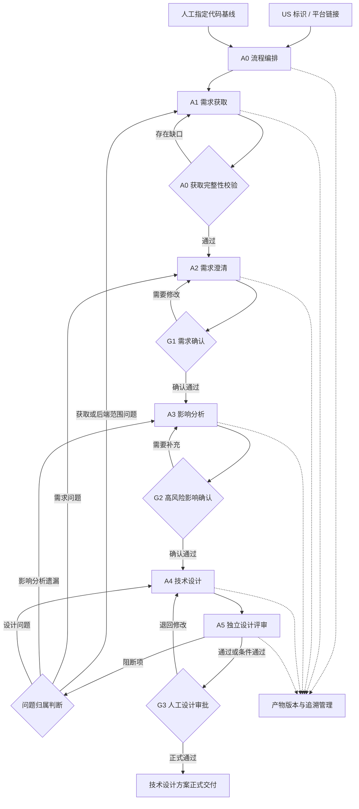
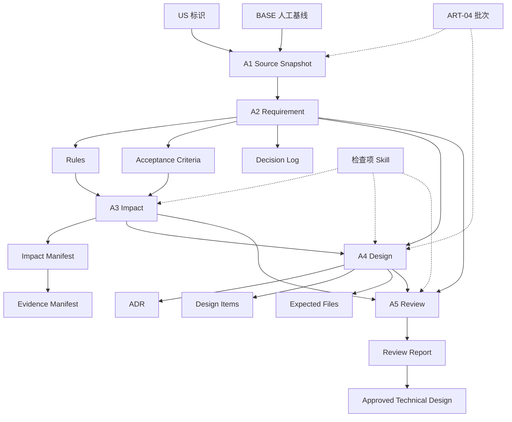

# 基于多 Agent 的存量 Spring Boot SaaS 系统需求分析与技术设计工作流

**文档版本：** V2.1

**建设范围：** US 获取 → 需求澄清 → 代码影响分析 → 技术方案设计 → 设计评审 → 技术方案正式交付

**V2.1 变更点：** 新增 A1 需求获取 Agent 与需求获取 Skill；分析基线改为人工维护、Agent 只做校验与登记；知识图谱改为通过 MCP 从公司统一知识库获取；项目特有检查项抽成独立 Skill（检查项来自在线文档）；新增多 US 并行与依赖管理；编排载体明确为 Claude Code Workflow。

---

# 1. 项目背景与建设目标

## 1.1 项目背景

当前系统是一个具有约 10 年历史的 Spring Boot SaaS 系统，长期迭代过程中积累了大量历史业务逻辑、技术封装、模块依赖、兼容性处理和特殊租户逻辑。

日常研发流程如下：

1. 产品经理提交已经过初步分析的 User Story（US）。
2. 研发人员理解需求，分析涉及的业务模块和代码。
3. 研发人员梳理代码影响范围、存量功能影响及潜在风险。
4. 输出详细技术设计方案。
5. 组织技术评审会议。
6. 评审通过后，将技术设计方案交接给其他开发人员实施。

目前上述工作高度依赖研发人员的个人经验，需要投入大量时间理解历史代码、梳理业务调用关系和分析潜在影响。

计划通过构建多 Agent 协作系统，将上述流程标准化、自动化。

## 1.2 建设目标

构建一套 AI Software Engineering Workflow，通过多个职责明确的 Agent 协同工作，实现：

- 自动从内部平台获取 US 原始内容（含前后端描述、附件、图片、外部参考资料）并过滤出后端实现范围。
- 自动理解产品 US。
- 结合业务规范和代码知识图谱补充需求上下文。
- 识别需求中的歧义、冲突和遗漏。
- 自动分析存量代码的修改范围及功能影响。
- 识别数据库、缓存、消息、API、权限及多租户风险。
- 自动生成符合项目技术规范的详细设计方案。
- 自动检查需求、影响分析和技术设计之间的一致性。
- 支持人工修改、确认、审批及断点重跑。
- 输出能够直接用于技术评审和后续开发交接的技术设计文档。

## 1.3 本期建设范围

| 阶段     | 内容                                 | 是否建设 |
| -------- | ------------------------------------ | -------- |
| A1       | 需求获取（平台拉取 + 后端范围过滤）  | 是       |
| A2       | 需求澄清                             | 是       |
| A3       | 代码影响分析                         | 是       |
| A4       | 技术方案设计                         | 是       |
| A5       | 设计评审                             | 是       |
| 人工审批 | 需求、影响、技术设计确认             | 是       |
| —        | 多 US 并行与依赖编排                 | 是       |
| A6       | 开发任务拆分                         | 暂不建设 |
| A7       | Coding Agent                         | 暂不建设 |
| A8       | Code Review Agent                    | 暂不建设 |
| A9       | Release Agent                        | 暂不建设 |

本期最终交付物为：

**经过需求确认、影响分析、技术设计及设计评审的正式技术设计方案。**

---

# 2. 整体架构设计

## 2.1 Agent 划分

系统采用"一个控制面 + 五个业务 Agent"的架构。A0 是控制面，不对应 LLM 子代理。

| 角色  | 名称                        | 核心职责                                                         |
| ----- | --------------------------- | ---------------------------------------------------------------- |
| A0    | Orchestrator（控制面，非 LLM） | workflow 编排、脚本校验、版本与状态维护、门禁停点、多 US 调度 |
| A1    | Requirement Collector Agent | 调用需求获取 Skill 拉取 US 原始内容，解析附件与图片，过滤后端范围 |
| A2    | Requirement Analyst Agent   | US 需求澄清、业务规则识别、验收标准生成                          |
| A3    | Impact Analyst Agent        | 代码触点识别、功能影响分析、风险分析                             |
| A4    | Technical Designer Agent    | 详细技术设计、技术决策、兼容与迁移方案                           |
| A5    | Design Reviewer Agent       | 独立审查需求覆盖、影响覆盖和技术设计质量                         |

五个业务 Agent 之间通过统一的产物协议交换信息，A0 负责校验这些产物。

A0 不直接承担业务分析和技术设计，也不派发为子代理：它由 workflow 定义、校验脚本和人工门禁共同实现，只负责组织执行过程并保证产物之间的一致性。

两点职责边界需要明确：

1. **A1 只做获取与过滤，不做需求解释。** 判断某段内容是前端还是后端属于信息归类，不产生新的业务规则；任何业务层面的补充仍由 A2 提出并经 G1 确认。
2. **A0 不建立代码基线。** 分支、commit、图谱版本由人工在批次启动时指定（见 4.3），A0 只负责校验、登记和失效判定。

## 2.2 整体工作流



说明：

1. 获取阶段不设独立人工门禁，由 A0 执行结构校验与覆盖校验（C13）；获取缺口在 G1 汇总中一并展示，涉及后端范围判断错误时直接回流 A1。
2. 多个 US 的并行与依赖编排见第 11 章，本节只描述单个 US 的主链路。

## 2.3 核心设计原则

### 原则一：事实与推断分离

Agent 必须明确区分：

- US 明确描述的事实。
- 项目规范中定义的规则。
- 当前代码中真实存在的行为。
- Agent 根据上下文推断出的内容。
- 尚未得到确认的假设。

代码现状不能自动成为产品需求。

### 原则二：所有结论必须有证据

每一个重要的需求规则、代码影响点、技术决策都应该能够追溯到来源。

证据来源包括：

- US 原文。
- 业务规范。
- 代码文件及符号。
- 代码知识图谱。
- Git 历史。
- 运行时调用记录。
- 人工确认记录。

### 原则三：Agent 不得擅自扩大需求范围

发现潜在业务遗漏时，可以提出问题，但不能直接将推断内容转化为已确认的需求。

### 原则四：设计与实现分离

A3 负责回答修改哪里、影响什么。

A4 负责回答应该如何修改。

A5 负责判断设计是否正确。

三个阶段不能混淆职责。

### 原则五：所有阶段均可追溯、可恢复

任何 Agent 产物都必须具有唯一 ID、版本号、输入依赖和生成记录。

### 原则六：原始需求快照不可变

A1 获取到的 US 原始内容（正文、附件、图片、外部链接）在获取时即固化快照并记录来源、时间与内容哈希。后续阶段只能读取快照，不得直接改写；US 在平台上被修改时生成新快照版本，并按依赖关系判定下游是否失效。

### 原则七：流程判定与语义判断分离

状态推进、门禁结论、一致性校验由编排脚本与校验器按结构化产物判定，不由 LLM 自行决定。LLM 只负责语义分析与产出结构化结果，"是否通过"永远由可复现的规则或人工决定。

### 原则八：可以采用流程图表示就采用流程图，不能使用文字描述

所有流程图都需要使用mermaid语法绘制，对于流程、结构等可以使用mermaid图的就使用

---

# 3. 基础设施与共享能力

在开发 A0～A5 之前，需要准备统一的基础能力。

## 3.1 代码知识图谱（MCP）

知识图谱由公司统一知识库提供，通过 MCP Server 暴露查询能力。本期不建设图谱本身，只约定调用契约。

### 3.1.1 接入方式

- Agent 通过 MCP 工具调用图谱服务，不直连图数据库，也不依赖图谱的内部存储结构。
- MCP 连接配置放在项目级或用户级配置中；凭据只存在于配置，不写入产物、日志和提示词。
- 后续图谱可能迁到项目内自建。迁移时只替换 MCP Server 的实现与连接配置，**工具名、入参、返回结构保持不变**，A3/A5 的调用方式不改。

### 3.1.2 查询能力

图谱 MCP 至少应提供以下查询工具：

| 查询能力               | 用途                     |
| ---------------------- | ------------------------ |
| entities_by_capability | 根据业务能力查找关联代码 |
| blast_radius           | 根据代码符号查询影响范围 |
| table_field_usages     | 查询表及字段的读写关系   |
| api_consumers          | 查询 API 调用方          |
| jobs_touching          | 查询关联 Job             |
| message_producers      | 查询消息生产者           |
| message_consumers      | 查询消息消费者           |
| config_references      | 查询配置项引用           |
| permission_references  | 查询权限点关联           |
| bean_dependencies      | 查询 Spring Bean 依赖    |
| cross_module_calls     | 查询跨模块调用关系       |
| tenant_context_paths   | 查询租户上下文传递关系   |

### 3.1.3 返回契约

每次查询结果必须提供结构化证据节点：

```yaml
evidence:
  node_id: graph-node-001
  node_type: method
  symbol: RefundService.refund
  file: module-order/RefundService.java
  relation: CALLS
  target: RefundRepository.save
  source: static_analysis
  confidence: high
  graph_version: graph-20261114-001
  commit: 8f3a9c2
```

禁止只返回一段自然语言描述而不提供证据节点。除证据节点外，返回体还必须包含：

- `graph_version`、`graph_commit`：本次查询使用的图谱版本与对应代码 commit。
- `retrieval_mode`：`graph` / `graph_export` / `static`。
- `truncated`：是否被分页或截断。截断时必须显式告知，不得静默返回部分结果。

### 3.1.4 版本与基线

- 基线中的 `graph_version`、`graph_commit` 由人工提供（见 4.3），A0 只登记与校验。
- 图谱 commit 允许落后于代码 commit，但落后范围必须由人工在基线中声明（例如不超过一个发布窗口）。
- 超出声明范围时，图谱结论只能作为线索，必须用静态检索复核；无法复核的结论标记为 `evidence_gap`。

### 3.1.5 降级策略

- MCP 不可达、超时或限流：按配置重试，仍失败则降级为静态检索（Grep/Glob/Read），并在产物中记录 `retrieval_mode: static` 与 `degraded_reason`。
- 降级不代表失败，但禁止在既无图谱、又未做静态检索的情况下给出"无影响"结论。

## 3.2 规范与知识库

知识库需要管理：

1. 业务需求规范。
2. 领域术语词典。
3. 业务规则文档。
4. 系统架构文档。
5. 数据库设计规范。
6. API 设计规范。
7. 消息设计规范。
8. 权限与多租户规范。
9. 开发规范。
10. 历史技术设计文档。
11. 历史架构决策记录。
12. 已知技术债务及兼容性约束。
13. 项目检查项清单（在线文档，由检查项 Skill 加载，不逐份入库）。

每份文档需要维护：

- 文档 ID。
- 版本。
- 有效状态。
- 生效时间。
- 适用模块。
- 来源。
- 是否已经废弃。

历史文档不能直接作为当前系统事实，必须结合代码基线判断有效性。

规范与代码现状冲突时，按以下顺序裁决，并在产物中记录裁决依据：

1. US 明确要求（仅在 G1 确认后生效）。
2. 当前有效规范。
3. 当前代码行为（只能作为现状事实，不能直接成为需求）。
4. 历史文档与历史决策（仅在代码尚未变化时参考）。

## 3.3 Skill 体系

Agent 的领域约束不写进提示词，而以 Skill 形式独立维护。本期涉及四类 Skill，统一遵循下面的契约。

### 3.3.1 通用契约

每个 Skill 必须声明：

- `skill_id`、版本号、来源（仓库 / 在线文档 / 平台接口）。
- 输入与输出的结构化定义。
- 依赖的外部系统与凭据要求。
- 失败模式与降级方式。
- 变更影响：哪些阶段需要重跑。

所有正式产物必须记录实际引用的 Skill 版本，并写入分析基线的 `skills` 字段。

### 3.3.2 需求获取 Skill

实现位置：`.claude/skills/etp-requirement-fetch/`。当前只有目录与占位说明，平台、鉴权、字段映射与解析逻辑后续实现。

本方案只约定 A1 依赖的最小输出，其余由 Skill 自行定义：

- 正文分块（文本 + 原文位置）。
- 附件与图片（引用 + 可读文本）。
- 外部参考资料（链接 + 摘要）。
- 来源元信息：`source_url`、`fetched_at`、`content_hash`。

输出不完整时，A1 登记缺口，不得用模型常识补全。

### 3.3.3 项目检查项 Skill

检查项清单由一个独立 Skill 从在线文档加载并解析，Agent 侧不硬编码。

本方案只约定消费方式：

- 每条检查项有唯一 ID 与适用阶段。
- A2～A5 每阶段只执行适用于本阶段的检查项，逐条给出 `pass` / `fail` / `not_applicable`。
- `not_applicable` 必须写理由，不允许留空。
- 检查项结论写入对应阶段产物，A0 校验覆盖完整性（C15）。

文档位置、格式、版本标识与缓存方式由 Skill 实现决定，不在本方案约束。

### 3.3.4 框架封装 Skill

框架封装 Skill 是 A4 的重要约束来源。

需要提供：

- Controller 标准写法。
- Service 分层规范。
- Repository/Mapper 规范。
- 统一异常处理。
- 统一返回结构。
- 数据库访问封装。
- 事务管理规范。
- 缓存使用规范。
- MQ 使用规范。
- 权限控制规范。
- 租户上下文规范。
- 日志及审计规范。
- 现有公共组件及 Helper 清单。

A4 必须记录实际引用的 Skill 版本。

### 3.3.5 领域分析 Skill

SaaS 专项基线（多租户、计费、存量兼容等）作为领域 Skill 维护，与项目检查项叠加使用：项目检查项处理本项目特有约束，领域 Skill 提供行业通用基线。两者的结论都进入检查项结论表，冲突时以项目检查项为准并记录冲突。

## 3.4 运行时证据

知识图谱主要反映静态代码关系，不能完全代表生产环境中的实际行为。例如：

1. 某个功能通过数据库配置动态启用。
2. 某个接口通过反射调用。
3. 某个 Job 由数据库配置决定是否执行。
4. 某个功能依赖租户级配置。
5. 某个业务分支通过 Spring Bean 条件装配。
6. 某个模块通过 MQ 订阅其他模块的事件。
7. 某些租户使用历史遗留的特殊配置。
8. 某个功能虽然代码存在，但已经没有实际调用。

建议提供可选的运行时证据查询能力：

| 数据来源     | 用途                   |
| ------------ | ---------------------- |
| API 访问记录 | 判断接口实际使用情况   |
| Trace 调用链 | 发现真实跨模块调用     |
| MQ 监控      | 识别实际消息订阅关系   |
| Job 执行记录 | 判断任务实际执行情况   |
| 配置中心     | 识别动态配置及租户差异 |
| SQL 访问记录 | 验证数据库读写路径     |

运行时证据不是每次都必须获取。

当需求涉及高风险业务链路、动态配置或无法通过静态分析确认的行为时，A3 应主动提出运行时证据查询。

没有数据时，必须标记为证据不足，不能推断为没有影响。

## 3.5 产物存储

编排载体是 Claude Code Workflow，因此产物的**唯一事实来源是文件系统 + Git**，数据库只做可选增强。

- Markdown：正式技术文档，供人阅读、评审和交接。
- JSON/YAML：结构化产物，供脚本校验与 Agent 之间传递。
- 文件系统：每个 US 一个目录，目录结构见第 16 章；状态以 `workflow-manifest.yaml` 为准。
- Git：正式产物版本管理，人工修改与版本递增通过提交留痕。
- 对象存储：原始需求附件、图片、大体积证据快照，产物中只保存哈希与引用。
- PostgreSQL（可选）：多 US 批次的看板与检索，不作为流程判定依据；与文件不一致时以文件为准。

Markdown 用于阅读，结构化数据用于机器校验。两者使用相同的 Artifact ID 与版本号。

## 3.6 运行载体：Claude Code Workflow

本期不单独实现编排服务，直接用 Claude Code 的 Workflow 能力驱动多个子代理。

### 3.6.1 角色映射

| 设计角色 | 实现载体 | 说明 |
| -------- | -------- | ---- |
| A0 | 主线程 + workflow 定义 + `/etp-awf-*` 命令 | 控制面，不派发为子代理；子代理也无法再派发 |
| A1～A5 | `.claude/agents/*.md` 子代理 | 一次派发对应一个阶段、一份产物 |
| Skill | `.claude/skills/*` | 子代理启动时按需读取 |
| 契约校验 | workflow 中的脚本步骤 | JSON Schema + 自定义断言，不交给 LLM |
| 图谱查询 | MCP 工具 | 见 3.1 |

与仓库当前实现（`.claude/agents/`）的对应关系：`etp-requirement-analyst`、`etp-impact-analyst`、`etp-technical-designer`、`etp-design-reviewer` 对应本设计的 A2～A5；A1 对应 `etp-requirement-collector`（已建占位实现）。各子代理 description 中的编号已按 A1～A5 同步。

### 3.6.2 编排方式

- 工作流以 DAG 定义：节点是阶段，边是产物依赖；每个节点固定为"读输入产物 → 执行 → 写输出产物 → 跑校验"。
- 子代理之间**不共享隐式上下文**，只通过产物文件传递。派发 prompt 必须列明输入文件路径、基线、允许写入的目录，禁止越界写其他阶段目录。
- 同一节点重复执行必须幂等：先读 manifest 中已有产物版本，已通过校验的不重复生成。

### 3.6.3 并行

- 同一批次内的多个 US 作为 DAG 的并行分支执行，隔离规则见第 11 章。
- 单 US 内部的 A1～A5 串行，不可并行，因为存在强产物依赖。
- 并行度设上限（默认 3），由人工在批次启动时调整；图谱 MCP 与获取 Skill 的限流需计入。

### 3.6.4 门禁停点

- G1、G2、G3 实现为 workflow 的显式中断点：输出摘要后停止，等待人工命令继续。
- 审批结论、审批人、时间写入 `workflow-manifest.yaml`；工作流不得自行判定门禁通过。

### 3.6.5 断点恢复

- 恢复时以 manifest 的 `current_stage` 与产物版本为准，从未完成的节点继续。
- 子代理本身无状态，恢复不依赖会话历史。

### 3.6.6 已知限制

- 子代理无持久记忆，所有上下文必须落盘，否则重跑结果不可复现。
- 并行分支的子代理互相不可见，跨 US 冲突只能由 A0 在汇总步骤检测。
- Workflow 不提供数据库事务，版本一致性依赖"先写新版本、再更新 manifest"的写入顺序。

---

# 4. A0：Orchestrator（控制面）

## 4.1 职责

A0 是整个工作流的控制中心，但**不是 LLM 子代理**，也不派发子代理。它由三部分共同实现：

- **workflow 定义**：阶段 DAG、并行分支、重试与门禁停点。
- **校验脚本**：C 规则、JSON Schema、版本一致性与 STALE 传播。
- **人工门禁**：G1/G2/G3 的决策与审批记录。

负责：

1. 接收 US 标识与**人工提供的分析基线**。
2. 校验基线（commit 可解析、图谱版本可查、Skill 版本存在），不合格则拒绝启动。
3. 选择执行模式。
4. 按 DAG 调度 A1～A5，管理多 US 的并行与依赖（见第 11 章）。
5. 管理阶段状态与门禁停点。
6. 维护产物版本及依赖关系。
7. 执行跨阶段一致性校验（C01～C16，由脚本判定）。
8. 管理人工审批及审批记录。
9. 管理 Agent 失败、重试和回流。
10. 识别人工修改及影响范围。
11. 组织最终交付物。

A0 明确**不负责**：

- 建立、切换或回退代码基线（由人工维护，见 4.3）。
- 编写需求、影响分析或技术设计结论。
- 判断设计质量或代替人工做门禁决策。

## 4.2 输入

```yaml
workflow_request:
  us_id: US-2026-001
  mode: final

  us_source:
    platform: internal-requirement-platform
    url: https://.../US-2026-001
    include_comments: true
    include_attachments: true

  # 人工提供，A0 只做校验、登记与冻结，不自行建立
  baseline:
    repository:
      name: legacy-saas
      branch: release/10.x
      commit: 8f3a9c2
    knowledge_graph:
      version: graph-20261114-001
      commit: 8f3a9c2
      lag_policy: 允许落后一个发布窗口
    documentation:
      version: docs-20261114-001
    skills:
      requirement_fetch: v0.1
      project_checklist: v1
      framework_skill: v3.2
    provided_by: human
    provided_at: 2026-11-14T20:00:00+08:00

  options:
    rerun_from: null
    existing_artifacts: []
    include_runtime_evidence: auto
    parallel_limit: 3
```

支持：

- 新建分析。
- 指定阶段重跑。
- 从指定产物版本继续执行。
- 人工修改后重新分析。
- 根据评审意见进行定向回流。

## 4.3 分析基线（人工维护）

分析基线由人工在批次启动时指定，**A0 不承担基线建立工作**，也不追踪分支漂移。

```yaml
analysis_baseline:
  baseline_id: BASE-001
  version: 1
  provided_by: human
  provided_at: 2026-11-14T20:00:00+08:00

  repository:
    name: legacy-saas
    branch: release/10.x
    commit: 8f3a9c2

  knowledge_graph:
    version: graph-20261114-001
    commit: 8f3a9c2
    lag_policy: 允许落后一个发布窗口

  documentation:
    version: docs-20261114-001

  skills:
    requirement_fetch: v0.1
    project_checklist: v1
    framework_skill: v3.2
```

A0 对基线只做四件事：

1. **登记**：写入 ART-01，并在 ART-00 中引用。
2. **校验**：commit 可解析、分支存在、图谱版本可查、所需 Skill 与检查项清单可取。任一项不满足则停在 `CREATED`，不得进入后续阶段。
3. **冻结**：同一批次内所有 Agent 只读取该基线，不得自行切换版本。
4. **失效判定**：人工更新基线后，按 12.4 的增量规则判定哪些产物标记 STALE。

约束：

- 基线只能由人工更新，每次更新生成新的 baseline 版本；A0 不得自动拉最新代码、切换分支或替换图谱版本。
- 同一批次的多个 US 可以共享同一基线，但必须在 ART-04 中登记；共享意味着任一 US 触发基线变更时，整批受影响。
- 分析期间代码库有新合入时，A0 只输出偏差报告（当前 HEAD 与基线 commit 的差异文件清单），是否重跑由人工决定。
- Skill 版本（含检查项清单）与代码 commit 同等重要，任何一项变化都可能使已完成阶段失效。

## 4.4 运行模式

| 模式  | 说明             | 约束                                 |
| ----- | ---------------- | ------------------------------------ |
| draft | 快速生成讨论稿   | 允许存在未确认假设                   |
| final | 正式技术设计流程 | 必须完成规定的人审和质量门禁         |
| batch | 多 US 并行批次   | 必须提供 ART-04 依赖与冲突登记       |

模式可以组合：`draft` / `final` 决定质量门禁强度，`batch` 决定调度方式。

draft 可以跳过人工审批，但不能跳过产物结构校验。

final 必须通过 G1、G2、A5 和 G3。

## 4.5 流程状态

```text
CREATED
BASELINE_CONFIRMED
A1_RUNNING
A2_RUNNING
WAITING_G1
A3_RUNNING
WAITING_G2
A4_RUNNING
A5_RUNNING
DESIGN_REVISION
WAITING_G3
WAITING_DEPENDENCY
COMPLETED
BLOCKED
```

状态说明：

- `BASELINE_CONFIRMED`：人工基线已提供且通过 A0 校验（取代原 `BASELINE_READY`，不再由 A0 建立基线）。
- `A1_RUNNING`：需求获取；结束时不进入人工门禁，直接由 C13/C14 判定是继续还是打回。
- `WAITING_DEPENDENCY`：多 US 批次中等待上游 US 产物（见第 11 章）。

状态由 workflow 节点状态与 `workflow-manifest.yaml` 共同维护，只能由编排脚本写入；子代理只写自己的产物，不得改写状态与门禁结论。

每个阶段还需要记录：

- 当前 Agent。
- 当前产物 ID。
- 当前产物版本。
- 输入依赖版本。
- 执行时间。
- 执行状态。
- 失败原因。
- 人工操作记录。

## 4.6 跨阶段一致性门禁

以下规则由校验脚本执行，不交给 LLM 判断；脚本无法判定时转人工确认并记录结论，不得默认通过。

| 规则 ID | 校验规则                                     |
| ------- | -------------------------------------------- |
| C01     | A2 所有 US 必须需求均有对应验收标准          |
| C02     | A2 推断规则不得未经确认进入最终需求          |
| C03     | A3 每个必改触点必须关联至少一条 A2 规则或 AC |
| C04     | A3 高风险触点必须完成 G2                     |
| C05     | A4 每个必改触点必须有对应设计说明            |
| C06     | A4 每个重要技术决策必须有决策记录            |
| C07     | A4 每个对外契约变更必须有兼容策略            |
| C08     | A5 不得存在未关闭的阻断项                    |
| C09     | 所有产物的输入版本必须一致                   |
| C10     | 人工修改的关键内容必须重新经过对应阶段确认   |
| C11     | 不允许存在无需求依据的设计变更               |
| C12     | final 产物必须使用有效的分析基线             |
| C13     | A1 每个内容块必须有归属，剔除项必须有理由    |
| C14     | A1 快照必须完整记录来源、时间与内容哈希      |
| C15     | 适用检查项必须逐条给出结论                   |
| C16     | 多 US 批次中重叠触点必须完成冲突登记         |

校验实现方式：

- 每条规则对应一段脚本断言，输入是结构化产物，输出是 `pass / fail / 无法判定` 与证据路径。
- 脚本只读产物、只写校验结果，不修改产物内容。
- 规则清单随实现放在 workflow 校验步骤中，与本表保持一一对应。

## 4.7 人工修改检测

所有 Agent 产物都需要进行版本管理。

修改检测不能只依赖文件 Hash，还应比较结构化产物的字段及章节差异。

修改分类：

| 修改类型     | 处理                   |
| ------------ | ---------------------- |
| 普通文字修改 | 记录修改，可继续执行   |
| 需求范围修改 | 返回 A2                |
| 业务规则修改 | 返回 A2，必要时重新 G1 |
| 影响触点修改 | 返回 A3                |
| 技术设计修改 | 返回 A4，并重新 A5     |
| 评审结论修改 | 重新执行相关审查       |
| 后端范围修改 | 返回 A1                |
| 代码基线变化 | 人工更新基线后判定失效 |
| 原始需求快照 | 只读，禁止改写         |

每次人工修改生成新的 Artifact Version，不覆盖旧版本。

如果人工修改导致下游产物依赖失效，A0 必须将其标记为 STALE。

## 4.8 输出产物

### ART-00：Workflow Manifest

记录整个 US 的工作流信息。

```yaml
workflow:
  id: WF-001
  us_id: US-2026-001
  mode: final
  status: WAITING_G1

  baseline_id: BASE-001

  artifacts:
    - A1-001:v1
    - A2-001:v1
    - A3-001:v0

  approvals:
    G1: pending
    G2: not_started
    G3: not_started

  current_stage: A2

  blocked_reasons: []
```

### ART-01：Analysis Baseline

记录人工提供的代码、知识图谱、规范文档、Skill 与检查项文档的版本。

### ART-02：Artifact Manifest

记录所有产物之间的版本依赖关系。

### ART-03：Workflow Report

记录每个阶段的执行情况、门禁结果、阻断原因及后续动作。

### ART-04：US Portfolio Manifest

多 US 批次时使用，登记批次内所有 US、依赖关系、冲突关系与排程。

```yaml
portfolio:
  id: BATCH-001
  baseline_id: BASE-001
  parallel_limit: 3

  us_nodes:
    - us_id: US-2026-001
      mode: final
      status: WAITING_G1
      depends_on: []
      conflicts_with: []
    - us_id: US-2026-002
      mode: final
      status: CREATED
      depends_on:
        - us_id: US-2026-001
          reason: 复用同一退款表结构
      conflicts_with:
        - us_id: US-2026-003
          scope: module-order/RefundService.java
```

---

# 5. A1：Requirement Collector Agent

## 5.1 目标

把内部平台上的 US 完整、可追溯地取回来，并明确"哪些内容属于后端实现范围"，为 A2 提供唯一的需求事实来源。

A1 只做三件事：

1. **获取完整**：正文、评论、附件、图片、外部参考资料。
2. **快照留痕**：内容不可变，来源、时间、哈希可回溯。
3. **范围过滤**：前端 / 后端 / 共用 / 非目标 四类归属，剔除项必须逐条有理由。

A1 不做：

- 不解读业务规则、不撰写验收标准（属 A2）。
- 不判断技术可行性、不推测实现方式（属 A3/A4）。
- 不因平台内容缺失而用模型常识补全。

## 5.2 输入

| 输入              | 说明                                             |
| ----------------- | ------------------------------------------------ |
| US 标识 / 链接    | 平台上的 US 编号或 URL                           |
| 需求获取 Skill    | `.claude/skills/etp-requirement-fetch/`（后续实现）    |
| 人工补充材料      | 平台无法获取的截图、会议结论、口头澄清（可选）   |
| Analysis Baseline | 本次分析基线，含 Skill 版本                      |

## 5.3 处理流程

### 步骤一：调用获取 Skill 拉取

按 Skill 契约取回：正文分块、附件、图片、外部链接、评论、验收标准、优先级、状态与更新时间。

Skill 返回内容不完整时，**不得用模型常识补全**，只能登记为缺口。

### 步骤二：固化快照

- 原始正文、附件、图片落盘；大文件存对象存储，产物中保存哈希与引用。
- 记录 `source_url`、`platform_updated_at`、`fetched_at`、`content_hash`。
- 快照生成后只读。平台内容后续变化时生成新快照版本，旧版本保留，并按依赖关系判定下游是否失效。

### 步骤三：内容归一与解析

- 还原章节层级，保留每块的原文位置（章节号或锚点）。
- 图片：做文字识别或内容描述，同时保留原图引用；识别失败登记缺口，不得猜测。
- 外部链接：抓取摘要与关键结论；需要登录或已失效时登记缺口。
- 表格：还原为结构化表格，保留行号，保证后续可回指原文。

### 步骤四：前后端归属判断

判断依据按优先级：

1. 平台自身的显式标注。
2. 章节标题（如"前端交互""接口设计""页面原型"）。
3. 术语与产物类型：页面、组件、样式、交互 → 前端；接口、表、Job、MQ、权限点、租户配置 → 后端。
4. 人工补充说明。

无法判断时标记 `unknown`，交 A2 与 G1 处理，**不得默认归入后端**。

### 步骤五：后端范围过滤

每个内容块输出四类归属之一：

| 归属          | 含义                                             | 后续处理             |
| ------------- | ------------------------------------------------ | -------------------- |
| `backend`     | 后端需要实现或调整                               | 进入 A2 输入         |
| `shared`      | 前后端共同约定（接口契约、字段语义、错误码）     | 进入 A2，标注为约束  |
| `frontend`    | 前端负责，仅作背景信息                           | 不进入需求规则       |
| `out_of_scope`| 明确不在本期范围                                 | 记录并说明依据       |

剔除项必须逐条登记：原文位置、归属类型、剔除理由。**禁止静默丢弃任何内容块**（C13）。

### 步骤六：缺口登记

以下情况进入 gaps：无法访问、解析失败、图片不可识别、链接失效、内容自相矛盾、关键信息缺失。

每条缺口记录：位置、类型、影响（是否影响后端范围判断）、建议处理方式（人工补充 / 降级处理 / 确认忽略）。

## 5.4 输出产物

### ART-10：Requirement Source Package

```yaml
requirement_source:
  id: A1-001
  version: 1
  us_id: US-2026-001
  baseline_id: BASE-001

  source:
    platform: internal-requirement-platform
    url: https://.../US-2026-001
    fetched_at: 2026-11-14T20:10:00+08:00
    platform_updated_at: 2026-11-12T09:30:00+08:00
    content_hash: sha256:9f2c...

  snapshot:
    ref: 01-source/raw.md
    assets:
      - id: ASSET-001
        path: 01-source/assets/image-01.png
        type: image
        parse_status: parsed
        text: 退款弹窗原型说明

  blocks:
    - id: BLK-001
      title: 退款金额校验
      location: "2.3"
      scope: backend
      reason: 描述接口校验逻辑
    - id: BLK-002
      title: 退款页交互
      location: "3.1"
      scope: frontend
      reason: 页面组件与交互态

  links:
    - url: https://.../refund-spec
      status: reachable
      summary: 财务退款口径说明

  backend_scope:
    block_ids:
      - BLK-001
    total_blocks: 24
    backend_blocks: 15

  gaps:
    - id: GAP-001
      block_id: BLK-008
      type: image_unreadable
      impact: 可能影响金额展示口径
      action: 人工补充截图
```

### ART-11：Backend Scope Report

供研发与产品快速核对的 Markdown 文档。

```markdown
# 需求获取与后端范围说明

## 1. 需求来源
## 2. 快照信息（来源、时间、哈希）
## 3. 内容结构与归属总览
## 4. 后端范围清单
## 5. 共用约定（接口/字段/错误码）
## 6. 前端范围（仅背景）
## 7. 剔除项与理由
## 8. 外部参考资料摘要
## 9. 附件与图片解析结果
## 10. 获取缺口与处理建议
```

## 5.5 失败与降级

| 情况                       | 处理                                                     |
| -------------------------- | -------------------------------------------------------- |
| 平台不可达 / 鉴权失败      | 停在 `A1_RUNNING`，置 `BLOCKED`，不得空跑后续阶段       |
| 部分附件下载失败           | 登记 gap，继续处理其余内容                               |
| 图片无法识别               | 登记 gap，保留原图，等待人工补充                         |
| 外部链接需登录或失效       | 登记 gap，记录链接与失败原因                             |
| 平台内容与人工提供的正文冲突 | 以平台快照为准，记录差异并要求人工确认                   |
| 分析期间平台内容变更       | 生成新快照版本，下游产物标记 STALE                       |

## 5.6 完成条件

- 每个内容块都有归属（`backend` / `shared` / `frontend` / `out_of_scope`）。
- 快照元信息完整（来源、抓取时间、内容哈希）。
- 所有缺口都有处理方式，且说明是否影响后端范围。
- 后端范围清单可直接作为 A2 的输入边界。

## 5.7 与 G1 的关系

获取阶段不设独立人工门禁，原因是一次 US 获取通常只需确认"取全了没有"，不需要业务裁决。处理方式：

- A0 执行 C13/C14 自动校验，不合格直接打回 A1。
- ART-11 作为 G1 的附件一并展示，研发或产品发现归属错误时，G1 直接判 REJECTED 并回流 A1 重新过滤。
- A1 重跑后，A2 及之后的产物按 12.4 的依赖规则失效。

---

# 6. A2：Requirement Analyst Agent

## 6.1 目标

将产品 US 转化为结构化、可追溯、可验收的需求澄清包。

A2 的核心目标不是重新编写 US，而是：

- 识别需求真实意图。
- 补充必要的业务上下文。
- 识别歧义和遗漏。
- 识别与现有业务规则的冲突。
- 区分目标行为与存量行为。
- 生成明确的验收标准。

A2 不得擅自将代码现状转化为已确认的业务需求。

A2 的输入边界是 A1 过滤后的后端范围；A2 负责解释"要做什么"，不负责重新切分前后端。

## 6.2 输入

| 输入              | 说明                                             |
| ----------------- | ------------------------------------------------ |
| ART-10            | 需求来源包（原始快照 + 内容归属）                |
| ART-11            | 后端范围说明（含剔除项与缺口）                   |
| 领域词典          | 业务术语解释                                     |
| 业务规范          | 已有业务规则                                     |
| 历史需求          | 相关历史 US（来自 ART-04 登记的历史批次）        |
| 代码知识图谱      | 业务能力及关联节点                               |
| 历史设计文档      | 相关历史设计决策                                 |
| Analysis Baseline | 本次分析基线                                     |

输入边界：

- A2 只处理 ART-10 中 `backend` 与 `shared` 归属的内容，`frontend` 仅作背景阅读，不得据此生成后端规则。
- A2 **不重新判断前后端归属**。发现归属错误时，输出 `scope_error` 并退回 A1，不得自行改判。
- ART-10 中的 gaps 必须逐条处理：能由业务侧澄清的转 open question，不能澄清的进入"假设与风险"，不得默认"没有这项需求"。

## 6.3 处理流程

### 步骤一：US 结构解析

提取：

- 业务目标。
- 需求背景。
- 用户角色。
- 适用业务场景。
- 主流程。
- 异常流程。
- 数据输入与输出。
- 状态变化。
- 权限要求。
- 非功能要求。
- 范围限制。

### 步骤二：需求完整性检查

检查：

- 是否存在模糊描述。
- 是否存在缺少前置条件的流程。
- 是否存在不可验证的要求。
- 是否存在业务状态不完整。
- 是否存在异常场景遗漏。
- 是否存在角色权限不明确。
- 是否存在数据边界不明确。
- 是否存在相互矛盾的规则。

重点识别以下表达：

- 参考原有功能。
- 按照之前的逻辑。
- 自动处理。
- 正常情况下。
- 适当调整。
- 支持相关配置。
- 保持原有兼容性。

这些表达必须结合具体业务上下文进行澄清。

### 步骤三：规范检查

检索相关业务规范，识别：

- US 与现行规范冲突。
- US 与历史决策冲突。
- US 缺少规范要求。
- US 使用了不一致的领域术语。

### 步骤四：图谱辅助补漏

通过知识图谱查找相关业务能力：

- 关联 API。
- 关联权限点。
- 关联业务状态。
- 关联 Job。
- 关联消息。
- 关联配置项。
- 关联数据库实体。
- 关联其他业务流程。

此处只负责发现潜在遗漏，不负责自动确认业务需求。

### 步骤五：区分事实与推断

所有业务规则必须标记来源。

定义以下类型：

| 类型          | 含义                     |
| ------------- | ------------------------ |
| explicit      | US 明确描述              |
| specification | 现行规范明确规定         |
| existing      | 当前代码中已经存在的行为 |
| inferred      | Agent 根据上下文推断     |
| unknown       | 当前无法确认             |

规则还需要记录：

- 置信度。
- 是否改变存量行为。
- 是否需要人工确认。
- 不处理可能造成的风险。

### 步骤六：现状与目标对比

明确：

- 当前系统行为。
- 本次需求目标行为。
- 本次保持不变的行为。
- 本次明确要改变的行为。
- 暂时无法确认的行为。

### 步骤七：生成验收标准

每条验收标准必须：

- 可以执行。
- 可以观察结果。
- 有明确前置条件。
- 有明确期望结果。
- 能关联业务规则。
- 能明确适用角色或租户范围。

## 6.4 输出产物

### ART-20：Requirement Clarification Package

A2 的正式结构化输出。

```yaml
requirement:
  id: A2-001
  version: 1
  us_id: US-2026-001
  baseline_id: BASE-001

  summary: 支持订单部分退款

  scope:
    in_scope: []
    out_of_scope: []

  roles: []

  rules:
    - id: R-001
      description: 部分退款金额不能超过剩余可退款金额
      source:
        type: explicit
        reference: US-2026-001
      confidence: high
      behavior_change: true
      confirmation_required: false
      decision_status: confirmed

    - id: R-002
      description: 部分退款时需要同步调整会员积分
      source:
        type: inferred
        reference: graph-node-123
      confidence: medium
      behavior_change: unknown
      confirmation_required: true
      decision_status: pending

  acceptance_criteria:
    - id: AC-001
      rule_ids:
        - R-001
      preconditions: 订单存在可退款金额
      steps: 执行部分退款
      expected: 退款成功且金额正确

  open_questions: []
  risks: []
```

### ART-21：Requirement Clarification Document

Markdown 文档，用于研发人员和产品经理阅读。

文档结构：

```markdown
# 需求澄清文档

## 1. 需求摘要

## 2. 需求范围
### 2.1 In Scope
### 2.2 Out of Scope

## 3. 角色与权限

## 4. 业务规则清单
### 4.1 已确认规则
### 4.2 存量行为
### 4.3 推断规则
### 4.4 待确认规则

## 5. 主流程与异常流程

## 6. 数据与状态

## 7. 非功能需求

## 8. SaaS 专项检查
### 8.1 多租户
### 8.2 默认配置与存量租户
### 8.3 计费与权益
### 8.4 审计日志
### 8.5 对外 API 与事件契约

## 9. 验收标准

## 10. 冲突与待裁决

## 11. Open Questions

## 12. 假设与风险
```

### ART-22：Requirement Decision Log

记录需求澄清过程中需要人工决定的问题。

```yaml
decisions:
  - id: DEC-001
    question: 部分退款是否需要按比例扣减会员积分
    source: R-002
    options:
      - 保持现有积分处理逻辑
      - 按退款比例扣减
      - 部分退款不处理积分
    recommended_option: 保持现有逻辑
    status: pending
    decided_by: null
    decision: null
    decided_at: null
```

## 6.5 人工门禁 G1：需求确认

G1 的目的：

确认 A2 输出的业务需求是否真实、完整、准确。

重点确认：

1. In Scope 和 Out of Scope。
2. 业务规则。
3. 存量行为是否发生变化。
4. 推断规则。
5. 验收标准。
6. Open Questions。
7. 重大业务风险。
8. 后端范围划分是否正确（对照 ART-11 的剔除项与缺口）。
9. 获取缺口是否已澄清或已明确接受。

G1 审批状态：

- APPROVED：通过。
- REJECTED：退回 A2。
- PARTIALLY_APPROVED：部分规则确认，其他规则继续待定。

对于无法确认的非核心问题，可以在最终方案中保留明确假设。

对于阻断核心流程、影响计费、权限或数据安全的问题，不允许进入 final 模式下的 A3。

## 6.6 完成条件

- 所有必须需求均有对应验收标准。
- 所有规则具有来源和分类。
- 不存在未经确认的推断需求。
- 业务范围明确。
- 关键 Open Questions 已处理。
- ART-10 的获取缺口已逐条处理或显式接受。
- 后端范围与 A1 的归属一致，无 `scope_error` 未关闭。
- G1 审批完成。

---

# 7. A3：Impact Analyst Agent

## 7.1 目标

根据已经确认的需求，分析存量系统需要修改的代码位置、影响的业务功能、潜在风险和测试方向。

A3 只负责分析，不负责提出详细实现方案。

核心回答：

1. 哪些代码必须修改？
2. 哪些代码可能需要修改？
3. 哪些现有功能会受到影响？
4. 哪些数据和外部契约可能受到影响？
5. 哪些历史行为需要保护？
6. 哪些影响目前缺少足够证据？

## 7.2 输入

| 输入         | 说明                                                   |
| ------------ | ------------------------------------------------------ |
| ART-20       | 结构化需求澄清包                                       |
| ART-22       | 已确认的需求决策                                       |
| ART-04       | 批次内其他 US 的依赖与冲突登记（单 US 时为空）         |
| 代码知识图谱 | 代码关系与业务映射（通过 MCP 查询，见 3.1）            |
| 仓库代码     | 基线版本的真实代码                                     |
| Git 历史     | 历史修改情况                                           |
| 运行时证据   | API、Trace、MQ、Job 等                                 |
| 项目规范     | 模块、分层及技术约束                                   |
| 检查项 Skill | 适用于 A3 的检查项（见 3.3.3）                         |
| 在途变更     | 人工提供的其他分支未合并变更清单                       |

说明：基线由人工固定，A3 不自行对比分支。需要判断在途变更时，由人工提供变更清单或分支列表；未提供时标记 `evidence_gap`，不得假设"没有其他改动"。

## 7.3 处理流程

### 步骤一：提取变更关注点

从 A2 提取：

- 业务实体。
- 业务规则。
- API。
- 状态。
- 数据字段。
- 配置项。
- 权限点。
- 消息事件。
- Job。
- 租户上下文。

生成本次分析的 Change Scope。

### 步骤二：知识图谱影响扩散

从关键业务节点开始进行图谱扩散。

分析：

- 直接调用方。
- 间接调用方。
- 关联 Service。
- 关联 Repository/Mapper。
- 数据库读写。
- 缓存引用。
- MQ 生产者与消费者。
- 定时任务。
- 配置引用。
- 权限引用。
- 跨模块调用。

扩散需要设置深度和边类型约束，避免无意义地遍历整个系统。

### 步骤三：静态代码验证

对图谱结果进行代码验证。

检查：

- 类和方法是否真实存在。
- 当前代码是否仍然与图谱一致。
- 是否存在反射调用。
- 是否存在 Spring Bean 动态装配。
- 是否存在动态 SQL。
- 是否存在配置驱动逻辑。
- 是否存在框架封装带来的隐式行为。

### 步骤四：运行时证据补充

对于以下场景主动查询运行时信息：

- 动态配置控制的功能。
- 反射调用。
- 跨服务异步链路。
- 特殊租户逻辑。
- 高风险数据写路径。
- 无法确认是否真实使用的接口。

没有运行时证据时，明确记录证据缺失。

### 步骤五：功能级 Blast Radius

将代码节点映射为产品功能。

例如：

| 代码节点           | 产品功能 | 影响说明 |
| ------------------ | -------- | -------- |
| RefundService      | 订单退款 | 直接影响 |
| MemberPointService | 会员积分 | 间接影响 |
| FinanceJob         | 财务对账 | 可能影响 |
| RefundController   | 退款 API | 直接影响 |

### 步骤六：数据与契约影响

检查：

- 数据库表及字段。
- 索引与约束。
- 缓存 Key。
- 缓存失效策略。
- MQ 消息。
- API 请求与响应。
- 配置项。
- 权限点。
- 租户上下文。
- 审计日志。

### 步骤七：存量行为与兼容性分析

识别：

- 默认配置变化。
- 老版本业务行为。
- 特殊租户定制逻辑。
- 历史状态处理。
- 老接口调用方。
- 历史数据依赖。
- 可能失效的兼容代码。

### 步骤八：风险分级

统一采用：

| 等级    | 含义                               |
| ------- | ---------------------------------- |
| BLOCKER | 存在明确的重大安全、数据或业务风险 |
| HIGH    | 高风险，需要研发确认               |
| MEDIUM  | 存在一定影响，需要在设计中处理     |
| LOW     | 影响范围较小                       |
| INFO    | 仅提供参考信息                     |

风险等级不能仅由 LLM 主观判断，应结合规则、影响范围和证据共同确定。

### 步骤九：冲突分析

两类冲突分别检查：

**批次内（读 ART-04）**

- 是否有其他 US 已声明冲突但未排程。
- 是否有其他 US 的触点与本 US 重叠但未登记。
- 上游依赖 US 的产物版本是否已变化。

**批次外（读人工提供的在途变更清单）**

- 是否有其他分支修改相同文件。
- 是否修改相同方法。
- 是否修改相同数据库表。
- 是否存在接口契约冲突。
- 是否存在其他 US 已经修改相同业务流程。

发现未登记的重叠时，A3 不自行调整排程，只输出 `CONFLICT` 项并回写 ART-04 建议，由 A0 与人工确认关系类型（见 11.5）。

本阶段的检查项（检查项 Skill 中适用 A3 的部分）必须逐条给结论，`not_applicable` 需说明理由，结论写入 ART-31。

## 7.4 证据类型

统一使用：

| 类型                  | 含义                     |
| --------------------- | ------------------------ |
| graph_proven          | 知识图谱关系证明         |
| static_analysis       | 静态代码分析证明         |
| runtime_proven        | 运行时行为证明           |
| configuration_proven  | 配置来源证明             |
| git_history           | Git 历史证明             |
| heuristic             | 根据代码或业务上下文推断 |
| needs_runtime_confirm | 需要运行时验证           |

每个影响点必须记录：

- 证据类型。
- 证据来源。
- 对应文件或图谱节点。
- 对应代码基线。
- 结论置信度。
- 是否需要人工确认。

## 7.5 输出产物

### ART-30：Impact Analysis Package

```yaml
impact_analysis:
  id: A3-001
  version: 1
  baseline_id: BASE-001
  requirement_ref: A2-001:v2

  summary:
    mandatory_changes: 3
    potential_changes: 2
    high_risks: 1

  impacts:
    - id: IMPACT-001
      rule_refs:
        - R-001
      acceptance_refs:
        - AC-001

      target:
        module: module-order
        file: RefundService.java
        symbol: RefundService.refund

      impact_type: mandatory
      evidence:
        - type: graph_proven
          reference: graph-node-001
        - type: static_analysis
          reference: RefundService.java:120

      affected_features:
        - 订单退款

      risk: high

      reason: 需要调整现有退款金额计算逻辑

      constraints:
        - 保持原有全额退款行为

      status: confirmed
```

### ART-31：Impact Analysis Document

```markdown
# 代码影响分析报告

## 1. 影响摘要

## 2. 功能级影响范围
### 2.1 直接影响功能
### 2.2 间接影响功能
### 2.3 潜在影响功能

## 3. 代码触点清单
### 3.1 必改项
### 3.2 可能修改项
### 3.3 只读依赖项

## 4. 数据影响
### 4.1 数据库
### 4.2 缓存
### 4.3 历史数据

## 5. 对外契约影响
### 5.1 API
### 5.2 MQ
### 5.3 配置
### 5.4 权限

## 6. SaaS 专项影响
### 6.1 多租户
### 6.2 特殊租户
### 6.3 默认配置
### 6.4 计费与权益
### 6.5 审计

## 7. 存量行为及兼容性风险

## 8. 在途变更冲突

## 9. 风险清单

## 10. 建议测试方向

## 11. 证据不足与待确认事项
```

### ART-32：Impact Evidence Manifest

独立保存影响分析的证据。

```yaml
evidence_manifest:
  impact_id: IMPACT-001
  baseline_id: BASE-001

  evidence:
    - id: EVIDENCE-001
      type: graph_proven
      source: graph-node-001
      description: RefundService 调用 RefundRepository

    - id: EVIDENCE-002
      type: static_analysis
      source: RefundService.java:120
      description: 当前退款金额计算逻辑
```

## 7.6 人工门禁 G2：高风险影响确认

G2 不是重新审查整个 A3 报告。

重点确认：

- 高风险数据写路径。
- 权限变更。
- 多租户隔离。
- 对外 API 契约。
- MQ 事件契约。
- 存量行为变更。
- 特殊租户影响。
- 无法通过静态分析确认的关键调用链。

研发可以：

- 确认影响结论。
- 修正影响范围。
- 补充遗漏触点。
- 要求 A3 进一步分析。
- 标记为暂时无法确认。

## 7.7 完成条件

- 所有必改项均关联 A2 规则或验收标准。
- 关键影响点有可验证证据。
- 所有高风险触点已经确认。
- 重要数据和契约影响已识别。
- 证据不足项已明确标记。
- G2 审批完成。

---

# 8. A4：Technical Designer Agent

## 8.1 目标

基于已确认的需求和影响分析，生成可以直接用于技术评审和后续开发交接的详细技术设计方案。

A4 必须遵循现有项目架构、分层规范和框架封装 Skill。

A4 不得随意重构无关代码，不得绕过已有公共封装。

## 8.2 输入

| 输入              | 说明          |
| ----------------- | ------------- |
| ART-20            | 需求澄清包    |
| ART-21            | 需求澄清文档  |
| ART-22            | 需求决策记录  |
| ART-30            | 影响分析包    |
| ART-31            | 影响分析报告  |
| ART-32            | 影响证据      |
| Framework Skill   | 项目技术封装  |
| 检查项 Skill      | 项目特有检查项（在线文档驱动，见 3.3.3） |
| 领域分析 Skill    | SaaS 专项基线（见 3.3.5） |
| ART-04            | 批次内依赖与冲突登记（单 US 时为空） |
| AGENTS.md         | 仓库开发规范  |
| Analysis Baseline | 分析基线      |

## 8.3 处理流程

### 步骤一：建立设计覆盖清单

提取所有 A3 必改触点。

生成 Design Coverage Matrix。

每个 IMPACT 必须对应一个或多个 DESIGN。

不允许出现没有设计归属的必改项。

### 步骤二：检索现有技术实现

根据 A3 的代码触点，进一步检索：

- 现有代码实现。
- 公共封装。
- 类似业务功能。
- 历史设计决策。
- 相关技术规范。
- 现有异常处理。
- 现有事务管理。
- 现有缓存和消息机制。

### 步骤三：确定技术方案

对关键设计问题提出候选方案。

例如：

- 修改现有接口还是新增接口？
- 同步处理还是异步处理？
- 扩展现有表还是新增表？
- 使用现有状态机还是扩展状态机？
- 采用数据库事务还是最终一致性？

对重要决策记录：

- 方案背景。
- 候选方案。
- 推荐方案。
- 选择理由。
- 影响。
- 代价。
- 风险。

### 步骤四：生成 ADR

对于重要架构和技术决策，生成 ADR。

```yaml
adr:
  id: ADR-001
  title: 部分退款采用现有退款服务扩展方案
  status: proposed

  context:
    - 现有系统已有退款处理流程
    - 本次需要支持部分退款

  options:
    - id: OPTION-001
      name: 扩展现有退款服务
      selected: true
      reason: 最大程度复用原有流程

    - id: OPTION-002
      name: 新建部分退款服务
      selected: false
      reason: 会增加重复业务逻辑

  consequences:
    - 需要调整金额计算逻辑
    - 需要保证原有全额退款兼容性

  references:
    - IMPACT-001
    - R-001
```

### 步骤五：设计关键业务流程

明确：

- 正常流程。
- 异常流程。
- 状态流转。
- 并发处理。
- 幂等处理。
- 事务边界。
- 超时与重试。
- 失败补偿。

### 步骤六：设计数据与契约

涉及数据库变更时，必须说明：

- 表结构。
- 字段定义。
- 类型。
- 默认值。
- 索引。
- 约束。
- 数据迁移。
- 历史数据兼容。
- 回滚可行性。

涉及 API 或 MQ 变更时，必须说明：

- 请求与响应。
- 字段兼容。
- 消费者兼容。
- 新旧版本共存。
- 是否需要灰度。

### 步骤七：执行检查项并设计 SaaS 安全与兼容性

先执行检查项 Skill 中适用于 A4 的检查项，再针对命中的项目展开设计。基线检查范围：

- 租户上下文。
- 数据隔离。
- 权限。
- 缓存租户维度。
- 异步消息租户上下文。
- 特殊租户逻辑。
- 默认配置。
- 存量数据。
- 计费及权益。

检查项结论（`pass` / `fail` / `not_applicable` + 依据）写入 ART-41 的检查项章节；`fail` 项必须在设计中给出处理方案或明确标注为残余风险。

### 步骤八：设计观测与故障处理

根据需求实际情况，设计：

- 日志。
- Trace。
- 指标。
- 审计记录。
- 异常告警。
- 业务监控。

不要求每个需求都增加所有观测项，但必须说明是否需要变化。

### 步骤九：发布与回滚设计

虽然本期不实现发布 Agent，但技术设计必须包含：

- 发布顺序。
- 配置变更。
- 数据迁移顺序。
- 灰度策略。
- 新旧版本兼容。
- 回滚方式。
- 数据回滚可行性。

### 步骤十：生成预期文件变更清单

根据 A3 触点和技术设计，给出预期修改文件。

注意：

此处是设计预期，不是实际代码修改结果。

## 8.4 输出产物

### ART-40：Technical Design Package

```yaml
technical_design:
  id: A4-001
  version: 1

  baseline_id: BASE-001

  requirement_ref: A2-001:v2
  impact_ref: A3-001:v2

  decisions:
    - ADR-001

  designs:
    - id: DESIGN-001
      impact_refs:
        - IMPACT-001
      description: 扩展退款金额计算逻辑
      status: proposed

  checklist:
    skill_version: v1
    results:
      - id: CHK-TENANT-01
        result: pass
      - id: CHK-BILL-03
        result: not_applicable
        reason: 不涉及计费规则

  cross_us:
    depends_on: []
    conflicts_with: []

  file_changes:
    - path: module-order/RefundService.java
      operation: modify
      impact_refs:
        - IMPACT-001
      design_refs:
        - DESIGN-001

  migration:
    required: false
    reason: 现有数据结构能够支持退款金额记录

  compatibility:
    required: true
    strategy: 保持原有全额退款行为

  observability:
    logging: required
    metrics: optional
    tracing: existing

  rollback:
    strategy: 回退应用版本
    data_rollback: not_required
```

### ART-41：Technical Design Document

正式技术设计文档。

```markdown
# 技术设计方案

## 1. 背景与目标
### 1.1 业务背景
### 1.2 本次目标
### 1.3 需求及规则引用

## 2. 方案概述
### 2.1 推荐方案
### 2.2 候选方案
### 2.3 方案对比
### 2.4 技术选型及取舍

## 3. 详细设计

### 3.1 模块与职责

### 3.2 核心业务流程
- 正常流程
- 异常流程
- 状态流转

### 3.3 核心代码设计
- 类与方法职责
- 调用关系
- 现有封装复用
- 关键逻辑说明

### 3.4 API 与事件契约
- API
- MQ
- 配置
- 权限

### 3.5 数据库设计
- 表结构
- 字段
- 索引
- 数据迁移

### 3.6 缓存设计
- Key
- TTL
- 更新策略
- 一致性

### 3.7 按 A3 触点的修改说明
- IMPACT 对应 DESIGN
- 修改原因
- 修改内容
- 关联规则

### 3.8 技术决策记录
- ADR

## 4. 非功能设计
### 4.1 性能
### 4.2 并发
### 4.3 幂等
### 4.4 超时与重试
### 4.5 高可用与降级

## 5. 安全与多租户
### 5.1 权限
### 5.2 租户隔离
### 5.3 特殊租户
### 5.4 数据安全

## 6. 可观测性
### 6.1 日志
### 6.2 指标
### 6.3 Trace
### 6.4 审计

## 7. 兼容、迁移与发布
### 7.1 存量行为兼容
### 7.2 数据迁移
### 7.3 发布顺序
### 7.4 灰度策略
### 7.5 回滚方案

## 8. 测试设计建议
### 8.1 单元测试
### 8.2 集成测试
### 8.3 回归测试
### 8.4 多租户测试
### 8.5 异常及边界测试

## 9. 风险与待确认事项

## 10. 预期代码修改清单

## 11. 需求与设计追溯矩阵
```

### ART-42：Architecture Decision Records

独立保存所有 ADR。

### ART-43：Design Coverage Matrix

确保需求和影响触点均有设计覆盖。

示例：

| 需求/影响 ID | 设计 ID    | 设计章节 | 覆盖状态 |
| ------------ | ---------- | -------- | -------- |
| R-001        | DESIGN-001 | 3.3      | Covered  |
| AC-001       | DESIGN-001 | 8.1      | Covered  |
| IMPACT-001   | DESIGN-001 | 3.7      | Covered  |

### ART-44：Expected File Change Manifest

记录预期修改文件。

| 文件               | 操作   | 关联 IMPACT | 关联 DESIGN | 原因         |
| ------------------ | ------ | ----------- | ----------- | ------------ |
| RefundService.java | MODIFY | IMPACT-001  | DESIGN-001  | 修改退款计算 |
| RefundMapper.java  | MODIFY | IMPACT-002  | DESIGN-002  | 修改数据查询 |

## 8.5 A4 硬性约束

1. 每个 A3 必改项必须有对应设计。
2. 每个重要技术决策必须记录 ADR。
3. 不允许无需求依据的设计变更。
4. 必须遵循现有框架 Skill。
5. 不允许绕过公共封装。
6. 对外契约变化必须说明兼容策略。
7. 有数据迁移时必须说明执行顺序和回滚。
8. 无迁移时必须说明原因。
9. 必须明确存量行为如何保持。
10. 必须明确预期修改文件。
11. 必须逐条回应适用于 A4 的检查项，`not_applicable` 需给理由。
12. 存在依赖或冲突的 US，设计中必须声明依赖的上游产物版本与冲突处理方式。

---

# 9. A5：Design Reviewer Agent

## 9.1 目标

A5 是独立的设计质量审查 Agent。

不是对 A4 进行主观评分，而是通过需求、影响证据、设计文档和项目规范进行对照审查。

A5 不应该完全依赖 A4 已经整理好的结论。

必须具备独立检索和验证能力。

## 9.2 输入

| 输入              | 说明             |
| ----------------- | ---------------- |
| ART-20            | 需求澄清包       |
| ART-22            | 需求决策记录     |
| ART-30            | 影响分析包       |
| ART-32            | 影响证据         |
| ART-40            | 技术设计包       |
| ART-41            | 技术设计文档     |
| ART-42            | ADR              |
| ART-43            | 设计覆盖矩阵     |
| ART-44            | 预期文件变更清单 |
| ART-04            | 批次依赖与冲突登记 |
| 检查项 Skill      | 全部检查项（独立复核执行情况） |
| 项目规范          | 当前有效规范     |
| 代码知识图谱      | 独立验证影响范围（通过 MCP 独立查询） |
| Analysis Baseline | 分析基线         |

## 9.3 审查流程

### 第一层：需求覆盖审查

检查：

- 每条业务规则是否得到设计支持。
- 每条 AC 是否有对应设计和测试建议。
- 是否存在需求遗漏。
- 是否擅自扩大需求范围。
- 是否将推断内容当作已确认需求。

### 第二层：影响分析覆盖审查

独立查询知识图谱，验证：

- 是否漏掉直接调用方。
- 是否漏掉间接调用方。
- 是否漏掉数据库读写方。
- 是否漏掉 MQ 消费者。
- 是否漏掉 Job。
- 是否漏掉权限及配置依赖。
- 是否漏掉特殊租户逻辑。

重点是发现 A3 没有识别的影响点。

### 第三层：技术设计正确性审查

检查：

- 是否符合现有系统架构。
- 是否正确复用现有封装。
- 是否存在重复造轮子。
- 是否存在不合理的事务边界。
- 是否存在幂等缺失。
- 是否存在并发风险。
- 是否存在异常处理遗漏。
- 是否存在不合理的复杂度。

### 第四层：数据及契约审查

检查：

- 数据库设计。
- 历史数据兼容。
- API 兼容。
- MQ 兼容。
- 缓存一致性。
- 数据迁移。
- 回滚可行性。

### 第五层：SaaS 专项审查

检查：

- 租户隔离。
- 权限控制。
- 特殊租户。
- 默认配置。
- 计费及权益。
- 审计日志。
- 跨租户风险。

### 第六层：发布与回滚审查

检查：

- 发布顺序。
- 新旧版本兼容。
- 灰度策略。
- 数据迁移顺序。
- 回滚可行性。
- 配置回滚。
- 数据不可逆操作。

### 第七层：设计合理性审查

检查：

- 是否为了简单需求引入复杂架构。
- 是否存在过度设计。
- 是否存在无关重构。
- 是否存在没有必要的新组件。
- 是否存在超出 US 范围的改动。

### 第八层：检查项与跨 US 一致性审查

检查：

- 适用于本阶段的检查项是否全部执行，是否有遗漏或虚假的 `not_applicable`。
- A4 结论为 `fail` 的检查项是否有对应处理方案或残余风险说明。
- 本 US 的预期文件变更是否与 ART-04 中其他 US 的变更冲突。
- 依赖的上游 US 产物版本是否与设计引用一致。
- 依赖或冲突未登记时，直接列为阻断项。

## 9.4 审查结论

| 结论             | 说明                                 |
| ---------------- | ------------------------------------ |
| PASS             | 没有阻断问题                         |
| CONDITIONAL_PASS | 存在非阻断条件，必须在正式通过前完成 |
| FAIL             | 存在阻断问题，必须修改               |

阻断问题必须明确：

- 问题描述。
- 问题证据。
- 违反的检查规则。
- 关联需求 ID。
- 关联影响 ID。
- 建议修正方式。
- 应回流到哪个 Agent。

## 9.5 输出产物

### ART-50：Design Review Report

```yaml
review:
  id: A5-001
  version: 1

  requirement_ref: A2-001:v2
  impact_ref: A3-001:v2
  design_ref: A4-001:v1

  conclusion: FAIL

  blocking_issues:
    - id: REVIEW-001
      category: compatibility
      description: 未说明原有全额退款逻辑如何保持兼容
      references:
        - R-001
        - IMPACT-001
        - DESIGN-001

      evidence:
        - RefundService.java

      recommendation: 补充新旧退款逻辑兼容设计

      return_to: A4
      status: open

  suggestions: []

  coverage:
    requirement_coverage: complete
    impact_coverage: incomplete
    design_coverage: incomplete

  checklist:
    skill_version: v1
    total: 18
    executed: 18
    failed_items: []
```

### ART-51：Design Review Document

```markdown
# 技术设计评审报告

## 1. 评审结论

## 2. 阻断问题
### REVIEW-001

## 3. 重要建议

## 4. 需求覆盖矩阵

## 5. 影响覆盖矩阵

## 6. 独立代码影响验证

## 7. SaaS 专项检查

## 8. 项目检查项执行复核

## 9. 跨 US 依赖与冲突检查

## 10. 技术方案合理性

## 11. 发布与回滚检查

## 12. 需要人工裁决的事项
```

### ART-52：Review Revision Instructions

A5 产生阻断问题时，输出机器可读的修订指令。

```yaml
revision:
  id: REV-001
  review_id: A5-001

  target_agent: A4

  issues:
    - review_id: REVIEW-001
      target_section: "7.1"
      instruction: 补充全额退款兼容策略
      required_evidence:
        - 现有退款处理代码
      expected_output:
        - 修改后的技术设计章节

  invalidated_artifacts:
    - A4-001:v1

  preserved_artifacts:
    - A2-001:v2
    - A3-001:v2
```

## 9.6 回流规则

| 问题类型       | 回流目标 |
| -------------- | -------- |
| 后端范围判断错误 | A1     |
| 获取内容缺失   | A1       |
| 需求理解错误   | A2       |
| 需求规则遗漏   | A2       |
| 影响范围遗漏   | A3       |
| 代码证据错误   | A3       |
| 技术方案不合理 | A4       |
| ADR 不合理     | A4       |
| 兼容性设计遗漏 | A4       |
| 设计范围过大   | A4       |

自动修订最多两轮。

超过两轮仍然无法通过，停止自动循环，输出争议报告并交由人工处理。

---

# 10. 人工审批门禁

整个工作流设置三个必要的人机门禁。

## G1：需求确认

| 项目     | 内容                                    |
| -------- | --------------------------------------- |
| 审批对象 | ART-11、ART-21、ART-22                  |
| 审批人   | 研发（必需）、产品经理（范围与验收标准） |
| 目的     | 确认业务规则、需求范围与后端范围划分    |
| 不通过   | 返回 A2；后端范围错误返回 A1            |

核心确认：

- 需求范围。
- 业务规则。
- 存量行为变化。
- 推断规则。
- 验收标准。
- 后端范围划分与剔除项（ART-11）。
- 获取缺口是否已接受。

## G2：高风险影响确认

| 项目     | 内容               |
| -------- | ------------------ |
| 审批对象 | ART-31、ART-32     |
| 审批人   | 研发负责人         |
| 目的     | 确认高风险代码影响 |
| 不通过   | 返回 A3            |

核心确认：

- 数据写路径。
- 权限。
- 多租户。
- 对外契约。
- 高风险调用链。
- 特殊租户。
- 证据不足项。

同一表、同一契约被多个 US 修改时，G2 合并评审（见 11.6）。

## G3：技术设计审批

| 项目     | 内容                         |
| -------- | ---------------------------- |
| 审批对象 | ART-41、ART-42、ART-51       |
| 审批人   | 技术负责人、架构师、相关研发 |
| 目的     | 正式确认技术设计             |
| 不通过   | 返回 A4 或指定阶段           |

G3 必须满足：

- A5 结论为 PASS，或者 CONDITIONAL_PASS 的条件已经落实并复核。
- 不存在未关闭的阻断问题。
- 所有需求规则都有对应设计。
- 所有必改触点都有设计说明。
- 重要技术决策已经确认。
- 发布及回滚方案完整。

G3 通过后，冻结本次技术设计版本，作为正式交付物。

## 审批记录

三个门禁的结论统一写入 `workflow-manifest.yaml`，并保留在 ART-03 中：

```yaml
approvals:
  G1:
    status: approved            # pending / approved / rejected / partially_approved
    approver: 研发负责人
    decided_at: 2026-11-15T10:00:00+08:00
    comment: 积分处理维持现状
    decided_items:              # 仅 partially_approved 时必填
      - ref: R-002
        decision: rejected
    rejected_to: null           # 非空时表示回流目标（A1/A2/A3/A4）
```

审批结论只由人工写入，工作流不得自动置为 approved。

---

# 11. 多 US 并行与依赖管理

多个 US 同时进入工作流时，不能简单地为每个 US 各跑一条流水线，否则会在同一张表、同一个接口或同一段代码上产出互相冲突的设计。本章定义两种关系下的编排方式。

## 11.1 三种关系

| 关系           | 含义                                                     | 典型场景                                     |
| -------------- | -------------------------------------------------------- | -------------------------------------------- |
| `depends_on`   | 上游 US 的产物是下游 US 的输入                           | 同一功能拆分、上游新增表/接口供下游使用      |
| `conflicts_with` | 互不依赖，但会改同一文件、表、接口、消息、配置或权限点 | 两个 US 都要改退款金额计算                   |
| `none`         | 无共享资源，可完全并行                                   | 不同模块、不同表、不同契约                   |

关系判定以**人工声明为主**（批次启动时登记到 ART-04），**A3 触点重叠探测为辅**。A3 发现未声明的重叠时，必须回写 ART-04 并提示人工确认关系类型，不得自行改变排程。

## 11.2 批次与隔离

- 一个批次 = 一份 ART-04 + 一份共享基线 + 多个 US 目录。
- 每个 US 目录独立，A1～A5 只读写自己目录；跨 US 只能读取上游**已冻结**的产物。
- 编号在 US 范围内唯一（R、AC、IMPACT、DESIGN 等），跨 US 引用必须带 US ID 前缀，例如 `US-2026-001/R-003`。

## 11.3 无依赖 US：并行执行

- 同一批次的无关 US 作为并行分支执行，默认并行度 3（`parallel_limit`），由人工调整。
- 共享同一基线：基线变更影响整批，A0 需在 ART-04 标记受影响的 US。
- 各 US 独立走 A1 → A5，互不等待、互不读取产物。
- 并行期不做跨 US 检查；在 A4 完成后由 A0 执行一次**跨 US 冲突扫描**（文件、表、API、MQ、配置、权限点），命中则转 11.5。

## 11.4 有依赖 US：分级并行

不是整条链都要串行，按阶段区分：

| 阶段 | 是否可并行 | 原因                                           |
| ---- | ---------- | ---------------------------------------------- |
| A1   | 可并行     | 获取只依赖平台，与上游无关                     |
| A2   | 可并行     | 需求澄清只依赖各自快照，上游结论未定时可先澄清 |
| A3   | 可并行     | 影响分析基于各自需求与同一代码基线             |
| A4   | 必须串行   | 下游设计必须读取上游的接口、表结构、契约产物   |
| A5   | 可并行     | 评审只读产物，不写设计                         |

补充规则：

- 上游产物发布新版本 → 下游 `depends_on` 边上的产物标记 STALE，由人工确认是否重跑。
- 上游 G1 结论变化必须通知下游 US，在 ART-04 中标记 `needs_review`。
- 下游不得假设上游未定稿的设计，未定稿内容只能标为假设并在设计中列明依赖。

## 11.5 冲突处理

| 冲突范围                                   | 处理                                             |
| ------------------------------------------ | ------------------------------------------------ |
| 同一文件的不同方法                         | 允许并行设计，A0 记录，合并时人工复核            |
| 同一方法、同一表结构、同一 API 契约        | 强制串行设计，后设计者必须读取前者设计           |
| 同一 MQ 事件、配置项、权限点               | 强制串行设计，并合并 G2                          |
| 冲突导致方案不可共存                       | 停止自动流程，输出冲突报告，人工裁决             |
| 设计期才发现共享资源（原判无关）           | 降级为依赖关系，重排批次，已完成的 A4 重新执行   |

## 11.6 门禁

- G1、G2 按 US 独立进行，不做批次合并。
- 同一表或同一契约被多个 US 修改时，**G2 必须合并评审**，一次覆盖所有相关 US，避免各自确认后互相推翻。
- G3 对存在依赖或冲突的 US 建议合并审批；若分开审批，后审批者必须读取先审批 US 的结论并在审批记录中声明。

## 11.7 批次完成条件

- 每个 US 满足单 US 的 DoD。
- ART-04 中的冲突全部关闭，依赖链上所有 US 完成，或显式声明不在本期交付。
- 批次级输出：合并后的交付目录、ART-04、批次汇总报告（含跨 US 冲突结论）。

## 11.8 在 Claude Code Workflow 中的实现

- 批次 = 父 DAG，每个 US = 一个子图；依赖边直接映射为 DAG 边，无关 US 映射为并行分支。
- 上游未完成时，下游停在 `WAITING_DEPENDENCY`，不占用并行槽位。
- 并行分支之间不共享会话上下文，跨 US 冲突只在 A0 的汇总步骤检测（见 3.6.6）。
- 并行度受 `parallel_limit` 与图谱 MCP、获取 Skill 的限流共同约束。

---

# 12. 统一产物管理与追溯体系

## 12.1 统一 ID 体系

| 前缀     | 含义           | 产生阶段     |
| -------- | -------------- | ------------ |
| WF       | 工作流         | A0           |
| BATCH    | US 批次        | A0           |
| BASE     | 分析基线       | 人工提供     |
| US       | User Story     | 输入         |
| SRC      | 需求来源快照   | A1           |
| BLK      | 需求内容块     | A1           |
| ASSET    | 附件/图片      | A1           |
| GAP      | 获取缺口       | A1           |
| R        | 业务规则       | A2           |
| AC       | 验收标准       | A2           |
| DEC      | 需求决策       | G1           |
| IMPACT   | 影响触点       | A3           |
| CONFLICT | 跨 US 冲突     | A3 / A0      |
| EVIDENCE | 分析证据       | A3           |
| ADR      | 技术决策       | A4           |
| DESIGN   | 设计项         | A4           |
| CHK      | 检查项结论     | A3 / A4 / A5 |
| REVIEW   | 评审问题       | A5           |
| REV      | 修订指令       | A5           |

所有 ID 在同一 US 范围内唯一；批次级 ID（BATCH、CONFLICT）在批次范围内唯一。跨 US 引用必须带 US 前缀。

## 12.2 产物版本协议

所有正式产物采用统一结构：

```yaml
artifact:
  id: A4-001
  type: technical_design
  version: 2

  generated_by: A4
  generated_at: 2026-11-14T21:00:00+08:00

  baseline_id: BASE-001

  dependencies:
    - artifact_id: A2-001
      version: 2
    - artifact_id: A3-001
      version: 2

  status: draft

  skills:
    requirement_fetch: v0.1
    project_checklist: v1
    framework_skill: v3.2

  modifications:
    - type: human_edit
      author: human
      affected_sections:
        - "3.2"
      reason: 补充事务边界

  review_status: pending
```

## 12.3 产物依赖关系



## 12.4 增量重跑规则

不能简单地从某个 Agent 开始重跑，然后保留所有旧产物。

需要根据产物依赖关系判断哪些产物失效。

| 修改对象      | 必须重新执行     | 需要重新验证 |
| ------------- | ---------------- | ------------ |
| US 快照变更   | A1、A2、A3、A4、A5 | G1、G2、G3 |
| 获取缺口补充  | 从 A1 起按依赖判断 | G1、G2、G3 |
| 检查项文档变更 | 按检查项适用阶段 | 相关门禁     |
| 上游 US 产物  | 下游 US 的 A4、A5 | G2、G3       |
| A2 业务规则   | A2、A3、A4、A5   | G1、G2、G3   |
| A2 纯文字描述 | 按依赖判断       | 相关阶段     |
| A3 影响触点   | A3、A4、A5       | G2、G3       |
| A3 证据补充   | A3、A5           | G2           |
| A4 技术设计   | A4、A5           | G3           |
| ADR 修改      | A4、A5           | G3           |
| A5 审查规则   | A5               | G3           |
| 代码基线变化（人工更新） | 根据差异影响判断 | 相关阶段 |

人工修改不应自动导致整个工作流重新执行。

应该采用依赖失效机制，只重跑受影响的阶段。

---

# 13. SaaS 存量系统专项检查规范

检查项不写死在提示词里，统一由**项目检查项 Skill** 从在线文档加载（见 3.3.3），本条只提供 SaaS 领域的基线清单。实际执行以 Skill 返回的最新版本为准；两者冲突时以项目检查项为准。

执行要求贯穿 A2～A5：

- 每阶段只执行适用于本阶段的检查项，逐条给 `pass` / `fail` / `not_applicable`。
- `not_applicable` 必须给理由。
- 结论进入对应阶段产物，A5 独立复核执行情况。

## 13.1 多租户隔离

- 是否存在跨租户数据可见风险？
- 是否正确传递 Tenant Context？
- SQL 是否包含正确的租户条件？
- 缓存 Key 是否区分租户？
- MQ 是否携带租户信息？
- 异步任务是否正确恢复租户上下文？

## 13.2 存量行为兼容

- 是否修改现有默认行为？
- 是否改变历史状态流转？
- 是否影响历史接口调用方？
- 是否破坏特殊租户逻辑？
- 是否存在老版本数据兼容问题？
- 是否需要保留旧逻辑？

## 13.3 数据库

- 是否修改表结构？
- 是否需要数据迁移？
- 是否涉及大表 DDL？
- 是否影响索引？
- 是否需要数据回填？
- 是否支持新旧版本共存？

## 13.4 权限与安全

- 是否新增或修改权限点？
- 是否改变已有角色权限？
- 是否存在越权访问？
- 是否影响后台管理权限？
- 是否影响数据导出及下载？

## 13.5 计费与权益

- 是否影响计费逻辑？
- 是否改变权益计算？
- 是否影响套餐限制？
- 是否影响历史账单？

## 13.6 消息与异步任务

- 是否改变消息契约？
- 是否存在重复消费？
- 是否存在消息丢失？
- 是否影响任务幂等？
- 是否影响历史消息消费？

## 13.7 边界与依赖

- 是否新增或修改对前端暴露的字段语义？
- 是否改变前后端共用约定的错误码？
- 是否影响外部系统的调用或回调？
- 是否引入新的第三方依赖？

## 13.8 可观测性

- 是否需要增加业务日志？
- 是否需要新增指标？
- 是否需要补充 Trace？
- 是否需要审计日志？
- 是否需要告警？

## 13.9 检查项维护

- 清单由业务或架构负责人在线文档中维护，Agent 侧不改代码。
- 新增检查项需声明适用阶段与严重级别；废弃检查项保留历史 ID，避免已完成分析无法解释。
- 检查项清单不可用时，A0 置 `BLOCKED`，不得跳过检查直接推进。

## 13.10 结论留痕

每条检查项结论必须包含：检查项 ID、结果（`pass` / `fail` / `not_applicable`）、依据（代码位置 / 图谱节点 / 设计章节）、执行阶段。汇总为检查项结论表，随阶段产物输出，A5 独立复核是否漏项或误判。

---

# 14. 运行模式与质量标准

## 14.1 Draft 模式

用途：快速分析、内部讨论、设计探索。

允许：

- 未确认业务假设。
- 未验证的运行时影响。
- 部分技术方案待定。
- A5 发现的问题暂时未修复。

但是必须明确标记：

- DRAFT。
- UNCONFIRMED。
- NEEDS_REVIEW。
- NEEDS_RUNTIME_CONFIRM。

Draft 产物禁止作为正式开发交接依据。

## 14.2 Final 模式

用途：正式技术设计与上会审批。

必须：

1. 人工提供分析基线，并通过 A0 校验（不满足则不允许进入 final）。
2. 完成 A1 需求获取，获取缺口已处理（C13/C14 通过）。
3. 完成 A2 需求澄清。
4. 完成 G1。
5. 完成 A3 影响分析。
6. 完成 G2。
7. 完成 A4 技术设计。
8. 完成 A5 评审。
9. 完成 G3。
10. 冻结正式产物版本。

多 US 批次还必须在 G3 前关闭 ART-04 中的全部冲突（见 11.7）。

## 14.3 最终质量标准（DoD）

| 检查项     | 通过条件                      |
| ---------- | ----------------------------- |
| 需求获取   | 所有内容块有归属、缺口已处理  |
| 需求完整性 | 所有必须需求均有验收标准      |
| 需求准确性 | 推断内容均有明确确认状态      |
| 需求追溯   | 规则和验收项均有来源          |
| 影响完整性 | 所有必改触点均有证据          |
| 风险管理   | 高风险项均已处理或明确接受    |
| 设计完整性 | 所有必改触点均有对应设计      |
| 技术决策   | 重要 ADR 已记录               |
| 兼容性     | 存量行为及契约兼容策略完整    |
| 数据设计   | 迁移与回滚方案明确            |
| SaaS 安全  | 多租户和权限检查完成          |
| 评审       | A5 无未关闭阻断项             |
| 人工审批   | G1、G2、G3 完成               |
| 检查项覆盖 | 适用检查项全部给出结论        |
| 跨 US 一致 | 批次冲突关闭、依赖已满足      |
| 版本一致性 | 所有产物基于有效分析基线      |
| 可追溯性   | US 到规则、影响、设计均可追溯 |

---

# 15. 失败与降级处理

| 异常情况             | 处理策略                       |
| -------------------- | ------------------------------ |
| 知识图谱无结果       | 扩大静态检索，标记证据不足     |
| 图谱与代码版本不一致 | 禁止 final，重新校验或更新图谱 |
| US 与规范冲突        | A2 输出待裁决事项              |
| US 存在关键歧义      | G1 阻断                        |
| 高风险触点缺少证据   | G2 强制人工确认                |
| 运行时数据不可用     | 标记 NEEDS_RUNTIME_CONFIRM     |
| 在途变更冲突         | A3 输出冲突报告                |
| A4 无法复用现有封装  | 输出设计偏差及原因，交人工确认 |
| A5 发现影响分析遗漏  | 返回 A3                        |
| A5 连续两轮不通过    | 停止自动循环，转人工           |
| 人工修改上游产物     | 根据依赖关系使下游产物失效     |
| 代码基线发生变化     | 检查触点差异并定向重跑         |
| Agent 执行失败       | 保留已有产物，支持断点恢复     |
| 获取平台不可达/鉴权失败 | 停在 A1，置 BLOCKED，不得空跑后续阶段 |
| 附件或图片无法解析   | 登记 gap 后继续；影响后端判断时不得进入 A2 |
| 外部链接失效或需登录 | 登记 gap，人工补充或明确忽略   |
| 图谱 MCP 不可用      | 降级静态检索，标记 retrieval_mode=static |
| 检查项清单不可用     | A0 置 BLOCKED，不得跳过检查 |
| 多 US 触点冲突       | 按 11.5 串行化或交人工裁决     |
| 上游 US 产物变更     | 下游标 STALE，人工确认重跑     |

---

# 16. 本期最终交付物清单

整个工作流结束后，应形成以下完整交付包。

| 编号   | 产物                               | 产生者 | 用途           |
| ------ | ---------------------------------- | ------ | -------------- |
| ART-00 | Workflow Manifest                  | A0     | 流程状态       |
| ART-01 | Analysis Baseline                  | A0     | 分析版本基线   |
| ART-02 | Artifact Manifest                  | A0     | 产物版本及依赖 |
| ART-03 | Workflow Report                    | A0     | 执行记录       |
| ART-04 | US Portfolio Manifest              | A0     | 多 US 依赖排程 |
| ART-10 | Requirement Source Package          | A1     | 原始需求快照   |
| ART-11 | Backend Scope Report               | A1     | 后端范围说明   |
| ART-20 | Requirement Clarification Package  | A2     | 结构化需求     |
| ART-21 | Requirement Clarification Document | A2     | 需求澄清文档   |
| ART-22 | Requirement Decision Log           | A2/G1  | 需求决策       |
| ART-30 | Impact Analysis Package            | A3     | 结构化影响分析 |
| ART-31 | Impact Analysis Document           | A3     | 影响分析报告   |
| ART-32 | Impact Evidence Manifest           | A3     | 影响证据       |
| ART-40 | Technical Design Package           | A4     | 结构化技术设计 |
| ART-41 | Technical Design Document          | A4     | 正式技术设计   |
| ART-42 | Architecture Decision Records      | A4     | 技术决策       |
| ART-43 | Design Coverage Matrix             | A4     | 需求及影响覆盖 |
| ART-44 | Expected File Change Manifest      | A4     | 预期修改文件   |
| ART-50 | Design Review Report               | A5     | 结构化审查结果 |
| ART-51 | Design Review Document             | A5     | 设计评审报告   |
| ART-52 | Review Revision Instructions       | A5     | 设计修订指令   |

最终正式交付包：

```text
docs/awf/
├── portfolio.yaml                  # ART-04，单 US 时可省略
└── US-2026-001/
    ├── 00-workflow/
    │   ├── workflow-manifest.yaml
    │   ├── analysis-baseline.yaml
    │   ├── artifact-manifest.yaml
    │   └── workflow-report.md
    │
    ├── 01-source/
    │   ├── source-package.yaml     # ART-10
    │   ├── backend-scope.md        # ART-11
    │   ├── raw.md                  # 原始正文快照
    │   └── assets/                 # 图片与附件（大文件引用对象存储）
    │
    ├── 02-requirement/
    │   ├── requirement-package.yaml
    │   ├── requirement-clarification.md
    │   └── decision-log.yaml
    │
    ├── 03-impact/
    │   ├── impact-package.yaml
    │   ├── impact-analysis.md
    │   └── evidence-manifest.yaml
    │
    ├── 04-design/
    │   ├── technical-design-package.yaml
    │   ├── technical-design.md
    │   ├── adrs/
    │   ├── design-coverage.yaml
    │   └── expected-file-changes.yaml
    │
    └── 05-review/
        ├── review-report.yaml
        ├── review-report.md
        └── revision-history/
```

目录编号与产物归属保持一致：`01-source` 由 A1 产出，`02-requirement` 由 A2 产出，依此类推。

---

# 17. 建设优先级

建议按照以下顺序实施。

## 第一阶段：跑通单 US 主链路

- Claude Code Workflow 编排骨架（DAG、门禁停点、断点恢复）。
- A0 状态机与人工基线的接收、校验、登记。
- 产物 ID、版本协议与 JSON Schema 校验。
- 需求获取 Skill 的接口契约（平台对接可先用人工上传替代）。
- A1 获取、快照与后端范围过滤。
- 人工修改检测与增量重跑机制。

## 第二阶段：需求到影响分析

- A2 需求澄清。
- G1 需求确认。
- 代码图谱 MCP 接入（含降级为静态检索）。
- A3 影响分析与证据链。
- G2 高风险确认。
- 运行时证据查询（可选）。

## 第三阶段：技术设计与评审

- A4 技术设计。
- ADR 与设计覆盖矩阵。
- 项目检查项 Skill（在线文档加载 + 版本快照）。
- A5 独立审查与检查项复核。
- 评审回流与 G3 人工审批。

## 第四阶段：多 US 并行

- ART-04 批次登记与依赖声明。
- 并行调度与 WAITING_DEPENDENCY。
- 跨 US 冲突扫描与合并评审。
- 批次级交付与汇总报告。

## 第五阶段：质量优化

- 历史设计知识库。
- 特殊租户知识库。
- 历史兼容性规则。
- Agent 质量评估（漏报率、误报率、人工修改率）。
- 历史 US 回归测试。

---

# 18. 最终设计原则

本系统需要始终坚持以下原则：

**1. 需求真实性优先**：Agent 可以发现遗漏，但不能擅自决定业务需求。

**2. 代码证据优先于模型推断**：所有重要影响结论都必须具备证据，证据不足必须明确标记。

**3. 存量行为保护优先**：不能因为实现新需求而无意破坏已有业务行为。

**4. 设计决策必须可解释**：重要技术方案必须有明确的选择依据、备选方案及影响。

**5. 审查必须具备独立性**：A5 不能仅依赖 A2、A3、A4 已经生成的结论。

**6. 人工审批拥有最终决策权**：需求、重大影响和正式技术设计均由对应负责人确认。

**7. 全流程必须可追溯**：任何一项设计都应该能够追溯到需求规则、代码证据和技术决策。

**8. 自动化不等于无门禁**：Agent 可以自动完成分析和设计，但不能自行突破业务和技术审批边界。

**9. 原始需求不可篡改**：所有分析都基于不可变快照，任何"记不清原文"的判断都视为无效。

**10. 流程判定可复现**：同一份产物、同一套规则，任何一次校验都应得到相同结论，不依赖模型当时的判断。

**11. 并行必须隔离**：多个 US 同时分析时，隔离优先于效率，冲突必须显式暴露而不是隐式覆盖。


# 19. 后续优化点：

这三个问题建议在真正开始开发之前确定，否则后续容易返工。

**Markdown 和 YAML 必须采用双产物模式**

不建议让 Agent 只输出 Markdown，原因是 A0 需要执行大量机器校验，例如：

- 每条 AC 是否有对应设计。
- 每个 IMPACT 是否有对应 DESIGN。
- 每个 ADR 是否有引用来源。
- 每个高风险项是否完成审批。
  这些工作不适合通过正则表达式解析 Markdown。

建议：
格式|	定位
---|---
YAML/JSON	|Agent 之间传递数据、机器校验
Markdown	|人员阅读、评审、交接


两个产物必须具有相同的 Artifact ID 和版本。


**不要让所有 Agent 自由检索整个知识库**
建议 A0 负责上下文装配，Agent 根据自身职责获取必要的补充证据。

例如：

- A1 只读取需求获取 Skill 与 US 标识，不需要业务规范。
- A2 主要获得后端范围、业务规范、领域词典、相关业务规则。
- A3 主要获得代码图谱、源码、Git 历史、运行时证据、ART-04。
- A4 主要获得需求、影响分析、框架 Skill、检查项 Skill。
- A5 获得全部正式产物，以及独立检索能力。
  这样可以减少无关上下文，也可以避免不同 Agent 因为检索到不同版本的文档而产生矛盾。

**A5 必须保留独立检索预算**
这是整个方案的一个关键点。

A5 不能只是把 A2～A4 的文档交给另一个 LLM，然后问它有没有问题。

它应该至少独立验证：

- A3 的关键调用链。
- 高风险数据读写路径。
- 对外 API 和 MQ 契约。
- A4 的关键代码修改依据。
- 是否存在没有需求依据的额外改动。
  否则多个 Agent 很容易形成共同盲区。