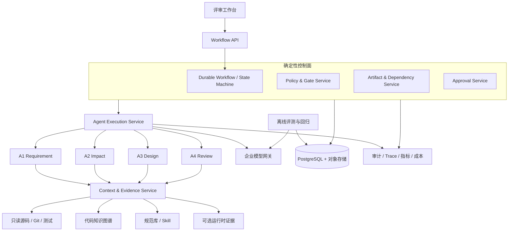
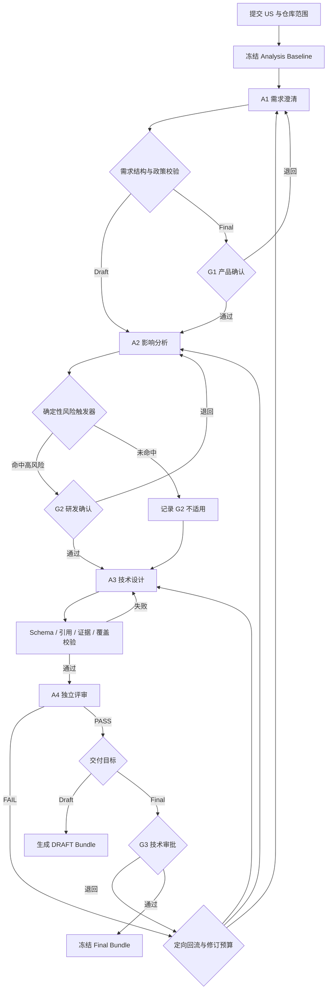

# 基于受控工作流与专业 Agent 的存量 Spring Boot SaaS 技术设计系统

**文档版本：** V3.0（优化版）  
**文档性质：** 建设方案与 MVP 落地基线  
**建设范围：** US 输入 → 需求澄清 → 影响分析 → 技术设计 → 独立评审 → 人工审批 → 正式交付  
**重要边界：** 系统辅助研发形成证据充分、可追溯的技术方案，不承诺自动证明影响分析完备，也不替代产品与技术负责人的决策。

---

## 0. 对 V2 的评审结论与核心修订

V2 对需求、影响、设计、评审的职责拆分较清晰，事实与推断分离、证据追溯、人工门禁、版本基线等原则应保留。主要问题不在 Agent 数量，而在**控制面职责、证据语义、审批一致性、安全治理和可验证落地**。

### 0.1 主要问题

| 优先级 | V2 问题 | 可能后果 | V3 修订 |
|---|---|---|---|
| P0 | 将状态管理、版本判断、门禁和一致性检查都交给“A0 Agent”，未区分确定性程序与 LLM | 状态迁移和审批结果可能不稳定、不可复现 | A0 改为确定性 Workflow/Policy 服务；LLM 只负责内容任务 |
| P0 | 默认“代码知识图谱已经建设完成”，但没有覆盖率、新鲜度、查询完整性和降级验收 | 把图谱漏边误当成无影响，项目前提不成立 | 增加图谱就绪检查；源码为当前事实依据，图谱只提供候选关系 |
| P0 | YAML 与 Markdown 双产物均可修改，只要求 ID 和版本相同 | 双源漂移，审批对象与实际交付内容可能不同 | 结构化 JSON 为唯一事实源，Markdown 为不可独立编辑的渲染视图 |
| P0 | Draft/Final、部分批准、未确认假设、CONDITIONAL_PASS 的规则存在冲突 | 未决事项可能以正式方案形式流出 | 分离“生成模式”和“交付状态”；final 采用统一、显式的阻断与例外策略 |
| P0 | 审批未强制绑定不可变内容哈希；“普通文字修改可继续”可能绕过 G3 | 审批后换文，审计链失效 | 审批绑定 artifact revision + hash；正式内容任何语义修改均重新审批 |
| P0 | 缺少代码外发、模型供应商、生产运行数据、Prompt Injection、工具权限和审计设计 | 源码或租户数据泄露，仓库文本诱导 Agent 越权 | 增加模型网关、最小权限、内容不可信、脱敏、网络边界和安全审计 |
| P0 | 质量评估放在最后，且没有金标集、业务基线和试点退出标准 | 无法判断系统是否优于人工或更简单方案 | 评测前置到 P0，与人工基线及单 Agent 基线比较 |
| P1 | A2 在设计前宣告“必改代码”，职责仍有重叠 | 把一种实现路径误当成唯一事实 | A2 输出候选修改点、行为依赖和影响面；A3 决定实际修改与不改理由 |
| P1 | “每个重要结论有证据”被隐含扩展成“可以证明没有遗漏” | 形成虚假的安全感 | 记录检索覆盖、未覆盖区域和残余风险；禁止无依据的“无影响” |
| P1 | 证据类型混入 `needs_runtime_confirm`，路径和行号没有内容快照 | 证据状态与来源混淆，代码变化后无法复核 | 分离 source kind、verification status、locator、content hash 和适用范围 |
| P1 | C09 要求“所有产物输入版本一致”，与增量重跑和 DAG 依赖不兼容 | 合法版本组合被误判，或真正的失效依赖未识别 | 校验精确依赖哈希及 STALE 传播，不要求所有产物版本号相同 |
| P1 | 状态机缺少取消、等待输入、重试中、并发修改、幂等和超时语义 | 断点恢复后重复执行，人工编辑与 Agent 回写冲突 | 增加持久化执行、幂等键、乐观锁、取消和分阶段状态 |
| P1 | G1 仅由研发审批业务需求，G2 对所有场景一刀切 | 产品责任缺位，简单需求审批成本过高 | G1 产品负责；G2 按风险触发；G3 技术负责人负责 |
| P1 | A4 的“独立性”仅来自另一个 Agent，缺少确定性校验与相关性误差控制 | 同样的检索遗漏和模型偏差被重复放大 | 确定性校验器 + 独立工具回查 + 风险导向审查；不宣称自动证明正确 |
| P1 | 建设顺序先做大而全控制面、运行时证据和在途变更，再验证价值 | 初期投入过重，失败成本高 | 以少量模块和历史 US 做纵切试点，逐项开放能力 |

### 0.2 保留的设计

- A1～A4 的内容职责边界。
- US、规则、验收标准、影响、设计、评审之间的追溯链。
- 代码、文档、Skill、模型与提示词的版本可追溯。
- 高风险变更的人审门禁。
- 对存量行为、多租户、权限、数据、契约、发布和回滚的专项检查。
- 自动修订有预算上限，超出后转人工。

---

## 1. 建设目标、范围与成功标准

### 1.1 建设目标

1. 将 US 转化为范围明确、来源清晰、可验收的需求澄清包。
2. 基于源码、图谱和可选运行时证据，给出可复核的候选影响范围及覆盖边界。
3. 生成符合现有架构、框架封装和 SaaS 约束的详细技术设计。
4. 用确定性规则和独立回查发现需求遗漏、无依据结论、设计缺口及兼容风险。
5. 让每个正式结论追溯到需求、证据、设计决策和审批记录。
6. 在保证质量不下降的前提下，减少研发检索、整理和重复撰写时间。

### 1.2 本期范围

本期建设：

- 工作流、产物、证据、审批和审计能力。
- A1 需求澄清、A2 影响分析、A3 技术设计、A4 设计评审。
- 源码检索、代码知识图谱、规范知识库和 Skill 的统一访问。
- Draft 辅助分析与 Final 人工审批交付。
- 离线评测、试点回归、运行监控和成本统计。

本期不建设：

- 自动修改业务代码、自动提交 MR、自动发布或操作生产数据。
- 无人审批的正式技术方案。
- 对全系统影响范围“绝对完整”的承诺。
- 面向所有仓库、语言和历史文档的一次性全覆盖。
- 将历史实际代码差异直接视为唯一正确设计。

### 1.3 成功标准

成功标准分为质量、效率、采用和安全四组，不能只统计“文档生成成功率”。

| 维度 | 核心指标 | 试点判定原则 |
|---|---|---|
| 需求质量 | 无依据规则率、关键问题发现率、AC 可执行率、产品退回原因 | 严重虚构需求为零；其余指标相对人工基线改善 |
| 影响质量 | 金标高风险触点召回率、证据支持率、覆盖率声明准确率 | 金标集已知关键安全/数据触点不得遗漏；误报率需同步报告 |
| 设计质量 | 规则/AC/影响覆盖、技术负责人一次通过率、人工修改量、评审逃逸问题 | 不得以减少人工评审为代价换取生成速度 |
| 证据质量 | 链接可解析率、片段哈希一致率、证据实际支持结论的比例 | 正式包证据可解析率和哈希一致率为 100% |
| 效率 | 单个 US 的端到端耗时、人工净评审耗时、模型与工具成本 | 与同类 US 的人工基线比较，报告 p50/p95，而非只看平均值 |
| 安全 | 未授权检索、越权审批、敏感数据外发、注入测试绕过次数 | 严重安全事件和审批绕过均为零 |
| 稳定性 | Schema 通过率、任务恢复成功率、重复副作用次数 | 正式交付 Schema 通过率 100%；技术重试不得产生重复审批或产物覆盖 |

效率提升的具体数值目标应在试点取得人工基线后确定，不能预先编造。多 Agent 方案还应与“同一工具链上的单 Agent 顺序工作流”做对照；若质量与成本没有优势，应保留简单方案。

---

## 2. 前置条件与责任分工

### 2.1 最小前置条件

开始试点前必须具备：

1. 可只读访问的目标仓库、固定 Commit 和依赖锁文件。
2. 至少一个边界清晰的业务模块及对应研发、产品和技术负责人。
3. 可执行的源码检索能力；知识图谱可以存在，但必须附带覆盖说明。
4. 已确认有效的开发规范、框架 Skill 和核心 SaaS 检查规则。
5. 企业批准的模型接入方式、数据保留策略和网络边界。
6. 统一身份认证、项目级权限和审计存储。
7. 一批用于离线评测的历史 US、当时代码快照、专家标注及后续实际变更。

运行时 Trace、生产 SQL 统计、全量在途分支分析不是 MVP 的硬性前提，应按风险逐步接入。

### 2.2 知识图谱就绪标准

每次图谱查询必须返回：

- 仓库、Commit、图谱构建时间和索引版本。
- 已索引模块、语言、构建产物和未索引区域。
- 支持的节点与边类型，以及反射、动态 SQL、条件装配等已知盲区。
- 查询深度、超时、截断、分页和是否返回全量结果。
- 节点和边的来源，不以自然语言替代定位信息。

图谱无结果只表示“在当前快照、查询范围和图谱能力内未发现”，不表示不存在。图谱未覆盖关键模块或 Commit 不一致时，可以生成 Draft，但不得直接形成 Final。

### 2.3 角色与职责

| 角色 | 主要责任 |
|---|---|
| 产品负责人 | 确认业务目标、范围、规则、AC、业务例外和遗留问题，负责 G1 |
| 研发负责人 | 核实代码事实、影响范围、技术约束和测试方向，负责触发时的 G2 |
| 技术负责人/架构师 | 确认技术决策、兼容性、发布回滚和最终设计，负责 G3 |
| 安全/数据负责人 | 按组织政策处理越权、敏感数据、不可逆操作等专项审批 |
| 平台 Owner | 维护工作流、模型网关、工具、Schema、权限、审计和运行质量 |
| 知识/Skill Owner | 维护规范有效性、适用版本、依赖兼容矩阵和更新记录 |

Agent 不具有审批身份，也不能代替上述角色接受风险。

---

## 3. 总体架构

### 3.1 架构原则

1. **确定性控制面：** 状态、权限、版本、依赖、门禁、审批、重试和失效传播由程序实现。
2. **受限内容 Agent：** A1～A4 只通过明确输入和只读工具完成内容任务，不自由协商流程。
3. **证据优先：** 图谱用于发现候选，源码和可复现材料用于核实当前事实。
4. **单一事实源：** JSON Canonical Artifact 是机器校验与审批对象，Markdown 由其渲染。
5. **最小上下文：** 按任务和权限装配证据，不将整仓、整库或全部运行日志交给模型。
6. **可替换实现：** 不将核心状态绑定到某个 Agent 框架的内存会话或某一家模型供应商。

### 3.2 逻辑架构



### 3.3 核心组件

| 组件 | 职责 | 明确不负责 |
|---|---|---|
| Workflow Service | 持久化状态、调度、超时、取消、恢复、幂等 | 编写需求或技术结论 |
| Policy Service | 风险规则、门禁、权限和 Final 资格判定 | 让 LLM 自行解释并绕过政策 |
| Artifact Service | 不可变版本、哈希、依赖、STALE 传播和渲染 | 覆盖旧版本或合并未审批修改 |
| Agent Execution Service | 提示词装配、结构化输出、工具预算、模型调用 | 保存唯一流程状态 |
| Context & Evidence Service | 权限过滤、检索、源码回核、证据快照和覆盖说明 | 将检索不到解释为不存在 |
| Approval Service | 审批人、审批对象哈希、意见、委托和失效 | 对“最新版本”做模糊审批 |
| Model Gateway | 模型路由、数据政策、配额、脱敏、审计和成本 | 静默切换到未批准模型 |
| Evaluation Service | 金标集、对照实验、回归、线上抽检 | 用单一 LLM 分数代替真实质量 |

MVP 可以合并部署部分组件，但逻辑边界和接口不能省略。

---

## 4. 工作流、模式与门禁

### 4.1 主流程



Draft 可以先跑完整流程以暴露问题，但所有未决项必须保留醒目标记，且不能通过“切换模式”直接变成 Final。Final 是对一组指定产物版本执行门禁和审批的提升过程。

### 4.2 门禁规则

| 门禁 | 触发条件 | 审批对象 | 通过条件 |
|---|---|---|---|
| G1 需求确认 | Final 必经 | REQ 指定 revision + hash | 范围、规则、AC、关键 NFR 已确认；无未决核心业务问题 |
| G2 影响确认 | 命中高风险触发器，或关键影响证据不足 | IMPACT + 证据 + 覆盖说明 | 高风险影响已核实；允许的例外有负责人、理由和到期时间 |
| G3 技术审批 | Final 必经 | DESIGN + REVIEW + 完整追溯包 | 无开放阻断项；重要决策、测试、迁移、发布回滚符合政策 |

高风险触发器至少包括：认证授权、租户隔离、计费权益、敏感数据、大表或不可逆迁移、公共 API/MQ 破坏性变更、资金或库存写路径、高扇出公共组件，以及组织配置的其他规则。

LLM 可以建议风险等级，但门禁触发由结构化标志和确定性政策决定。证据不足不得自动降为低风险。BLOCKER 不允许以普通风险接受方式放行。

### 4.3 审查结论

A4 仅输出：

- `PASS`：本次规定检查未发现阻断项，不代表数学意义上的正确性证明。
- `FAIL`：存在阻断项，必须定向修改。

取消含义模糊的 `CONDITIONAL_PASS`。非阻断建议可以保留；凡是 Final 前必须完成的条件，都属于阻断项，关闭并复核后才能进入 G3。

### 4.4 状态与并发

工作流状态至少包括：

```text
CREATED → READY → RUNNING → COMPLETED
RUNNING ↔ WAITING_INPUT / WAITING_APPROVAL
RUNNING → RETRYING → RUNNING
活动状态 → BLOCKED / FAILED
活动状态 → CANCELLING → CANCELLED
```

每个 Agent Stage 单独记录 `PENDING/RUNNING/SUCCEEDED/FAILED/CANCELLED/SKIPPED`、尝试次数、输入哈希、输出哈希和错误分类。

控制要求：

- 每次执行使用幂等键；技术重试不得覆盖已存在产物。
- 人工编辑使用 revision/ETag 乐观锁，过期提交必须重新合并。
- 取消只停止后续调度，已完成的不可变产物保留。
- 内容校验失败与技术故障分开计数；自动内容修订默认最多两轮，预算可配置。
- 超时、模型限流、工具部分失败均有明确状态，不能静默生成“完整结果”。

---

## 5. 分析基线与证据体系

### 5.1 Analysis Baseline

基线一旦创建不可修改，至少包含：

```yaml
baseline:
  id: BASE-001
  repositories:
    - name: order-service
      commit: 8f3a9c2-full-sha
      dirty: false
      dependency_lock_hash: sha256:...
  graph:
    snapshot_id: graph-001
    commit: 8f3a9c2-full-sha
    indexed_modules: [order-core, order-api]
    excluded_modules: [legacy-script]
    coverage_report: evidence://graph-coverage-001
  documents:
    snapshot_id: docs-001
  skills:
    - id: project-workflow
      version: 1.2.0
      compatible_dependency_set: deps-hash-001
  execution:
    prompt_set_version: prompts-001
    schema_set_version: schemas-001
    tool_policy_version: tools-001
    model_policy_id: model-policy-001
  runtime_evidence:
    environment: staging
    time_window: null
```

多仓场景逐仓固定 Commit；不能仅记录分支名。模型实际提供方、模型标识、参数和 fallback 记录放入 Run Provenance，并按企业政策控制可见性。

代码变化时不修改旧基线，而是创建新基线并执行差异分析。只有差异触及依赖节点、证据、规范或设计约束时，才使对应产物失效；无法判断时采取保守失效。

### 5.2 事实优先级与冲突处理

不同问题使用不同事实来源，不能简单给所有来源排一个总优先级：

- **当前实现事实：** 指定 Commit 的源码、构建配置、数据库迁移和可复现测试。
- **当前运行事实：** 标明环境、时间窗口和采集范围的运行时证据。
- **应遵守规范：** 当前有效且有 Owner 的规范、Skill、ADR 和组织政策。
- **候选关系发现：** 图谱、全文检索、Git 历史和语义搜索。
- **业务目标事实：** 已确认 US、产品决策和审批记录。
- **历史资料：** 仅作线索，需核实有效性和适用范围。

规范与代码冲突时，分别记录“现状”和“应有约束”，不得自动把其中一个改写为另一个。

### 5.3 统一证据模型

```yaml
evidence:
  id: EV-001
  kind: source_code
  locator:
    repository: order-service
    commit: 8f3a9c2-full-sha
    path: order-core/src/main/java/.../RefundService.java
    symbol: com.acme.RefundService.refund
    lines: 120-147
  snapshot:
    content_hash: sha256:...
    excerpt_uri: evidence://EV-001
  captured_at: 2026-11-14T20:00:00+08:00
  verification:
    status: VERIFIED
    method: exact_source_read
  supports:
    - IMPACT-001
  limitations:
    - 仅证明当前静态实现，不证明所有运行时分支均被执行
```

`kind` 可取 `source_code/graph_edge/test/runtime/configuration/document/git_history/human_decision`。  
`verification.status` 独立取 `UNVERIFIED/VERIFIED/CONTRADICTED/STALE`，不再把 `needs_runtime_confirm` 当作证据来源。

证据必须可定位、可校验、可说明其证明边界。运行时证据额外记录环境、时间范围、采样率和脱敏方式；一个环境的“未观察到调用”不能证明生产环境从不调用。

置信度只作为带定义的分类，不将多个 LLM 自评分数相乘得出“风险百分比”。高风险结论必须有可复核证据，不能只靠高置信度。

### 5.4 影响覆盖声明

A2 必须输出：

- 已查询仓库、模块、种子符号、边类型和深度。
- 已执行的源码回查、契约扫描和可选运行时查询。
- 被排除、超时、截断、无权限或未索引的区域。
- 已知动态行为盲区。
- 残余风险和仍需人工确认的事项。

只有完成某一明确查询集合后，才能写“在该查询集合内未发现其他影响”；禁止无范围限定的“无其他影响”。

---

## 6. 产物、版本与追溯

### 6.1 单一事实源

每类产物只有一份 Canonical JSON：

- `REQ`：需求范围、规则、AC、NFR、问题和产品决策。
- `IMPACT`：候选触点、行为依赖、风险、覆盖声明和证据引用。
- `DESIGN`：设计项、必要 ADR、预期文件、测试、迁移发布和覆盖矩阵。
- `REVIEW`：审查发现、证据、结论和修订指令。
- `WORKFLOW/BASELINE`：执行、基线和依赖信息。

Markdown、评审页面和最终 PDF 均为视图。人员提交的修改通过受控 Patch API 写回 Canonical JSON 并生成新 revision，不能分别维护 YAML 与 Markdown 两份事实。

### 6.2 统一版本协议

```yaml
artifact:
  id: DESIGN-US-2026-001
  revision: 3
  schema_version: design.v1
  baseline_id: BASE-001
  status: IN_REVIEW
  content_hash: sha256:...
  dependencies:
    - id: REQ-US-2026-001
      revision: 2
      content_hash: sha256:...
    - id: IMPACT-US-2026-001
      revision: 4
      content_hash: sha256:...
  provenance:
    run_id: RUN-001
    generator: A3
    prompt_version: design-prompt-003
    model_policy_id: model-policy-001
  approvals: []
```

状态采用 `DRAFT/IN_REVIEW/APPROVED/STALE/SUPERSEDED`。ID 在同一 US 内稳定，revision 不可变递增；重跑生成新 revision，不覆盖旧内容。Run Provenance 记录实际模型、工具调用、检索快照、token、成本和错误。

### 6.3 追溯模型

主链路为：

```text
US → Rule/NFR → AC → Candidate Impact → Design → Test Mapping → Review → Approval
                    ↘ Evidence ↗          ↘ ADR / Risk Decision
```

规则：

1. 每条已确认规则和 NFR 必须有设计覆盖，或有明确“不需要技术变更”的理由。
2. 每条 AC 必须映射到设计行为和测试建议。
3. 每个候选影响必须由 A3 标记为 `CHANGE/NO_CHANGE/MANUAL_DECISION`，并给出理由。
4. 每个实际设计变更必须追溯到规则、NFR、已确认技术约束或必要兼容性要求，避免把技术必需修改误判为“无 AC 即违规”。
5. 每个 Final 阻断发现必须关闭于指定 REVIEW revision，不能仅修改状态而没有新证据或新设计。

### 6.4 依赖失效与审批

不再要求“所有输入版本号一致”，而是校验：

- 依赖 ID、revision、hash 是否真实存在。
- 当前依赖是否仍为产物声明的版本。
- 上游语义变更是否已传播并使下游 STALE。
- 审批 hash 是否与当前交付 hash 完全一致。

| 变更 | 最小处理 |
|---|---|
| 规则、范围、AC、关键 NFR 变化 | 使 IMPACT、DESIGN、REVIEW 失效；重新 G1，后续按风险重审 |
| 新增或推翻影响证据 | 重验 IMPACT；检查 DESIGN 是否依赖该证据，不能默认保留 |
| 候选触点或覆盖声明变化 | 重跑相关设计与 A4；重新触发风险政策 |
| 设计或 ADR 变化 | 重跑确定性检查和 A4；重新 G3 |
| 仅渲染模板变化，Canonical JSON 未变 | 重新渲染并校验；可保留原审批，但记录视图版本 |
| 正式文档文字由人工修改 | Canonical revision/hash 改变，重新执行受影响校验与 G3 |
| 代码/规范/Skill 基线变化 | 新建基线，按差异定向失效；无法判断则保守重跑 |

---

## 7. 专业 Agent 设计

### 7.1 A1：Requirement Analyst

**目标：** 形成可确认、可验收的需求包，而不是替产品补需求。

输入：US、领域词典、有效业务规范、相关历史决策，以及明确标记为“现状参考”的代码事实。

处理：

1. 解析目标、角色、范围、主异常流程、状态、数据、权限和 NFR。
2. 识别歧义、冲突、缺失边界和不可验证表述。
3. 将 `explicit/specification/existing/inferred/unknown` 分栏保存。
4. 对推断只生成 Open Question，不直接进入已确认规则。
5. AC 使用可执行前置条件、操作和可观察结果；必要时采用 Given/When/Then，并包含角色、租户、数据边界和异常路径。
6. NFR 尽量量化；缺少指标时列为待确认，不编造 TPS、延迟或可用性数字。

Final 完成条件：核心范围无未决问题；所有规则有来源和确认状态；AC 覆盖已确认目标行为；G1 通过。Draft 可保留假设，但不能继承为已确认事实。

### 7.2 A2：Impact Analyst

**目标：** 找到候选代码触点、现有行为依赖、外部契约和测试影响，并说明检索覆盖与未知区域。

A2 不在设计前武断声明“必改”。影响类型包括：

- `MODIFICATION_CANDIDATE`：可能需要修改的代码或配置。
- `BEHAVIOR_DEPENDENCY`：本次必须保护的现有行为。
- `CONSUMER/PRODUCER`：可能受契约变化影响的上下游。
- `DATA/MESSAGE/JOB/PERMISSION/TENANT`：专项影响。
- `TEST_ONLY`：只需回归验证的区域。

处理顺序：需求种子提取 → 图谱与源码检索 → 关键关系源码回核 → 数据/契约/权限/租户扩散 → 必要时申请运行时证据 → 功能映射 → 风险政策标记 → 覆盖声明。

Git 历史用于发现共同修改线索，不证明当前关系。在途分支分析作为可选增强，必须记录分支清单和可见范围。

### 7.3 A3：Technical Designer

**目标：** 在已确认需求、候选影响和现有框架约束下，形成最小且完整的可实施设计。

必须说明：

- 每个候选触点的 `CHANGE/NO_CHANGE/MANUAL_DECISION` 及理由。
- 模块、类和方法职责，关键调用、状态、事务、并发、幂等和异常路径。
- API/MQ/配置的字段级兼容策略。
- 数据库变更的 expand → migrate/backfill → contract 顺序、锁与性能风险、回填校验和回滚边界。
- 多租户、权限、缓存 Key、异步上下文、审计和特殊租户策略。
- 与 AC 对应的单元、集成、契约、回归和异常测试建议。
- 发布依赖、灰度、监控、回退触发条件和数据不可逆点。

只有对成本、兼容性、架构方向有实质影响的决策才生成 ADR，避免为显而易见的选择制造文书。预期文件清单是设计估计，不伪装成实际代码修改。

### 7.4 A4：Design Reviewer

A4 采用三层检查：

1. **确定性校验：** Schema、引用、hash、状态、覆盖矩阵、审批和风险政策。
2. **工具独立回查：** 对高风险种子重新查询源码/图谱，核对关键数据写路径、契约消费者、租户和权限路径。
3. **语义审查：** 需求覆盖、技术合理性、过度设计、事务与并发、迁移回滚和测试充分性。

A4 使用独立 prompt 和最小必要上下文，不直接继承 A3 的自然语言结论。可以采用不同模型做交叉检查，但“不同模型”不是质量保证，仍需工具证据和人工抽检。

每个发现包含严重级别、关联 ID、支持证据、检查规则、建议修复和回流目标。无证据的模型担忧只能标为建议或待核实项，不能直接伪造为 BLOCKER。

---

## 8. 确定性质量门禁

至少实现以下校验器：

| 校验器 | 通过条件 |
|---|---|
| Schema | Canonical JSON 符合版本化 JSON Schema，无未声明关键字段 |
| Reference | 所有 Rule、AC、Impact、Design、Evidence、Review 引用存在且类型正确 |
| Evidence | Final 中关键证据可读取，Commit/path/hash 匹配，状态不是 STALE/CONTRADICTED |
| Baseline | 产物与基线匹配；图谱盲区已声明且满足 Final 政策 |
| Requirement | Final 不含未确认推断；核心 Open Question 已关闭 |
| Coverage | 规则/NFR、AC、候选 Impact、Design、Test Mapping 按第 6.3 节闭合 |
| Contract | 对外 API/MQ/权限变更存在兼容策略和风险审批 |
| Data | 数据迁移有顺序、校验、性能和回滚边界；不可逆点已显式标记 |
| Security | 权限、租户、敏感数据和模型工具政策无违规 |
| Review | 所有阻断发现已在后续设计中修复并由 A4 复核 |
| Approval | 审批人权限有效，审批 hash 等于交付 hash，必需门禁无遗漏 |
| Staleness | 交付 DAG 中无 STALE 或依赖 hash 不匹配产物 |

门禁结果由程序生成，包含规则版本、输入 hash、失败项和可重放记录。LLM 不能修改门禁结果，只能修复内容后重新执行。

---

## 9. 安全、权限与数据治理

### 9.1 信任边界

US、Issue、源码、注释、测试、文档、历史设计和运行日志均视为**不可信数据**，其中出现的“忽略之前规则”“调用某命令”“上传代码”等文本不得成为系统指令。只有经过审核和版本控制的系统提示、政策和 Skill 属于可信控制指令。

### 9.2 工具与执行权限

- 本期默认只读，按仓库、路径、工具和数据类型授予最小权限。
- MVP 不提供任意 Shell，不允许 Agent 安装依赖、访问任意网络或写业务仓库。
- 图谱、源码、Git、文档和运行时工具分别使用 allowlist、超时、结果大小和查询频率限制。
- Skill 中的脚本默认不在分析流程执行；确需执行时必须签名/审核、沙箱隔离、限制文件系统和网络。
- 所有工具返回都带数据标签，防止检索内容覆盖系统指令。

### 9.3 源码与敏感数据

- 通过企业模型网关访问批准模型，明确数据驻留、日志、保留和是否用于训练的合同政策。
- 发送前进行最小化裁剪、密钥扫描和必要的敏感字段脱敏；禁止把整仓或生产数据库内容作为默认上下文。
- 传输和存储加密，对象存储与数据库按项目隔离，密钥放在专用密钥管理系统。
- 生产运行证据默认只取聚合元数据；读取原始客户数据、SQL 参数或日志正文需单独授权并留审计。
- 明确产物保留期、删除流程、备份策略和离职/权限回收流程。

### 9.4 身份与审计

- RBAC 至少覆盖项目、仓库、工作流、产物和审批动作；高风险工具可叠加 ABAC。
- 审批记录包含真实身份、时间、对象 hash、意见和授权来源，禁止共享 Agent 身份审批。
- 审计日志记录检索范围、模型请求元数据、工具调用、人工修改、风险接受和导出行为。
- 审计日志与普通运行日志分离，防篡改并按组织政策保留。

需要单独区分“被分析的 SaaS 多租户”和“Agent 平台自身的项目/租户隔离”，两者都必须测试。

---

## 10. 模型执行、可靠性与可观测性

### 10.1 模型执行协议

1. 每个 Agent 使用版本化 prompt、输入 Schema、输出 Schema 和工具政策。
2. 模型输出先进行 JSON Schema 和业务校验，不通过正则猜测修复正式结构化结果。
3. 对确定性抽取优先使用低随机性参数；实际参数写入 Run Provenance。
4. 上下文按“任务必需产物 → 高风险证据 → 补充资料”装配，设置 token、工具调用、证据数量和成本预算。
5. 缓存键包含基线、输入 hash、prompt、模型和工具政策，避免跨版本误用。
6. fallback 只能切换到企业批准的模型，并记录原因；用于 Final 的关键产物在模型变化后按政策重审，禁止静默降级。

### 10.2 故障处理

| 故障 | 处理 |
|---|---|
| 模型超时/限流 | 有界指数退避和抖动；沿用同一幂等执行记录 |
| 输出 Schema 不合法 | 将校验错误反馈给模型有限次修复；仍失败则转人工 |
| 工具超时或部分结果 | 保存部分覆盖，不宣称完整；高风险场景阻断 Final |
| 图谱与源码不一致 | 以源码核实当前事实，记录图谱缺陷；按覆盖政策决定降级 |
| 运行时数据不可用 | 标记证据缺口并触发人工判断，不推断为无影响 |
| 人工编辑冲突 | 乐观锁拒绝覆盖，展示差异后合并为新 revision |
| 连续内容评审失败 | 达到修订预算后 BLOCKED，输出争议与证据差异 |
| 任务取消/服务重启 | 从持久化 Stage 恢复，已完成产物复用，未完成任务重新校验幂等键 |

### 10.3 可观测性

统一 `workflow_id/run_id/stage_id/trace_id`，监控：

- 各阶段成功率、耗时、重试、取消、阻塞原因和恢复情况。
- 模型 token、成本、延迟、限流、fallback 和 Schema 修复次数。
- 图谱/源码/文档/运行时工具命中率、超时、截断和错误。
- 证据无效、引用失效、STALE 传播和审批退回原因。
- 每个 US 的人工评审时长、编辑量、自动修订轮数和最终交付成本。

容量、可用性、RPO/RTO、数据保留和性能 SLO 应根据实际并发 US 数、仓库规模与部署环境在上线前量化并压测；本方案不虚构固定数值。

---

## 11. 评测体系与上线验收

### 11.1 金标集

试点选择覆盖不同业务模块、风险等级和变更类型的历史 US，保留当时代码、文档和依赖快照。每条样本尽量包含：

- 产品确认的规则、关键 Open Questions 和 AC。
- 专家标注的关键触点、必须保护行为、契约和高风险路径。
- 当时评审意见及实际后续变更。
- 已知漏评、线上问题或返工作为困难样本。

实际代码 diff 是弱标签，不代表唯一正确答案；历史技术文档也可能错误。金标以专家复核为准，并记录标注者分歧。

数据集按时间或仓库划分开发集与保留集，防止将后续文档、实现或评审答案泄漏进检索上下文。

### 11.2 离线指标

| 指标 | 计算/检查方式 |
|---|---|
| 需求事实准确率 | 抽检规则是否被 US、有效规范或已确认现状支持 |
| 关键问题召回 | Agent 提出的有效问题覆盖专家标注关键问题的比例 |
| 高风险触点召回 | 检出的金标高风险触点 / 金标高风险触点，同时报告误报 |
| 证据支持率 | 抽检证据是否真正支持对应结论，而不只是链接存在 |
| 覆盖声明准确率 | 声明的查询、截断和盲区是否与工具日志一致 |
| 设计追溯完整率 | 规则/AC/Impact/Design/Test 链路闭合比例 |
| 审查有效性 | A4 真实问题 precision/recall、阻断误报率和人工复核一致性 |
| 人工修改量 | 关键字段修改率、重写章节比例和退回原因 |
| 效率与成本 | 人工净耗时、系统耗时、token/工具成本及 p50/p95 |

LLM-as-a-Judge 只能辅助初筛，必须与人工抽检校准，不能单独作为放行依据。

### 11.3 对照与安全测试

至少比较：

1. 当前人工流程。
2. 单 Agent + 相同工具与证据服务。
3. A1～A4 分阶段工作流。
4. 去掉图谱、去掉 Skill、去掉 A4 的消融实验，以确认每项投入的实际价值。

安全测试必须包含仓库文档 Prompt Injection、越权仓库检索、跨项目数据访问、密钥外发、审批后换文、过期产物复用、工具返回注入和生产运行数据越权。

### 11.4 上线步骤

1. **离线回放：** 只生成结果，不向真实用户开放，达到关键质量门槛。
2. **Shadow：** 与人工流程并行，不影响正式设计，收集差异和耗时。
3. **Assist：** 研发使用 Draft，所有结论由人工整理，验证工作台和证据体验。
4. **Limited Final：** 仅对指定模块和低/中风险类型开放 Final，G1/G3 全量人审。
5. **扩大范围：** 根据保留集和线上抽检结果逐步增加模块、高风险类型和自动化程度。

任何阶段出现关键证据虚构、审批绕过、敏感信息泄露或已知高风险触点系统性遗漏，都应回退到上一阶段。

---

## 12. 分阶段建设计划

### P0：基础与可评估性

交付：仓库只读访问、不可变基线、Canonical Artifact、最小状态机、统一身份、模型网关、审计、Schema、金标集和人工基线。  
退出条件：可以重放历史 US，所有模型输入输出有版本和权限记录，安全边界通过测试。

### P1：需求与影响纵切

交付：A1、A2、源码优先的证据服务、图谱适配、覆盖声明、G1、风险触发 G2、评审工作台。  
退出条件：试点模块的需求和关键影响质量达到金标门槛；无法索引的区域会明确降级而非静默遗漏。

### P2：设计、评审与正式交付

交付：A3、必要 ADR、A4、确定性校验器、依赖失效、G3、Final Bundle 和成本看板。  
退出条件：审批 hash 不可绕过，追溯与 STALE 测试通过，Limited Final 的质量不低于人工基线。

### P3：按需增强

根据 P1/P2 数据决定是否增加运行时证据、在途变更分析、多仓扩展、更多框架 Skill 和模型交叉评审。没有明确收益的能力不进入默认路径。

### P4：持续治理

维护金标集、线上抽检、Skill/规范更新、模型升级回归、权限复核、成本优化和事故复盘。模型、prompt、Schema、图谱和风险政策变更都必须触发对应回归。

---

## 13. 最小接口与交付包

### 13.1 外部接口

```text
POST   /workflows
GET    /workflows/{id}
POST   /workflows/{id}/runs
POST   /workflows/{id}/cancel
GET    /workflows/{id}/artifacts/{artifactId}/revisions/{revision}
PATCH  /workflows/{id}/artifacts/{artifactId}       # If-Match + structured patch
POST   /workflows/{id}/decisions
POST   /workflows/{id}/approvals                    # artifact revision + hash
POST   /workflows/{id}/rebaseline
GET    /workflows/{id}/trace-matrix
GET    /workflows/{id}/audit
```

审批、编辑、重跑和重定基线接口必须鉴权并校验资源版本。内部工具接口统一返回数据、覆盖范围、截断信息、错误和证据定位，不能只返回自然语言。

### 13.2 Final Bundle

```text
US-2026-001/
├── manifest.json                 # 交付内容、依赖和总哈希
├── baseline.json
├── requirement.json
├── requirement.md                # 渲染视图
├── impact.json
├── impact.md
├── evidence/                     # 可访问的证据快照或受控引用
├── design.json
├── design.md
├── review.json
├── review.md
├── trace-matrix.json
└── approvals.json
```

Final Bundle 固化所有 revision/hash、Schema 版本、生成与审批记录。证据包含敏感信息时可仅存受控引用，但交付时必须验证访问权限和可用性。

### 13.3 Final DoD

- [ ] 所有 Canonical Artifact 通过对应 Schema 和引用校验。
- [ ] 基线固定到 Commit，图谱与未覆盖区域说明完整。
- [ ] 关键结论证据有效，且没有把证据不足写成无影响。
- [ ] 需求、AC、候选影响、设计、测试和评审追溯闭合。
- [ ] 无未关闭 BLOCKER；风险例外符合政策、有负责人和有效期。
- [ ] G1、G3 完成；G2 已完成或有确定性的“不适用”记录。
- [ ] 所有审批绑定当前 hash，DAG 中无 STALE 产物。
- [ ] 多租户、权限、契约、迁移、灰度、回滚和测试按适用性完成。
- [ ] 安全与权限检查通过，交付包不含未授权敏感信息。
- [ ] 实际模型、prompt、工具、成本和生成记录可追溯。

---

## 14. 建设前需要确认的组织决策

以下不是 Agent 可以自行决定的技术细节：

1. 允许使用的模型、部署区域、源码外发和数据保留政策。
2. 首批试点仓库、模块、US 类型及对应产品/研发/架构审批人。
3. 图谱实际覆盖、动态行为盲区和 Final 可接受的最低证据等级。
4. 高风险目录、风险接受权限、例外有效期和专项安全审批政策。
5. 金标集 Owner、专家标注资源和人工基线采集方式。
6. 平台并发量、保留期、可用性、RPO/RTO 和成本预算。
7. 与单 Agent 对照后，多 Agent 是否确有质量收益；若无，则采用更简单的顺序工作流。

---

## 15. 最终原则

1. **工作流确定性优先：** 状态、权限、版本和审批不交给 LLM 决定。
2. **证据边界清晰：** 有证据不等于证明完备，检索不到不等于不存在。
3. **需求由人确认：** 代码现状和历史文档不能自动成为新需求。
4. **设计保持最小：** A2 不预设唯一实现，A3 不做无需求依据的重构。
5. **审批绑定内容：** 任何正式内容的语义变化都必须重新校验和审批。
6. **安全默认关闭：** 只读、最小权限、不可信内容隔离，能力按验证结果开放。
7. **质量用数据证明：** 与人工和单 Agent 基线比较，持续跟踪误报、漏报、人工成本和真实退回原因。
8. **先纵切再扩展：** 先证明一个模块的端到端价值，再建设全量运行时与企业级增强。
