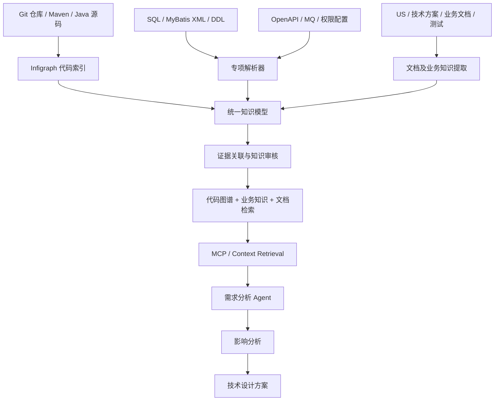

# 企业级 Spring Boot SaaS 代码知识库建设实施方案

结合你的实际场景，我建议建设一个面向遗留系统的 **Code Intelligence Knowledge Base（代码智能知识库）**。

它不是简单地把代码上传到向量数据库，也不是单纯构建一张 Neo4j 图，而是把以下知识关联起来：

1. **代码知识**：系统有哪些模块、类、方法、接口和依赖。
2. **业务知识**：每个模块实现什么业务能力，有哪些业务规则。
3. **数据知识**：业务逻辑访问哪些数据库表、字段以及外部数据源。
4. **架构知识**：模块之间有哪些依赖限制，系统有哪些公共组件。
5. **需求知识**：历史 US、技术设计方案、验收标准与代码实现之间有什么关系。
6. **测试知识**：哪些测试覆盖哪些业务能力、接口和代码。

最终让 Agent 可以根据一份 US，沿着知识库中的关联关系找到真正需要分析的代码，而不是依赖关键词搜索碰运气。

我会采用以下路线：

## 推荐技术路线

**Infigraph** (主方案 PoC)

代码结构分析、图关系、混合检索、MCP 接入。采用 Apache-2.0 许可版本。

------

**GroundGraph** (对比验证)

重点参考需求、文档、测试与代码之间的证据关联模型。

------

**Java 专项解析器** (扩展层)

补充 Spring Bean、MyBatis、权限、MQ 和 Java 类型解析。

------

**Agent + MCP** (应用层)

将图谱查询能力提供给需求分析 Agent 和技术设计 Agent。

这里有一个许可问题需要先说明：GitNexus 当前仓库使用 PolyForm Noncommercial 1.0.0，商业许可另行提供。因此，对你的企业 SaaS 项目，我不建议未经许可审查就把它作为生产基础。Infigraph 使用 Apache-2.0，GroundGraph 提供 Apache-2.0/MIT 双许可。

**总体原则：先利用开源项目构建 70% 左右的基础代码知识，再自己补充真正有业务价值的企业领域知识。** 不要一开始就开发自己的图数据库、向量检索引擎和 AST 解析器。

------

# 第一部分：确定整体架构

我建议先确定以下架构，再按步骤实施。

````

````

第一阶段不需要立即部署 Neo4j 和 Qdrant。Infigraph 本身已经包含图存储、混合检索、结构化数据导入和 MCP 能力，并支持导出 Neo4j Cypher、GraphML 和 JSON。

先利用它的现有能力把流程跑通，后续确实出现多租户查询、独立图服务、集中式权限管理等需求，再考虑拆分存储。

------

# 第二部分：具体实施步骤

## 步骤 1：准备一个试点代码仓库

(第一项实际工作)

不要直接对整个十年历史代码库进行全量知识建设。

先选择一个具有代表性的业务模块。

我建议优先选择一个业务链路比较完整的模块，例如订单、用户或权限模块。

准备以下材料：

| 材料       | 内容                           |
| ---------- | ------------------------------ |
| Git 仓库   | 源代码及历史提交               |
| Maven 配置 | 根 POM 和各子模块 POM          |
| Java 源码  | Controller、Service、Mapper 等 |
| MyBatis    | Mapper 接口和 XML              |
| 数据库     | 相关业务表 DDL                 |
| MQ         | Topic、消费者、生产者配置      |
| 权限       | API 权限定义                   |
| 业务文档   | 对应模块的业务说明             |
| 历史 US    | 10～20 个具有代表性的需求      |
| 测试代码   | 单元测试、集成测试             |

特别注意：在开始索引之前，排除以下内容：

```
target/
build/
node_modules/
.git/
*.jar
*.class
*.log
application-prod.yml
*.pem
*.key
敏感配置文件
```

同时排除自动生成代码、第三方依赖源码等不需要索引的内容。

**本步骤产物：**

```
knowledge-base/
├── repository/
│   ├── source
│   └── repository-inventory.md
├── database/
│   └── ddl/
├── api/
├── mq/
├── permissions/
├── requirements/
├── architecture/
└── tests/
```

这个目录是知识建设输入材料的管理结构，不是要求把全部生产源码复制到其中。

建议记录本次试点的 Git Commit SHA，所有分析都以同一版本为基准。

## 步骤 2：使用 Infigraph 构建基础代码图谱

这是最先应该动手的一步。

项目：

Infigraph GitHub

官方项目说明它支持 Java、Kotlin 等 JVM 语言，可以从 AST 提取代码实体、调用和依赖关系，另外具有 SCIP 编译级信息导入能力。

**2.1 安装并建立索引**

按照项目官方安装说明安装，然后进入 Maven 项目根目录：

```
cd /path/to/your/saas-project

# 初次建立代码知识图谱
infigraph index
```

索引完成之后，先不要急着接入 Agent。

**2.2 先检查代码结构**

执行：

```
# 查看系统架构概览
infigraph architecture

# 查看项目 API 路由
infigraph routes

# 查询调用者
infigraph trace-callers "createOrder"

# 查询被调用的方法
infigraph trace-callees "createOrder"

# 查询方法变更的影响范围
infigraph impact "OrderService.java::createOrder"

# 导出图谱数据
infigraph export json --output graph.json
```

这些是 Infigraph 提供的对应查询能力。

**2.3 在这个阶段验证什么？**

假设系统有：

```
order-service
    |
    +-- OrderController
    |
    +-- OrderService
    |
    +-- OrderMapper
    |
    +-- OrderEventPublisher
```

你需要确认：

- 是否识别了所有模块和 Java 类？
- 是否识别了方法签名？
- 是否能找到 Controller 到 Service 的调用关系？
- 是否能识别跨模块调用？
- 是否能找到方法的调用者？
- 是否能分析一个类变更后的影响范围？
- 是否能识别 Spring 的 REST 路由？

这里特别需要检查 Spring 依赖注入是否完整。AST 解析出 `@Autowired` 注解，并不意味着它已经准确还原运行时 Bean 依赖。

**本步骤产物：**

- 基础 Java 代码索引。
- 模块、类、方法关系。
- 初步调用链。
- API 路由索引。
- 一份代码图谱质量检查报告。

## 步骤 3：增强 Java 语义解析能力

这是针对你十年历史 Spring Boot 项目最重要的一个环节。

我建议使用：

SCIP Java

SCIP 是用于代码智能索引的协议，`scip-java` 可以利用 Java 编译器 API 生成符号和跨文件引用信息，再导入 Infigraph。

操作流程：

```
# 在 Maven 项目根目录生成 SCIP 索引
scip-java index

# 导入到 Infigraph
infigraph scip-import --index index.scip
```

这里有一个与你的遗留系统直接相关的版本问题：

(需要先检查 JDK 版本)

当前 `scip-java` 文档列出的 Java 支持为：

| Java 版本 | 支持情况                |
| --------- | ----------------------- |
| Java 7    | 不支持                  |
| Java 8    | 不支持                  |
| Java 11   | 支持                    |
| Java 17   | 支持，需要额外 JVM 参数 |
| Java 21   | 支持，需要额外 JVM 参数 |

Maven 项目可以使用自动索引模式。

如果你的系统还停留在 Java 8，不要为了接入 SCIP 直接升级整个生产系统。

可以采用：

- Infigraph Tree-sitter 解析作为基础。
- Eclipse JDT 或 Spoon 作为 Java 专项分析工具。
- 基于现有 Maven classpath 做类型解析。
- 对没有解析成功的方法调用标记为 `UNRESOLVED`。

Spoon 也是一个值得考虑的 Java 静态分析工具，具有 AST 和源代码分析能力，并支持分析较老版本的 Java 源码。

**本步骤产物：**

- 更准确的类和方法符号。
- 跨文件方法引用关系。
- 接口实现关系。
- 类型关联关系。
- 无法解析关系清单。

这里不要追求调用图百分之百完整。Spring AOP、反射、动态代理、多态分派等都需要单独处理。

## 步骤 4：补充企业 SaaS 专属关系

(核心自研部分)

Infigraph 可以解决很多通用代码分析问题，但对于你的 SaaS 系统，还需要增加一些领域解析器。

我建议按照以下五个解析器来开发。

### 4.1 Spring Framework 解析器

负责把 Spring 的声明式依赖转化为知识关系。

需要识别：

| Spring 特征       | 构建的知识      |
| ----------------- | --------------- |
| `@RestController` | Controller 节点 |
| `@RequestMapping` | API 节点        |
| `@Service`        | Service 节点    |
| `@Repository`     | Repository 节点 |
| `@Component`      | Bean 节点       |
| `@Autowired`      | Bean 依赖关系   |
| 构造器注入        | Bean 依赖关系   |
| `@Qualifier`      | Bean 候选限定   |
| `@Transactional`  | 事务边界        |
| `@EventListener`  | 事件监听关系    |
| `@Profile`        | 环境条件关系    |
| AOP 注解          | 横切逻辑关联    |

举个例子：

```
@Service
public class OrderService {

    private final OrganizationService organizationService;
    private final OrderMapper orderMapper;

    public OrderService(
        OrganizationService organizationService,
        OrderMapper orderMapper
    ) {
        this.organizationService = organizationService;
        this.orderMapper = orderMapper;
    }
}
```

应该识别出：

```
OrderService
    |
    +-- INJECTS --> OrganizationService
    |
    +-- INJECTS --> OrderMapper
```

同时要区分 `INJECTS` 和 `CALLS`。

依赖注入只代表组件存在依赖，不代表每个方法都实际调用了该组件。

### 4.2 MyBatis SQL 解析器

这是历史较久的 Spring Boot 项目最需要重点处理的一项。

因为很多业务影响关系隐藏在 Mapper XML 中。

例如：

```
<select id="findOrder"
        resultType="Order">
    SELECT *
    FROM t_order o
    LEFT JOIN t_user u
        ON o.user_id = u.id
    WHERE o.order_id = #{orderId}
</select>
```

希望形成：

```
OrderMapper.findOrder()
       |
       +-- READS --> t_order
       |
       +-- READS --> t_user
```

再例如：

```
<update id="updateOrder">
    UPDATE t_order
    SET order_status = #{status}
    WHERE order_id = #{orderId}
</update>
```

形成：

```
OrderMapper.updateOrder()
       |
       +-- WRITES --> t_order
       |
       +-- WRITES --> t_order.order_status
```

建议解析以下内容：

- Mapper 接口。
- XML namespace。
- SQL statement id。
- SQL 访问表。
- SQL 访问字段。
- INSERT、UPDATE、DELETE、SELECT。
- 动态 SQL。
- include/refid。
- 公共 SQL 片段。

动态表名、复杂动态 SQL、存储过程等无法确定的关系必须保留未解析状态，不能假装已经准确提取。

### 4.3 RocketMQ 解析器

如果项目统一封装了 MQ Common 模块，优先解析公共封装层。

需要识别：

| 对象             | 关系           |
| ---------------- | -------------- |
| 业务方法         | PUBLISHES      |
| MQ Topic         | 消息主题       |
| Consumer         | SUBSCRIBES     |
| Message Listener | CONSUMES       |
| 业务方法         | CONSUMES_EVENT |

例如：

```
OrderService.createOrder()
      |
      +-- PUBLISHES --> order-created
                              |
                              +-- SUBSCRIBED_BY
                                      |
                                      +-- InventoryConsumer
                                      |
                                      +-- NotificationConsumer
```

同时解析：

- Topic 常量。
- 消费者 Group。
- 消息 Tag。
- 消息 DTO。
- 生产者封装组件。
- 重试和死信相关配置。

对于动态 Topic，尽量从配置项解析；无法解析时明确标记。

### 4.4 权限解析器

对 SaaS 系统非常重要。

需要关联：

```
API
 |
 +-- PROTECTED_BY --> Permission
                         |
                         +-- BOUND_TO --> Role
```

具体提取：

- API 对应权限点。
- 权限注解。
- Auth 模块的权限注册定义。
- 角色与权限绑定关系。
- SDK 注册过程。
- 删除 API 后可能失效的权限点。

这里要特别注意：一个 API 的权限定义、权限注册行为和运行时鉴权机制可能位于不同模块，不能只根据 `@PreAuthorize` 一类注解建立完整权限关系。

### 4.5 多租户及公共组件解析器

建议额外识别：

- TenantContext。
- 租户过滤器。
- MyBatis 租户拦截器。
- 数据权限拦截器。
- 数据脱敏组件。
- 审计日志组件。
- 分布式锁。
- 事务管理。
- 缓存封装。

这部分最好结合你们已有的架构规范，明确哪些是强制约束，哪些只是普通技术依赖。

**本步骤产物：**

```
custom-extractors/
├── spring-analyzer/
├── mybatis-analyzer/
├── rocketmq-analyzer/
├── permission-analyzer/
├── tenant-analyzer/
└── architecture-analyzer/
```

这几个解析器才是你未来需要持续维护的核心自研模块。

------

## 步骤 5：建立业务知识，不要只存代码

这一阶段开始解决 RAG 和代码知识图谱都不容易单独解决的问题：业务语义。

例如：

```
订单创建
    |
    +-- 业务规则：用户必须属于有效组织
    |
    +-- 业务规则：组织必须具有订单创建权限
    |
    +-- 业务规则：订单创建成功后发送事件
```

这些信息未必能直接从代码推导出来。

我的建议是采用：

**业务文档 + 结构化知识节点 + 人工审核。**

建议新增以下知识实体：

| 实体                | 示例                            |
| ------------------- | ------------------------------- |
| BusinessCapability  | 订单创建                        |
| BusinessProcess     | 订单审批流程                    |
| BusinessRule        | 组织必须具有创建权限            |
| Requirement         | US-2026-001                     |
| AcceptanceCriterion | 组织无权限时拒绝创建            |
| ArchitectureRule    | 禁止 Controller 直接访问 Mapper |
| DesignDecision      | 订单事件通过 Common-MQ 发布     |

关系如下：

```
US-2026-001
    |
    +-- RELATES_TO --> 订单创建
                           |
                           +-- IMPLEMENTED_BY --> OrderService.createOrder()
                           |
                           +-- CONSTRAINED_BY --> BR-001
                           |
                           +-- VERIFIED_BY --> OrderServiceTest
```

推荐让 GroundGraph 参与这一阶段的 PoC：

GroundGraph GitHub

它特别值得参考的是证据关联和 AI 提议、人工确认的工作流。其 README 介绍了 Requirement、Docs、Tests、Routes、DB Tables 等实体，并使用来源证据关联关系；它也使用 Gson Java/Maven 项目进行过端到端验证。

但是我不建议直接把它和 Infigraph 同时投入生产，两者代码图谱能力有重叠。先在同一试点模块上比较，选择一个作为主要代码索引底座。

## 步骤 6：利用 Infigraph 的结构化数据导入，建立业务关联

这是一个很值得利用的开源能力。

Infigraph 支持通过 TOML 定义 Schema，再把 JSON/YAML 结构化数据导入图谱，并且可以把业务节点连接到已解析的代码 Symbol。

例如，创建：

```
.infigraph/
└── structured-schemas/
    └── api_endpoints.toml
```

定义 API 节点：

```
schema_id = "api_endpoints"
name = "API Endpoints"
node_table = "Endpoint"

[[columns]]
name = "id"
col_type = "STRING"
primary = true

[[columns]]
name = "method"
col_type = "STRING"

[[columns]]
name = "path"
col_type = "STRING"

[[columns]]
name = "handler"
col_type = "STRING"

[[columns]]
name = "permission"
col_type = "STRING"

[[edges]]
name = "HANDLED_BY"
from_table = "Endpoint"
to_table = "Symbol"
from_column = "id"
to_column = "handler"
resolve_symbol = true
```

再生成数据：

```
endpoints.json
[
  {
    "id": "POST:/orders",
    "method": "POST",
    "path": "/orders",
    "handler": "com.example.order.OrderController.createOrder",
    "permission": "order:create"
  }
]
```

然后导入：

```
infigraph ingest \
  --schema api_endpoints \
  --data-file endpoints.json
```

这个例子展示了如何把 API 路由关联到代码 Symbol。实际接入时，`handler` 必须与索引器能解析到的 Symbol 标识一致。

同样的方式可以扩展出：

```
business_capabilities.toml
business_rules.toml
requirements.toml
mq_topics.toml
permissions.toml
database_tables.toml
architecture_rules.toml
```

**这里有一个关键原则：**

AI 从 US 中抽取出来的 `Requirement → Method` 关系，首先应该进入候选状态，而不是直接认定为事实。

例如：

```
{
  "requirementId": "US-2026-001",
  "targetSymbol": "OrderService.createOrder",
  "relation": "AFFECTS",
  "status": "PROPOSED",
  "source": "llm_analysis"
}
```

经过人工审核后再变成：

```
{
  "requirementId": "US-2026-001",
  "targetSymbol": "OrderService.createOrder",
  "relation": "AFFECTS",
  "status": "CONFIRMED",
  "source": "human_review"
}
```

否则，错误的业务关联一旦进入知识库，就会被后续 Agent 反复引用。

## 步骤 7：建立统一知识检索接口，提供给 Agent

前面的工作都是在构建知识，现在需要解决如何使用知识。

我不建议让需求分析 Agent 直接执行大量 Cypher，也不建议让它自己组合几十次代码搜索。

应该提供一组有明确职责的 MCP Tools。

Infigraph 已经提供了丰富的 MCP 工具，包括 `search_symbols`、`symbol_context`、`trace_callers`、`trace_callees`、`transitive_impact`、`get_doc_context` 等。

我建议在其基础上封装一个 SaaS Knowledge MCP Server。

对 Agent 暴露以下工具：

| MCP Tool                       | 功能                         |
| ------------------------------ | ---------------------------- |
| `search_business_capability`   | 根据业务描述查找相关业务能力 |
| `get_business_context`         | 获取业务能力对应的业务规则   |
| `find_related_code`            | 查找实现业务能力的代码       |
| `analyze_change_impact`        | 分析修改代码的影响范围       |
| `find_api_permissions`         | 查找 API 和权限关系          |
| `find_database_impact`         | 查找涉及的表和字段           |
| `find_mq_dependencies`         | 查找消息生产者和消费者       |
| `find_related_tests`           | 查找关联测试                 |
| `get_architecture_constraints` | 获取架构约束                 |
| `get_evidence`                 | 获取关系对应的源代码和证据   |

其中，`analyze_change_impact` 应该是你最重要的工具。

例如：

```
{
  "requirement": "订单创建增加组织级别限制",
  "targetCapability": "ORDER_CREATE",
  "depth": 3
}
```

内部执行：

```
1. 识别订单创建业务能力
2. 查找订单创建相关代码
3. 扩展方法调用关系
4. 查找相关 Controller/API
5. 查找 MyBatis Mapper 和数据库表
6. 查找相关 MQ Topic 和消费者
7. 查找权限定义
8. 查找测试覆盖
9. 检索关联业务规则
10. 汇总证据并生成上下文
```

返回结果建议采用统一的结构：

```
{
  "requirement": "订单创建增加组织级别限制",
  "capability": "ORDER_CREATE",
  "relatedModules": [],
  "relatedApis": [],
  "relatedMethods": [],
  "relatedTables": [],
  "relatedTopics": [],
  "relatedPermissions": [],
  "businessRules": [],
  "architectureConstraints": [],
  "relatedTests": [],
  "evidence": [],
  "unresolvedQuestions": []
}
```

特别注意 `evidence` 和 `unresolvedQuestions`。

一个好的知识库不应该只告诉 Agent 找到了什么，还应该告诉它：

- 这个结论的来源是什么？
- 是静态分析得到的，还是人工确认的？
- 是否还有未确定的依赖？
- 哪些关系没有足够证据？

### Agent 的实际调用过程

我建议最终设计成：

**输入 US**

订单创建增加组织限制

**需求理解 Agent**

识别业务能力、实体、业务规则和需求边界

**SaaS Knowledge MCP**

查询图谱、文档、业务规则和技术约束

**代码上下文**

类、方法、依赖、表、MQ、API

**业务上下文**

历史 US、业务规则、架构约束

**技术设计 Agent**

形成改造方案和影响分析

**技术设计文档**

包含改动文件、关联功能、风险、测试和证据

这样你原本的需求分析流程就有了一个可以持续积累知识的基础。

## 步骤 8：建立知识增量更新机制

这个步骤千万不要忽略。

对于十年历史的 SaaS 系统，知识图谱最大的风险之一就是过时。

例如：

某个版本删除了一个 API，但是知识图谱仍然认为这个 API 存在。

那么 Agent 后续生成的技术方案就可能是错误的。

建议建立如下更新机制：

| 事件             | 更新动作                |
| ---------------- | ----------------------- |
| 新增 Java 文件   | 增量解析                |
| 修改 Java 方法   | 更新方法和关联关系      |
| 修改 POM         | 更新模块依赖            |
| 修改 Mapper XML  | 更新 SQL 读写关系       |
| 修改数据库 DDL   | 更新表和字段关系        |
| 修改 MQ 配置     | 更新 Topic 和消费者关系 |
| 修改权限定义     | 更新 API 权限关系       |
| 新增 US          | 建立需求知识节点        |
| 技术设计评审通过 | 更新已经确认的业务关联  |
| 代码合并         | 更新代码索引及版本信息  |

可以使用 Git Webhook 或 CI/CD Pipeline 触发：

```
Git Commit
    |
    v
识别变更文件
    |
    v
判断需要更新的知识类型
    |
    v
增量解析
    |
    v
更新图谱
    |
    v
关联关系校验
    |
    v
发布新的知识版本
```

建议建立以下版本信息：

```
{
  "repository": "saas-platform",
  "branch": "main",
  "commitId": "a1b2c3d",
  "indexVersion": "2026.11.19.001",
  "extractorVersion": "1.0.0",
  "schemaVersion": "1.0.0",
  "indexedAt": "2026-11-19T20:00:00+08:00"
}
```

每次 Agent 分析 US 时，必须明确使用哪个 Git Commit 对应的知识快照。

建议：

- 开发阶段使用 `watch` 监听变更。
- 合并 PR 后更新主分支知识索引。
- 定期执行全量校验。
- 保留历史索引快照。
- 发现解析失败时标记知识不完整，不允许静默沿用旧关系。

------

## 步骤 9：建立知识库质量评估体系

我不建议以节点数量、关系数量或者知识库文档数量作为建设目标。

这些数字无法说明 Agent 是否真正理解了系统。

应该建立一组标准测试问题。

例如：

| 测试问题                 | 预期结果             |
| ------------------------ | -------------------- |
| 找到创建订单的入口       | 所有相关 API         |
| 找到创建订单完整调用链   | 关键 Service 和方法  |
| 找到订单创建访问的数据库 | 相关表和字段         |
| 找到订单创建发布的 MQ    | Topic 和事件         |
| 找到订单事件消费者       | 所有已识别消费者     |
| 找到订单创建对应权限     | 权限定义和鉴权逻辑   |
| 找到相关历史需求         | US 和技术方案        |
| 找到已有测试             | 关联测试类及覆盖范围 |

建议人工准备 20～30 个经过确认的问题及标准答案。

重点观察四个指标：

**1. 图谱关系准确率**

Agent 查询出来的关联关系中，有多少是真实存在的。

**2. 图谱关系召回率**

系统真实存在的关联关系中，有多少被知识图谱找到了。

**3. 影响范围召回率**

修改一个模块时，是否找到了真正会受到影响的 API、表、MQ 和业务功能。

**4. 技术方案完整性**

使用知识库后，技术方案是否减少了关键改动点遗漏，是否正确复用了已有业务实现。

建议对每种关系独立统计，例如 `CALLS`、`READS`、`PUBLISHES`，不要把它们混为一个准确率。

一个可以采用的初始 PoC 验收标准是：关键关系召回率和准确率都达到 90% 以上，关键关系具备可追溯证据，并且没有未标识的关键解析缺口。这是建议的工程验收门槛，不是开源项目承诺能够达到的性能指标。

然后使用同样的历史 US 分别测试：

- 原始 Agent。
- RAG Agent。
- Knowledge Graph + RAG Agent。

让技术评审人员对三份方案进行盲评。

这才能判断你的建设投入是否真的产生价值。

------

# 第三部分：最终的技术选型

结合整个实施过程，我建议采用以下技术组合。

| 模块             | 推荐方案                       | 是否需要自研        |
| ---------------- | ------------------------------ | ------------------- |
| Java 代码索引    | Infigraph                      | 否                  |
| Java 语义补充    | SCIP Java                      | 否，兼容时使用      |
| Java 8 补充解析  | Spoon / Eclipse JDT            | 需要适配            |
| 通用代码知识图谱 | Infigraph                      | 否                  |
| 业务知识图谱     | Infigraph Structured Ingestion | 需要设计 Schema     |
| 业务知识审核     | 参考 GroundGraph               | 需要实现审核流程    |
| 文档检索         | Infigraph 文档索引             | 先不自研            |
| 向量检索         | Infigraph 内置能力             | 先不引入独立 Qdrant |
| 图数据库         | Infigraph 内置存储             | 暂时不引入 Neo4j    |
| Agent 接入       | MCP                            | 需要封装业务工具    |
| 增量更新         | Git + CI/CD                    | 需要开发            |
| 质量评估         | 自建测试集                     | 需要开发            |

这里特别强调：

**不要在第一阶段同时引入 Neo4j、Qdrant、Milvus、Elasticsearch。**

Infigraph 已经提供图存储、混合检索、结构化数据导入及 MCP，而且可以导出到 Neo4j 格式。你应该先验证这些基础能力。

如果将来需要多项目集中管理、复杂业务关系查询、跨团队图谱服务，再独立考虑 Neo4j。Qdrant 则在需要独立维护大规模向量检索服务时再考虑。

------

# 第四部分：给你的实际实施排期

为了避免一次性建设太多东西，我建议分成四个里程碑。

1. **里程碑一：代码知识索引**

   (第一优先级)

   实施内容：

   - 部署 Infigraph。
   - 索引一个 Spring Boot 业务模块。
   - 分析 Maven 模块、类、方法、调用关系。
   - 接入 SCIP（检查 Java 版本兼容性）。
   - 验证影响分析。

   验收产物：代码知识图谱和分析报告。

2. **里程碑二：企业技术关系**

   实施内容：

   - Spring Bean 关系。
   - MyBatis SQL 与表关系。
   - RocketMQ 生产消费关系。
   - API 与权限关系。
   - 多租户和公共组件约束。

   验收产物：企业技术关系知识库。

3. **里程碑三：业务知识建设**

   实施内容：

   - 导入历史 US。
   - 导入历史技术设计方案。
   - 建立业务能力和业务规则。
   - 建立 US 与代码关系。
   - 增加人工审核流程。

   验收产物：业务知识图谱及证据链。

4. **里程碑四：Agent 接入**

   实施内容：

   - 建立 SaaS Knowledge MCP。
   - 设计上下文检索策略。
   - 接入需求分析 Agent。
   - 生成技术设计方案。
   - 建立知识库增量更新。
   - 建立质量评估。

   验收产物：完整的 US → 技术影响分析 → 技术设计流程。

## 第五部分：我认为最需要提前设计好的三个问题

最后有三个问题，我建议从第一天就考虑。

**1. 知识之间的关系必须有证据。**

不要只存：

```
OrderService -> OrderMapper
```

还要存：

```
关系：OrderService -> OrderMapper
关系类型：INJECTS
证据：OrderService.java
行号：25
来源：AST_ANALYSIS
Git Commit：a1b2c3d
可信等级：STATIC_CONFIRMED
```

业务关系则使用 `HUMAN_CONFIRMED` 或 `LLM_PROPOSED` 等不同来源状态。

**2. 业务知识不能全部交给 LLM 自动生成。**

历史业务文档可能过时，代码注释可能不准确，方法名称也可能误导模型。

建议采用：

```
自动抽取
    |
    v
生成候选知识
    |
    v
证据验证
    |
    v
人工审核
    |
    v
正式入库
```

**3. 知识库必须与代码版本绑定。**

尤其是你的系统，技术方案评审时使用的代码版本，可能与后续实施时的代码版本不同。

没有版本绑定，知识库中的关系就可能出现时间错位。

------

# 我的最终建议

我认为你现在最正确的起点是：

**第一步只部署 Infigraph，不要立即开发自己的 Knowledge Platform。**

先在你的真实 Spring Boot 仓库里运行：

```
infigraph index

infigraph architecture

infigraph routes

infigraph trace-callers "目标方法"

infigraph trace-callees "目标方法"

infigraph export json --output graph.json
```

然后选择 3 条真实业务链路，检查它能否正确还原：

- API → Controller → Service。
- Service → Mapper → 数据库表。
- Service → MQ → Consumer。

接着验证 SCIP 对你当前 Java 版本的支持情况。

**只有当你明确知道 Infigraph 哪些关系解析得准确、哪些关系解析得不完整，才开始编写自己的扩展解析器。**

这样建设出来的知识库才是建立在真实代码证据之上的，而不是又一个依赖大模型猜测业务关系的系统。