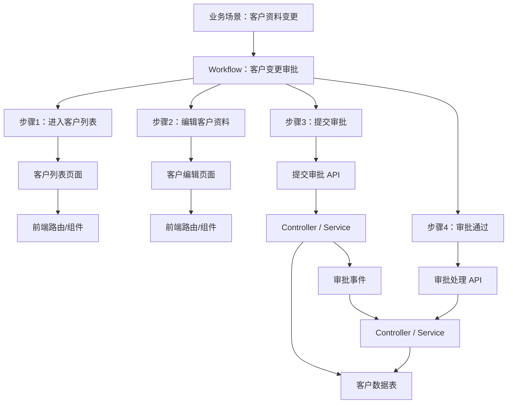

你遇到的其实是一个很典型的**代码知识与业务知识脱节**的问题。

Agent 读取代码仓库，能够知道系统有哪些 Controller、Service、REST API、数据库表，却不一定知道用户是如何完成一项业务的。

例如，代码里可能存在：

- 客户列表查询接口
- 客户详情查询接口
- 客户编辑接口
- 客户提交审批接口
- 审批通过接口
- 合同生成接口

Agent 能够分别理解这些接口，却未必知道：

> 用户在客户管理页面选择一个客户，进入详情页，修改客户资料，提交审批；审批人员进入待办页面审批通过后，系统才允许生成合同。

而且，这个业务过程可能涉及不同角色、多个页面、接口调用、异步消息和状态变化。

**我的建议是：不要试图仅通过代码分析解决这个问题，而是给 Agent 增加一个独立的「业务行为知识层」（Business Behavior Knowledge）。**

它与代码知识库相互关联，但不是同一个东西。

---

# 一、先明确 Agent 需要具备哪几类知识

我建议将 Agent 的知识划分成三个层次。

## 业务知识层

用户为什么操作、业务如何运行

**业务场景**

客户创建、合同审批、订单结算

**业务流程**

页面操作、角色交互、流程分支

**业务规则**

前置条件、状态限制、权限约束

**业务变体**

租户配置、角色差异、功能开关

---

## 技术知识层

业务由什么代码实现

**前端**\
路由、页面、组件

**后端**\
API、Service

**数据**\
表、消息、任务

---

## 证据层

这些知识是从哪里来的，可信度如何

**文档**\
US、PRD、操作手册

**运行记录**\
调用链、操作轨迹

**代码证据**\
源码、测试、配置

三层之间最重要的关系是：

**业务流程中的每一步，都应该尽可能关联到实际的技术实现和证据。**

这样 Agent 才能从业务场景一路追溯到代码。

# 二、核心设计：建立业务流程知识库

我建议将「业务流程」作为知识库的核心实体，而不是把 API 当作核心实体。

一个业务流程应该能完整表达以下信息：

| 信息   | 具体内容          |
| ---- | ------------- |
| 业务场景 | 用户想完成什么业务     |
| 参与角色 | 谁发起、谁处理、谁审批   |
| 入口页面 | 从哪个菜单、页面进入    |
| 操作步骤 | 用户执行了哪些操作     |
| 页面跳转 | 操作后进入哪个页面     |
| 接口调用 | 每一步触发哪些接口     |
| 状态变化 | 业务对象发生了什么变化   |
| 数据影响 | 读取、修改了哪些业务数据  |
| 异步行为 | 是否触发 MQ、定时任务等 |
| 业务规则 | 有哪些前置条件和限制    |
| 流程分支 | 不同条件下如何流转     |

注意：不能简单地将一个接口等同于一个业务步骤。

例如，用户点击「提交审批」时，前端可能先校验表单，再调用多个接口；后端可能同步修改状态，又异步发送 MQ 消息。应该把这些行为组织到同一个有业务语义的步骤下。

## 2.1 建议的数据模型

我建议先定义以下知识实体：

| 实体               | 含义                         |
| ---------------- | -------------------------- |
| BusinessDomain   | 业务域，例如客户管理                 |
| BusinessScenario | 业务场景，例如客户资料变更              |
| Workflow         | 完整业务流程                     |
| WorkflowStep     | 流程中的一个步骤                   |
| Page             | 前端页面                       |
| UIAction         | 用户操作                       |
| API              | 接口定义                       |
| CodeSymbol       | Controller、Service、方法等代码元素 |
| BusinessEntity   | 客户、合同、订单等业务对象              |
| BusinessRule     | 业务规则                       |
| Role             | 用户角色                       |
| Permission       | 权限定义                       |
| Event            | MQ 消息、领域事件                 |
| Job              | 定时任务、异步任务                  |
| Evidence         | 支撑知识的文档、测试或运行记录            |

这些实体通过关系连接：




这里有一个关键设计：

**业务流程不是代码调用关系图。**

业务流程表达的是用户如何完成业务；代码调用关系表达的是程序如何执行。两者通过 Page、API、CodeSymbol 等实体建立映射。

---

# 三、知识从哪里来？这是最重要的部分

仅仅依赖静态代码分析是不够的。你需要建立一套业务知识采集机制。

我建议综合使用五种来源。

## 3.1 产品文档和 US

这是业务知识的第一来源。

例如产品经理提供：

> US：支持客户基本资料变更，客户提交资料变更后，需要经过管理员审批，审批通过后更新客户信息。

Agent 可以初步提取：

- 业务对象：客户
- 业务操作：资料变更
- 参与角色：客户、管理员
- 流程：发起变更 → 审批 → 更新客户信息
- 业务规则：审批通过后才更新正式资料

但是，US 一般不会告诉 Agent 具体经过哪些页面、调用哪些接口。

所以这只能作为业务流程的初始定义，不能直接当成完整知识。

## 3.2 QA 测试用例和 E2E 自动化测试

这是我认为最值得挖掘的数据来源之一。

QA 的测试用例通常已经描述了：

- 登录什么账号
- 进入哪个菜单
- 点击什么按钮
- 填写什么内容
- 页面发生什么变化
- 最终预期什么结果

这实际上就是业务流程的操作描述。

例如：

```
测试场景：客户资料变更审批

前置条件：
1. 存在一个状态正常的客户
2. 用户拥有客户编辑权限
3. 当前用户拥有资料审批权限

操作步骤：
1. 登录客户管理员账号
2. 进入客户管理页面
3. 搜索指定客户
4. 点击编辑按钮
5. 修改客户名称
6. 点击提交审批
7. 退出当前用户
8. 登录审批人员账号
9. 进入审批待办页面
10. 找到对应审批任务
11. 点击通过

预期结果：
1. 客户资料变更申请提交成功
2. 审批人员能够看到待审批任务
3. 审批通过后，客户正式资料发生更新
```

Agent 可以把这个测试用例转换成结构化 Workflow。

如果你的老系统积累了多年 QA 测试用例，我建议优先整理它们。这通常比重新让开发人员编写全部业务流程文档成本更低。

## 3.3 实际页面操作轨迹

这是解决你当前问题最直接的方式。

**让 Agent 或自动化程序实际操作系统，记录完整的用户操作过程。**

推荐使用 Playwright。

一次完整的操作记录应该包含：

| 采集对象 | 采集内容                 |
| ---- | -------------------- |
| 页面   | URL、页面标题、页面标识        |
| 操作   | 点击、输入、选择、提交          |
| 页面变化 | 页面跳转、弹窗、表单变化         |
| 网络请求 | HTTP Method、URL、请求顺序 |
| 接口结果 | 状态码、响应摘要             |
| 时间   | 操作时间、请求时间            |
| 关联标识 | Trace ID、请求 ID       |

比如：

```
Scenario: 客户资料变更审批

Step 1:
  Page: /customer/list
  Action: 点击客户查询
  API:
    GET /api/customer/page

Step 2:
  Page: /customer/list
  Action: 点击客户编辑
  Navigation:
    /customer/edit/10001

Step 3:
  Page: /customer/edit/10001
  Action: 点击提交审批
  API:
    POST /api/customer/change/submit

Step 4:
  Page: /approval/todo
  Actor: 审批人员
  Action: 点击审批通过
  API:
    POST /api/approval/10001/approve
```

这些记录可以让 Agent 知道：

- 哪些页面属于同一个业务场景；
- 哪个页面操作触发哪个 API；
- 用户操作的先后关系；
- 不同角色如何共同完成一项业务。

但需要注意：Playwright 只能记录它实际执行过的路径。没有被执行的异常分支、不同角色、不同租户配置，仍然需要补充采集。

## 3.4 后端运行链路

页面操作只能看到浏览器侧的接口请求，不能完整看到后端发生的事情。

例如：

```
用户点击提交审批
      |
      v
POST /api/customer/change/submit
      |
      v
CustomerController
      |
      v
CustomerChangeService
      |
      +---- 修改申请状态
      |
      +---- 写入审批任务
      |
      +---- 发布 CustomerChangeSubmitted 事件
                       |
                       v
                 MQ Consumer
                       |
                       v
                 通知审批人员
```

因此建议将前端操作记录与后端 Trace 关联起来。

你之前关注过 Spring Boot 可观测体系，这里可以直接复用 OpenTelemetry 的 Trace ID、Span ID 等信息。

需要采集：

- HTTP 请求入口
- Controller、Service 调用链
- 数据库读写
- MQ 消息生产和消费
- 异步任务执行
- 外部系统调用

这样可以形成：

**用户操作 → 前端请求 → 后端执行 → 数据变化 → 异步事件**

这一条完整链路。

生产环境采集时需要对用户信息、业务数据、Token、请求参数等进行脱敏，避免将敏感数据直接写入知识库。

## 3.5 开发人员和业务人员确认

最后一个来源是人工确认。

无论是从 US、测试用例还是运行轨迹提取的流程，都可能存在遗漏。

例如：

- 只有特定租户才能进入该流程；
- 某些客户等级需要额外审批；
- 部分业务流程由定时任务触发；
- 特定管理员可以跳过某个步骤。

这些信息可能既没有写在代码注释中，也没有出现在普通测试用例里。

所以建议每个重要 Workflow 都具有一个确认状态：

`Draft → Pending Review → Verified → Deprecated`

Agent 可以自动提取和整理知识，但不能把未经确认的推测直接当作确定的业务事实。

---

# 四、知识库具体应该怎么存储？

这里我不建议一开始就直接上 Neo4j 或复杂的 GraphRAG 架构。

我的建议是：

**Markdown/YAML 作为知识载体，关系模型作为知识结构，向量检索作为语义检索手段，图查询作为关系分析手段。**

这样成本比较低，也方便长期维护。

例如：

```
business-knowledge/
│
├── index.yaml
│
├── domains/
│   ├── customer/
│   │   ├── domain.yaml
│   │   ├── scenarios/
│   │   │   ├── customer-create.yaml
│   │   │   ├── customer-update.yaml
│   │   │   └── customer-approval.yaml
│   │   │
│   │   ├── rules/
│   │   │   ├── customer-status-rules.yaml
│   │   │   └── customer-permission-rules.yaml
│   │   │
│   │   └── evidence/
│   │
│   ├── contract/
│   └── order/
│
├── shared/
│   ├── roles.yaml
│   ├── permissions.yaml
│   └── business-entities.yaml
│
└── generated/
    ├── page-api-map.json
    └── api-code-map.json
```

## 4.1 一个 Workflow 文件应该长什么样？

例如 `customer-approval.yaml`：

```
workflow:
  id: customer.approval
  name: 客户资料变更审批
  domain: customer
  status: verified

  description: >
    客户管理员修改客户资料并提交审批，
    审批人员审批通过后正式更新客户资料。

  actors:
    - role: CUSTOMER_ADMIN
      responsibility: 修改客户资料并提交审批

    - role: APPROVER
      responsibility: 审核客户资料变更申请

  preconditions:
    - 客户记录已存在
    - 客户当前状态允许修改
    - 当前用户拥有客户编辑权限

  steps:
    - id: step-01
      name: 查询客户
      actor: CUSTOMER_ADMIN

      page:
        route: /customer/list
        component: CustomerList

      action:
        type: click
        description: 搜索客户并打开详情

      apis:
        - method: GET
          path: /api/customer/page

    - id: step-02
      name: 修改客户资料
      actor: CUSTOMER_ADMIN

      page:
        route: /customer/edit/{id}
        component: CustomerEdit

      action:
        type: submit
        description: 修改客户基本信息

    - id: step-03
      name: 提交审批
      actor: CUSTOMER_ADMIN

      apis:
        - method: POST
          path: /api/customer/change/submit

      effects:
        - 更新变更申请状态
        - 创建审批任务
        - 发布客户变更事件

    - id: step-04
      name: 审批资料
      actor: APPROVER

      page:
        route: /approval/todo
        component: ApprovalTodo

      apis:
        - method: POST
          path: /api/approval/{id}/approve

  postconditions:
    - 审批通过后客户正式资料更新
    - 变更申请状态变为 APPROVED

  variants:
    - condition: 客户属于特殊等级
      behavior: 需要额外的二级审批

  evidence:
    - type: test_case
      ref: QA-CUSTOMER-023

    - type: playwright_trace
      ref: customer-approval-trace-001

    - type: source_code
      ref: CustomerChangeService

  verification:
    verified_at: 2026-11-22
    verified_by: business-owner
```

这个文件只是一个示例结构，具体字段还需要结合你现有系统完善。

这里有三个设计原则：

1. **一个 Workflow 对应一个完整业务场景，而不是一个接口。**
2. 页面、API、代码、表、事件均使用稳定 ID 或可解析的代码引用关联。
3. 每个关键知识点都保留来源，方便 Agent 判断是否可信。

# 五、Agent 如何使用这些知识？

知识库建好以后，不要简单地把所有 Markdown 文件塞进 Agent 的上下文。

应该给 Agent 提供一组专门的业务知识查询能力。

例如，可以通过 MCP Server 暴露以下工具：

| 工具                          | 功能                 |
| --------------------------- | ------------------ |
| `search_business_scenarios` | 根据 US 描述检索相关业务场景   |
| `get_workflow_detail`       | 获取完整业务流程           |
| `get_workflow_variants`     | 获取不同角色、租户、配置下的流程分支 |
| `trace_business_impact`     | 从业务流程追踪页面、接口和代码影响  |
| `find_related_workflows`    | 查询有关联的业务流程         |
| `get_business_rules`        | 查询业务规则及限制          |
| `get_knowledge_evidence`    | 查询流程的来源和验证记录       |

例如：

Agent 接收到一个 US：

> 支持修改客户的联系人信息，修改后需要重新审批。

它不应该马上开始扫描所有 Controller。

而应该按照以下顺序工作：


flowchart TD
    A["接收 US"] --> B["提取业务对象和业务动作"]
    B --> C["检索业务场景"]
    C --> D["获取相关 Workflow"]
    D --> E["分析流程步骤和业务分支"]
    E --> F["查询页面、API、权限关联"]
    F --> G["追踪 Controller / Service / SQL / MQ"]
    G --> H["识别直接影响和间接影响"]
    H --> I["生成技术设计方案"]

\#chatgpt-mermaid-\_r_cl\_{font-family:-apple-system-body,ui-sans-serif,-apple-system,system-ui,"Segoe UI",Helvetica,"Apple Color Emoji",Arial,sans-serif,"Segoe UI Emoji","Segoe UI Symbol";font-size:16px;fill:rgb(13, 13, 13);}@keyframes edge-animation-frame{from{stroke-dashoffset:0;}}@keyframes dash{to{stroke-dashoffset:0;}}#chatgpt-mermaid-\_r_cl\_ .edge-animation-slow{stroke-dasharray:9,5!important;stroke-dashoffset:900;animation:dash 50s linear infinite;stroke-linecap:round;}#chatgpt-mermaid-\_r_cl\_ .edge-animation-fast{stroke-dasharray:9,5!important;stroke-dashoffset:900;animation:dash 20s linear infinite;stroke-linecap:round;}#chatgpt-mermaid-\_r_cl\_ .error-icon{fill:rgb(243, 243, 243);}#chatgpt-mermaid-\_r_cl\_ .error-text{fill:rgb(13, 13, 13);stroke:rgb(13, 13, 13);}#chatgpt-mermaid-\_r_cl\_ .edge-thickness-normal{stroke-width:1px;}#chatgpt-mermaid-\_r_cl\_ .edge-thickness-thick{stroke-width:3.5px;}#chatgpt-mermaid-\_r_cl\_ .edge-pattern-solid{stroke-dasharray:0;}#chatgpt-mermaid-\_r_cl\_ .edge-thickness-invisible{stroke-width:0;fill:none;}#chatgpt-mermaid-\_r_cl\_ .edge-pattern-dashed{stroke-dasharray:3;}#chatgpt-mermaid-\_r_cl\_ .edge-pattern-dotted{stroke-dasharray:2;}#chatgpt-mermaid-\_r_cl\_ .marker{fill:rgb(143, 143, 143);stroke:rgb(143, 143, 143);}#chatgpt-mermaid-\_r_cl\_ .marker.cross{stroke:rgb(143, 143, 143);}#chatgpt-mermaid-\_r_cl\_ svg{font-family:-apple-system-body,ui-sans-serif,-apple-system,system-ui,"Segoe UI",Helvetica,"Apple Color Emoji",Arial,sans-serif,"Segoe UI Emoji","Segoe UI Symbol";font-size:16px;}#chatgpt-mermaid-\_r_cl\_ p{margin:0;}#chatgpt-mermaid-\_r_cl\_ .label{font-family:-apple-system-body,ui-sans-serif,-apple-system,system-ui,"Segoe UI",Helvetica,"Apple Color Emoji",Arial,sans-serif,"Segoe UI Emoji","Segoe UI Symbol";color:rgb(13, 13, 13);}#chatgpt-mermaid-\_r_cl\_ .cluster-label text{fill:rgb(13, 13, 13);}#chatgpt-mermaid-\_r_cl\_ .cluster-label span{color:rgb(13, 13, 13);}#chatgpt-mermaid-\_r_cl\_ .cluster-label span p{background-color:transparent;}#chatgpt-mermaid-\_r_cl\_ .label text,#chatgpt-mermaid-\_r_cl\_ span{fill:rgb(13, 13, 13);color:rgb(13, 13, 13);}#chatgpt-mermaid-\_r_cl\_ .node rect,#chatgpt-mermaid-\_r_cl\_ .node circle,#chatgpt-mermaid-\_r_cl\_ .node ellipse,#chatgpt-mermaid-\_r_cl\_ .node polygon,#chatgpt-mermaid-\_r_cl\_ .node path{fill:rgb(222, 234, 251);stroke:rgb(83, 154, 248);stroke-width:1px;}#chatgpt-mermaid-\_r_cl\_ .rough-node .label text,#chatgpt-mermaid-\_r_cl\_ .node .label text,#chatgpt-mermaid-\_r_cl\_ .image-shape .label,#chatgpt-mermaid-\_r_cl\_ .icon-shape .label{text-anchor:middle;}#chatgpt-mermaid-\_r_cl\_ .node .katex path{fill:#000;stroke:#000;stroke-width:1px;}#chatgpt-mermaid-\_r_cl\_ .rough-node .label,#chatgpt-mermaid-\_r_cl\_ .node .label,#chatgpt-mermaid-\_r_cl\_ .image-shape .label,#chatgpt-mermaid-\_r_cl\_ .icon-shape .label{text-align:center;}#chatgpt-mermaid-\_r_cl\_ .node.clickable{cursor:pointer;}#chatgpt-mermaid-\_r_cl\_ .root .anchor path{fill:rgb(143, 143, 143)!important;stroke-width:0;stroke:rgb(143, 143, 143);}#chatgpt-mermaid-\_r_cl\_ .arrowheadPath{fill:rgb(143, 143, 143);}#chatgpt-mermaid-\_r_cl\_ .edgePath .path{stroke:rgb(143, 143, 143);stroke-width:1px;}#chatgpt-mermaid-\_r_cl\_ .flowchart-link{stroke:rgb(143, 143, 143);fill:none;}#chatgpt-mermaid-\_r_cl\_ .edgeLabel{background-color:rgb(252, 252, 252);text-align:center;}#chatgpt-mermaid-\_r_cl\_ .edgeLabel p{background-color:rgb(252, 252, 252);}#chatgpt-mermaid-\_r_cl\_ .edgeLabel rect{opacity:0.5;background-color:rgb(252, 252, 252);fill:rgb(252, 252, 252);}#chatgpt-mermaid-\_r_cl\_ .labelBkg{background-color:rgba(252, 252, 252, 0.5);}#chatgpt-mermaid-\_r_cl\_ .cluster rect{fill:rgb(243, 243, 243);stroke:rgba(0, 0, 0, 0.1);stroke-width:1px;}#chatgpt-mermaid-\_r_cl\_ .cluster text{fill:rgb(13, 13, 13);}#chatgpt-mermaid-\_r_cl\_ .cluster span{color:rgb(13, 13, 13);}#chatgpt-mermaid-\_r_cl\_ div.mermaidTooltip{position:absolute;text-align:center;max-width:200px;padding:2px;font-family:-apple-system-body,ui-sans-serif,-apple-system,system-ui,"Segoe UI",Helvetica,"Apple Color Emoji",Arial,sans-serif,"Segoe UI Emoji","Segoe UI Symbol";font-size:12px;background:rgb(243, 243, 243);border:1px solid rgba(0, 0, 0, 0.1);border-radius:2px;pointer-events:none;z-index:100;}#chatgpt-mermaid-\_r_cl\_ .flowchartTitleText{text-anchor:middle;font-size:18px;fill:rgb(13, 13, 13);}#chatgpt-mermaid-\_r_cl\_ rect.text{fill:none;stroke-width:0;}#chatgpt-mermaid-\_r_cl\_ .icon-shape,#chatgpt-mermaid-\_r_cl\_ .image-shape{background-color:rgb(252, 252, 252);text-align:center;}#chatgpt-mermaid-\_r_cl\_ .icon-shape p,#chatgpt-mermaid-\_r_cl\_ .image-shape p{background-color:rgb(252, 252, 252);padding:2px;}#chatgpt-mermaid-\_r_cl\_ .icon-shape .label rect,#chatgpt-mermaid-\_r_cl\_ .image-shape .label rect{opacity:0.5;background-color:rgb(252, 252, 252);fill:rgb(252, 252, 252);}#chatgpt-mermaid-\_r_cl\_ .label-icon{display:inline-block;height:1em;overflow:visible;vertical-align:-0.125em;}#chatgpt-mermaid-\_r_cl\_ .node .label-icon path{fill:currentColor;stroke:revert;stroke-width:revert;}#chatgpt-mermaid-\_r_cl\_ .node .neo-node{stroke:rgb(83, 154, 248);}#chatgpt-mermaid-\_r_cl\_ [data-look="neo"].node rect,#chatgpt-mermaid-\_r_cl\_ [data-look="neo"].cluster rect,#chatgpt-mermaid-\_r_cl\_ [data-look="neo"].node polygon{stroke:url(#chatgpt-mermaid-\_r_cl\_-gradient);filter:drop-shadow( 1px 2px 2px rgba(185,185,185,1));}#chatgpt-mermaid-\_r_cl\_ [data-look="neo"].swimlane.cluster rect{filter:none;}#chatgpt-mermaid-\_r_cl\_ [data-look="neo"].node path{stroke:url(#chatgpt-mermaid-\_r_cl\_-gradient);stroke-width:1px;}#chatgpt-mermaid-\_r_cl\_ [data-look="neo"].node .outer-path{filter:drop-shadow( 1px 2px 2px rgba(185,185,185,1));}#chatgpt-mermaid-\_r_cl\_ [data-look="neo"].node .neo-line path{stroke:rgb(83, 154, 248);filter:none;}#chatgpt-mermaid-\_r_cl\_ [data-look="neo"].node circle{stroke:url(#chatgpt-mermaid-\_r_cl\_-gradient);filter:drop-shadow( 1px 2px 2px rgba(185,185,185,1));}#chatgpt-mermaid-\_r_cl\_ [data-look="neo"].node circle .state-start{fill:#000000;}#chatgpt-mermaid-\_r_cl\_ [data-look="neo"].icon-shape .icon{fill:url(#chatgpt-mermaid-\_r_cl\_-gradient);filter:drop-shadow( 1px 2px 2px rgba(185,185,185,1));}#chatgpt-mermaid-\_r_cl\_ [data-look="neo"].icon-shape .icon-neo path{stroke:url(#chatgpt-mermaid-\_r_cl\_-gradient);filter:drop-shadow( 1px 2px 2px rgba(185,185,185,1));}#chatgpt-mermaid-\_r_cl\_ .node text{font-size:14px;font-weight:600;letter-spacing:normal;fill:rgb(0, 79, 153);}#chatgpt-mermaid-\_r_cl\_ .edgeLabels text{font-size:13px;font-weight:600;letter-spacing:-0.08px;fill:rgb(0, 79, 153);}#chatgpt-mermaid-\_r_cl\_ .node tspan[font-weight="normal"],#chatgpt-mermaid-\_r_cl\_ .edgeLabels tspan[font-weight="normal"]{font-weight:600;}#chatgpt-mermaid-\_r_cl\_ .edgeLabel .label rect{opacity:1;rx:13px;ry:13px;fill:rgb(245, 250, 255);stroke:rgb(206, 219, 229);stroke-width:1px;}#chatgpt-mermaid-\_r_cl\_ .node rect,#chatgpt-mermaid-\_r_cl\_ .node circle,#chatgpt-mermaid-\_r_cl\_ .node ellipse,#chatgpt-mermaid-\_r_cl\_ .node polygon,#chatgpt-mermaid-\_r_cl\_ .node path{fill:rgb(229, 243, 255);stroke:rgba(0, 0, 0, 0.1);stroke-width:1px;}#chatgpt-mermaid-\_r_cl\_ .node rect{rx:16px;ry:16px;}#chatgpt-mermaid-\_r_cl\_ .mermaid-decision .label-container{fill:rgb(245, 250, 255);stroke:rgb(206, 219, 229);stroke-dasharray:2,2;}#chatgpt-mermaid-\_r_cl\_ .edgePaths .flowchart-link{stroke:rgb(143, 143, 143);stroke-width:1px;stroke-linecap:round;stroke-linejoin:round;}#chatgpt-mermaid-\_r_cl\_ .marker{fill:rgb(143, 143, 143);stroke:rgb(143, 143, 143);}#chatgpt-mermaid-\_r_cl\_ :root{--mermaid-font-family:-apple-system-body,ui-sans-serif,-apple-system,system-ui,"Segoe UI",Helvetica,"Apple Color Emoji",Arial,sans-serif,"Segoe UI Emoji","Segoe UI Symbol";}接收 US提取业务对象和业务动作检索业务场景获取相关 Workflow分析流程步骤和业务分支查询页面、API、权限关联追踪 Controller / Service /SQL / MQ识别直接影响和间接影响生成技术设计方案

举个例子：

Agent 通过知识库发现，这个 US 涉及：

- 客户资料变更审批流程；
- 客户管理页面；
- 审批待办页面；
- 客户资料变更接口；
- 审批接口；
- 客户变更 Service；
- 审批任务创建逻辑；
- 客户变更事件消费者。

这时，它就不再只是分析「修改客户接口」了，而是在分析整个业务链路。

另外，当知识库找不到相关流程时，Agent 应该明确表示：

> 当前没有找到经过验证的业务流程知识，以下结论基于源码静态分析，尚未确认完整用户操作路径。

这比让 Agent 自己补全一套看似合理、实际不确定的业务流程可靠得多。

---

# 六、建议的具体实施步骤

不要一开始就想着覆盖整个 SaaS 系统。我建议分阶段建设。

| 阶段   | 主要工作                   | 交付物                |
| ---- | ---------------------- | ------------------ |
| 第一阶段 | 整理现有 US、QA 测试用例、操作手册   | 业务场景清单             |
| 第二阶段 | 使用 Playwright 录制典型业务流程 | 页面操作轨迹             |
| 第三阶段 | 结合后端 Trace 分析完整调用链     | 业务技术映射             |
| 第四阶段 | 将流程整理为结构化 Workflow     | 业务流程知识库            |
| 第五阶段 | 建立业务知识与代码符号的关联         | 业务代码关系索引           |
| 第六阶段 | 为 Agent 开发业务知识查询工具     | MCP Server 或内部知识服务 |
| 第七阶段 | 使用历史 US 进行效果验证         | 业务影响分析评估集          |

**第一批建议只挑选 10～20 个核心业务流程。**

优先选那些具有跨页面、跨角色、跨模块特征的业务，例如：

- 客户创建与审批
- 合同创建与签署
- 订单创建与支付
- 订单取消与退款
- 用户注册与组织加入
- 角色创建与权限分配
- 发票申请与开具
- 业务数据导入与审核

这些流程最能体现业务知识层的价值。

## 关于是否需要知识图谱

我的判断是：需要图关系模型，但不需要第一天就引入图数据库。

建议采用渐进式架构：

**第一阶段：结构化业务知识**

YAML / Markdown + Git + 全文检索

---

**第二阶段：语义检索**

结构化知识 + Embedding + 向量检索

---

**第三阶段：关系查询**

业务节点、代码节点、调用关系、影响路径，必要时引入 Neo4j

---

**第四阶段：自动知识更新**

监听 Git 变更、测试结果和运行轨迹，识别过期知识并触发复核

尤其不要只依赖向量检索。向量检索适合找到「相似业务场景」，但不适合保证「一个流程经过哪些页面、调用了哪些接口」这样的精确关系。后者必须有明确的结构化关系。

---

# 七、还有一个容易被忽略的问题：业务知识如何保持最新？

对于一个维护了 10 年的 Spring Boot SaaS 系统，这个问题非常重要。

假设今天：

- 开发人员删除一个接口；
- 修改一个审批流程；
- 新增一个租户配置；
- 修改一个角色的权限；
- 修改一个 MQ 消息消费者。

对应的业务 Workflow 可能已经过期。

因此建议建立知识与代码的变更关联：

```
Git Commit / Pull Request
          |
          v
   代码变更分析
          |
          v
  提取受影响代码元素
          |
          v
   查询关联的业务流程
          |
          v
   标记 Workflow 为待复核
          |
          v
  测试验证 / 人工确认
          |
          v
    更新业务知识库
```

不要让 Agent 发现代码有变化后，直接自动改写已验证的业务流程。它可以自动发现差异、提出修改建议，但重要业务知识应该经过测试或人工确认后才能更新。

---

# 八、我认为最适合你的整体架构

最终建议构建这样一套系统：

\#chatgpt-mermaid-\_r_ce\_{font-family:-apple-system-body,ui-sans-serif,-apple-system,system-ui,"Segoe UI",Helvetica,"Apple Color Emoji",Arial,sans-serif,"Segoe UI Emoji","Segoe UI Symbol";font-size:16px;fill:rgb(13, 13, 13);}@keyframes edge-animation-frame{from{stroke-dashoffset:0;}}@keyframes dash{to{stroke-dashoffset:0;}}#chatgpt-mermaid-\_r_ce\_ .edge-animation-slow{stroke-dasharray:9,5!important;stroke-dashoffset:900;animation:dash 50s linear infinite;stroke-linecap:round;}#chatgpt-mermaid-\_r_ce\_ .edge-animation-fast{stroke-dasharray:9,5!important;stroke-dashoffset:900;animation:dash 20s linear infinite;stroke-linecap:round;}#chatgpt-mermaid-\_r_ce\_ .error-icon{fill:rgb(243, 243, 243);}#chatgpt-mermaid-\_r_ce\_ .error-text{fill:rgb(13, 13, 13);stroke:rgb(13, 13, 13);}#chatgpt-mermaid-\_r_ce\_ .edge-thickness-normal{stroke-width:1px;}#chatgpt-mermaid-\_r_ce\_ .edge-thickness-thick{stroke-width:3.5px;}#chatgpt-mermaid-\_r_ce\_ .edge-pattern-solid{stroke-dasharray:0;}#chatgpt-mermaid-\_r_ce\_ .edge-thickness-invisible{stroke-width:0;fill:none;}#chatgpt-mermaid-\_r_ce\_ .edge-pattern-dashed{stroke-dasharray:3;}#chatgpt-mermaid-\_r_ce\_ .edge-pattern-dotted{stroke-dasharray:2;}#chatgpt-mermaid-\_r_ce\_ .marker{fill:rgb(143, 143, 143);stroke:rgb(143, 143, 143);}#chatgpt-mermaid-\_r_ce\_ .marker.cross{stroke:rgb(143, 143, 143);}#chatgpt-mermaid-\_r_ce\_ svg{font-family:-apple-system-body,ui-sans-serif,-apple-system,system-ui,"Segoe UI",Helvetica,"Apple Color Emoji",Arial,sans-serif,"Segoe UI Emoji","Segoe UI Symbol";font-size:16px;}#chatgpt-mermaid-\_r_ce\_ p{margin:0;}#chatgpt-mermaid-\_r_ce\_ .label{font-family:-apple-system-body,ui-sans-serif,-apple-system,system-ui,"Segoe UI",Helvetica,"Apple Color Emoji",Arial,sans-serif,"Segoe UI Emoji","Segoe UI Symbol";color:rgb(13, 13, 13);}#chatgpt-mermaid-\_r_ce\_ .cluster-label text{fill:rgb(13, 13, 13);}#chatgpt-mermaid-\_r_ce\_ .cluster-label span{color:rgb(13, 13, 13);}#chatgpt-mermaid-\_r_ce\_ .cluster-label span p{background-color:transparent;}#chatgpt-mermaid-\_r_ce\_ .label text,#chatgpt-mermaid-\_r_ce\_ span{fill:rgb(13, 13, 13);color:rgb(13, 13, 13);}#chatgpt-mermaid-\_r_ce\_ .node rect,#chatgpt-mermaid-\_r_ce\_ .node circle,#chatgpt-mermaid-\_r_ce\_ .node ellipse,#chatgpt-mermaid-\_r_ce\_ .node polygon,#chatgpt-mermaid-\_r_ce\_ .node path{fill:rgb(222, 234, 251);stroke:rgb(83, 154, 248);stroke-width:1px;}#chatgpt-mermaid-\_r_ce\_ .rough-node .label text,#chatgpt-mermaid-\_r_ce\_ .node .label text,#chatgpt-mermaid-\_r_ce\_ .image-shape .label,#chatgpt-mermaid-\_r_ce\_ .icon-shape .label{text-anchor:middle;}#chatgpt-mermaid-\_r_ce\_ .node .katex path{fill:#000;stroke:#000;stroke-width:1px;}#chatgpt-mermaid-\_r_ce\_ .rough-node .label,#chatgpt-mermaid-\_r_ce\_ .node .label,#chatgpt-mermaid-\_r_ce\_ .image-shape .label,#chatgpt-mermaid-\_r_ce\_ .icon-shape .label{text-align:center;}#chatgpt-mermaid-\_r_ce\_ .node.clickable{cursor:pointer;}#chatgpt-mermaid-\_r_ce\_ .root .anchor path{fill:rgb(143, 143, 143)!important;stroke-width:0;stroke:rgb(143, 143, 143);}#chatgpt-mermaid-\_r_ce\_ .arrowheadPath{fill:rgb(143, 143, 143);}#chatgpt-mermaid-\_r_ce\_ .edgePath .path{stroke:rgb(143, 143, 143);stroke-width:1px;}#chatgpt-mermaid-\_r_ce\_ .flowchart-link{stroke:rgb(143, 143, 143);fill:none;}#chatgpt-mermaid-\_r_ce\_ .edgeLabel{background-color:rgb(252, 252, 252);text-align:center;}#chatgpt-mermaid-\_r_ce\_ .edgeLabel p{background-color:rgb(252, 252, 252);}#chatgpt-mermaid-\_r_ce\_ .edgeLabel rect{opacity:0.5;background-color:rgb(252, 252, 252);fill:rgb(252, 252, 252);}#chatgpt-mermaid-\_r_ce\_ .labelBkg{background-color:rgba(252, 252, 252, 0.5);}#chatgpt-mermaid-\_r_ce\_ .cluster rect{fill:rgb(243, 243, 243);stroke:rgba(0, 0, 0, 0.1);stroke-width:1px;}#chatgpt-mermaid-\_r_ce\_ .cluster text{fill:rgb(13, 13, 13);}#chatgpt-mermaid-\_r_ce\_ .cluster span{color:rgb(13, 13, 13);}#chatgpt-mermaid-\_r_ce\_ div.mermaidTooltip{position:absolute;text-align:center;max-width:200px;padding:2px;font-family:-apple-system-body,ui-sans-serif,-apple-system,system-ui,"Segoe UI",Helvetica,"Apple Color Emoji",Arial,sans-serif,"Segoe UI Emoji","Segoe UI Symbol";font-size:12px;background:rgb(243, 243, 243);border:1px solid rgba(0, 0, 0, 0.1);border-radius:2px;pointer-events:none;z-index:100;}#chatgpt-mermaid-\_r_ce\_ .flowchartTitleText{text-anchor:middle;font-size:18px;fill:rgb(13, 13, 13);}#chatgpt-mermaid-\_r_ce\_ rect.text{fill:none;stroke-width:0;}#chatgpt-mermaid-\_r_ce\_ .icon-shape,#chatgpt-mermaid-\_r_ce\_ .image-shape{background-color:rgb(252, 252, 252);text-align:center;}#chatgpt-mermaid-\_r_ce\_ .icon-shape p,#chatgpt-mermaid-\_r_ce\_ .image-shape p{background-color:rgb(252, 252, 252);padding:2px;}#chatgpt-mermaid-\_r_ce\_ .icon-shape .label rect,#chatgpt-mermaid-\_r_ce\_ .image-shape .label rect{opacity:0.5;background-color:rgb(252, 252, 252);fill:rgb(252, 252, 252);}#chatgpt-mermaid-\_r_ce\_ .label-icon{display:inline-block;height:1em;overflow:visible;vertical-align:-0.125em;}#chatgpt-mermaid-\_r_ce\_ .node .label-icon path{fill:currentColor;stroke:revert;stroke-width:revert;}#chatgpt-mermaid-\_r_ce\_ .node .neo-node{stroke:rgb(83, 154, 248);}#chatgpt-mermaid-\_r_ce\_ [data-look="neo"].node rect,#chatgpt-mermaid-\_r_ce\_ [data-look="neo"].cluster rect,#chatgpt-mermaid-\_r_ce\_ [data-look="neo"].node polygon{stroke:url(#chatgpt-mermaid-\_r_ce\_-gradient);filter:drop-shadow( 1px 2px 2px rgba(185,185,185,1));}#chatgpt-mermaid-\_r_ce\_ [data-look="neo"].swimlane.cluster rect{filter:none;}#chatgpt-mermaid-\_r_ce\_ [data-look="neo"].node path{stroke:url(#chatgpt-mermaid-\_r_ce\_-gradient);stroke-width:1px;}#chatgpt-mermaid-\_r_ce\_ [data-look="neo"].node .outer-path{filter:drop-shadow( 1px 2px 2px rgba(185,185,185,1));}#chatgpt-mermaid-\_r_ce\_ [data-look="neo"].node .neo-line path{stroke:rgb(83, 154, 248);filter:none;}#chatgpt-mermaid-\_r_ce\_ [data-look="neo"].node circle{stroke:url(#chatgpt-mermaid-\_r_ce\_-gradient);filter:drop-shadow( 1px 2px 2px rgba(185,185,185,1));}#chatgpt-mermaid-\_r_ce\_ [data-look="neo"].node circle .state-start{fill:#000000;}#chatgpt-mermaid-\_r_ce\_ [data-look="neo"].icon-shape .icon{fill:url(#chatgpt-mermaid-\_r_ce\_-gradient);filter:drop-shadow( 1px 2px 2px rgba(185,185,185,1));}#chatgpt-mermaid-\_r_ce\_ [data-look="neo"].icon-shape .icon-neo path{stroke:url(#chatgpt-mermaid-\_r_ce\_-gradient);filter:drop-shadow( 1px 2px 2px rgba(185,185,185,1));}#chatgpt-mermaid-\_r_ce\_ .node text{font-size:14px;font-weight:600;letter-spacing:normal;fill:rgb(0, 79, 153);}#chatgpt-mermaid-\_r_ce\_ .edgeLabels text{font-size:13px;font-weight:600;letter-spacing:-0.08px;fill:rgb(0, 79, 153);}#chatgpt-mermaid-\_r_ce\_ .node tspan[font-weight="normal"],#chatgpt-mermaid-\_r_ce\_ .edgeLabels tspan[font-weight="normal"]{font-weight:600;}#chatgpt-mermaid-\_r_ce\_ .edgeLabel .label rect{opacity:1;rx:13px;ry:13px;fill:rgb(245, 250, 255);stroke:rgb(206, 219, 229);stroke-width:1px;}#chatgpt-mermaid-\_r_ce\_ .node rect,#chatgpt-mermaid-\_r_ce\_ .node circle,#chatgpt-mermaid-\_r_ce\_ .node ellipse,#chatgpt-mermaid-\_r_ce\_ .node polygon,#chatgpt-mermaid-\_r_ce\_ .node path{fill:rgb(229, 243, 255);stroke:rgba(0, 0, 0, 0.1);stroke-width:1px;}#chatgpt-mermaid-\_r_ce\_ .node rect{rx:16px;ry:16px;}#chatgpt-mermaid-\_r_ce\_ .mermaid-decision .label-container{fill:rgb(245, 250, 255);stroke:rgb(206, 219, 229);stroke-dasharray:2,2;}#chatgpt-mermaid-\_r_ce\_ .edgePaths .flowchart-link{stroke:rgb(143, 143, 143);stroke-width:1px;stroke-linecap:round;stroke-linejoin:round;}#chatgpt-mermaid-\_r_ce\_ .marker{fill:rgb(143, 143, 143);stroke:rgb(143, 143, 143);}#chatgpt-mermaid-\_r_ce\_ :root{--mermaid-font-family:-apple-system-body,ui-sans-serif,-apple-system,system-ui,"Segoe UI",Helvetica,"Apple Color Emoji",Arial,sans-serif,"Segoe UI Emoji","Segoe UI Symbol";}Agent 工作层统一知识层知识构建层知识采集层US 分析 Agent业务知识查询工具影响分析技术设计方案业务流程知识库业务-技术关系索引代码知识索引语义索引知识提取 Agent人工 / 测试验证业务与代码关联US / PRDQA 测试用例Playwright 页面操作OpenTelemetry TraceGit 代码仓库操作手册

这套架构的核心不是某一个 RAG 框架，也不是某一个图数据库，而是让 Agent 同时具备三种能力：

1. **知道业务是什么：** 理解用户目标、业务场景、角色和操作流程。
2. **知道业务怎么运行：** 理解跨页面、跨接口、跨服务的执行链路。
3. **知道业务由什么实现：** 能够将业务步骤准确关联到前端组件、后端代码、数据库和消息。

最终，你的 Agent 才能从传统的：

> 根据 US 搜索相关接口，分析接口影响。

升级为：

> 根据 US 定位业务场景，理解完整业务流程，识别关联页面、接口、权限、数据和异步任务，再追踪具体代码实现并分析影响范围。

**我最建议你优先做的事情：先不要急着构建知识图谱，先挑选一个完整业务（例如客户创建与审批），通过 QA 用例、Playwright 操作轨迹和后端 Trace，把它整理成一份经过验证的 Workflow。**

当你把 3～5 个真实业务流程完整跑通后，知识模型、采集工具和 Agent 查询接口应该如何设计，就会变得非常清晰。

重新加载回复