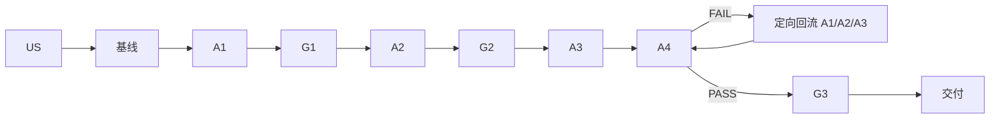

# agent-for-it-designer

用 Claude Code 类 coding agent 完成存量 Spring Boot SaaS 系统的**需求澄清、代码影响分析、技术设计、设计评审**。

本仓库交付的是可直接落地的 **subagent / workflow / skill / command** 资产，不是应用代码。使用方式见 [USAGE.md](USAGE.md)，设计依据见 [Agent技术方案设计-GPT-V2.md](Agent技术方案设计-GPT-V2.md)。

## 1. 它是什么

| 组成 | 位置 | 作用 |
| --- | --- | --- |
| 入口约定 | `CLAUDE.md` | 何时启用、角色边界、硬性规则 |
| 工作流 | `.claude/workflows/awf.js` | 可执行编排脚本（`{name: "awf"}`）；流程规则见 `.claude/skills/etp-awf-workflow/references/orchestration-rules.md` |
| 子代理 | `.claude/agents/*.md` | A0 执行（Preflight/校验/登记）、A1 获取、A2 澄清、A3 影响、A4 设计、A5 评审 |
| 技能 | `.claude/skills/*/SKILL.md` | 流程协议、SaaS 检查、文档模板、代码检索、评审标准 |
| 命令 | `.claude/commands/etp-awf-*.md` | `/etp-awf-start`、`/etp-awf-run`、`/etp-awf-gate`、`/etp-awf-status`、`/etp-awf-rerun`、`/etp-awf-review` |

A0（编排）由 `.claude/workflows/awf.js` 脚本 + 主线程共同承担：脚本负责按状态编排各阶段的 `agent` 调用，状态机、产物版本、门禁与一致性校验仍在主线程执行，因为 Claude Code 的子代理不能再次派发子代理。脚本没有文件系统，读 manifest、算 sha256、跑校验、写登记这些文件层工作交给 `etp-awf-controller` 子代理（A0 执行层，只写 `00-workflow/`）。A1–A5 各自在独立上下文中工作，只写本阶段产物。

## 2. 快速开始

把 `.claude/`、`CLAUDE.md` 放到你的存量系统仓库根目录，然后：

```text
/etp-awf-start US-2026-001 docs/requirements/US-2026-001.md
/etp-awf-run

# 到达 G1 后查看阻断项与待决策项
/etp-awf-status
/etp-awf-gate G1

# 继续 A2 → G2 → A3 → A4
/etp-awf-run
/etp-awf-gate G2
/etp-awf-run
/etp-awf-gate G3
```

产物在 `docs/awf/US-2026-001/`：

```text
00-workflow/     workflow-manifest、analysis-baseline、artifact-manifest、workflow-report
01-source/       source-package.yaml、backend-scope.md、raw.md、assets/
02-requirement/  requirement-package.yaml、requirement-clarification.md、decision-log.yaml
03-impact/       impact-package.yaml、impact-analysis.md、evidence-manifest.yaml
04-design/       technical-design-package.yaml、technical-design.md、adrs/、design-coverage.yaml、expected-file-changes.yaml
05-review/       review-report.yaml、review-report.md、revision-instructions.yaml
```

## 3. 流程



14 个状态：`CREATED`、`BASELINE_CONFIRMED`、`A1_RUNNING`、`WAITING_G1`、`A2_RUNNING`、`WAITING_G2`、`A3_RUNNING`、`A4_RUNNING`、`A5_RUNNING`、`DESIGN_REVISION`、`WAITING_DEPENDENCY`、`WAITING_G3`、`COMPLETED`、`BLOCKED`。

三个门禁均为人工：G1 需求确认、G2 高风险影响确认、G3 设计审批。命令只计算阻断项与展开待决策项，不会替用户通过。

## 4. 关键机制

### 双产物

每个阶段同时产出 YAML（机器校验、追溯）与 Markdown（阅读、评审），同 Artifact ID 同版本；Markdown 由 YAML 渲染，人工修改 YAML 后必须重渲染。

### 事实与推断分离

每条业务规则带 `source.type`（explicit / specification / existing / inferred / unknown / human）、置信度、是否改变存量行为、是否需要人工确认。推断项在 G1 裁决前必须是 `pending`，C02 会拦截「推断被当成需求」。

### 证据链

每个影响点必须带证据：`graph:<node>`、`file:line`、`doc:id#clause`、`git:commit`、`runtime:<source>`、`human:<decision>`。缺证据写 `evidence_gap` 与 `NEEDS_RUNTIME_CONFIRM`，禁止断言「无影响」。

### 门禁与一致性

G1/G2/G3 阻断项与 C01–C12 的判定公式在 `gates-and-checks.md`，全部可由主线程读 YAML 计算，不依赖模型主观打分。

### 回流与增量重跑

A4 FAIL 输出 `revision-instructions.yaml`，按 `return_to` 只重跑最早受影响阶段；最多两轮，超限写 `DISPUTE.md` 并 `BLOCKED`。人工修改按字段/章节分类，只失效下游，不默认全量重跑。

## 5. 接入你的仓库

| 需要 | 做法 |
| --- | --- |
| 业务规范 | 放到 `docs/knowledge/`，在 `analysis-baseline.yaml` 登记版本；A1 只引用命中条款 |
| 代码知识图谱 | 若已有图谱 MCP 工具，A2/A4 自动优先使用；否则走 `etp-code-graph-query` 的 ripgrep 降级 |
| 框架封装约定 | 在仓库 `CLAUDE.md`/`AGENTS.md` 写清 Controller/Service/Repository/异常/事务/缓存/MQ/权限/租户规范，A3 必须遵循 |
| SaaS 检查项 | 按团队实际修改 `.claude/skills/etp-legacy-saas-analysis/references/saas-checklist.md` |
| 文档模板 | 按团队评审习惯调整 `.claude/skills/etp-design-doc-writing/references/*.md`，但章节号需与协议一致 |
| 运行时证据 | 可选接 API/Trace/MQ/Job/配置中心查询；未接入时相关结论会标为证据不足 |

## 6. 设计取舍

1. **A0 拆成脚本 + 主线程**：编排放在 `.claude/workflows/awf.js`，状态写入与门禁留在主线程，因为子代理不能再派发；这样门禁只由主线程写状态，避免子代理越权推进。
2. **YAML 优先**：覆盖矩阵、追溯、门禁都要求机器可读；只写 Markdown 会让校验退化成人工阅读。
3. **不内置校验脚本**：全部规则以 checklist + 字段约束表达，避免把工作流绑定到某个运行时；需要自动化时可在 CI 里对 YAML 做 JSON Schema 校验。
4. **draft 与 final 双模式**：draft 允许跳过人工门禁但强制标记，禁止用于交接。

## 7. 非目标

- 不生成业务代码、不做 Code Review、不做发布（A5–A8 不在本期）。
- 不替代人工需求判断与架构决策；它只负责把决策过程结构化、把证据摆出来。
- 不保证「一次生成即正确」；质量来自门禁、证据与独立评审，而不是模型自信。

## 8. 兼容其他 coding agent

结构与 Claude Code 一致。若使用 `.codebuddy/` 或其他目录约定，把 `.claude/agents`、`.claude/skills`、`.claude/commands`、`.claude/workflows` 同步复制过去即可；入口约定以 `AGENTS.md`/`CLAUDE.md` 为准。
